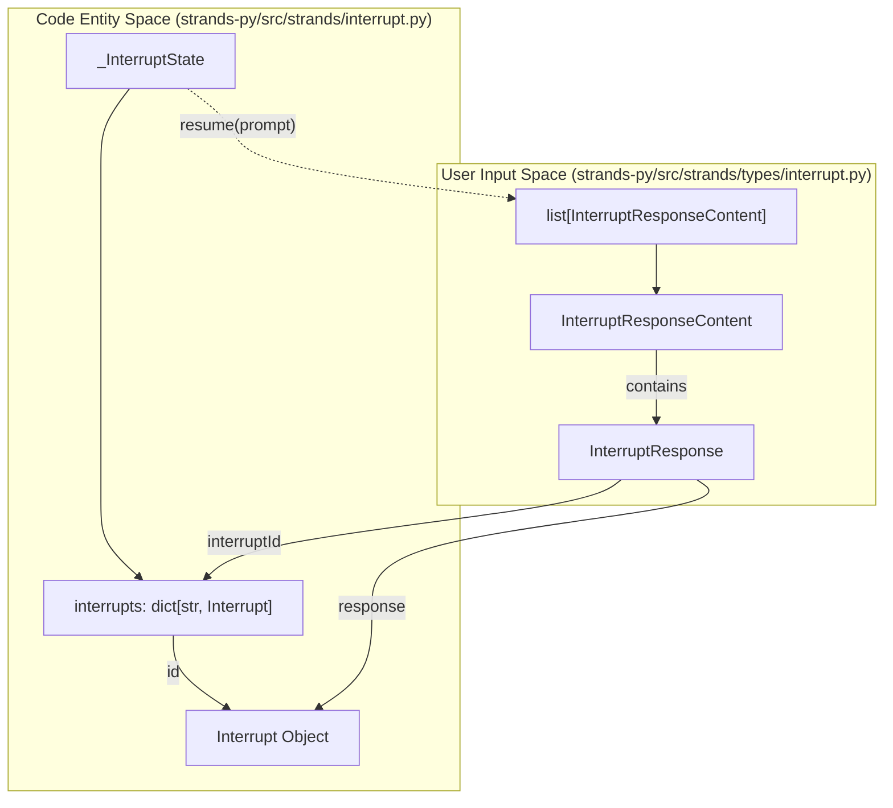
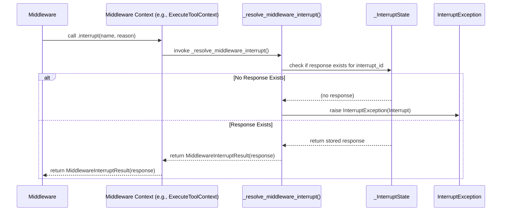
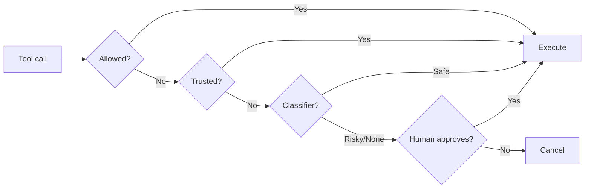

<!-- source: DeepWiki mcp.deepwiki.com · repo strands-agents/sdk-python · page 5.4 Interrupt Handling and Human-in-the-Loop · fetched 2026-10-27 -->

# Interrupt Handling and Human-in-the-Loop

<details>
<summary>Relevant source files</summary>

The following files were used as context for generating this wiki page:

- [site/src/content/docs/user-guide/concepts/agents/interventions/cedar-authorization.mdx](site/src/content/docs/user-guide/concepts/agents/interventions/cedar-authorization.mdx)
- [site/src/content/docs/user-guide/concepts/agents/interventions/cedar-authorization.py](site/src/content/docs/user-guide/concepts/agents/interventions/cedar-authorization.py)
- [site/src/content/docs/user-guide/concepts/agents/interventions/cedar-authorization.ts](site/src/content/docs/user-guide/concepts/agents/interventions/cedar-authorization.ts)
- [site/src/content/docs/user-guide/concepts/agents/interventions/cedar-authorization_imports.ts](site/src/content/docs/user-guide/concepts/agents/interventions/cedar-authorization_imports.ts)
- [site/src/content/docs/user-guide/concepts/agents/interventions/human-in-the-loop.mdx](site/src/content/docs/user-guide/concepts/agents/interventions/human-in-the-loop.mdx)
- [site/src/content/docs/user-guide/concepts/agents/interventions/human-in-the-loop.py](site/src/content/docs/user-guide/concepts/agents/interventions/human-in-the-loop.py)
- [site/src/content/docs/user-guide/concepts/agents/interventions/human-in-the-loop.ts](site/src/content/docs/user-guide/concepts/agents/interventions/human-in-the-loop.ts)
- [site/src/content/docs/user-guide/concepts/agents/interventions/human-in-the-loop_imports.ts](site/src/content/docs/user-guide/concepts/agents/interventions/human-in-the-loop_imports.ts)
- [site/src/content/docs/user-guide/concepts/agents/interventions/index.mdx](site/src/content/docs/user-guide/concepts/agents/interventions/index.mdx)
- [site/src/content/docs/user-guide/concepts/agents/interventions/interventions.py](site/src/content/docs/user-guide/concepts/agents/interventions/interventions.py)
- [site/src/content/docs/user-guide/concepts/agents/interventions/interventions.ts](site/src/content/docs/user-guide/concepts/agents/interventions/interventions.ts)
- [site/src/content/docs/user-guide/concepts/agents/interventions/interventions_imports.ts](site/src/content/docs/user-guide/concepts/agents/interventions/interventions_imports.ts)
- [site/src/content/docs/user-guide/concepts/agents/interventions/steering.mdx](site/src/content/docs/user-guide/concepts/agents/interventions/steering.mdx)
- [site/src/content/docs/user-guide/concepts/agents/interventions/steering.ts](site/src/content/docs/user-guide/concepts/agents/interventions/steering.ts)
- [site/src/content/docs/user-guide/concepts/agents/interventions/steering_imports.ts](site/src/content/docs/user-guide/concepts/agents/interventions/steering_imports.ts)
- [site/src/content/docs/user-guide/concepts/plugins/steering.mdx](site/src/content/docs/user-guide/concepts/plugins/steering.mdx)
- [strands-py/src/strands/_middleware/README.md](strands-py/src/strands/_middleware/README.md)
- [strands-py/src/strands/_middleware/__init__.py](strands-py/src/strands/_middleware/__init__.py)
- [strands-py/src/strands/_middleware/registry.py](strands-py/src/strands/_middleware/registry.py)
- [strands-py/src/strands/_middleware/stages.py](strands-py/src/strands/_middleware/stages.py)
- [strands-py/src/strands/_middleware/types.py](strands-py/src/strands/_middleware/types.py)
- [strands-py/src/strands/experimental/bidi/agent/agent.py](strands-py/src/strands/experimental/bidi/agent/agent.py)
- [strands-py/src/strands/interrupt.py](strands-py/src/strands/interrupt.py)
- [strands-py/src/strands/interventions/__init__.py](strands-py/src/strands/interventions/__init__.py)
- [strands-py/src/strands/interventions/actions.py](strands-py/src/strands/interventions/actions.py)
- [strands-py/src/strands/interventions/handler.py](strands-py/src/strands/interventions/handler.py)
- [strands-py/src/strands/interventions/registry.py](strands-py/src/strands/interventions/registry.py)
- [strands-py/src/strands/types/_events.py](strands-py/src/strands/types/_events.py)
- [strands-py/src/strands/vended_interventions/hitl/__init__.py](strands-py/src/strands/vended_interventions/hitl/__init__.py)
- [strands-py/src/strands/vended_interventions/hitl/classifier.py](strands-py/src/strands/vended_interventions/hitl/classifier.py)
- [strands-py/src/strands/vended_interventions/hitl/hitl.py](strands-py/src/strands/vended_interventions/hitl/hitl.py)
- [strands-py/tests/strands/agent/test_agent_cancellation.py](strands-py/tests/strands/agent/test_agent_cancellation.py)
- [strands-py/tests/strands/interventions/__init__.py](strands-py/tests/strands/interventions/__init__.py)
- [strands-py/tests/strands/interventions/test_actions.py](strands-py/tests/strands/interventions/test_actions.py)
- [strands-py/tests/strands/interventions/test_registry.py](strands-py/tests/strands/interventions/test_registry.py)
- [strands-py/tests/strands/middleware/test_agent_middleware.py](strands-py/tests/strands/middleware/test_agent_middleware.py)
- [strands-py/tests/strands/middleware/test_agent_stream_middleware.py](strands-py/tests/strands/middleware/test_agent_stream_middleware.py)
- [strands-py/tests/strands/middleware/test_execute_tool_middleware.py](strands-py/tests/strands/middleware/test_execute_tool_middleware.py)
- [strands-py/tests/strands/middleware/test_middleware_interrupts.py](strands-py/tests/strands/middleware/test_middleware_interrupts.py)
- [strands-py/tests/strands/middleware/test_registry.py](strands-py/tests/strands/middleware/test_registry.py)
- [strands-py/tests/strands/test_interrupt.py](strands-py/tests/strands/test_interrupt.py)
- [strands-py/tests/strands/vended_interventions/__init__.py](strands-py/tests/strands/vended_interventions/__init__.py)
- [strands-py/tests/strands/vended_interventions/test_hitl.py](strands-py/tests/strands/vended_interventions/test_hitl.py)
- [strands-ts/src/vended-interventions/cedar/__tests__/cedar.test.node.ts](strands-ts/src/vended-interventions/cedar/__tests__/cedar.test.node.ts)
- [strands-ts/src/vended-interventions/cedar/__tests__/fixtures/entities.json](strands-ts/src/vended-interventions/cedar/__tests__/fixtures/entities.json)
- [strands-ts/src/vended-interventions/cedar/__tests__/fixtures/env-restricted.cedar](strands-ts/src/vended-interventions/cedar/__tests__/fixtures/env-restricted.cedar)
- [strands-ts/src/vended-interventions/cedar/__tests__/fixtures/permit-all.cedar](strands-ts/src/vended-interventions/cedar/__tests__/fixtures/permit-all.cedar)
- [strands-ts/src/vended-interventions/cedar/__tests__/fixtures/permit-search-deny-delete.cedar](strands-ts/src/vended-interventions/cedar/__tests__/fixtures/permit-search-deny-delete.cedar)
- [strands-ts/src/vended-interventions/cedar/__tests__/fixtures/rate-limited.cedar](strands-ts/src/vended-interventions/cedar/__tests__/fixtures/rate-limited.cedar)
- [strands-ts/src/vended-interventions/cedar/__tests__/fixtures/role-based.cedar](strands-ts/src/vended-interventions/cedar/__tests__/fixtures/role-based.cedar)
- [strands-ts/src/vended-interventions/cedar/__tests__/fixtures/test.cedar](strands-ts/src/vended-interventions/cedar/__tests__/fixtures/test.cedar)
- [strands-ts/src/vended-interventions/cedar/__tests__/fixtures/test.cedarschema](strands-ts/src/vended-interventions/cedar/__tests__/fixtures/test.cedarschema)
- [strands-ts/src/vended-interventions/cedar/cedar.ts](strands-ts/src/vended-interventions/cedar/cedar.ts)
- [strands-ts/src/vended-interventions/cedar/schema-generator.ts](strands-ts/src/vended-interventions/cedar/schema-generator.ts)
- [strands-ts/src/vended-interventions/hitl/__tests__/hitl.test.ts](strands-ts/src/vended-interventions/hitl/__tests__/hitl.test.ts)
- [strands-ts/src/vended-interventions/hitl/classifier.ts](strands-ts/src/vended-interventions/hitl/classifier.ts)
- [strands-ts/src/vended-interventions/hitl/hitl.ts](strands-ts/src/vended-interventions/hitl/hitl.ts)
- [strands-ts/src/vended-interventions/hitl/index.ts](strands-ts/src/vended-interventions/hitl/index.ts)

</details>


## Purpose and Scope

This document describes the interrupt mechanism in the Strands Agents SDK, which enables human-in-the-loop (HITL) workflows by pausing agent execution to request user input. Interrupts allow agents to ask clarifying questions, request approvals, or gather additional information before proceeding with tool execution or hook logic.

The system uses a unique "interrupt-and-resume" pattern where the agent state is preserved, returned to the user, and subsequently restored when the user provides responses. This mechanism is supported across single-agent execution and multi-agent orchestration.

---

## Core Entities

The interrupt system is built around four primary components: the `Interrupt` data model, the `InterruptException` for flow control, the `_InterruptState` for persistence, and the `_Interruptible` protocol.

### Interrupt Data Model
The `Interrupt` class represents a specific request for human intervention. It contains a unique `id`, a user-defined `name`, a `reason` for the pause, and eventually, the user's `response`. [strands-py/src/strands/interrupt.py:15-29]()

### InterruptException
This exception is raised when human input is required. It carries the `Interrupt` object and is caught by the agent's execution loop to trigger a graceful pause. [strands-py/src/strands/interrupt.py:35-41]()

### _InterruptState
This internal class tracks the lifecycle of interrupts during a session. It manages activation status, stores pending interrupts in a dictionary, and handles the injection of user responses during the resume phase. It also maintains an internal `_version` counter to track state changes. [strands-py/src/strands/interrupt.py:44-61]()

### Interruptible Protocol
The `_Interruptible` protocol defines the interface for objects (like hook events or tool contexts) that can trigger interrupts. It provides the `interrupt()` method which either returns a previous response or raises an `InterruptException`. [strands-py/src/strands/_middleware/stages.py:129-159]()

---

## Code-to-Logic Mapping

The following diagrams bridge the gap between high-level HITL concepts and the specific code entities used to implement them.

### Entity Relationship: Interrupt State and Responses
This diagram shows how `InterruptResponseContent` provided by a user maps back to the `_InterruptState` and individual `Interrupt` objects.


**Sources:** [strands-py/src/strands/interrupt.py:44-107](), [strands-py/src/strands/types/_events.py:100-109]()

### Interrupt Flow: Middleware to Exception
This diagram illustrates the functional path when a middleware component triggers an interrupt.


**Sources:** [strands-py/src/strands/_middleware/stages.py:65-101](), [strands-py/src/strands/_middleware/stages.py:129-159](), [strands-py/src/strands/interrupt.py:35-41]()

---

## Interrupt Lifecycle

The lifecycle follows a strict state machine: **Raise -> Return -> Respond -> Resume**.

### 1. Raising the Interrupt
Interrupts are typically raised inside middleware (e.g., `ExecuteToolStage`) or within tools using `ToolContext`. When `interrupt()` is called, the system generates a unique ID. If no response is found in the current state, an `InterruptException` is thrown. [strands-py/src/strands/_middleware/stages.py:129-159](), [strands-py/tests/strands/middleware/test_middleware_interrupts.py:51-56]()

### 2. Returning to the User
The Agent catches the exception and returns an `AgentResult` where the `stop_reason` is set to `"interrupt"`. [strands-py/tests/strands/middleware/test_middleware_interrupts.py:61-64]()
The `interrupts` attribute contains the list of pending `Interrupt` objects. [strands-py/tests/strands/middleware/test_middleware_interrupts.py:65-66]()

### 3. Responding and Resuming
To resume, the user invokes the agent again, passing a list of `InterruptResponseContent`.
1. The agent calls `_InterruptState.resume(prompt)`. [strands-py/src/strands/interrupt.py:107-141]()
2. The state updates the `response` field of the corresponding `Interrupt` objects and increments the `_version`. [strands-py/src/strands/interrupt.py:130-138]()
3. The execution loop restarts. When the middleware calls `interrupt()` again, the method sees the response and returns it to the caller instead of raising an exception. [strands-py/tests/strands/middleware/test_middleware_interrupts.py:78-80]()

---

## Implementation Details

### Interrupt ID Generation
The ID must be unique across middleware calls. The implementation of `_interrupt_id` (provided by the middleware context) ensures that the same interrupt can be identified across different execution cycles. For `ExecuteToolStage`, the ID is namespaced by `toolUseId` and a UUID5 hash of the interrupt name: `v1:middleware_execute_tool:<toolUseId>:<uuid5(name)>`. For `AgentStreamStage`, it's `v1:middleware_agent_stream:<uuid5(name)>`. [strands-py/src/strands/_middleware/stages.py:161-164](), [strands-py/src/strands/_middleware/README.md:121-122]()

### State Versioning
The `_InterruptState` maintains an internal `_version` counter. This counter increments whenever the state is activated, deactivated, or resumed. This allows the system to detect if the interrupt state has changed and needs to be persisted. [strands-py/src/strands/interrupt.py:59-60](), [strands-py/src/strands/interrupt.py:69-70](), [strands-py/src/strands/interrupt.py:89-90](), [strands-py/src/strands/interrupt.py:140-141]()

### JSON Serialization
Interrupt states and individual interrupts are JSON serializable via `to_dict()` and `from_dict()` methods. This is critical for `SessionManager` implementations (like `FileSessionManager`) to store the HITL state between process restarts. [strands-py/src/strands/interrupt.py:32-34](), [strands-py/src/strands/interrupt.py:155-192]()

### Interrupt State Context
The `_InterruptState` can store additional context in its `context` attribute. For example, when a tool execution is interrupted, the `tool_use_message` and `tool_results` are stored here to allow for resuming the tool execution. [strands-py/src/strands/interrupt.py:57-58](), [strands-py/src/strands/interrupt.py:63-64]()

### Middleware-initiated Interrupts
The `ExecuteToolContext` and `AgentStreamContext` provide an `interrupt()` method for middleware to trigger human-in-the-loop approval flows. This method is read-only with respect to interrupt state; it inspects prior responses but does not register the interrupt itself. The executor's `InterruptException` handler is the single registration site. [strands-py/src/strands/_middleware/stages.py:129-159](), [strands-py/src/strands/_middleware/README.md:80-90]()

---

## Human-in-the-Loop (HITL) Intervention

The `HumanInTheLoop` intervention handler is a vended plugin that simplifies adding human oversight to agent tool execution. It pauses agent execution before tool calls to request human approval. [site/src/content/docs/user-guide/concepts/agents/interventions/human-in-the-loop.mdx:16-22]()

### How it Works
The `HumanInTheLoop` handler uses the SDK's interrupt mechanism but abstracts away the manual interrupt/resume loop when an `ask` option is provided. [site/src/content/docs/user-guide/concepts/agents/interventions/human-in-the-loop.mdx:20-22]()

#### Human-in-the-Loop Flow

**Sources:** [site/src/content/docs/user-guide/concepts/agents/interventions/human-in-the-loop.mdx:23-33]()

### Usage Modes

The `HumanInTheLoop` intervention supports several modes for collecting human responses:

1.  **Interrupt/Resume Mode (Default):** Without an `ask` option, the handler raises an interrupt, and the agent pauses. The caller presents the interrupt to the user, collects their response, and resumes the agent. This is the standard interrupt/resume pattern. [site/src/content/docs/user-guide/concepts/agents/interventions/human-in-the-loop.mdx:37-39]()
    ```python
    agent = Agent(
        tools=[delete_files],
        interventions=[HumanInTheLoop()],
    )

    result = agent("Delete the temp files")

    if result.stop_reason == "interrupt":
        print(result.interrupts[0].reason)
        result = agent(
            [
                {
                    "interruptResponse": {
                        "interruptId": result.interrupts[0].id,
                        "response": "yes",
                    }
                }
            ]
        )
    ```
    **Sources:** [site/src/content/docs/user-guide/concepts/agents/interventions/human-in-the-loop.py:31-54]()

2.  **Stdio Mode:** For CLI applications, passing `ask="stdio"` prompts the user inline via stdin. The agent blocks until the user responds, eliminating the need for explicit interrupt handling on the caller side. [site/src/content/docs/user-guide/concepts/agents/interventions/human-in-the-loop.mdx:58-61]()
    ```python
    agent = Agent(
        tools=[delete_files],
        interventions=[HumanInTheLoop(ask="stdio")],
    )
    agent("Delete the temp files")
    ```
    **Sources:** [site/src/content/docs/user-guide/concepts/agents/interventions/human-in-the-loop.py:64-70]()

3.  **Custom UI Callback:** For web UIs or other custom interfaces, a function can be passed to `ask`. This function receives a prompt string and must return the user's response. [site/src/content/docs/user-guide/concepts/agents/interventions/human-in-the-loop.mdx:80-82]()
    ```python
    async def ask(prompt: str) -> str:
        return await ask_user_via_slack(prompt)

    agent = Agent(
        tools=[delete_files],
        interventions=[HumanInTheLoop(ask=ask)],
    )
    agent("Delete the temp files")
    ```
    **Sources:** [site/src/content/docs/user-guide/concepts/agents/interventions/human-in-the-loop.py:83-93]()

### Risk Classifier
The `classifier` option allows an LLM to decide whether a tool call needs approval. Tools in `allowed_tools` bypass the classifier. [site/src/content/docs/user-guide/concepts/agents/interventions/human-in-the-loop.mdx:102-104]()
```python
agent = Agent(
    tools=[read_file, delete_files],
    interventions=[
        HumanInTheLoop(
            allowed_tools=["read_file"],
            classifier=True,
        ),
    ],
)
agent("Read config.json then delete /tmp/old-logs")
```
**Sources:** [site/src/content/docs/user-guide/concepts/agents/interventions/human-in-the-loop.py:175-188]()

The classifier's system prompt or model can be customized, or a custom classification function can be provided. [site/src/content/docs/user-guide/concepts/agents/interventions/human-in-the-loop.mdx:123-124]()
```python
agent = Agent(
    tools=[delete_files],
    interventions=[
        HumanInTheLoop(
            classifier=LLMClassifierConfig(
                system_prompt="Only flag destructive operations.",
            ),
        ),
    ],
)

def my_classifier(event, **kwargs):
    from strands.vended_interventions.hitl.classifier import (
        ClassifierResult,
    )
    is_dangerous = event.tool_use["name"].startswith("delete")
    return ClassifierResult(
        requires_human_in_the_loop=is_dangerous,
        reason="destructive tool" if is_dangerous else None,
    )

agent = Agent(
    tools=[delete_files],
    interventions=[HumanInTheLoop(classifier=my_classifier)],
)
```
**Sources:** [site/src/content/docs/user-guide/concepts/agents/interventions/human-in-the-loop.py:193-220]()

### Trust Mode
When `enable_trust` is set to `True`, a human can respond with `'t'` or `'trust'` to approve the current tool call and remember that decision for the rest of the session. Subsequent calls to the same tool skip the prompt entirely. Trust state is stored in `agent.state` and persists across turns within a session. [site/src/content/docs/user-guide/concepts/agents/interventions/human-in-the-loop.mdx:175-180]()
```python
agent = Agent(
    tools=[delete_files],
    interventions=[
        HumanInTheLoop(
            ask="stdio",
            enable_trust=True,
        ),
    ],
)
agent("Delete all log files in /tmp")
```
**Sources:** [site/src/content/docs/user-guide/concepts/agents/interventions/human-in-the-loop.py:128-141]()

---

## Cedar Authorization Intervention

The `CedarAuthorization` intervention evaluates Cedar policies before each tool call, providing declarative, identity-aware access control over agent behavior. It is a vended intervention handler available in both Python and TypeScript SDKs. [site/src/content/docs/user-guide/concepts/agents/interventions/cedar-authorization.mdx:13-15]()

### How it Works
The handler intercepts tool calls and maps them to a Cedar authorization request. If no `permit` statement matches, the tool call is denied, and the agent receives feedback explaining the denial. The design is fail-closed, meaning if principal identity cannot be resolved, all tool calls are denied. [site/src/content/docs/user-guide/concepts/agents/interventions/cedar-authorization.mdx:18-29]()

#### Cedar Concept Mapping
| Cedar concept | Maps to | Example |
|---|---|---|
| **Principal** | User identity | `User::"alice@acme.com"` |
| **Action** | Tool name | `Action::"search"` |
| **Resource** | Static (unconstrained) | `Resource::"agent"` |
| **Context.input** | Tool arguments | `{ query: "quarterly report" }` |
| **Context.session** | Invocation metadata | `{ hour_utc: 14, call_count: 3, role: "admin" }` |
**Sources:** [site/src/content/docs/user-guide/concepts/agents/interventions/cedar-authorization.mdx:20-27]()

### Basic Usage
To permit specific tools and deny others, define Cedar policies and pass them to the `CedarAuthorization` intervention.
```python
from strands import Agent, tool
from strands.vended_interventions.cedar import CedarAuthorization

@tool
def search(query: str) -> str:
    return f"Results for: {query}"

@tool
def delete_record(record_id: str) -> str:
    return f"Deleted {record_id}"

cedar = CedarAuthorization(
    policies="""
      permit(principal, action == Action::"search", resource);
    """,
)

agent = Agent(
    tools=[search, delete_record],
    interventions=[cedar],
)

# If the agent calls search, it's permitted; a delete_record call is denied
# (no matching permit)
agent("Search for quarterly reports then delete record 42")
```
**Sources:** [site/src/content/docs/user-guide/concepts/agents/interventions/cedar-authorization.py:6-29]()

### Role-based Access Control
For multi-tenant agents, `principal_resolver` extracts the principal from `invocation_state`, and `context_enricher` forwards role information into Cedar context. [site/src/content/docs/user-guide/concepts/agents/interventions/cedar-authorization.mdx:54-56]()
```python
cedar = CedarAuthorization(
    policies="""
      permit(principal, action, resource)
      when { context.session.role == "admin" };

      permit(principal, action == Action::"search", resource)
      when { context.session.role == "analyst" };
    """,
    principal_resolver=lambda state: (
        {"type": "User", "id": str(state["user_id"])} if state.get("user_id") else None
    ),
    context_enricher=lambda invocation_state: {
        "role": str(invocation_state.get("role", "none"))
    },
)
```
**Sources:** [site/src/content/docs/user-guide/concepts/agents/interventions/cedar-authorization.py:46-62]()

### Rate Limiting
Cedar policies can reference `context.session.call_count` to track successful tool invocations during a session, enabling rate limiting. [site/src/content/docs/user-guide/concepts/agents/interventions/cedar-authorization.mdx:77-79]()
```python
cedar = CedarAuthorization(
    policies="""
      permit(principal, action == Action::"send_email", resource)
      when { context.session.call_count < 5 };

      permit(principal, action == Action::"search", resource);
    """,
)
```
**Sources:** [site/src/content/docs/user-guide/concepts/agents/interventions/cedar-authorization.py:89-98]()

### Schema Validation
Passing tool definitions to `CedarAuthorization` enables schema validation, catching policy typos at construction time by generating a Cedar schema from tool definitions. [site/src/content/docs/user-guide/concepts/agents/interventions/cedar-authorization.mdx:99-102]()
```python
cedar = CedarAuthorization(
    policies="""
      permit(principal, action == Action::"search", resource);
      permit(principal, action == Action::"delete_record", resource)
      when { context.session.role == "admin" };
    """,
    tools=[search, delete_record],
    context_enricher=lambda invocation_state: {
        "role": str(invocation_state.get("role", "none"))
    },
)
```
**Sources:** [site/src/content/docs/user-guide/concepts/agents/interventions/cedar-authorization.py:116-127]()

### Environment Gating
Tools can be blocked based on deployment context by forwarding environment metadata through `context_enricher`. [site/src/content/docs/user-guide/concepts/agents/interventions/cedar-authorization.mdx:151-153]()
```python
cedar = CedarAuthorization(
    policies="""
      permit(principal, action == Action::"deploy", resource)
      when { context.session has environment &&
             context.session.environment != "production" };
    """,
    context_enricher=lambda invocation_state: {
        "environment": str(invocation_state.get("environment", "unknown"))
    },
)
```
**Sources:** [site/src/content/docs/user-guide/concepts/agents/interventions/cedar-authorization.py:164-174]()

### File-based Policies and Hot Reload
For production, policies can be stored in `.cedar` files. The handler reads and parses these files at construction time. The `hot_reload` option allows policies to be updated without restarting the agent process. [site/src/content/docs/user-guide/concepts/agents/interventions/cedar-authorization.mdx:173-176]()
```python
cedar = CedarAuthorization(
    policy_files=["./policies/my_policy.cedar"],
    hot_reload=True,
)
```
**Sources:** [site/src/content/docs/user-guide/concepts/agents/interventions/cedar-authorization.py:187-190]()

---

## Summary of Key Classes and Methods

| Class/Method | File | Description |
|--------------|------|-------------|
| `Interrupt` | `strands-py/src/strands/interrupt.py` | Data class for an interrupt event. [strands-py/src/strands/interrupt.py:15-29]() |
| `_InterruptState` | `strands-py/src/strands/interrupt.py` | Manages active interrupts and their responses. [strands-py/src/strands/interrupt.py:44-61]() |
| `InterruptException` | `strands-py/src/strands/interrupt.py` | Exception that pauses the agent loop. [strands-py/src/strands/interrupt.py:35-41]() |
| `_resolve_middleware_interrupt()` | `strands-py/src/strands/_middleware/stages.py` | Resolves middleware-initiated interrupts. [strands-py/src/strands/_middleware/stages.py:65-101]() |
| `ExecuteToolContext.interrupt()` | `strands-py/src/strands/_middleware/stages.py` | Primary API for raising/checking interrupts from tool execution middleware. [strands-py/src/strands/_middleware/stages.py:129-159]() |
| `_InterruptState.resume()` | `strands-py/src/strands/interrupt.py` | Injects user responses into the state. [strands-py/src/strands/interrupt.py:107-141]() |
| `_InterruptState.deactivate()` | `strands-py/src/strands/interrupt.py` | Clears all interrupts and context. [strands-py/src/strands/interrupt.py:62-71]() |
| `HumanInTheLoop` | `strands-py/src/strands/vended_interventions/hitl/hitl.py` | Vended intervention for human approval of tool calls. [strands-py/src/strands/vended_interventions/hitl/hitl.py:20-22]() |
| `CedarAuthorization` | `strands-py/src/strands/vended_interventions/cedar/cedar_authorization.py` | Vended intervention for policy-based access control using Cedar. [strands-py/src/strands/vended_interventions/cedar/cedar_authorization.py:20-22]()

**Sources:** [strands-py/src/strands/interrupt.py](), [strands-py/src/strands/_middleware/stages.py](), [strands-py/src/strands/vended_interventions/hitl/hitl.py](), [strands-py/src/strands/vended_interventions/cedar/cedar_authorization.py]()

---

