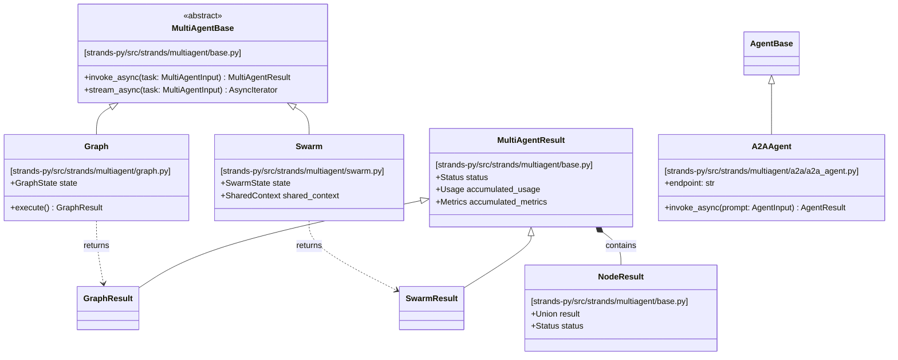
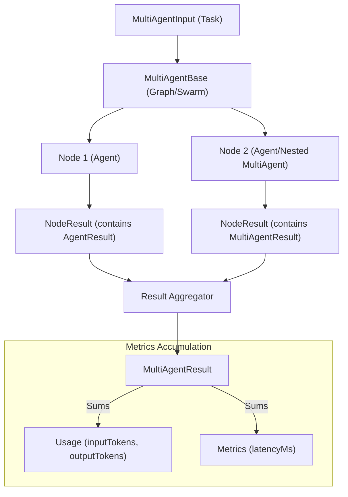

<!-- source: DeepWiki mcp.deepwiki.com · repo strands-agents/sdk-python · page 6 Multi-Agent Orchestration · fetched 2026-10-27 -->

# Multi-Agent Orchestration

Relevant source files

The following files were used as context for generating this wiki page:

- [.gitignore](.gitignore)
- [AGENTS.md](AGENTS.md)
- [CONTRIBUTING.md](CONTRIBUTING.md)
- [README.md](README.md)
- [package-lock.json](package-lock.json)
- [package.json](package.json)
- [pyproject.toml](pyproject.toml)
- [site/src/content/docs/user-guide/concepts/multi-agent/swarm.mdx](site/src/content/docs/user-guide/concepts/multi-agent/swarm.mdx)
- [strandly/package.json](strandly/package.json)
- [strands-py/src/strands/multiagent/__init__.py](strands-py/src/strands/multiagent/__init__.py)
- [strands-py/src/strands/multiagent/base.py](strands-py/src/strands/multiagent/base.py)
- [strands-py/src/strands/multiagent/graph.py](strands-py/src/strands/multiagent/graph.py)
- [strands-py/src/strands/multiagent/swarm.py](strands-py/src/strands/multiagent/swarm.py)
- [strands-py/tests/strands/agent/hooks/test_hook_registry.py](strands-py/tests/strands/agent/hooks/test_hook_registry.py)
- [strands-py/tests/strands/hooks/test_registry.py](strands-py/tests/strands/hooks/test_registry.py)
- [strands-py/tests/strands/multiagent/test_base.py](strands-py/tests/strands/multiagent/test_base.py)
- [strands-py/tests/strands/multiagent/test_graph.py](strands-py/tests/strands/multiagent/test_graph.py)
- [strands-py/tests/strands/multiagent/test_swarm.py](strands-py/tests/strands/multiagent/test_swarm.py)
- [strands-py/tests/strands/plugins/test_multiagent_plugin.py](strands-py/tests/strands/plugins/test_multiagent_plugin.py)
- [strands-py/tests_integ/test_multiagent_graph.py](strands-py/tests_integ/test_multiagent_graph.py)
- [strands-py/tests_integ/test_multiagent_swarm.py](strands-py/tests_integ/test_multiagent_swarm.py)
- [strands-ts/package.json](strands-ts/package.json)
- [strands-ts/src/__fixtures__/agent-helpers.ts](strands-ts/src/__fixtures__/agent-helpers.ts)
- [strands-ts/src/__tests__/queue.test.ts](strands-ts/src/__tests__/queue.test.ts)
- [strands-ts/src/multiagent/__tests__/graph.test.ts](strands-ts/src/multiagent/__tests__/graph.test.ts)
- [strands-ts/src/multiagent/__tests__/interrupts.test.ts](strands-ts/src/multiagent/__tests__/interrupts.test.ts)
- [strands-ts/src/multiagent/__tests__/nodes.test.ts](strands-ts/src/multiagent/__tests__/nodes.test.ts)
- [strands-ts/src/multiagent/__tests__/swarm.test.ts](strands-ts/src/multiagent/__tests__/swarm.test.ts)
- [strands-ts/src/multiagent/graph.ts](strands-ts/src/multiagent/graph.ts)
- [strands-ts/src/multiagent/nodes.ts](strands-ts/src/multiagent/nodes.ts)
- [strands-ts/src/multiagent/state.ts](strands-ts/src/multiagent/state.ts)
- [strands-ts/src/multiagent/swarm.ts](strands-ts/src/multiagent/swarm.ts)
- [strands-ts/src/queue.ts](strands-ts/src/queue.ts)
- [strands-ts/src/vended-tools/bash/bash.ts](strands-ts/src/vended-tools/bash/bash.ts)

This page provides a high-level overview of the multi-agent orchestration capabilities in the Strands Agents SDK. The SDK supports complex coordination patterns, allowing multiple agents to work together on tasks that exceed the capabilities of a single agent.

## Overview and Architecture

Multi-agent orchestration in Strands is built upon a unified abstraction layer. All orchestrators inherit from `MultiAgentBase` and return standardized `MultiAgentResult` objects, ensuring consistency in how multi-agent systems are invoked, streamed, and monitored.

### Multi-Agent Abstraction Hierarchy

The following diagram illustrates how core multi-agent entities relate to the base abstractions and the result types they produce.

**Entity Mapping: Natural Language to Code Space**

**Sources**: [strands-py/src/strands/multiagent/base.py:178-200](), [strands-py/src/strands/multiagent/graph.py:403-430](), [strands-py/src/strands/multiagent/swarm.py:228-250](), [strands-py/src/strands/multiagent/base.py:43-57](), [strands-py/src/strands/multiagent/a2a/a2a_agent.py:33-45]()

---

## Core Components

### Multi-Agent Base and Patterns
The `MultiAgentBase` class defines the standard interface for all orchestrators. It requires implementations for asynchronous invocation (`invoke_async`) and streaming (`stream_async`). This base class ensures that whether you are using a deterministic graph or an autonomous swarm, the calling code remains consistent.
For details, see [Multi-Agent Base and Patterns](#6.1).

**Sources**: [strands-py/src/strands/multiagent/base.py:178-200]()

### Graph-based Orchestration
The `Graph` pattern allows for deterministic execution where agents (or other multi-agent systems) are nodes connected by edges. It supports parallel execution of independent nodes via `asyncio.gather` and conditional logic via `GraphEdge` to determine the execution path based on the current `GraphState`.
For details, see [Graph-based Orchestration](#6.2).

**Sources**: [strands-py/src/strands/multiagent/graph.py:1-15](), [strands-py/src/strands/multiagent/graph.py:143-158](), [strands-py/src/strands/multiagent/graph.py:636-650]()

### Swarm Collaboration
The `Swarm` pattern enables autonomous collaboration. Agents in a swarm work together as a team with a `SharedContext`. They coordinate using a specialized handoff mechanism where agents can pass control to other specialists dynamically using tool-based coordination.
For details, see [Swarm Collaboration](#6.3).

**Sources**: [strands-py/src/strands/multiagent/swarm.py:1-14](), [strands-py/src/strands/multiagent/swarm.py:118-130](), [strands-py/src/strands/multiagent/swarm.py:544-560]()

### Multi-Agent State and Persistence
Orchestrators track execution state (e.g., `GraphState`, `SwarmState`) and aggregate metrics like token usage and latency across all participating agents. The SDK supports persisting this state via `SessionManager` implementations, allowing multi-agent sessions to be resumed after interrupts or failures.
For details, see [Multi-Agent State and Persistence](#6.4).

**Sources**: [strands-py/src/strands/multiagent/graph.py:64-105](), [strands-py/src/strands/multiagent/swarm.py:167-184](), [strands-py/src/strands/multiagent/base.py:128-137]()

### Agent-to-Agent (A2A) Protocol
The A2A protocol provides a standardized way for agents to communicate across network boundaries. It allows an agent to be exposed as a service and consumed by other agents using the `A2AAgent` client wrapper. `A2AAgent` handles the conversion between Strands types and A2A protocol messages.
For details, see [Agent-to-Agent (A2A) Protocol](#6.5).

**Sources**: [package-lock.json:19-46](), [strands-ts/src/a2a/index.ts](), [strands-ts/src/a2a/express-server.ts]()

---

## Execution Flow and Result Aggregation

When a multi-agent system executes, it wraps the outputs of individual agents into `NodeResult` objects. These are then aggregated into a final `MultiAgentResult`.

**Data Flow: Execution to Result Aggregation**

**Sources**: [strands-py/src/strands/multiagent/base.py:43-57](), [strands-py/src/strands/multiagent/base.py:128-137](), [strands-py/src/strands/multiagent/base.py:59-70]()

### Status Tracking
The execution lifecycle of any multi-agent node or the system as a whole is tracked using the `Status` enum:
- `PENDING`: Task initialized but not started.
- `EXECUTING`: Currently running.
- `COMPLETED`: Finished successfully.
- `FAILED`: Encountered an unhandled exception.
- `INTERRUPTED`: Paused (e.g., for human-in-the-loop input or manual triggers).

**Sources**: [strands-py/src/strands/multiagent/base.py:24-39]()

---

