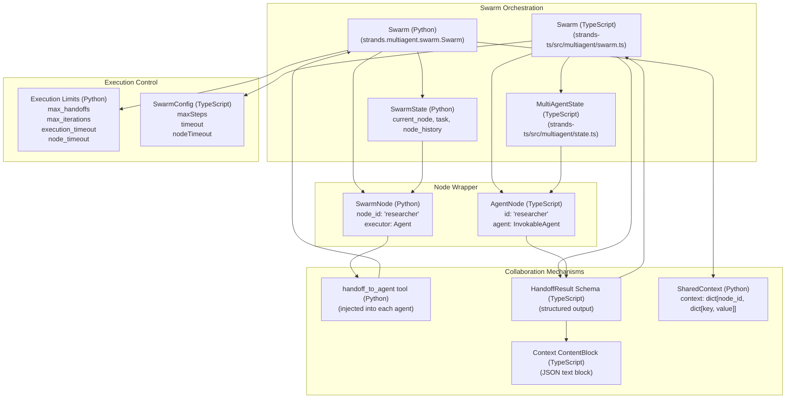
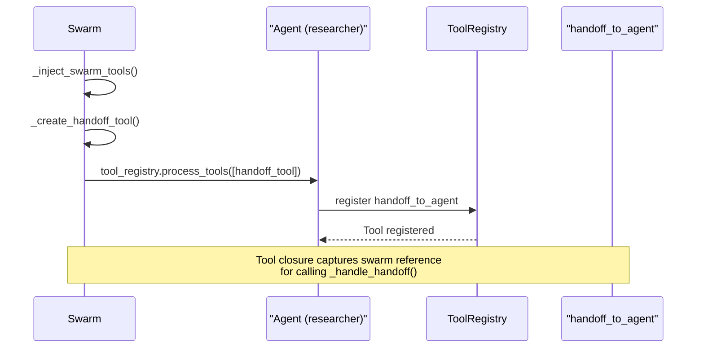
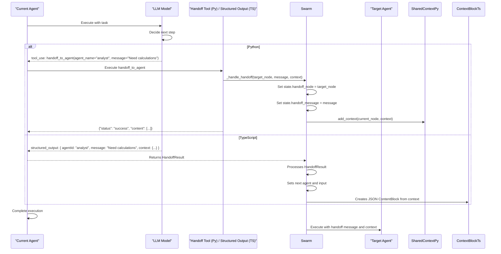
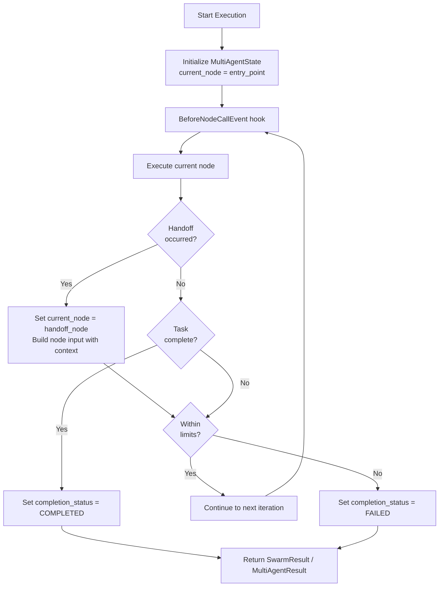
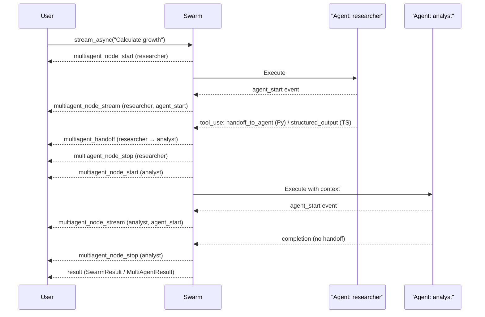

<!-- source: DeepWiki mcp.deepwiki.com · repo strands-agents/sdk-python · page 6.3 Swarm Collaboration · fetched 2026-10-27 -->

# Swarm Collaboration

<details>
<summary>Relevant source files</summary>

The following files were used as context for generating this wiki page:

- [site/src/content/docs/user-guide/concepts/multi-agent/swarm.mdx](site/src/content/docs/user-guide/concepts/multi-agent/swarm.mdx)
- [strands-py/src/strands/multiagent/__init__.py](strands-py/src/strands/multiagent/__init__.py)
- [strands-py/src/strands/multiagent/base.py](strands-py/src/strands/multiagent/base.py)
- [strands-py/src/strands/multiagent/graph.py](strands-py/src/strands/multiagent/graph.py)
- [strands-py/src/strands/multiagent/swarm.py](strands-py/src/strands/multiagent/swarm.py)
- [strands-py/tests/strands/agent/hooks/test_hook_registry.py](strands-py/tests/strands/agent/hooks/test_hook_registry.py)
- [strands-py/tests/strands/hooks/test_registry.py](strands-py/tests/strands/hooks/test_registry.py)
- [strands-py/tests/strands/multiagent/test_base.py](strands-py/tests/strands/multiagent/test_base.py)
- [strands-py/tests/strands/multiagent/test_graph.py](strands-py/tests/strands/multiagent/test_graph.py)
- [strands-py/tests/strands/multiagent/test_swarm.py](strands-py/tests/strands/multiagent/test_swarm.py)
- [strands-py/tests/strands/plugins/test_multiagent_plugin.py](strands-py/tests/strands/plugins/test_multiagent_plugin.py)
- [strands-py/tests_integ/test_multiagent_graph.py](strands-py/tests_integ/test_multiagent_graph.py)
- [strands-py/tests_integ/test_multiagent_swarm.py](strands-py/tests_integ/test_multiagent_swarm.py)
- [strands-ts/src/__fixtures__/agent-helpers.ts](strands-ts/src/__fixtures__/agent-helpers.ts)
- [strands-ts/src/__tests__/queue.test.ts](strands-ts/src/__tests__/queue.test.ts)
- [strands-ts/src/multiagent/__tests__/graph.test.ts](strands-ts/src/multiagent/__tests__/graph.test.ts)
- [strands-ts/src/multiagent/__tests__/interrupts.test.ts](strands-ts/src/multiagent/__tests__/interrupts.test.ts)
- [strands-ts/src/multiagent/__tests__/nodes.test.ts](strands-ts/src/multiagent/__tests__/nodes.test.ts)
- [strands-ts/src/multiagent/__tests__/swarm.test.ts](strands-ts/src/multiagent/__tests__/swarm.test.ts)
- [strands-ts/src/multiagent/graph.ts](strands-ts/src/multiagent/graph.ts)
- [strands-ts/src/multiagent/nodes.ts](strands-ts/src/multiagent/nodes.ts)
- [strands-ts/src/multiagent/swarm.ts](strands-ts/src/multiagent/swarm.ts)
- [strands-ts/src/queue.ts](strands-ts/src/queue.ts)
- [strands-ts/src/vended-tools/bash/bash.ts](strands-ts/src/vended-tools/bash/bash.ts)

</details>


The Swarm pattern provides autonomous agent collaboration through tool-based handoffs and shared working memory. Unlike Graph's deterministic DAG execution ([6.2]()), Swarm enables self-organizing agent teams where agents decide who to hand off to based on their assessment of the task.

For the base multi-agent abstractions and result types, see [Multi-Agent Base and Patterns](6.1). For state persistence and resumption, see [Multi-Agent State and Persistence](6.4).

---

## Swarm Architecture

The Swarm system consists of four core components that work together to enable collaborative agent execution.



**Sources:** [strands-py/src/strands/multiagent/swarm.py:229-302](), [strands-py/src/strands/multiagent/swarm.py:64-110](), [strands-py/src/strands/multiagent/swarm.py:114-161](), [strands-py/src/strands/multiagent/swarm.py:163-222](), [strands-ts/src/multiagent/swarm.ts:133-140](), [strands-ts/src/multiagent/swarm.ts:156-162](), [strands-ts/src/multiagent/swarm.ts:44-66](), [strands-ts/src/multiagent/swarm.ts:81-86]()

---

## Creating a Swarm

### Basic Initialization

Create a Swarm by passing a list of `Agent` instances (Python) or `SwarmNodeDefinition` (TypeScript). Each agent becomes a node in the swarm.

**Python:**
```python
from strands import Agent
from strands.multiagent import Swarm

researcher = Agent(
    name="researcher",
    system_prompt="You are a research specialist. When you need calculations, hand off to the analyst."
)

analyst = Agent(
    name="analyst", 
    system_prompt="You are a data analyst. When you need research, hand off to the researcher."
)

swarm = Swarm(
    nodes=[researcher, analyst],
    entry_point=researcher,  # Optional: defaults to first agent
    max_handoffs=20,         # Maximum handoffs allowed
    max_iterations=20,       # Maximum node executions
    execution_timeout=900.0, # Total timeout in seconds
    node_timeout=300.0       # Per-node timeout in seconds
)
```
**Sources:** [strands-py/src/strands/multiagent/swarm.py:232-265](), [strands-py/tests_integ/test_multiagent_swarm.py:117-150]()

**TypeScript:**
```typescript
import { Agent } from '@strands/agent'
import { Swarm } from '@strands/multiagent'

const researcher = new Agent({
  id: 'researcher',
  systemPrompt: 'You are a research specialist. When you need calculations, hand off to the analyst.',
})

const analyst = new Agent({
  id: 'analyst',
  systemPrompt: 'You are a data analyst. When you need research, hand off to the researcher.',
})

const swarm = new Swarm({
  nodes: [researcher, analyst],
  start: 'researcher', // Optional: defaults to first agent in `nodes`
  maxSteps: 20,        // Maximum total agent executions
  timeout: 900_000,    // Total timeout in milliseconds
  nodeTimeout: 300_000, // Per-node timeout in milliseconds
})
```
**Sources:** [strands-ts/src/multiagent/swarm.ts:133-140](), [strands-ts/src/multiagent/swarm.ts:89-102]()

### Agent Naming Requirements

Each agent must have a unique identifier.

**Python:** Each agent must have a unique `name` attribute. If an agent lacks a name, Swarm auto-generates one (`node_0`, `node_1`, etc.).

| Requirement | Validation | Error Message |
|-------------|------------|---------------|
| Unique names | `node_id in self.nodes` | `Node ID '{node_id}' is not unique` |
| Unique instances | `id(node) in seen_instances` | `Duplicate node instance detected` |
| No session managers | `node._session_manager is not None` | `Session persistence is not supported for Swarm agents yet` |

**Sources:** [strands-py/src/strands/multiagent/swarm.py:460-514]()

**TypeScript:** Each `SwarmNodeDefinition` must resolve to a unique `id`. `AgentNode` instances derive their `id` from the wrapped `Agent`'s `id`.

**Sources:** [strands-ts/src/multiagent/swarm.ts:164-170]()

### Entry Point Configuration

The entry point determines which agent executes first.

**Python:**
1. **Explicit entry point**: Pass an `Agent` instance that exists in the nodes list.
2. **Default behavior**: If `entry_point=None`, uses the first agent in the nodes list.
3. **Invalid entry point**: Raises `ValueError` if the specified agent is not in the swarm.

```python
# Option 1: Explicit entry point
swarm = Swarm([researcher, analyst, writer], entry_point=analyst)

# Option 2: Default (uses first agent)
swarm = Swarm([researcher, analyst, writer])  # researcher executes first

# Option 3: Invalid - raises ValueError
other_agent = Agent(name="other")
swarm = Swarm([researcher, analyst], entry_point=other_agent)  # Error!
```

**Sources:** [strands-py/src/strands/multiagent/swarm.py:268](), [strands-py/src/strands/multiagent/swarm.py:481-490](), [strands-py/src/strands/multiagent/swarm.py:499-500]()

**TypeScript:**
1. **Explicit start node**: Pass the `id` of an agent in the `nodes` array to the `start` option.
2. **Default behavior**: If `start` is omitted, the first agent in the `nodes` array is used.
3. **Invalid start node**: Throws an error if the `start` ID does not correspond to a node in the swarm.

**Sources:** [strands-ts/src/multiagent/swarm.ts:172-178]()

---

## Handoff Mechanism

### Python: Tool Injection

Swarm automatically injects a `handoff_to_agent` tool into each agent's tool registry during initialization. This tool is the primary coordination mechanism.



**Sources:** [strands-py/src/strands/multiagent/swarm.py:515-543](), [strands-py/src/strands/multiagent/swarm.py:545-576]()

### Python: Handoff Tool Signature

The injected tool has the following signature and behavior:

```python
@tool
def handoff_to_agent(
    agent_name: str,           # Name of target agent
    message: str,              # Explanation of why handing off
    context: dict[str, Any] | None = None  # Optional shared context
) -> dict[str, Any]:
    """Transfer control to another agent in the swarm for specialized help."""
```

**Tool Response Format:**

| Status | Response Structure |
|--------|-------------------|
| Success | `{"status": "success", "content": [{"text": "Handing off to {agent_name}: {message}"}]}` |
| Agent Not Found | `{"status": "error", "content": [{"text": "Error: Agent '{agent_name}' not found in swarm"}]}` |
| Exception | `{"status": "error", "content": [{"text": "Error in handoff: {str(e)}"}]}` |

**Sources:** [strands-py/src/strands/multiagent/swarm.py:549-576]()

### Python: Tool Name Conflicts

Swarm validates that no agent already has tools named `handoff_to_agent`. If conflicts exist, initialization raises `ValueError`.

**Sources:** [strands-py/src/strands/multiagent/swarm.py:523-534]()

### TypeScript: Structured Output Handoff

In TypeScript, handoffs are driven by structured output from the agent, rather than an injected tool. The `Swarm` orchestrator provides a `ZodSchema` to the current agent, which the agent's model is prompted to fill.

```typescript
interface HandoffResult {
  /** Agent id to hand off to. Omit to end the swarm and return `message` as the final response. */
  agentId?: string
  /** Instructions for the next agent, or the final response if no handoff. */
  message: string
  /** Structured data to pass to the next agent. Serialized as a JSON text block alongside the handoff message. */
  context?: Record<string, unknown>
}
```

The `Swarm` constructs a `ZodSchema` for this `HandoffResult` and passes it to the current agent's `invoke` or `stream` method via the `structuredOutputSchema` option.

**Sources:** [strands-ts/src/multiagent/swarm.ts:70-81](), [strands-ts/src/multiagent/swarm.ts:290-300]()

### Handoff Execution Flow



**Sources:** [strands-py/src/strands/multiagent/swarm.py:578-602](), [strands-ts/src/multiagent/swarm.ts:290-300]()

### Auto-Completion

If an agent completes without calling `handoff_to_agent` (Python) or without providing an `agentId` in its structured output (TypeScript), the swarm considers the task complete and sets `completion_status = Status.COMPLETED`.

**Sources:** [strands-py/src/strands/multiagent/swarm.py:706-733](), [strands-ts/src/multiagent/swarm.ts:302-304]()

---

## Shared Context

### Python: SharedContext Structure

`SharedContext` stores JSON-serializable information that agents share during collaboration. The structure is a nested dictionary: `context[node_id][key] = value`.

```python
@dataclass
class SharedContext:
    context: dict[str, dict[str, Any]]
    
    def add_context(self, node: SwarmNode, key: str, value: Any) -> None:
        """Add context for a specific node."""
```

**Validation Rules:**

| Validation | Check | Error Message |
|------------|-------|---------------|
| Key not None | `key is None` | `Key cannot be None` |
| Key is string | `not isinstance(key, str)` | `Key must be a string` |
| Key not empty | `not key.strip()` | `Key cannot be empty` |
| JSON serializable | `json.dumps(value)` | `Value is not JSON serializable` |

**Sources:** [strands-py/src/strands/multiagent/swarm.py:114-161]()

### TypeScript: Context Propagation

In TypeScript, the `context` field of the `HandoffResult` is serialized into a JSON `TextBlock` and included in the input `MultiAgentInput` for the next agent. This ensures context is explicitly passed as part of the message flow.

**Sources:** [strands-ts/src/multiagent/swarm.ts:79-81](), [strands-ts/src/multiagent/swarm.ts:300]()

### Node Input Construction

The `_build_node_input` method (Python) or equivalent logic (TypeScript) constructs a formatted string containing all relevant context for the next agent, including the original task, previous agent history, and shared knowledge.

**Sources:** [strands-py/src/strands/multiagent/swarm.py:604-676](), [strands-ts/src/multiagent/swarm.ts:300]()

---

## Execution Flow

### Synchronous vs Asynchronous Execution

Swarm provides three execution methods:

| Method | Type | Usage |
|--------|------|-------|
| `__call__(task)` (Python only) | Synchronous | `result = swarm("Complete this task")` |
| `invoke_async(task)` | Asynchronous | `result = await swarm.invoke_async("Task")` |
| `stream_async(task)` | Async Generator | `async for event in swarm.stream_async("Task")` |

**Sources:** [strands-py/src/strands/multiagent/swarm.py:303-316](), [strands-py/src/strands/multiagent/swarm.py:318-340](), [strands-py/src/strands/multiagent/swarm.py:342-416](), [strands-ts/src/multiagent/swarm.ts:200-202](), [strands-ts/src/multiagent/swarm.ts:204-206]()

### Execution Loop



**Sources:** [strands-py/src/strands/multiagent/swarm.py:706-815](), [strands-ts/src/multiagent/swarm.ts:208-320]()

### State Tracking

`SwarmState` (Python) or `MultiAgentState` (TypeScript) maintains execution state throughout the swarm lifecycle, tracking token usage via `accumulated_usage` and latency via `accumulated_metrics`.

**Sources:** [strands-py/src/strands/multiagent/swarm.py:163-180](), [strands-ts/src/multiagent/state.ts:10-20]()

---

## Execution Limits and Controls

### Limit Types

Swarm supports multiple execution limits to prevent infinite loops and control resource usage:

**Python:**
```python
swarm = Swarm(
    nodes=[agent1, agent2, agent3],
    max_handoffs=20,                    # Maximum handoffs to agents
    max_iterations=20,                  # Maximum node executions
    execution_timeout=900.0,            # Total timeout (seconds)
    node_timeout=300.0,                 # Per-node timeout (seconds)
    repetitive_handoff_detection_window=5,     # Window size for loop detection
    repetitive_handoff_min_unique_agents=3     # Min unique agents in window
)
```

**Sources:** [strands-py/src/strands/multiagent/swarm.py:232-274]()

**TypeScript:**
```typescript
const swarm = new Swarm({
    nodes: [agent1, agent2, agent3],
    maxSteps: 20,                       // Max total agent executions (including start)
    timeout: 900_000,                   // Total timeout (milliseconds)
    nodeTimeout: 300_000,               // Per-node timeout (milliseconds)
    repetitiveHandoffDetectionWindow: 5, // Window size for loop detection
    repetitiveHandoffMinUniqueAgents: 3, // Min unique agents in window
})
```

**Sources:** [strands-ts/src/multiagent/swarm.ts:44-66](), [strands-ts/src/multiagent/swarm.ts:89-102]()

### Limit Enforcement

The `SwarmState.should_continue` method (Python) or internal `_checkLimits` (TypeScript) checks all limits before each iteration, returning a boolean and a descriptive reason if limits are breached.

**Sources:** [strands-py/src/strands/multiagent/swarm.py:182-221](), [strands-ts/src/multiagent/swarm.ts:322-350]()

### Node Timeout

Individual node executions are wrapped with `asyncio.wait_for` (Python) or `AbortSignal` (TypeScript) using `node_timeout`. When a node times out, execution fails with a descriptive exception.

**Sources:** [strands-py/src/strands/multiagent/swarm.py:417-458](), [strands-py/src/strands/multiagent/swarm.py:759-787](), [strands-ts/src/multiagent/swarm.ts:270-271](), [strands-ts/src/multiagent/nodes.ts:177-183]()

### Repetitive Handoff Detection

Detects scenarios where agents repeatedly hand off to each other without making progress by analyzing the unique agents in a sliding window of the `node_history`.

**Sources:** [strands-py/src/strands/multiagent/swarm.py:209-219](), [strands-ts/src/multiagent/swarm.ts:352-370]()

---

## Event Streaming

### Stream Event Types

When using `stream_async()` (Python) or `stream()` (TypeScript), Swarm emits events.

**Python:** Events are defined in `src/strands/types/_events.py`.

| Event Type | When Emitted | Key Fields |
|------------|--------------|------------|
| `multiagent_node_start` | Node begins execution | `node_id`, `node_type` |
| `multiagent_node_stream` | Forwarded agent events | `node_id`, `event` |
| `multiagent_handoff` | Handoff occurs | `from_node_ids`, `to_node_ids`, `message` |
| `multiagent_node_stop` | Node completes | `node_id`, `node_result` |
| `multiagent_node_interrupt` | Node interrupted | `node_id`, `interrupts` |
| `multiagent_node_cancel` | Node cancelled | `node_id`, `reason` |
| `result` | Swarm completes | `result` (SwarmResult) |

**Sources:** [strands-py/src/strands/multiagent/swarm.py:342-416](), [strands-py/tests_integ/test_multiagent_swarm.py:177-233]()

**TypeScript:** Events are defined in `strands-ts/src/multiagent/events.ts`.

| Event Type | When Emitted | Key Fields |
|------------|--------------|------------|
| `multiAgentInitializedEvent` | Swarm is initialized | `multiAgentId`, `multiAgentType` |
| `beforeMultiAgentInvocationEvent` | Before swarm invocation | `multiAgentId`, `multiAgentType` |
| `beforeNodeCallEvent` | Before a node executes | `nodeId`, `nodeType`, `state` |
| `nodeStreamUpdateEvent` | Forwarded agent events | `nodeId`, `nodeType`, `event` |
| `multiAgentHandoffEvent` | Handoff occurs | `fromNodeId`, `toNodeId`, `message`, `context` |
| `nodeResultEvent` | Node completes | `nodeId`, `nodeType`, `result` |
| `afterNodeCallEvent` | After a node executes | `nodeId`, `nodeType`, `state`, `result` |
| `afterMultiAgentInvocationEvent` | After swarm invocation | `multiAgentId`, `multiAgentType`, `result` |
| `multiAgentResultEvent` | Swarm completes | `result` (MultiAgentResult) |

**Sources:** [strands-ts/src/multiagent/events.ts](), [strands-ts/src/multiagent/swarm.ts:208-320]()

### Event Flow Example



**Sources:** [strands-py/tests_integ/test_multiagent_swarm.py:177-233](), [strands-ts/src/multiagent/__tests__/swarm.test.ts]()

---

## Swarm vs Graph Comparison

### Architectural Differences

```mermaid
graph TB
    subgraph "Swarm Pattern (Python)"
        S_EntryPy["Entry Point<br/>(single agent)"]
        S_Agent1Py["Agent 1"]
        S_Agent2Py["Agent 2"]
        S_Agent3Py["Agent 3"]
        S_ToolPy["handoff_to_agent<br/>tool call"]
        S_ContextPy["SharedContext"]
        
        S_EntryPy --> S_Agent1Py
        S_Agent1Py -.->|"decides via tool call"| S_ToolPy
        S_ToolPy -.-> S_Agent2Py
        S_Agent2Py -.-> S_ToolPy
        S_ToolPy -.-> S_Agent3Py
        S_Agent1Py --> S_ContextPy
        S_Agent2Py --> S_ContextPy
        S_Agent3Py --> S_ContextPy
    end
    
    subgraph "Swarm Pattern (TypeScript)"
        S_EntryTs["Entry Point<br/>(single agent ID)"]
        S_Agent1Ts["AgentNode 1"]
        S_Agent2Ts["AgentNode 2"]
        S_Agent3Ts["AgentNode 3"]
        S_OutputTs["HandoffResult<br/>structured output"]
        S_ContextTs["Context ContentBlock"]
        
        S_EntryTs --> S_Agent1Ts
        S_Agent1Ts -.->|"decides via structured output"| S_OutputTs
        S_OutputTs -.-> S_Agent2Ts
        S_Agent2Ts -.-> S_OutputTs
        S_OutputTs -.-> S_Agent3Ts
        S_Agent1Ts --> S_ContextTs
        S_Agent2Ts --> S_ContextTs
        S_Agent3Ts --> S_ContextTs
    end

    subgraph "Graph Pattern (Python)"
        G_EntryPy["Entry Points<br/>(multiple nodes)"]
        G_Node1Py["Node 1"]
        G_Node2Py["Node 2"]
        G_Node3Py["Node 3"]
        G_EdgePy["Explicit Edges<br/>(with conditions)"]
        G_StatePy["Graph State"]
        
        G_EntryPy --> G_Node1Py
        G_EntryPy --> G_Node2Py
        G_Node1Py --> G_EdgePy
        G_Node2Py --> G_EdgePy
        G_EdgePy --> G_Node3Py
        G_Node1Py --> G_StatePy
        G_Node2Py --> G_StatePy
        G_Node3Py --> G_StatePy
    end

    subgraph "Graph Pattern (TypeScript)"
        G_EntryTs["Entry Points<br/>(multiple nodes)"]
        G_Node1Ts["Node 1"]
        G_Node2Ts["Node 2"]
        G_Node3Ts["Node 3"]
        G_EdgeTs["Explicit Edges<br/>(with conditions)"]
        G_StateTs["MultiAgentState"]
        
        G_EntryTs --> G_Node1Ts
        G_EntryTs --> G_Node2Ts
        G_Node1Ts --> G_EdgeTs
        G_Node2Ts --> G_EdgeTs
        G_EdgeTs --> G_Node3Ts
        G_Node1Ts --> G_StateTs
        G_Node2Ts --> G_StateTs
        G_Node3Ts --> G_StateTs
    end
```



**Sources:** [strands-py/src/strands/multiagent/swarm.py:1-14](), [strands-py/src/strands/multiagent/graph.py:1-15](), [strands-ts/src/multiagent/swarm.ts:111-122](), [strands-ts/src/multiagent/graph.ts:111-122]()

### When to Use Each Pattern

| Aspect | Swarm | Graph |
|--------|-------|-------|
| **Control Flow** | Autonomous (agents decide) | Deterministic (DAG-based) |
| **Coordination** | Tool-based handoffs (Python) / Structured output (TypeScript) | Explicit edges |
| **Parallelism** | Sequential (one agent at a time) | Parallel node execution |
| **Entry Points** | Single entry point | Multiple entry points |
| **State Sharing** | SharedContext (key-value, Python) / JSON ContentBlock (TypeScript) | Edge-based output propagation |
| **Cycles** | Implicit (via handoffs) | Explicit (conditional edges) |
| **Best For** | Dynamic task routing, conversational flows | Deterministic pipelines, fan-out/fan-in |

**Sources:** [strands-py/src/strands/multiagent/swarm.py:1-14](), [strands-py/src/strands/multiagent/graph.py:1-15](), [strands-py/src/strands/multiagent/base.py:24-40](), [strands-ts/src/multiagent/swarm.ts:111-122](), [strands-ts/src/multiagent/graph.ts:111-122]()

---

