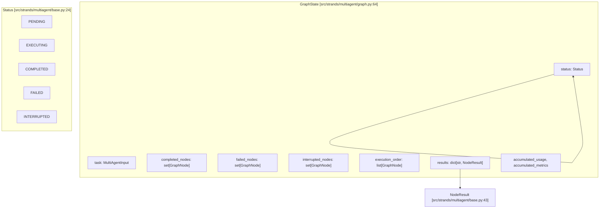
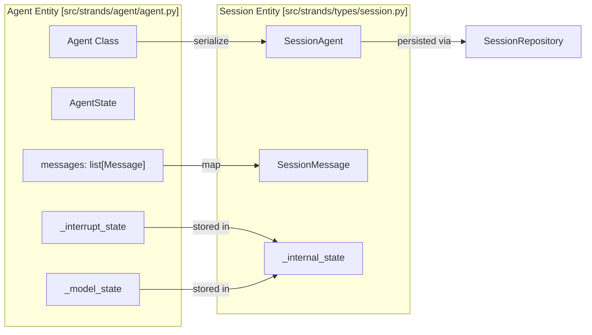

<!-- source: DeepWiki mcp.deepwiki.com · repo strands-agents/sdk-python · page 6.4 Multi-Agent State and Persistence · fetched 2026-10-27 -->

# Multi-Agent State and Persistence

Relevant source files

The following files were used as context for generating this wiki page:

- [.gitignore](.gitignore)
- [AGENTS.md](AGENTS.md)
- [CONTRIBUTING.md](CONTRIBUTING.md)
- [README.md](README.md)
- [package-lock.json](package-lock.json)
- [package.json](package.json)
- [pyproject.toml](pyproject.toml)
- [site/src/content/docs/user-guide/concepts/memory/bedrock-knowledge-base.mdx](site/src/content/docs/user-guide/concepts/memory/bedrock-knowledge-base.mdx)
- [site/src/content/docs/user-guide/concepts/memory/bedrock-knowledge-base.ts](site/src/content/docs/user-guide/concepts/memory/bedrock-knowledge-base.ts)
- [site/src/content/docs/user-guide/concepts/memory/bedrock-knowledge-base_imports.ts](site/src/content/docs/user-guide/concepts/memory/bedrock-knowledge-base_imports.ts)
- [strandly/package.json](strandly/package.json)
- [strands-py/pyproject.toml](strands-py/pyproject.toml)
- [strands-py/src/strands/_identifier.py](strands-py/src/strands/_identifier.py)
- [strands-py/src/strands/session/__init__.py](strands-py/src/strands/session/__init__.py)
- [strands-py/src/strands/session/repository_session_manager.py](strands-py/src/strands/session/repository_session_manager.py)
- [strands-py/src/strands/session/s3_session_manager.py](strands-py/src/strands/session/s3_session_manager.py)
- [strands-py/src/strands/session/snapshot_session_manager.py](strands-py/src/strands/session/snapshot_session_manager.py)
- [strands-py/src/strands/vended_memory_stores/bedrock_knowledge_base/__init__.py](strands-py/src/strands/vended_memory_stores/bedrock_knowledge_base/__init__.py)
- [strands-py/src/strands/vended_memory_stores/bedrock_knowledge_base/store.py](strands-py/src/strands/vended_memory_stores/bedrock_knowledge_base/store.py)
- [strands-py/src/strands/vended_memory_stores/bedrock_knowledge_base/types.py](strands-py/src/strands/vended_memory_stores/bedrock_knowledge_base/types.py)
- [strands-py/tests/strands/agent/test_agent_storage.py](strands-py/tests/strands/agent/test_agent_storage.py)
- [strands-py/tests/strands/session/test_repository_session_manager.py](strands-py/tests/strands/session/test_repository_session_manager.py)
- [strands-py/tests/strands/session/test_s3_session_manager.py](strands-py/tests/strands/session/test_s3_session_manager.py)
- [strands-py/tests/strands/session/test_snapshot_session_manager.py](strands-py/tests/strands/session/test_snapshot_session_manager.py)
- [strands-py/tests/strands/test_identifier.py](strands-py/tests/strands/test_identifier.py)
- [strands-py/tests/strands/vended_memory_stores/bedrock_knowledge_base/test_store.py](strands-py/tests/strands/vended_memory_stores/bedrock_knowledge_base/test_store.py)
- [strands-py/tests_integ/test_snapshot_session.py](strands-py/tests_integ/test_snapshot_session.py)
- [strands-ts/package.json](strands-ts/package.json)
- [strands-ts/src/multiagent/state.ts](strands-ts/src/multiagent/state.ts)

## Purpose and Scope

This document explains how multi-agent orchestration patterns (Graph and Swarm) manage state and persist execution progress. It covers state structures, `SessionManager` integration, serialization mechanisms, and resume capabilities for interrupted or failed executions.

The SDK provides a robust session management layer that allows agents and multi-agent systems to persist their conversation history, internal model states, and custom user states across different storage backends (e.g., File, S3).

---

## State Structures

Both Graph and Swarm maintain dedicated state objects that track execution progress, metrics, and results throughout multi-agent orchestration.

### GraphState

`GraphState` tracks the execution state of graph-based orchestration, including node completion status, execution order, and accumulated metrics.

| Field | Type | Description |
|-------|------|-------------|
| `task` | `MultiAgentInput` | Original input task/query [src/strands/multiagent/graph.py:83]() |
| `status` | `Status` | Current execution status (PENDING, EXECUTING, COMPLETED, FAILED, INTERRUPTED) [src/strands/multiagent/graph.py:86]() |
| `completed_nodes` | `set[GraphNode]` | Nodes that successfully completed execution [src/strands/multiagent/graph.py:87]() |
| `failed_nodes` | `set[GraphNode]` | Nodes that encountered errors [src/strands/multiagent/graph.py:88]() |
| `interrupted_nodes` | `set[GraphNode]` | Nodes interrupted by user [src/strands/multiagent/graph.py:89]() |
| `execution_order` | `list[GraphNode]` | Chronological list of node executions [src/strands/multiagent/graph.py:90]() |
| `results` | `dict[str, NodeResult]` | Mapping of node IDs to their results [src/strands/multiagent/graph.py:94]() |
| `accumulated_usage` | `Usage` | Total token usage across all nodes [src/strands/multiagent/graph.py:97]() |
| `accumulated_metrics` | `Metrics` | Total latency and performance metrics [src/strands/multiagent/graph.py:98]() |

**Graph State Diagram**

**Sources:** [src/strands/multiagent/graph.py:64-126](), [src/strands/multiagent/base.py:24-40](), [src/strands/multiagent/base.py:43-125]()

### SwarmState

`SwarmState` tracks the execution state of swarm-based collaboration, including agent handoffs, shared context, and node history.

| Field | Type | Description |
|-------|------|-------------|
| `current_node` | `SwarmNode | None` | Agent currently executing [src/strands/multiagent/swarm.py:170]() |
| `task` | `MultiAgentInput` | Original task from user [src/strands/multiagent/swarm.py:171]() |
| `completion_status` | `Status` | Current swarm execution status [src/strands/multiagent/swarm.py:172]() |
| `shared_context` | `SharedContext` | Context shared between agents [src/strands/multiagent/swarm.py:173]() |
| `node_history` | `list[SwarmNode]` | Complete history of agent executions [src/strands/multiagent/swarm.py:174]() |
| `results` | `dict[str, NodeResult]` | Mapping of node IDs to results [src/strands/multiagent/swarm.py:176]() |

**Sources:** [src/strands/multiagent/swarm.py:167-224]()

---

## Session Management Implementation

The SDK uses a tiered architecture for session management, separating the storage logic from the agent-specific synchronization logic.

### RepositorySessionManager

The `RepositorySessionManager` is the primary class for persisting agent state into a `SessionRepository` [src/strands/session/repository_session_manager.py:28](). It optimizes performance by tracking state versions and only performing I/O when changes are detected [src/strands/session/repository_session_manager.py:114-143]().

Key features include:
- **Automatic Session Creation:** Creates a new session if the `session_id` does not exist [src/strands/session/repository_session_manager.py:53-57]().
- **State Versioning:** Tracks `state_version`, `interrupt_state_version`, and `conversation_manager_state` to minimize redundant updates [src/strands/session/repository_session_manager.py:114-135]().
- **Message Redaction:** Allows updating the latest message in the repository, useful for hiding sensitive content or intermediate tool outputs [src/strands/session/repository_session_manager.py:88-100]().

**Agent to Session Mapping**

**Sources:** [src/strands/session/repository_session_manager.py:28-168](), [src/strands/types/session.py:108-140]()

### Session Data Models

The persistence layer uses specific dataclasses to ensure JSON compatibility:
- **SessionMessage:** Wraps a standard `Message` with a `message_id` and timestamps [src/strands/types/session.py:59-74](). It handles binary data by automatically base64 encoding/decoding `bytes` values [src/strands/types/session.py:78-94]().
- **SessionAgent:** Captures the state of an agent, including its user-managed `state`, `conversation_manager_state`, and internal framework state like interrupts [src/strands/types/session.py:108-139]().

**Sources:** [src/strands/types/session.py:59-140](), [src/strands/types/session.py:28-56]()

---

## Multi-Agent Persistence Hooks

Multi-agent systems (Graph and Swarm) utilize the hook system to integrate with `SessionManager`. They register themselves as hook providers to trigger state saving and restoration at specific lifecycle events.

| Hook Event | Role in Persistence |
|------------|---------------------|
| `BeforeMultiAgentInvocationEvent` | Restores the orchestrator state from the session before starting execution [src/strands/multiagent/graph.py:538-552](). |
| `AfterNodeCallEvent` | Saves the orchestrator state after every individual node (agent or sub-graph) completes [src/strands/multiagent/graph.py:882-892](). |
| `AfterMultiAgentInvocationEvent` | Performs a final state sync once the entire task is finished or failed [src/strands/multiagent/graph.py:590-592](). |

**Sources:** [src/strands/multiagent/graph.py:456-462](), [src/strands/session/repository_session_manager.py:102-168]()

---

## Interrupt and Resume

Persistence is critical for Human-in-the-Loop (HITL) workflows where an agent or multi-agent system must stop and wait for external input.

### Interrupt State Restoration
When an agent is initialized from a session, `RepositorySessionManager.initialize` calls `SessionAgent.initialize_internal_state` [src/strands/session/repository_session_manager.py:186](). This restores:
1. **Interrupt State:** Reconstructs the `_InterruptState` object, including active interrupts and context [src/strands/types/session.py:175-178]().
2. **Model State:** Restores provider-specific state like `response_id` for OpenAI Responses API [src/strands/types/session.py:179-180]().

### Multi-Agent Resume Flow
In a multi-agent context, the orchestrator (Graph or Swarm) checks its persisted `status`. If the status is `INTERRUPTED`, it resumes by:
1. Identifying the `interrupted_nodes` [src/strands/multiagent/graph.py:89]()
2. Injecting the `interruptResponse` provided in the new input into the specific agent's state [tests_integ/interrupts/multiagent/test_session.py:53-61]().
3. Continuing execution from the point of interruption.

**Sources:** [src/strands/session/repository_session_manager.py:170-195](), [src/strands/types/session.py:175-181](), [tests_integ/interrupts/multiagent/test_session.py:24-73]()

---

## Implementation Details

### Binary Data Handling
Since session state is typically stored as JSON, the SDK recursively scans for `bytes` objects in messages (e.g., images or audio) and encodes them using base64 [src/strands/types/session.py:28-40](). Upon restoration, these are decoded back to `bytes` [src/strands/types/session.py:43-56]().

### Sync Optimization
To prevent excessive database writes, `RepositorySessionManager.sync_agent` compares current versions of the agent's state against the `_last_synced_internal_state` [src/strands/session/repository_session_manager.py:114-135](). If no functional change is detected (e.g., a model call that didn't result in a new message or state update), the sync is skipped [src/strands/session/repository_session_manager.py:137-143]().

**Sources:** [src/strands/types/session.py:28-56](), [src/strands/session/repository_session_manager.py:102-168]()

---

