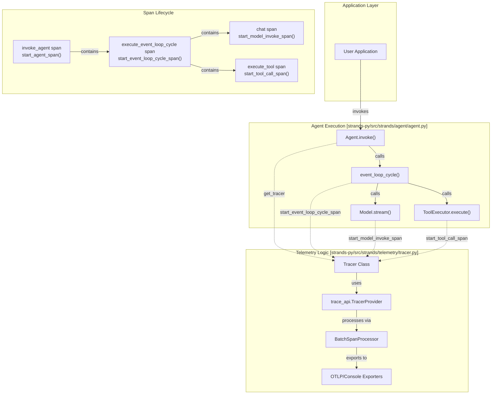
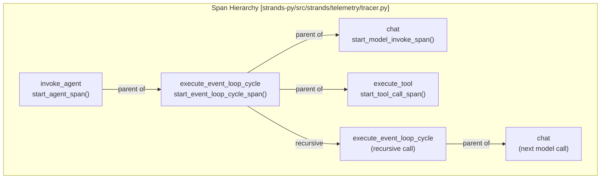

<!-- source: DeepWiki mcp.deepwiki.com · repo strands-agents/sdk-python · page 7 Telemetry and Observability · fetched 2026-10-27 -->

# Telemetry and Observability

<details>
<summary>Relevant source files</summary>

The following files were used as context for generating this wiki page:

- [strands-py/src/strands/memory/extraction/model_extractor.py](strands-py/src/strands/memory/extraction/model_extractor.py)
- [strands-py/src/strands/telemetry/tracer.py](strands-py/src/strands/telemetry/tracer.py)
- [strands-py/tests/strands/memory/test_model_extractor.py](strands-py/tests/strands/memory/test_model_extractor.py)
- [strands-py/tests/strands/memory/test_telemetry.py](strands-py/tests/strands/memory/test_telemetry.py)
- [strands-py/tests/strands/telemetry/test_tracer.py](strands-py/tests/strands/telemetry/test_tracer.py)
- [strands-ts/src/memory/__tests__/memory-tracing.test.ts](strands-ts/src/memory/__tests__/memory-tracing.test.ts)
- [strands-ts/src/telemetry/__tests__/meter.test.ts](strands-ts/src/telemetry/__tests__/meter.test.ts)
- [strands-ts/src/telemetry/__tests__/tracer.test.node.ts](strands-ts/src/telemetry/__tests__/tracer.test.node.ts)
- [strands-ts/src/telemetry/meter.ts](strands-ts/src/telemetry/meter.ts)
- [strands-ts/src/telemetry/tracer.ts](strands-ts/src/telemetry/tracer.ts)

</details>


## Purpose and Scope

This document provides an overview of the observability features in the Strands Agents SDK, including distributed tracing and metrics collection. The SDK integrates OpenTelemetry to provide comprehensive visibility into agent execution, model inference, tool calls, and multi-agent coordination.

For detailed information on specific observability features:
- **OpenTelemetry Integration**: See [OpenTelemetry Integration](#7.1)
- **Tracing and Spans**: See [Tracing and Spans](#7.2)
- **Metrics and Performance Monitoring**: See [Metrics and Performance Monitoring](#7.3)

## Observability Architecture

The SDK's observability system is built on OpenTelemetry and provides tracing throughout the agent execution stack. The architecture follows a non-invasive design where telemetry integrates through context propagation and centralized instrumentation points, allowing observability without modifying core agent logic.

### Telemetry Execution Flow

The following diagram bridges the high-level execution concepts to the specific `Tracer` methods and OpenTelemetry SDK entities.



**Sources:** [strands-py/src/strands/telemetry/tracer.py:77-160]()

## Core Components

### Tracer Class

The `Tracer` class [strands-py/src/strands/telemetry/tracer.py:83-86]() provides the primary interface for creating and managing OpenTelemetry spans. It handles span lifecycle management, attribute setting, and event recording. Both Python and TypeScript SDKs have their own `Tracer` implementations [strands-py/src/strands/telemetry/tracer.py:83-86](), [strands-ts/src/telemetry/tracer.ts:164-165]().

| Component | Purpose | Key Methods |
|-----------|---------|-------------|
| `Tracer` | Span creation and management | `start_agent_span()`, `start_model_invoke_span()`, `start_tool_call_span()`, `start_event_loop_cycle_span()` |
| `get_tracer()` | Global tracer accessor (Python) | Returns singleton `Tracer` instance |
| `StrandsTelemetry` | Configuration and setup | `setup_console_exporter()`, `setup_otlp_exporter()`, `setup_meter()` |

The `Tracer` automatically instruments agent execution at key points:
- **Agent invocation**: Full lifecycle from input to result via `start_agent_span` [strands-py/src/strands/telemetry/tracer.py:571-627](), [strands-ts/src/telemetry/tracer.ts:200-201]().
- **Event loop cycles**: Each iteration of the recursive event loop via `start_event_loop_cycle_span` [strands-py/src/strands/telemetry/tracer.py:370-398](), [strands-ts/src/telemetry/tracer.ts:202-203]().
- **Model calls**: LLM inference with streaming events via `start_model_invoke_span` [strands-py/src/strands/telemetry/tracer.py:280-308](), [strands-ts/src/telemetry/tracer.ts:204-205]().
- **Tool executions**: Individual tool invocations with input/output via `start_tool_call_span` [strands-py/src/strands/telemetry/tracer.py:491-528](), [strands-ts/src/telemetry/tracer.ts:206-207]().
- **Memory operations**: Tracing for search, add, and inject operations within the memory subsystem [strands-py/src/strands/memory/extraction/model_extractor.py:86-88](), [strands-py/tests/strands/memory/test_telemetry.py:149-151](), [strands-ts/src/memory/__tests__/memory-tracing.test.ts:64-79]().

**Sources:** [strands-py/src/strands/telemetry/tracer.py:77-895](), [strands-ts/src/telemetry/tracer.ts:164-165](), [strands-py/src/strands/memory/extraction/model_extractor.py:86-88](), [strands-py/tests/strands/memory/test_telemetry.py:149-151](), [strands-ts/src/memory/__tests__/memory-tracing.test.ts:64-79]()

### Telemetry Configuration

The `StrandsTelemetry` class (Python) provides centralized configuration for OpenTelemetry components. It supports method chaining for convenient setup and handles both trace and metrics exporters. The TypeScript SDK uses environment variables and direct OpenTelemetry API calls for configuration.

```mermaid
graph LR
    subgraph "Python Config Entity [strands-py/src/strands/telemetry/config.py]"
        StrandsTelemetry["StrandsTelemetry Class"]
        Resource["Resource.create()"]
    end
    
    subgraph "Trace Exporters"
        ConsoleExporter["ConsoleSpanExporter"]
        OTLPExporter["OTLPSpanExporter"]
    end
    
    subgraph "Span Processors"
        SimpleProcessor["SimpleSpanProcessor"]
        BatchProcessor["BatchSpanProcessor"]
    end
    
    subgraph "Global Provider"
        TracerProvider["SDKTracerProvider"]
    end
    
    StrandsTelemetry -->|creates| Resource
    StrandsTelemetry -->|initializes| TracerProvider
    TracerProvider -->|uses| Resource
    
    StrandsTelemetry -->|setup_console_exporter()| ConsoleExporter
    StrandsTelemetry -->|setup_otlp_exporter()| OTLPExporter
    
    ConsoleExporter -->|wrapped by| SimpleProcessor
    OTLPExporter -->|wrapped by| BatchProcessor
    
    SimpleProcessor -->|added to| TracerProvider
    BatchProcessor -->|added to| TracerProvider
```

**Sources:** [strands-py/src/strands/telemetry/config.py:47-194]()

#### Basic Configuration (Python)

```python
# Quick setup with default configuration
from strands.telemetry import StrandsTelemetry

StrandsTelemetry().setup_otlp_exporter()
```

**Sources:** [strands-py/src/strands/telemetry/config.py:64-66]()

#### Advanced Configuration (Python)

```python
# Configure with custom exporters and options
telemetry = StrandsTelemetry()
telemetry.setup_console_exporter()  # For development
telemetry.setup_otlp_exporter(
    endpoint="https://my-otel-collector:4318",
    headers={"api-key": "..."}
)
telemetry.setup_meter(
    enable_console_exporter=True,
    enable_otlp_exporter=True
)
```

**Sources:** [strands-py/src/strands/telemetry/config.py:126-194]()

## Span Hierarchy and Lifecycle

The SDK creates a hierarchical span structure that reflects the agent execution flow. Each span captures timing, attributes, and events relevant to its scope.



**Sources:** [strands-py/src/strands/telemetry/tracer.py:275-687]()

### Span Attributes

Each span type includes standard and custom attributes following OpenTelemetry semantic conventions:

| Span Type | Key Attributes | Source Methods |
|-----------|----------------|----------------|
| Agent | `gen_ai.agent.name`, `gen_ai.request.model`, `gen_ai.agent.tools` | `start_agent_span()` [strands-py/src/strands/telemetry/tracer.py:571-627](), [strands-ts/src/telemetry/__tests__/tracer.test.node.ts:65-81]() |
| Event Loop Cycle | `event_loop.cycle_id`, `event_loop.parent_cycle_id` | `start_event_loop_cycle_span()` [strands-py/src/strands/telemetry/tracer.py:370-398]() |
| Model Call | `gen_ai.request.model`, `gen_ai.usage.*`, `gen_ai.server.request.duration` | `start_model_invoke_span()` [strands-py/src/strands/telemetry/tracer.py:280-308]() |
| Tool Call | `gen_ai.tool.name`, `gen_ai.tool.call.id`, `gen_ai.tool.status` | `start_tool_call_span()` [strands-py/src/strands/telemetry/tracer.py:491-528]() |
| Memory Search | `memory.store_names`, `memory.query`, `memory.entry_count` | `start_memory_search_span()` [strands-py/tests/strands/memory/test_telemetry.py:86-88](), [strands-ts/src/memory/__tests__/memory-tracing.test.ts:76-79]() |
| Memory Add | `memory.store_names`, `memory.entry_count` | `start_memory_add_span()` [strands-py/tests/strands/memory/test_telemetry.py:122-124](), [strands-ts/src/memory/__tests__/memory-tracing.test.ts:113-115]() |
| Memory Inject | `memory.injected`, `memory.entry_count`, `memory.format_error` | `start_memory_inject_span()` [strands-py/tests/strands/memory/test_telemetry.py:157-159](), [strands-ts/src/memory/__tests__/memory-tracing.test.ts:151-153]() |

**Sources:** [strands-py/src/strands/telemetry/tracer.py:275-687](), [strands-ts/src/telemetry/__tests__/tracer.test.node.ts:65-81](), [strands-py/tests/strands/memory/test_telemetry.py:86-88](), [strands-ts/src/memory/__tests__/memory-tracing.test.ts:76-79](), [strands-py/tests/strands/memory/test_telemetry.py:122-124](), [strands-ts/src/memory/__tests__/memory-tracing.test.ts:113-115](), [strands-py/tests/strands/memory/test_telemetry.py:157-159](), [strands-ts/src/memory/__tests__/memory-tracing.test.ts:151-153]()

### Span Events

Spans record events at key points in execution:

- **`gen_ai.user.message`**: User input messages (legacy convention) [strands-py/src/strands/telemetry/tracer.py:814-821]().
- **`gen_ai.assistant.message`**: Assistant response messages (legacy convention) [strands-py/src/strands/telemetry/tracer.py:823-833]().
- **`gen_ai.tool.message`**: Tool invocations and results (legacy convention) [strands-py/src/strands/telemetry/tracer.py:835-856]().
- **`gen_ai.client.inference.operation.details`**: Structured message content (experimental convention) [strands-py/src/strands/telemetry/tracer.py:785-794]().

**Sources:** [strands-py/src/strands/telemetry/tracer.py:770-865]()

## GenAI Semantic Conventions

The SDK supports both legacy and experimental OpenTelemetry GenAI semantic conventions. The version is controlled by the `OTEL_SEMCONV_STABILITY_OPT_IN` environment variable [strands-py/src/strands/telemetry/tracer.py:98-102]().

### Convention Versions

| Convention | Environment Variable | Provider Attribute | Events Format |
|------------|---------------------|-------------------|---------------|
| Legacy (default) | Not set | `gen_ai.system` | Separate events per message type |
| Experimental | `gen_ai_latest_experimental` | `gen_ai.provider.name` | `gen_ai.client.inference.operation.details` |

**Sources:** [strands-py/src/strands/telemetry/tracer.py:98-111](), [strands-py/src/strands/telemetry/tracer.py:770-795]()

## Integration Points

### Context Propagation

OpenTelemetry context propagation ensures spans are properly nested:

1. **Explicit parent span**: Passed as `parent_span` parameter to span creation methods.
2. **Implicit context**: Retrieved via `trace_api.get_current_span()` when no parent specified [strands-py/src/strands/telemetry/tracer.py:143-144]().
3. **Context setting**: Parent context set via `trace_api.set_span_in_context(parent_span)` [strands-py/src/strands/telemetry/tracer.py:147-148]().

**Sources:** [strands-py/src/strands/telemetry/tracer.py:125-159]()

## Custom Trace Attributes

All span creation methods accept a `custom_trace_attributes` parameter for application-specific metadata. These attributes are propagated to:
- Agent spans via `start_agent_span(..., custom_trace_attributes={...})` [strands-py/src/strands/telemetry/tracer.py:577-627]().
- Event loop cycle spans [strands-py/src/strands/telemetry/tracer.py:370-398]().
- Model invocation spans [strands-py/src/strands/telemetry/tracer.py:280-308]().
- Tool call spans [strands-py/src/strands/telemetry/tracer.py:491-528]().

**Sources:** [strands-py/src/strands/telemetry/tracer.py:280-627]()

## Multi-Agent Telemetry

Multi-agent systems (Swarm and Graph) create their own span hierarchies:
- `start_multiagent_span(task, instance)` where `instance` is "swarm" or "graph" [strands-py/src/strands/telemetry/tracer.py:701-739]().
- `end_swarm_span(span, result)` for Swarm completion [strands-py/src/strands/telemetry/tracer.py:741-769]().

**Sources:** [strands-py/src/strands/telemetry/tracer.py:701-769]()

## Error Handling and Span Status

Spans track execution status and capture exceptions. The `_end_span()` method [strands-py/src/strands/telemetry/tracer.py:183-223]() handles status setting:
- **Success**: `span.set_status(StatusCode.OK)` [strands-py/src/strands/telemetry/tracer.py:211]().
- **Error**: `span.set_status(StatusCode.ERROR, str(error))` and `span.record_exception(error)` [strands-py/src/strands/telemetry/tracer.py:202-203]().

**Sources:** [strands-py/src/strands/telemetry/tracer.py:183-223]()

## Telemetry Best Practices

### Non-Invasive Design

Telemetry failures never interrupt agent execution. All span operations are wrapped in exception handling [strands-py/src/strands/telemetry/tracer.py:199-222]().

### Structured Data Serialization

The `JSONEncoder` class [strands-py/src/strands/telemetry/tracer.py:29-75]() handles non-serializable types in trace attributes:
- **DateTime objects**: Converted to ISO format strings [strands-py/src/strands/telemetry/tracer.py:56-57]().
- **Non-serializable values**: Replaced with `"<replaced>"` placeholder [strands-py/src/strands/telemetry/tracer.py:73-74]().

**Sources:** [strands-py/src/strands/telemetry/tracer.py:29-75]()

## Summary

The Strands SDK provides comprehensive observability through:

1.  **OpenTelemetry Integration**: Standard tracing with semantic conventions.
2.  **Hierarchical Spans**: Agent → Event Loop → Model/Tool structure.
3.  **Flexible Configuration**: Console and OTLP exporters with method chaining.
4.  **Custom Attributes**: Application-specific metadata support.
5.  **Multi-Agent Support**: Span hierarchies for Swarm and Graph coordination.
6.  **Non-Invasive Design**: Failures don't interrupt agent execution.

For implementation details, see:
-   [OpenTelemetry Integration](#7.1) - Detailed tracing configuration and span management
-   [Tracing and Spans](#7.2) - Detailed span lifecycle and types
-   [Metrics and Performance Monitoring](#7.3) - Token usage, latency, and performance metrics

**Sources:** [strands-py/src/strands/telemetry/tracer.py:1-896](), [strands-py/src/strands/telemetry/config.py:1-195](), [strands-ts/src/telemetry/tracer.ts:1-163](), [strands-ts/src/telemetry/meter.ts:1-163]()

---

