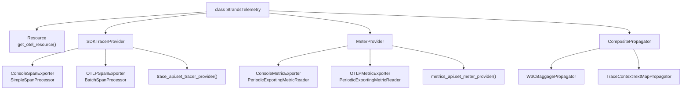
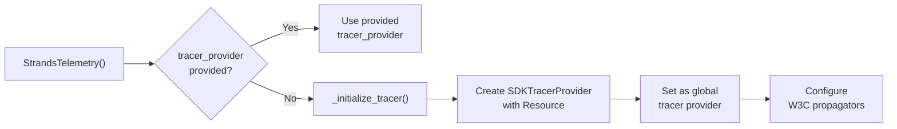
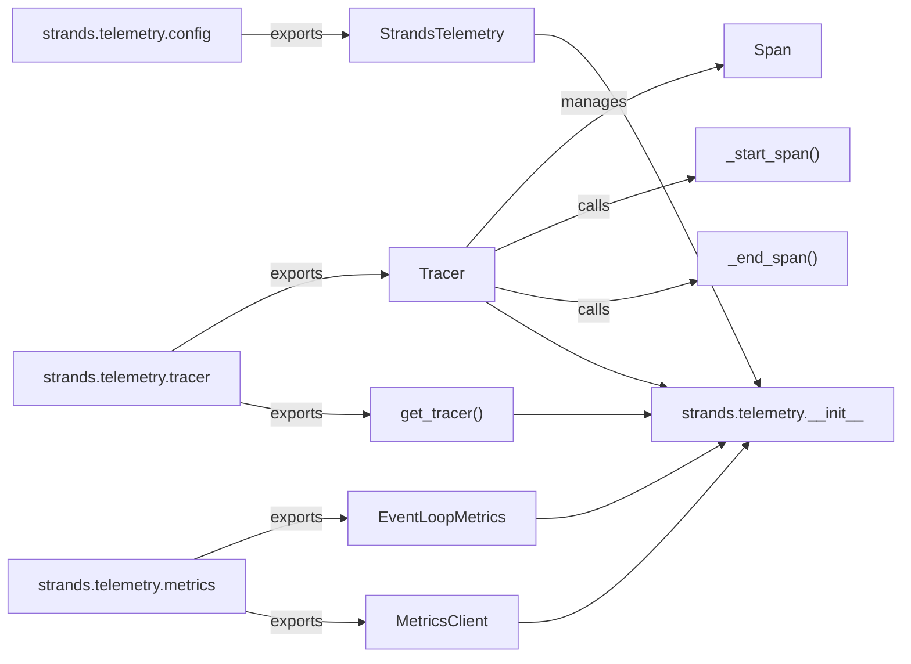

<!-- source: DeepWiki mcp.deepwiki.com · repo strands-agents/sdk-python · page 7.1 OpenTelemetry Integration · fetched 2026-10-27 -->

# OpenTelemetry Integration

Relevant source files

The following files were used as context for generating this wiki page:

- [strands-py/src/strands/memory/extraction/model_extractor.py](strands-py/src/strands/memory/extraction/model_extractor.py)
- [strands-py/src/strands/telemetry/tracer.py](strands-py/src/strands/telemetry/tracer.py)
- [strands-py/tests/strands/memory/test_model_extractor.py](strands-py/tests/strands/memory/test_model_extractor.py)
- [strands-py/tests/strands/memory/test_telemetry.py](strands-py/tests/strands/memory/test_telemetry.py)
- [strands-py/tests/strands/telemetry/test_tracer.py](strands-py/tests/strands/telemetry/test_tracer.py)
- [strands-ts/src/memory/__tests__/memory-tracing.test.ts](strands-ts/src/memory/__tests__/memory-tracing.test.ts)
- [strands-ts/src/telemetry/__tests__/config.test.node.ts](strands-ts/src/telemetry/__tests__/config.test.node.ts)
- [strands-ts/src/telemetry/__tests__/config.test.ts](strands-ts/src/telemetry/__tests__/config.test.ts)
- [strands-ts/src/telemetry/__tests__/tracer.test.node.ts](strands-ts/src/telemetry/__tests__/tracer.test.node.ts)
- [strands-ts/src/telemetry/config.ts](strands-ts/src/telemetry/config.ts)
- [strands-ts/src/telemetry/tracer.ts](strands-ts/src/telemetry/tracer.ts)
- [strands-ts/src/tools/__tests__/zod-tool.test-d.ts](strands-ts/src/tools/__tests__/zod-tool.test-d.ts)
- [strands-ts/src/tools/tool-factory.ts](strands-ts/src/tools/tool-factory.ts)
- [strands-ts/src/tools/zod-tool.ts](strands-ts/src/tools/zod-tool.ts)
- [strands-ts/test/integ/telemetry.test.node.ts](strands-ts/test/integ/telemetry.test.node.ts)

## Purpose and Scope

This document describes the OpenTelemetry integration setup and configuration in the Strands Agents SDK. It covers the `StrandsTelemetry` class for configuring trace and metric exporters, resource initialization, and the `Tracer` class which handles the instrumentation logic for models, tools, and agents. For detailed information about span types, semantic conventions, and trace hierarchies, see page 7.2. For metrics collection and performance monitoring, see page 7.3.

---

## StrandsTelemetry Class Overview

The `StrandsTelemetry` class provides centralized configuration for OpenTelemetry components including tracer providers, span processors, metric exporters, and context propagators. It follows a builder pattern with method chaining for convenient setup. [strands-py/src/strands/telemetry/config.py:47-85]()

### Architecture

The following diagram bridges the **Code Entity Space** (classes and functions) to the **System Space** (OpenTelemetry SDK components).

**Strands Telemetry Architecture**

**Sources:** [strands-py/src/strands/telemetry/config.py:47-199]()

### Class Responsibilities

| Component | Responsibility |
|-----------|---------------|
| `StrandsTelemetry` | Orchestrates OpenTelemetry setup and configuration [strands-py/src/strands/telemetry/config.py:47-85]() |
| `get_otel_resource()` | Creates standardized resource with service metadata [strands-py/src/strands/telemetry/config.py:27-44]() |
| `setup_console_exporter()` | Configures console trace output via `SimpleSpanProcessor` [strands-py/src/strands/telemetry/config.py:126-147]() |
| `setup_otlp_exporter()` | Configures OTLP trace export via `BatchSpanProcessor` [strands-py/src/strands/telemetry/config.py:148-172]() |
| `setup_meter()` | Configures metric collection and export for console or OTLP [strands-py/src/strands/telemetry/config.py:173-199]() |

---

## Initialization

The `StrandsTelemetry` class can be initialized with or without a pre-configured tracer provider. When no provider is supplied, it automatically creates and registers a global tracer provider. [strands-py/src/strands/telemetry/config.py:101-104]()

### Initialization Flow

**StrandsTelemetry Initialization Sequence**

**Sources:** [strands-py/src/strands/telemetry/config.py:87-124]()

When `tracer_provider` is `None`, the `_initialize_tracer` method:
1. Creates an OpenTelemetry `Resource` via `get_otel_resource()` [strands-py/src/strands/telemetry/config.py:100-111]()
2. Instantiates an `SDKTracerProvider` with the resource [strands-py/src/strands/telemetry/config.py:111]()
3. Registers it globally via `trace_api.set_tracer_provider()` [strands-py/src/strands/telemetry/config.py:114]()
4. Configures `CompositePropagator` with `W3CBaggagePropagator` and `TraceContextTextMapPropagator` [strands-py/src/strands/telemetry/config.py:117-124]()

---

## Resource Configuration

The `get_otel_resource()` function creates a standardized OpenTelemetry resource containing service identification and telemetry metadata. [strands-py/src/strands/telemetry/config.py:27-44]()

### Resource Attributes

| Attribute | Value | Source |
|-----------|-------|--------|
| `service.name` | `"strands-agents"` | Default, overridable via `OTEL_SERVICE_NAME` [strands-py/src/strands/telemetry/config.py:33-37]() |
| `service.version` | Package version | `version("strands-agents")` [strands-py/src/strands/telemetry/config.py:38]() |
| `telemetry.sdk.name` | `"opentelemetry"` | Fixed [strands-py/src/strands/telemetry/config.py:39]() |
| `telemetry.sdk.language` | `"python"` | Fixed [strands-py/src/strands/telemetry/config.py:40]() |

**Sources:** [strands-py/src/strands/telemetry/config.py:27-44]()

---

## Tracer Initialization and Semantic Conventions

The `Tracer` class manages the lifecycle of spans and integrates with the OpenTelemetry `trace_api`. [strands-py/src/strands/telemetry/tracer.py:77-90]()

### Opt-in Semantic Conventions
The SDK supports latest Generative AI semantic conventions through the `OTEL_SEMCONV_STABILITY_OPT_IN` environment variable. [strands-py/src/strands/telemetry/tracer.py:98-103]() Supported values include:
- `gen_ai_latest_experimental`: Enables latest span attributes for AI operations. [strands-py/src/strands/telemetry/tracer.py:101]()
- `gen_ai_tool_definitions`: Includes tool schemas in trace attributes. [strands-py/src/strands/telemetry/tracer.py:102]()
- `gen_ai_use_latest_invocation_tokens`: Uses the latest token usage naming conventions. [strands-py/src/strands/telemetry/tracer.py:103]()

### Threading Support
Upon initialization, the `Tracer` automatically instruments threading using `ThreadingInstrumentor().instrument()` to ensure context propagation across threads. [strands-py/src/strands/telemetry/tracer.py:96]()

---

## Trace Exporter Configuration

### Console Exporter Setup
The `setup_console_exporter` method configures a `SimpleSpanProcessor` with a `ConsoleSpanExporter`. [strands-py/src/strands/telemetry/config.py:126-147]() Any keyword arguments passed to this method are forwarded to the `ConsoleSpanExporter` initializer. [strands-py/src/strands/telemetry/config.py:130-132]()

### OTLP Exporter Setup
The `setup_otlp_exporter` method configures a `BatchSpanProcessor` with an `OTLPSpanExporter`. [strands-py/src/strands/telemetry/config.py:148-172]() It imports `OTLPSpanExporter` from `opentelemetry.exporter.otlp.proto.http.trace_exporter` lazily to avoid unnecessary dependencies if OTLP is not used. [strands-py/src/strands/telemetry/config.py:162]()

---

## Metrics Provider Configuration

The `setup_meter()` method initializes the OpenTelemetry Meter and configures metric readers. [strands-py/src/strands/telemetry/config.py:173-199]()

**Parameters:**
- `enable_console_exporter`: Adds a `PeriodicExportingMetricReader` using `ConsoleMetricExporter`. [strands-py/src/strands/telemetry/config.py:180-184]()
- `enable_otlp_exporter`: Adds a `PeriodicExportingMetricReader` using `OTLPMetricExporter`. [strands-py/src/strands/telemetry/config.py:186-191]()

**Sources:** [strands-py/src/strands/telemetry/config.py:173-199]()

---

## Tracer and Global Access

The SDK provides a centralized way to access tracing functionality via the `Tracer` class and `get_tracer` utility. [strands-py/src/strands/telemetry/__init__.py:8]()

### Code Entity Mapping
The following diagram maps the internal telemetry modules to their exported symbols and illustrates how `Tracer` interacts with span management.

**Telemetry Module Exports and Span Lifecycle**

**Sources:** [strands-py/src/strands/telemetry/__init__.py:1-21](), [strands-py/src/strands/telemetry/tracer.py:126-190]()

### Singleton Access
The `get_tracer()` function is intended to be the primary entry point for obtaining a tracer instance, ensuring consistent instrumentation across the agent lifecycle. [strands-py/src/strands/telemetry/__init__.py:8]()

### JSON Serialization
The `Tracer` uses a custom `JSONEncoder` to handle non-serializable types (like `datetime` or complex objects) when attaching attributes or events to spans. [strands-py/src/strands/telemetry/tracer.py:29-75]() If an object cannot be serialized, it is replaced with the string `"<replaced>"` to prevent telemetry export failures. [strands-py/src/strands/telemetry/tracer.py:74]()

**Sources:** [strands-py/src/strands/telemetry/__init__.py:6-21](), [strands-py/src/strands/telemetry/tracer.py:29-75]()

---

