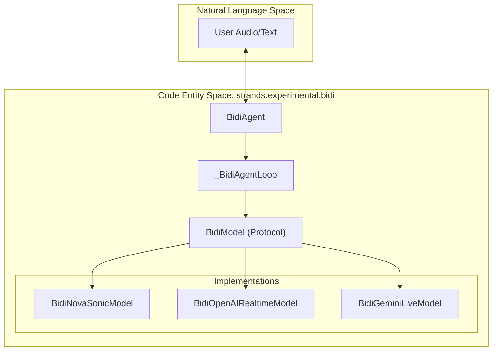

<!-- source: DeepWiki mcp.deepwiki.com · repo strands-agents/sdk-python · page 8.2 Bidirectional Model Providers · fetched 2026-10-27 -->

# Bidirectional Model Providers

<details>
<summary>Relevant source files</summary>

The following files were used as context for generating this wiki page:

- [strands-py/src/strands/experimental/bidi/_telemetry.py](strands-py/src/strands/experimental/bidi/_telemetry.py)
- [strands-py/src/strands/experimental/bidi/agent/loop.py](strands-py/src/strands/experimental/bidi/agent/loop.py)
- [strands-py/src/strands/experimental/bidi/models/gemini_live.py](strands-py/src/strands/experimental/bidi/models/gemini_live.py)
- [strands-py/src/strands/experimental/bidi/models/nova_sonic.py](strands-py/src/strands/experimental/bidi/models/nova_sonic.py)
- [strands-py/src/strands/experimental/bidi/models/openai_realtime.py](strands-py/src/strands/experimental/bidi/models/openai_realtime.py)
- [strands-py/src/strands/models/_validation.py](strands-py/src/strands/models/_validation.py)
- [strands-py/src/strands/types/_snapshot.py](strands-py/src/strands/types/_snapshot.py)
- [strands-py/tests/strands/agent/test_snapshot.py](strands-py/tests/strands/agent/test_snapshot.py)
- [strands-py/tests/strands/experimental/bidi/agent/test_agent.py](strands-py/tests/strands/experimental/bidi/agent/test_agent.py)
- [strands-py/tests/strands/experimental/bidi/agent/test_loop.py](strands-py/tests/strands/experimental/bidi/agent/test_loop.py)
- [strands-py/tests/strands/experimental/bidi/agent/test_loop_telemetry.py](strands-py/tests/strands/experimental/bidi/agent/test_loop_telemetry.py)
- [strands-py/tests/strands/experimental/bidi/models/test_gemini_live.py](strands-py/tests/strands/experimental/bidi/models/test_gemini_live.py)
- [strands-py/tests/strands/experimental/bidi/models/test_nova_sonic.py](strands-py/tests/strands/experimental/bidi/models/test_nova_sonic.py)
- [strands-py/tests/strands/experimental/bidi/models/test_openai_realtime.py](strands-py/tests/strands/experimental/bidi/models/test_openai_realtime.py)
- [strands-py/tests/strands/experimental/bidi/types/test_events.py](strands-py/tests/strands/experimental/bidi/types/test_events.py)
- [strands-py/tests/strands/models/test__validation.py](strands-py/tests/strands/models/test__validation.py)

</details>


Bidirectional model providers enable real-time, low-latency streaming interactions by maintaining persistent connections between the SDK and the AI model. Unlike standard request-response models, these providers support simultaneous audio/text input and output, allowing for natural features like user interruptions and continuous speech-to-speech loops.

## The BidiModel Interface

The `BidiModel` protocol defines a standardized contract for all bidirectional providers. It abstracts provider-specific streaming protocols (such as WebSockets or AWS EventStream) into a uniform event-based API used by the `BidiAgent` [strands-py/src/strands/experimental/bidi/models/model.py:31-40]().

| Method | Description |
| :--- | :--- |
| `start()` | Establishes the persistent connection, sending initial context (system prompt, tools, history) [strands-py/src/strands/experimental/bidi/models/model.py:44-62](). |
| `stop()` | Gracefully terminates the connection and cleans up resources [strands-py/src/strands/experimental/bidi/models/model.py:65-71](). |
| `send(content)` | Transmits `BidiInputEvent` (text, audio, image) or `ToolResultEvent` to the model [strands-py/src/strands/experimental/bidi/models/model.py:89-115](). |
| `receive()` | An `AsyncIterable` that yields normalized `BidiOutputEvent` objects from the model [strands-py/src/strands/experimental/bidi/models/model.py:74-87](). |

**Key Entity Relationships:**

The following diagram illustrates how the `BidiModel` interface bridges the gap between the high-level `BidiAgent` logic and the specific provider implementations.

Title: Bidirectional Model Architecture

Sources: [strands-py/src/strands/experimental/bidi/models/model.py:31-115](), [strands-py/src/strands/experimental/bidi/agent/agent.py:102-107](), [strands-py/src/strands/experimental/bidi/agent/agent.py:161-161]()

## Provider Implementations

### BidiNovaSonicModel
The `BidiNovaSonicModel` implements support for Amazon Nova Sonic via the Bedrock `InvokeModelWithBidirectionalStream` API [strands-py/src/strands/experimental/bidi/models/nova_sonic.py:1-5]().

*   **Requirements**: Requires Python 3.12+ due to advanced async requirements in the AWS SDK [strands-py/src/strands/experimental/bidi/models/nova_sonic.py:18-21]().
*   **Event Sequencing**: Manages a strict hierarchical sequence: `connectionStart` → `promptStart` → content streaming [strands-py/src/strands/experimental/bidi/models/nova_sonic.py:9-12]().
*   **Connection Limits**: Nova Sonic has an 8-minute connection limit. The model raises `BidiModelTimeoutError`, which the `_BidiAgentLoop` catches to perform a transparent "re-start" of the session [strands-py/src/strands/experimental/bidi/models/nova_sonic.py:12-13](), [strands-py/src/strands/experimental/bidi/models/model.py:118-124]().
*   **Audio Defaults**: Uses 16kHz mono PCM by default with the "matthew" voice [strands-py/src/strands/experimental/bidi/models/nova_sonic.py:77-94]().
*   **Turn Detection**: Nova Sonic v2 supports `turn_detection` with configurable `endpointingSensitivity` [strands-py/src/strands/experimental/bidi/models/nova_sonic.py:144-157]().

Sources: [strands-py/src/strands/experimental/bidi/models/nova_sonic.py:1-184](), [strands-py/src/strands/experimental/bidi/models/model.py:118-124]()

### BidiOpenAIRealtimeModel
This provider uses WebSockets to connect to the OpenAI Realtime API. It supports both `audio` and `text` modalities.

*   **Audio Handling**: Defaults to 24kHz PCM audio [strands-py/src/strands/experimental/bidi/models/openai_realtime.py:58-58]().
*   **Session Configuration**: Allows deep configuration of server-side Voice Activity Detection (VAD) via the `provider_config` [strands-py/src/strands/experimental/bidi/models/openai_realtime.py:60-77]().
*   **WebSocket Management**: Manages lifecycle through `websockets.connect` and explicit JSON event serialization [strands-py/src/strands/experimental/bidi/models/openai_realtime.py:15-16](), [strands-py/src/strands/experimental/bidi/models/openai_realtime.py:209-213]().

Sources: [strands-py/src/strands/experimental/bidi/models/openai_realtime.py:1-134](), [strands-py/src/strands/experimental/bidi/models/openai_realtime.py:15-16](), [strands-py/src/strands/experimental/bidi/models/openai_realtime.py:209-213]()

### BidiGeminiLiveModel
Implements the Gemini Multimodal Live API, supporting native audio/video streaming and tool calling.

*   **Lazy Loading**: The implementation is lazy-loaded to defer importing optional dependencies until needed.
*   **Audio Defaults**: Uses 16kHz input sample rate and 24kHz output sample rate by default [strands-py/src/strands/experimental/bidi/models/gemini_live.py:49-51]().
*   **SDK Integration**: Leverages the official `google-genai` SDK for robust WebSocket communication and built-in tool integration [strands-py/src/strands/experimental/bidi/models/gemini_live.py:8-12]().

Sources: [strands-py/src/strands/experimental/bidi/models/gemini_live.py:1-107](), [strands-py/src/strands/experimental/bidi/models/gemini_live.py:49-51]()

## Audio and Text I/O Adapters

The SDK provides adapter classes to bridge local hardware or terminal I/O with the bidirectional event system.

### BidiTextIO
A terminal-based adapter for text-only bidirectional testing. It uses `PromptSession` for asynchronous user input.

*   **Input**: Returns `BidiTextInputEvent` from user terminal input.
*   **Output**: Handles `BidiTranscriptStreamEvent` to display partial and final transcripts. It also signals `BidiInterruptionEvent` when user speech is detected.

Sources: [strands-py/tests/strands/experimental/bidi/io/test_text.py:10-12](), [strands-py/tests/strands/experimental/bidi/io/test_text.py:31-36](), [strands-py/tests/strands/experimental/bidi/io/test_text.py:42-45]()

### BidiAudioIO
A hardware-level adapter (typically using `PyAudio`) to capture microphone input and play back model audio output.

*   **Audio Samples**: Normalizes sample rates and formats (e.g., PCM 16-bit) to match the `BidiModel` configuration.
*   **Buffering**: Utilizes `_BidiAudioBuffer` for thread-safe audio chunk management between the `PyAudio` callback and the async event loop.
*   **Interruption Handling**: Automatically clears the output buffer upon receiving a `BidiInterruptionEvent` to stop playback immediately.

Sources: [strands-py/src/strands/experimental/bidi/agent/agent.py:43-43](), [strands-py/tests/strands/experimental/bidi/io/test_audio.py:8-177]()

## Data Flow and Tool Execution

The data flow in a bidirectional session is managed by the `_BidiAgentLoop`. It coordinates between the `BidiModel`'s `send`/`receive` methods and the Agent's tool/history logic.

Title: Bidirectional Data Flow (Audio & Tools)
```mermaid
sequenceDiagram
    participant IO as "BidiAudioIO / BidiTextIO"
    participant Agent as "BidiAgent"
    participant Loop as "_BidiAgentLoop"
    participant Model as "BidiModel (Implementation)"
    participant Tool as "ConcurrentToolExecutor"

    IO->>Agent: BidiAudioInputEvent
    Agent->>Model: send(audio_chunk)
    
    Model-->>Loop: BidiTranscriptStreamEvent
    Loop-->>IO: Display text to user

    Model-->>Loop: ToolUseStreamEvent
    Loop->>Tool: execute(tool_call)
    Tool-->>Loop: ToolResult
    Loop->>Model: send(ToolResultEvent)
    
    Model-->>Loop: BidiAudioStreamEvent
    Loop-->>IO: Play audio to user
```

### Tool Interaction
Unlike standard agents, `BidiAgent` can execute tools while simultaneously continuing to process audio input.
*   **Concurrent Execution**: Uses `ConcurrentToolExecutor` by default to handle tool calls without blocking the streaming connection [strands-py/src/strands/experimental/bidi/agent/agent.py:148-148]().
*   **Direct Calls**: The `BidiAgent.tool` property allows manual tool invocation via `_ToolCaller`, which is recorded in the conversation history as a user-initiated action [strands-py/src/strands/experimental/bidi/agent/agent.py:145-145]().
*   **Registry Integration**: Tools are managed via `ToolRegistry`, which handles loading from directories or manual registration [strands-py/src/strands/experimental/bidi/agent/agent.py:121-128]().

Sources: [strands-py/src/strands/experimental/bidi/agent/agent.py:55-173](), [strands-py/src/strands/experimental/bidi/agent/loop.py:1-161]()

## Async Management: _TaskGroup

Because bidirectional models require handling multiple concurrent streams (input, output, tool execution), the SDK uses a `_TaskGroup` utility [strands-py/src/strands/experimental/bidi/agent/agent.py:33-33]().

*   **Functionality**: It manages the lifecycle of the persistent connection and background event processing. If one task fails (e.g., the model connection drops), the `_TaskGroup` ensures all other related tasks are cancelled and cleaned up immediately [strands-py/src/strands/experimental/bidi/agent/agent.py:33-33]().
*   **Lifecycle Control**: The `stop_all` helper is used to ensure clean shutdown of all asynchronous tasks associated with the bidirectional stream [strands-py/src/strands/experimental/bidi/models/nova_sonic.py:46-46](), [strands-py/src/strands/experimental/bidi/agent/agent.py:33-33]().

Sources: [strands-py/src/strands/experimental/bidi/agent/agent.py:33-33](), [strands-py/src/strands/experimental/bidi/agent/loop.py:1-161](), [strands-py/src/strands/experimental/bidi/models/nova_sonic.py:46-46]()

---

