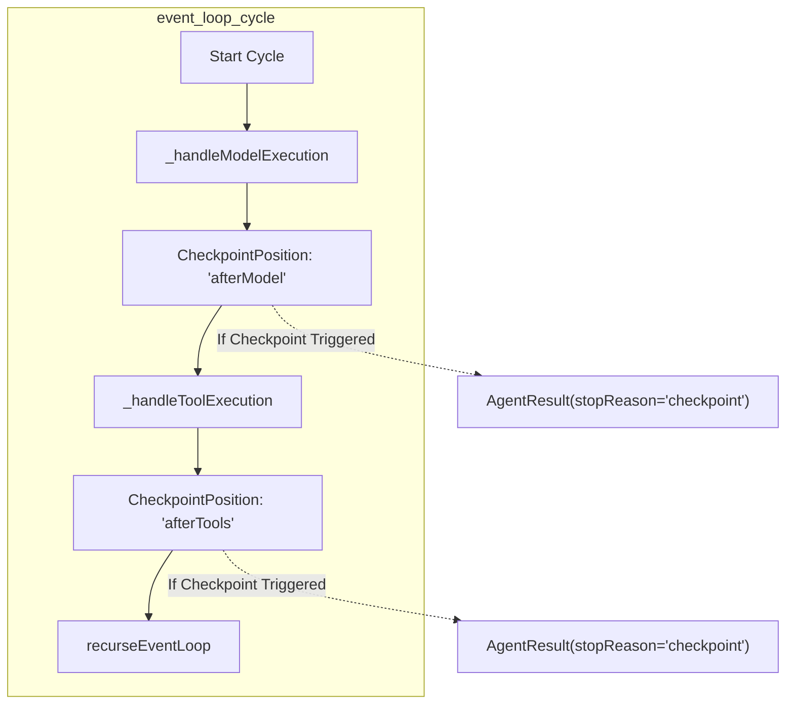
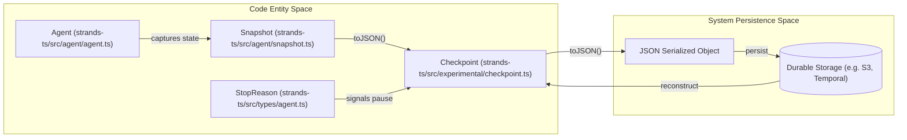

<!-- source: DeepWiki mcp.deepwiki.com · repo strands-agents/sdk-python · page 8.3 Checkpoint System · fetched 2026-10-27 -->

# Checkpoint System

Relevant source files

The following files were used as context for generating this wiki page:

- [site/src/content/docs/user-guide/concepts/agents/prompts.mdx](site/src/content/docs/user-guide/concepts/agents/prompts.mdx)
- [site/src/content/docs/user-guide/concepts/agents/retry-strategies.mdx](site/src/content/docs/user-guide/concepts/agents/retry-strategies.mdx)
- [site/src/content/docs/user-guide/concepts/agents/snapshots.mdx](site/src/content/docs/user-guide/concepts/agents/snapshots.mdx)
- [site/src/content/docs/user-guide/concepts/agents/state.mdx](site/src/content/docs/user-guide/concepts/agents/state.mdx)
- [site/src/content/docs/user-guide/concepts/agents/structured-output.mdx](site/src/content/docs/user-guide/concepts/agents/structured-output.mdx)
- [site/src/content/docs/user-guide/concepts/model-providers/google.mdx](site/src/content/docs/user-guide/concepts/model-providers/google.mdx)
- [site/src/content/docs/user-guide/concepts/multi-agent/agents-as-tools.mdx](site/src/content/docs/user-guide/concepts/multi-agent/agents-as-tools.mdx)
- [site/src/content/docs/user-guide/safety-security/trusted-message-history.mdx](site/src/content/docs/user-guide/safety-security/trusted-message-history.mdx)
- [strands-py/src/strands/event_loop/_retry.py](strands-py/src/strands/event_loop/_retry.py)
- [strands-py/tests/strands/agent/test_agent_retry.py](strands-py/tests/strands/agent/test_agent_retry.py)
- [strands-py/tests/strands/agent/test_retry.py](strands-py/tests/strands/agent/test_retry.py)
- [strands-ts/src/agent/__tests__/agent.checkpoint.test.ts](strands-ts/src/agent/__tests__/agent.checkpoint.test.ts)
- [strands-ts/src/errors.ts](strands-ts/src/errors.ts)
- [strands-ts/src/experimental/__tests__/checkpoint.test.ts](strands-ts/src/experimental/__tests__/checkpoint.test.ts)
- [strands-ts/src/experimental/checkpoint.ts](strands-ts/src/experimental/checkpoint.ts)
- [strands-ts/src/experimental/index.ts](strands-ts/src/experimental/index.ts)
- [strands-ts/src/multiagent/multiagent.ts](strands-ts/src/multiagent/multiagent.ts)
- [strands-ts/src/types/__tests__/agent.test.ts](strands-ts/src/types/__tests__/agent.test.ts)
- [strands-ts/test/integ/agent.checkpoint.test.node.ts](strands-ts/test/integ/agent.checkpoint.test.node.ts)

The Checkpoint system is an experimental feature designed for durable agent execution and crash-resilient workflows. It allows the SDK to capture the full state of an `Agent` at specific boundaries within the ReAct execution cycle, enabling external orchestrators (such as Temporal) to persist the state and resume execution after a failure or planned pause [strands-ts/src/experimental/checkpoint.ts:1-13]().

## Core Concepts

The system operates by producing a `Checkpoint` object, which is a JSON-serializable container for the agent's state at a specific point in time [strands-ts/src/experimental/checkpoint.ts:46-62]().

### Checkpoint Positions
The SDK defines two granular positions within every `event_loop_cycle` where a checkpoint can be established:

| Position | Description |
| :--- | :--- |
| `afterModel` | The model call has completed, and tool requests have been parsed, but tools have not yet been executed [strands-ts/src/experimental/checkpoint.ts:8-8](). |
| `afterTools` | All tool executions for the current cycle are complete, and the results are ready for the next model reasoning step [strands-ts/src/experimental/checkpoint.ts:9-9](). |

### Data Flow and Resume Pattern
The checkpoint system follows a pattern similar to the SDK's interrupt mechanism:
1. **Pause**: The agent stops execution and returns an `AgentResult` where the `stopReason` is set to `"checkpoint"` [strands-ts/src/experimental/checkpoint.ts:16-17](), [strands-ts/src/types/agent.js:41-41]().
2. **State**: The `AgentResult` contains a `checkpoint` field populated with a `Checkpoint` instance [strands-ts/src/experimental/checkpoint.ts:17-17]().
3. **Persistence**: The application serializes the `Checkpoint` via `toJSON()` and stores it in a durable store [strands-ts/src/experimental/checkpoint.ts:70-71]().
4. **Resume**: The application reconstructs the checkpoint via `fromJSON()` and passes it back to the `agent()` call using a `checkpointResume` content block [strands-ts/src/experimental/checkpoint.ts:18-19]().

**Sources:**
- [strands-ts/src/experimental/checkpoint.ts:1-32]()
- [strands-ts/src/experimental/checkpoint.ts:42-68]()
- [strands-ts/src/types/agent.js:39-61]()

## Implementation Details

### The Checkpoint Class
The `Checkpoint` class is a dataclass that ensures compatibility across different versions of the SDK using a schema version check [strands-ts/src/experimental/checkpoint.ts:46-69]().

| Attribute | Type | Role |
| :--- | :--- | :--- |
| `position` | `CheckpointPosition` | Identifies if the pause happened `afterModel` or `afterTools` [strands-ts/src/experimental/checkpoint.ts:64-64](). |
| `cycleIndex` | `number` | The 0-based index of the current ReAct loop cycle [strands-ts/src/experimental/checkpoint.ts:65-65](). |
| `snapshot` | `Record<string, any>` | The serialized agent state (messages, state, etc.) produced by `Snapshot.toJSON()` [strands-ts/src/experimental/checkpoint.ts:52-55](). |
| `appData` | `Record<string, any>` | Opaque dictionary for application-level state (e.g., workflow IDs) that the SDK ignores [strands-ts/src/experimental/checkpoint.ts:56-60](). |
| `schemaVersion` | `string` | Internal versioning (currently "1.0") to prevent resuming from incompatible data [strands-ts/src/experimental/checkpoint.ts:68-68](). |

**Sources:**
- [strands-ts/src/experimental/checkpoint.ts:40-69]()
- [strands-ts/src/experimental/index.ts:1-12]()

### Logical Execution Flow
The following diagram illustrates how the execution loop interacts with the checkpoint positions.

**Title: Checkpoint Boundaries in Agent Execution**

**Sources:**
- [strands-ts/src/experimental/checkpoint.ts:7-13]()
- [strands-ts/src/types/agent.js:39-61]()

## Resilience and Limitations

The system is designed for durability, but the experimental nature introduces specific behaviors that developers must manage:

*   **Metrics Management**: `Usage` and `Metrics` (latency, tokens) are not currently persisted within the `Checkpoint`. On resume, metrics are reset, and the caller is responsible for aggregating usage across multiple durable runs [strands-ts/src/experimental/checkpoint.ts:20-22](), [strands-ts/src/types/agent.js:8-38]().
*   **Hook Lifecycle**: `BeforeInvocationEvent` and `AfterInvocationEvent` fire on every resume call. Hooks that count invocations will treat a resumed agent as a new invocation [strands-ts/src/experimental/checkpoint.ts:27-29]().
*   **Model Compatibility**: Stateful models (like those using `OpenAIResponsesModel` with `stateful=True`) are not supported because server-side session IDs are not captured in the `Snapshot` [strands-ts/src/experimental/checkpoint.ts:23-24]().
*   **Tool Granularity**: While the SDK checkpoints at cycle boundaries, per-tool granularity (checkpointing between individual tools in a single turn) requires a custom `ToolExecutor` implementation [strands-ts/src/experimental/checkpoint.ts:11-13]().
*   **Snapshot Validation**: Resuming from a checkpoint involves `Snapshot.fromJSON()`, which validates the `SNAPSHOT_SCHEMA_VERSION`. Mismatches will raise a `SnapshotError` [strands-ts/src/errors.ts:157-172]().

### Mapping Code Entities to System Space
This diagram maps the internal data structures used during the checkpoint/resume process.

**Title: Entity Mapping for Checkpoint Persistence**

**Sources:**
- [strands-ts/src/experimental/checkpoint.ts:46-62]()
- [strands-ts/src/experimental/checkpoint.ts:70-75]()
- [strands-ts/src/types/agent.js:39-61]()
- [site/src/content/docs/user-guide/concepts/agents/snapshots.mdx:1-7]()

---

