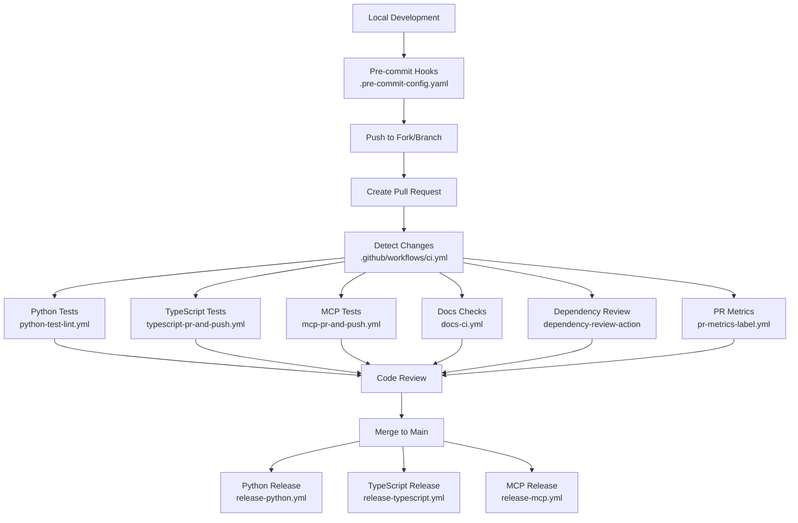
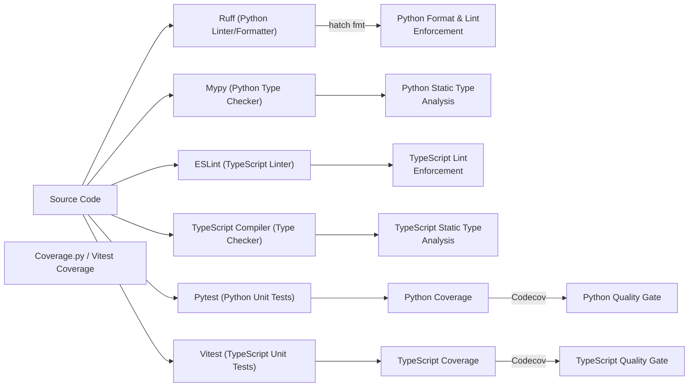
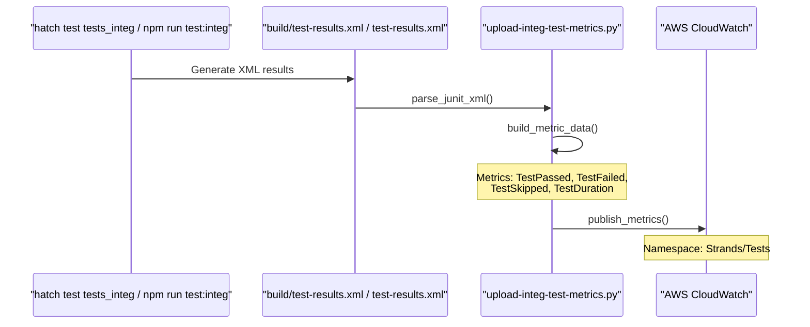

<!-- source: DeepWiki mcp.deepwiki.com · repo strands-agents/sdk-python · page 9 Development and Contributing · fetched 2026-10-27 -->

# Development and Contributing

Relevant source files

The following files were used as context for generating this wiki page:

- [.github/workflows/ci.yml](.github/workflows/ci.yml)
- [.github/workflows/mcp-pr-and-push.yml](.github/workflows/mcp-pr-and-push.yml)
- [.github/workflows/mcp-security-audit.yml](.github/workflows/mcp-security-audit.yml)
- [.github/workflows/mcp-test-lint.yml](.github/workflows/mcp-test-lint.yml)
- [.github/workflows/mcp-test-package-build.yml](.github/workflows/mcp-test-package-build.yml)
- [.github/workflows/pr-metrics-analyze.yml](.github/workflows/pr-metrics-analyze.yml)
- [.github/workflows/pr-metrics-label.yml](.github/workflows/pr-metrics-label.yml)
- [.github/workflows/pr-title.yml](.github/workflows/pr-title.yml)
- [.github/workflows/python-check-markdown-links.yml](.github/workflows/python-check-markdown-links.yml)
- [.github/workflows/python-integration-test.yml](.github/workflows/python-integration-test.yml)
- [.github/workflows/python-pr-and-push.yml](.github/workflows/python-pr-and-push.yml)
- [.github/workflows/python-publish-lambda-layer.yml](.github/workflows/python-publish-lambda-layer.yml)
- [.github/workflows/python-security-audit.yml](.github/workflows/python-security-audit.yml)
- [.github/workflows/python-test-lint.yml](.github/workflows/python-test-lint.yml)
- [.github/workflows/python-test-package-build.yml](.github/workflows/python-test-package-build.yml)
- [.github/workflows/release-mcp.yml](.github/workflows/release-mcp.yml)
- [.github/workflows/release-python.yml](.github/workflows/release-python.yml)
- [.github/workflows/release-typescript.yml](.github/workflows/release-typescript.yml)
- [.github/workflows/typescript-integration-test.yml](.github/workflows/typescript-integration-test.yml)
- [strands-mcp/.gitignore](strands-mcp/.gitignore)
- [strands-mcp/.pre-commit-config.yaml](strands-mcp/.pre-commit-config.yaml)
- [strands-mcp/pyproject.toml](strands-mcp/pyproject.toml)
- [strands-mcp/tests/test_dependencies.py](strands-mcp/tests/test_dependencies.py)
- [team/DECISIONS.md](team/DECISIONS.md)

This document provides a high-level overview of the development workflow, tooling, and contribution process for the Strands Agents SDK. It covers the development environment setup, testing infrastructure, CI/CD pipeline, and team governance.

For detailed information on:
- Development environment configuration and local setup, see [Development Environment Setup](#9.1)
- Testing strategies, test matrices, and coverage requirements, see [Testing Infrastructure](#9.2)
- CI/CD workflows, quality gates, and release process, see [CI/CD Pipeline](#9.3)
- Team development tenets, API bar-raising, and design processes, see [Team Governance and Design Process](#9.4)

## Overview

The Strands Agents SDK employs a defense-in-depth approach to code quality, with multiple layers of automated checks from local development through production release. The development pipeline is built on modern Python and TypeScript tooling and GitHub Actions, ensuring consistent quality across all contributions.

**Core Technologies:**
- **Build System**: `hatchling` as the build backend for Python and `npm` workspaces for TypeScript.
- **Version Control**: Git with semantic versioning via `commitizen` for Python and `cz-conventional-commits` for TypeScript.
- **Quality Tools**: `ruff` (Python linting/formatting), `mypy` (Python type checking), `pytest` (Python testing), `ESLint` (TypeScript linting), `TypeScript` compiler (TypeScript type checking), `Vitest` (TypeScript testing).
- **CI/CD**: GitHub Actions with multi-platform testing and automated release.
- **Python Support**: 3.10 through 3.14 [strands-mcp/pyproject.toml:18-22]().

Sources: [strands-mcp/pyproject.toml:18-22]()

## Development Workflow

The development workflow follows a standard Git-based contribution model with automated quality gates at each stage.

**Natural Language to Code Entity: Workflow Mapping**

**Development Workflow Stages**

| Stage | Tools | Purpose | Enforcement |
|-------|-------|---------|-------------|
| Local Development | `hatch`, `npm`, `pre-commit` | Format, lint, test before commit | Optional (recommended) |
| Pull Request | GitHub Actions | Multi-platform testing, linting, type checking, security audit | Required |
| API Check | `griffe` (Python) | Detect breaking API changes | Required [ .github/workflows/python-pr-and-push.yml:34-39]() |
| Integration Tests | `hatch test tests_integ`, `npm run test:integ` | Validate against real AWS services | Required for trusted contributors [ .github/workflows/python-integration-test.yml:137]() [ .github/workflows/typescript-integration-test.yml:148]() |
| Code Review | GitHub | Manual review | Required |
| Release | `hatch`, `npm`, PyPI/npm Trusted Publisher | Semantic versioning, distribution | Automated [ .github/workflows/release-python.yml:1-11]() [ .github/workflows/release-typescript.yml:1-11]() [ .github/workflows/release-mcp.yml:1-11]() |

Sources: [ .github/workflows/python-pr-and-push.yml:34-39](), [ .github/workflows/python-integration-test.yml:137](), [ .github/workflows/typescript-integration-test.yml:148](), [ .github/workflows/release-python.yml:1-11](), [ .github/workflows/release-typescript.yml:1-11](), [ .github/workflows/release-mcp.yml:1-11]()

## Quality Gates and Standards

### Code Quality Standards

The project enforces strict code quality standards through automated tooling configured in `pyproject.toml` and `package.json`.

**Code Quality Flow**

**Key Standards:**
- **Conventional Commits**: All PR titles must follow the Conventional Commits specification, enforced by the `amannn/action-semantic-pull-request` action [ .github/workflows/pr-title.yml:15-35]().
- **API Design**: Decisions are guided by tenets such as "Hooks as Low-Level Primitives, Not High-Level Abstractions", "Prefer Flat Namespaces Over Nested Modules", and "Provide Both Low-Level and High-Level APIs" [team/DECISIONS.md:5-137]().
- **Breaking Changes**: "Pay for Play: Opt-In Breaking Changes Are Acceptable" allows for minor breaking changes if they only affect users who explicitly adopt new functionality [team/DECISIONS.md:104-122]().

Sources: [ .github/workflows/pr-title.yml:15-35](), [team/DECISIONS.md:5-137](), [team/DECISIONS.md:104-122]()

## Pre-commit Hooks

Pre-commit hooks run automatically before each commit to enforce quality standards locally. For details, see [Development Environment Setup](#9.1).

## CI/CD Architecture

The CI/CD pipeline consists of multiple GitHub Actions workflows that enforce quality gates and automate releases.

**Workflow Summary:**

| Workflow | Trigger | Purpose | Permissions |
|----------|---------|---------|-------------|
| `ci.yml` | `pull_request`, `workflow_dispatch` | Detects changes and orchestrates Python, TypeScript, MCP, and Docs checks [ .github/workflows/ci.yml:1-149]() | `contents: read`, `pull-requests: read` |
| `python-test-lint.yml` | `workflow_call` | Runs Python unit tests across Python versions and OS, and linting [ .github/workflows/python-test-lint.yml:1-184]() | `contents: read` |
| `python-integration-test.yml` | `pull_request_target`, `merge_group`, `workflow_call` | Runs Python integration tests with AWS OIDC role [ .github/workflows/python-integration-test.yml:1-187]() | `id-token: write`, `pull-requests: read`, `contents: read` |
| `typescript-integration-test.yml` | `pull_request_target`, `merge_group`, `workflow_call` | Runs TypeScript integration tests with AWS OIDC role [ .github/workflows/typescript-integration-test.yml:1-173]() | `id-token: write`, `pull-requests: read`, `contents: read` |
| `release-python.yml` | `workflow_dispatch` | Manual release workflow for Python SDK to PyPI [ .github/workflows/release-python.yml:1-178]() | `id-token: write`, `contents: write` |
| `release-typescript.yml` | `workflow_dispatch` | Manual release workflow for TypeScript SDK to npm [ .github/workflows/release-typescript.yml:1-184]() | `id-token: write`, `contents: write` |
| `release-mcp.yml` | `workflow_dispatch` | Manual release workflow for MCP server to PyPI [ .github/workflows/release-mcp.yml:1-160]() | `id-token: write`, `contents: write` |

For more details, see [CI/CD Pipeline](#9.3).

Sources: [ .github/workflows/ci.yml:1-149](), [ .github/workflows/python-test-lint.yml:1-184](), [ .github/workflows/python-integration-test.yml:1-187](), [ .github/workflows/typescript-integration-test.yml:1-173](), [ .github/workflows/release-python.yml:1-178](), [ .github/workflows/release-typescript.yml:1-184](), [ .github/workflows/release-mcp.yml:1-160]()

## Test Infrastructure

### Test Matrix and Metrics

The project runs tests across a comprehensive matrix of Python versions (3.10 - 3.14) and operating systems (Ubuntu, Windows, macOS) for the Python SDK [ .github/workflows/python-test-lint.yml:18-57](). Similar matrices exist for TypeScript.

**Integration Test Metrics Flow**

Integration tests publish metrics to AWS CloudWatch for monitoring performance and reliability trends [ .github/workflows/python-integration-test.yml:147-187]().

For more details, see [Testing Infrastructure](#9.2).

Sources: [ .github/workflows/python-test-lint.yml:18-57](), [ .github/workflows/python-integration-test.yml:147-187]()

## Security and Authorization

### Pull Request Security Model

The project uses a secure model for handling external contributions, particularly for integration tests that require AWS access.

- **Authorization Check**: The `authorization-check` job in integration test workflows verifies if the PR author has `maintain`, `triage`, `write`, or `admin` roles before allowing access to sensitive environments [ .github/workflows/python-integration-test.yml:62-93](), [ .github/workflows/typescript-integration-test.yml:70-100]().
- **OIDC Authentication**: AWS credentials are assumed via OIDC roles (`role-to-assume`), eliminating the need for long-lived secrets [ .github/workflows/python-integration-test.yml:110-115](), [ .github/workflows/typescript-integration-test.yml:115-120]().

Sources: [ .github/workflows/python-integration-test.yml:62-93](), [ .github/workflows/typescript-integration-test.yml:70-100](), [ .github/workflows/python-integration-test.yml:110-115](), [ .github/workflows/typescript-integration-test.yml:115-120]()

## Contributing Guidelines

To contribute to the Strands Agents SDK, please refer to the detailed child pages:
- [Development Environment Setup](#9.1) for local configuration.
- [Testing Infrastructure](#9.2) for testing guidelines.
- [CI/CD Pipeline](#9.3) for workflow details.
- [Team Governance and Design Process](#9.4) for development tenets and design processes.

---

