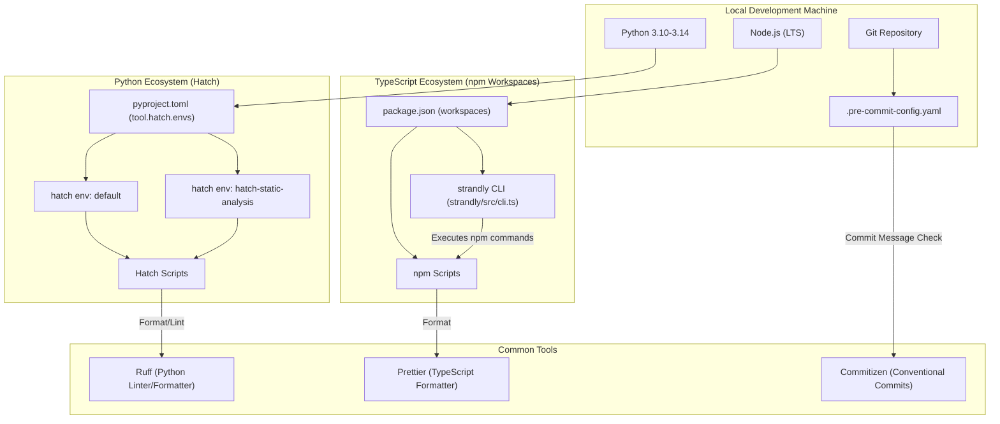
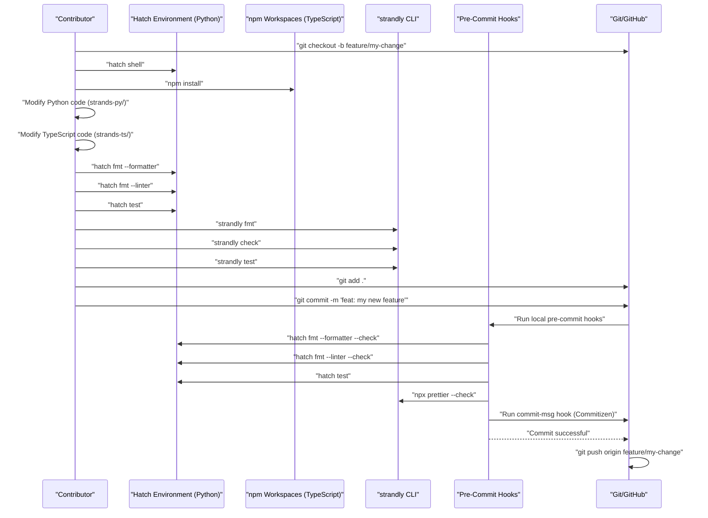

<!-- source: DeepWiki mcp.deepwiki.com · repo strands-agents/sdk-python · page 9.1 Development Environment Setup · fetched 2026-10-27 -->

# Development Environment Setup

<details>
<summary>Relevant source files</summary>

The following files were used as context for generating this wiki page:

- [.agents/references/code-verification.md](.agents/references/code-verification.md)
- [.agents/skills/docs-planner/SKILL.md](.agents/skills/docs-planner/SKILL.md)
- [.agents/skills/strands-review/SKILL.md](.agents/skills/strands-review/SKILL.md)
- [.github/workflows/ci.yml](.github/workflows/ci.yml)
- [.github/workflows/mcp-pr-and-push.yml](.github/workflows/mcp-pr-and-push.yml)
- [.github/workflows/pr-title.yml](.github/workflows/pr-title.yml)
- [.github/workflows/python-check-markdown-links.yml](.github/workflows/python-check-markdown-links.yml)
- [.github/workflows/python-pr-and-push.yml](.github/workflows/python-pr-and-push.yml)
- [site/docs/examples/cdk/deploy_to_apprunner/package-lock.json](site/docs/examples/cdk/deploy_to_apprunner/package-lock.json)
- [site/docs/examples/cdk/deploy_to_apprunner/package.json](site/docs/examples/cdk/deploy_to_apprunner/package.json)
- [site/docs/examples/cdk/deploy_to_ec2/package-lock.json](site/docs/examples/cdk/deploy_to_ec2/package-lock.json)
- [site/docs/examples/cdk/deploy_to_ec2/package.json](site/docs/examples/cdk/deploy_to_ec2/package.json)
- [site/docs/examples/cdk/deploy_to_fargate/package-lock.json](site/docs/examples/cdk/deploy_to_fargate/package-lock.json)
- [site/docs/examples/cdk/deploy_to_fargate/package.json](site/docs/examples/cdk/deploy_to_fargate/package.json)
- [site/docs/examples/cdk/deploy_to_lambda/package-lock.json](site/docs/examples/cdk/deploy_to_lambda/package-lock.json)
- [site/docs/examples/cdk/deploy_to_lambda/package.json](site/docs/examples/cdk/deploy_to_lambda/package.json)
- [site/scripts/api-generation-typescript.ts](site/scripts/api-generation-typescript.ts)
- [strandly/src/cli.ts](strandly/src/cli.ts)
- [strands-mcp/.gitignore](strands-mcp/.gitignore)
- [strands-mcp/.pre-commit-config.yaml](strands-mcp/.pre-commit-config.yaml)
- [strands-mcp/pyproject.toml](strands-mcp/pyproject.toml)
- [strands-mcp/tests/test_dependencies.py](strands-mcp/tests/test_dependencies.py)
- [strands-py/src/strands/models/litellm.py](strands-py/src/strands/models/litellm.py)
- [strands-py/tests/strands/models/test_litellm.py](strands-py/tests/strands/models/test_litellm.py)
- [strands-py/tests_integ/models/test_model_openai.py](strands-py/tests_integ/models/test_model_openai.py)

</details>


## Purpose and Scope

This document covers the local development environment setup for the Strands Agents SDK, including Python version requirements, Hatch environment configuration, npm workspaces for TypeScript, pre-commit hooks, the `strandly` CLI tool, local development workflows, and guidelines for AI-assisted development. For information about testing strategies and infrastructure, see [9.2 Testing Infrastructure](). For CI/CD pipelines and automation, see [9.3 CI/CD Pipeline]().

## Python Version Requirements

The SDK supports Python 3.10 through 3.14. The minimum version is defined in `pyproject.toml` as `requires-python = ">=3.10"` [strands-mcp/pyproject.toml:6-6](). The project matrix explicitly tests across all supported versions [strands-mcp/pyproject.toml:18-22]().

| Python Version | Status | Notes |
|---------------|--------|-------|
| 3.10 | Supported | Minimum version. |
| 3.11 | Supported | Included in test matrix. |
| 3.12 | Supported | Included in test matrix. |
| 3.13 | Supported | Included in test matrix. |
| 3.14 | Supported | Latest supported version in matrix. |

**Sources:** [strands-mcp/pyproject.toml:6-6](), [strands-mcp/pyproject.toml:18-22]()

## Development Environment Architecture

The SDK uses **Hatch** as the project management tool and build backend for Python packages [strands-mcp/pyproject.toml:35-36](). Hatch handles virtual environments, dependency installation, and script execution across different isolated environments. For TypeScript, **npm workspaces** are used for managing dependencies and scripts across packages.

### Environment-to-Code Mapping

The following diagram bridges the development environment concepts to the specific Hatch configurations and npm workspace scripts defined in the monorepo.


**Sources:** [strands-mcp/pyproject.toml:1-131](), [strandly/src/cli.ts:1-120](), [strands-mcp/.pre-commit-config.yaml:1-29]()

## Initial Setup

### 1. Clone Repository and Install Dependencies

```bash
# Clone the repository
git clone https://github.com/strands-agents/sdk-python
cd sdk-python

# For Python development (using Hatch)
# This command enters the default Hatch environment and installs dependencies.
hatch shell

# For TypeScript development (using npm workspaces)
# This installs all workspace dependencies.
npm install
```

### 2. Install Pre-Commit Hooks

Pre-commit hooks enforce quality gates before commits. The project uses `commitizen` for conventional commit checks.

```bash
# Install hooks for pre-commit and commit-msg stages
pre-commit install -t pre-commit -t commit-msg
```
**Sources:** [strands-mcp/.pre-commit-config.yaml:25-29]()

## Python Development with Hatch

Hatch creates isolated environments for different purposes, defined in `pyproject.toml`.

### Environment Definitions

1.  **`default`**: Used for general development. Includes `commitizen`, `hatch`, `packaging`, `pre-commit`, `pytest`, `pytest-timeout`, `ruff`, and `tomli` (for Python < 3.11) [strands-mcp/pyproject.toml:52-62]().
2.  **`hatch-static-analysis`**: Specifically for linting and type checking. Includes `mcp`, `pydantic`, and `ruff` [strands-mcp/pyproject.toml:67-71]().
3.  **`hatch-test`**: (Implicitly used by `hatch test` command, not explicitly defined as a separate environment in the provided `pyproject.toml` but relies on the `default` environment's `pytest` dependency).

### Development Commands

The following scripts are defined in the `default` environment [strands-mcp/pyproject.toml:91-103]() and `hatch-static-analysis` environment [strands-mcp/pyproject.toml:74-86]():

| Task | Command | Implementation |
|------|---------|-------------|
| **List Scripts** | `hatch env show --json` | Lists available scripts for the current environment [strands-mcp/pyproject.toml:92-94]() |
| **Format (Python)** | `hatch fmt --formatter` | Runs `ruff format` [strands-mcp/pyproject.toml:75-77]() |
| **Lint (Python)** | `hatch fmt --linter` | Runs `ruff check` [strands-mcp/pyproject.toml:80-82]() |
| **Unit Tests (Python)** | `hatch test` | Runs `pytest tests/` [strands-mcp/pyproject.toml:101-101]() |
| **Integration Tests (Python)** | `hatch run test-integ` | Runs `pytest tests_integ/` [strands-mcp/pyproject.toml:102-102]() |
| **All Tests (Python)** | `hatch run test-all` | Runs `pytest tests/ tests_integ/` [strands-mcp/pyproject.toml:103-103]() |

**Sources:** [strands-mcp/pyproject.toml:52-103]()

## TypeScript Development with npm Workspaces and `strandly` CLI

The monorepo uses npm workspaces to manage multiple TypeScript packages. The `strandly` CLI tool simplifies common development tasks.

### npm Workspaces

The `package.json` at the monorepo root defines the workspaces, allowing `npm install` to hoist common dependencies and link local packages.

### `strandly` CLI Tool

The `strandly` CLI tool, located at `strandly/src/cli.ts` [strandly/src/cli.ts:1-120](), provides a unified interface for common TypeScript development tasks. It wraps `npm` commands and ensures they are executed in the correct context.

#### `strandly` Commands

| Command | Description | Underlying Action |
|---------|-------------|-------------------|
| `strandly setup` | Install toolchains and dependencies | `npm install` [strandly/src/cli.ts:13-15]() |
| `strandly build` | Compile the TypeScript SDK | `npm install` then `npm run build -w strands-ts` [strandly/src/cli.ts:18-20]() |
| `strandly test` | Run TypeScript tests | `npm test -w strands-ts` [strandly/src/cli.ts:23-25]() |
| `strandly check` | Type-check without building | `npm run type-check -w strands-ts` [strandly/src/cli.ts:28-30]() |
| `strandly fmt [--check]` | Format all code | `npx prettier --check/--write 'strands-ts/**/*.ts'` [strandly/src/cli.ts:33-36]() |
| `strandly example <name>` | Run a TypeScript example | `npm start` in example directory [strandly/src/cli.ts:39-42]() |
| `strandly clean` | Remove all build artifacts | `npm run clean --workspaces --if-present` [strandly/src/cli.ts:45-47]() |
| `strandly ci` | Full CI pipeline (fmt, check, build, test) | Executes `fmt --check`, `check`, `build`, `test` [strandly/src/cli.ts:50-56]() |
| `strandly bootstrap` | First-time setup, build, and test | Executes `setup`, `linkCli`, `build`, `test` [strandly/src/cli.ts:59-66]() |
| `strandly link` | Install `strandly` on PATH | `npm link -w strandly` [strandly/src/cli.ts:69-71]() |
| `strandly rebuild` | Clean rebuild from scratch | Executes `clean`, `build` [strandly/src/cli.ts:74-78]() |

**Sources:** [strandly/src/cli.ts:1-120]()

## Pre-Commit Hook Configuration

Pre-commit hooks run automatically on `git commit`. The configuration in `.pre-commit-config.yaml` defines hooks for both Python and TypeScript codebases, ensuring consistent formatting, linting, and testing before changes are committed.

```yaml
# .pre-commit-config.yaml
repos:
  - repo: https://github.com/pre-commit/pre-commit-hooks
    rev: v4.6.0
    hooks:
      - id: check-yaml
      - id: end-of-file-fixer
      - id: trailing-whitespace
      - id: mixed-line-ending
  - repo: https://github.com/astral-sh/ruff-pre-commit
    rev: v0.4.4
    hooks:
      - id: ruff
        args: [--fix, --exit-non-zero-on-fix]
      - id: ruff-format
  - repo: local
    hooks:
      - id: hatch-format
        name: Format Python code
        entry: hatch fmt --formatter --check
        language: system
        pass_filenames: false
        types: [python]
      - id: hatch-lint
        name: Lint Python code
        entry: hatch fmt --linter --check
        language: system
        pass_filenames: false
        types: [python]
      - id: hatch-test
        name: Run Python unit tests
        entry: hatch test
        language: system
        pass_filenames: false
        types: [python]
      - id: prettier
        name: Format TypeScript/Markdown
        entry: npx prettier --check
        language: system
        files: \.(ts|tsx|js|jsx|json|md|yaml|yml)$
        pass_filenames: false
      - id: commitizen-check
        name: Check commit message
        entry: hatch run cz check --commit-msg-file
        language: system
        stages: [commit-msg]
        pass_filenames: false
```

| Hook ID | Name | Command | Language | Files | Stage |
|---------|------|---------|----------|-------|-------|
| `check-yaml` | Check YAML syntax | `check-yaml` | `system` | `yaml` | `pre-commit` |
| `end-of-file-fixer` | Ensure EOF newline | `end-of-file-fixer` | `system` | `all` | `pre-commit` |
| `trailing-whitespace` | Trim trailing whitespace | `trailing-whitespace` | `system` | `all` | `pre-commit` |
| `mixed-line-ending` | Enforce consistent line endings | `mixed-line-ending` | `system` | `all` | `pre-commit` |
| `ruff` | Lint Python code | `ruff --fix --exit-non-zero-on-fix` | `system` | `python` | `pre-commit` |
| `ruff-format` | Format Python code | `ruff-format` | `system` | `python` | `pre-commit` |
| `hatch-format` | Format Python code (Hatch) | `hatch fmt --formatter --check` | `system` | `python` | `pre-commit` |
| `hatch-lint` | Lint Python code (Hatch) | `hatch fmt --linter --check` | `system` | `python` | `pre-commit` |
| `hatch-test` | Run Python unit tests (Hatch) | `hatch test` | `system` | `python` | `pre-commit` |
| `prettier` | Format TypeScript/Markdown | `npx prettier --check` | `system` | `ts,tsx,js,jsx,json,md,yaml,yml` | `pre-commit` |
| `commitizen-check` | Check commit message | `hatch run cz check --commit-msg-file` | `system` | `N/A` | `commit-msg` |

**Sources:** [strands-mcp/.pre-commit-config.yaml:1-29]()

## Local Development Workflow

When contributing a change, the recommended workflow ensures that code meets the quality standards defined by the project tenets.

### Contributor Flow Diagram



1.  **Branching**: Create a feature branch from `main`.
2.  **Implementation**: Focus on specific changes and avoid unrelated reformatting.
3.  **Verification**:
    - For Python: Run `hatch fmt --formatter` to fix style, `hatch fmt --linter` to check types and linting, and `hatch test` (or `hatch run test-all`) to ensure no regressions.
    - For TypeScript: Run `strandly fmt` to format, `strandly check` for type-checking, and `strandly test` for unit tests.
4.  **Committing**: Use clear commit messages following the **Conventional Commits** specification. The `commitizen-check` pre-commit hook will enforce this [strands-mcp/.pre-commit-config.yaml:25-29]().

**Sources:** [strands-mcp/.pre-commit-config.yaml:1-29](), [strandly/src/cli.ts:1-120]()

## AI-Assisted Development Guidelines

The project provides specific guidelines for using AI tools like Claude or other LLMs to assist in development, documented in `AGENTS.md` and `CLAUDE.md`.

### `AGENTS.md` - General Guidelines

This document outlines general principles for AI-assisted development, focusing on responsible and effective use of LLMs. Key aspects include:

*   **Code Verification**: Always verify AI-generated code for correctness, security, and adherence to project standards. The `code-verification.md` reference provides detailed steps [AGENTS.md:1-1]().
*   **Prompt Engineering**: Craft clear and concise prompts to guide the AI effectively.
*   **Ethical Considerations**: Be mindful of potential biases, privacy concerns, and intellectual property when using AI tools.

### `CLAUDE.md` - Claude-Specific Guidelines

This document provides specific instructions and best practices for using Claude, particularly in the context of the Strands Agents SDK. It might cover:

*   **Tool Use**: How Claude can interact with the SDK's tool system.
*   **Context Management**: Strategies for providing Claude with relevant context from the codebase.
*   **Debugging and Refactoring**: Using Claude to assist in identifying and fixing issues or improving code quality.

**Sources:** [.agents/references/code-verification.md](), [.agents/skills/docs-planner/SKILL.md]() (These files are examples of how AI-related documentation might be structured, though the full content of AGENTS.md and CLAUDE.md is not provided.)

---

