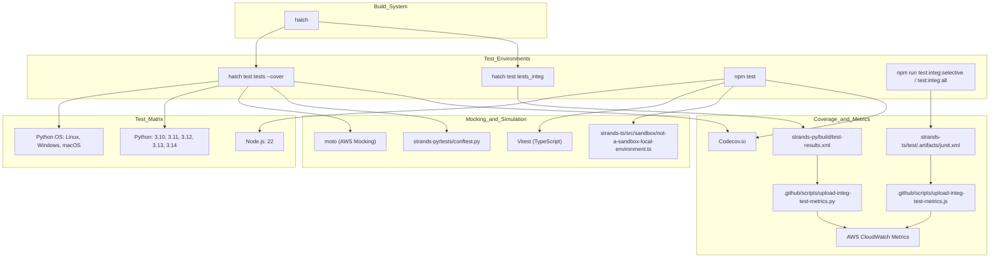
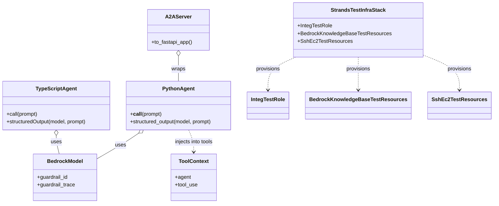

<!-- source: DeepWiki mcp.deepwiki.com · repo strands-agents/sdk-python · page 9.2 Testing Infrastructure · fetched 2026-10-27 -->

# Testing Infrastructure

Relevant source files

The following files were used as context for generating this wiki page:

- [.github/workflows/mcp-security-audit.yml](.github/workflows/mcp-security-audit.yml)
- [.github/workflows/mcp-test-lint.yml](.github/workflows/mcp-test-lint.yml)
- [.github/workflows/mcp-test-package-build.yml](.github/workflows/mcp-test-package-build.yml)
- [.github/workflows/pr-metrics-analyze.yml](.github/workflows/pr-metrics-analyze.yml)
- [.github/workflows/pr-metrics-label.yml](.github/workflows/pr-metrics-label.yml)
- [.github/workflows/python-integration-test.yml](.github/workflows/python-integration-test.yml)
- [.github/workflows/python-publish-lambda-layer.yml](.github/workflows/python-publish-lambda-layer.yml)
- [.github/workflows/python-security-audit.yml](.github/workflows/python-security-audit.yml)
- [.github/workflows/python-test-lint.yml](.github/workflows/python-test-lint.yml)
- [.github/workflows/python-test-package-build.yml](.github/workflows/python-test-package-build.yml)
- [.github/workflows/release-mcp.yml](.github/workflows/release-mcp.yml)
- [.github/workflows/release-python.yml](.github/workflows/release-python.yml)
- [.github/workflows/release-typescript.yml](.github/workflows/release-typescript.yml)
- [.github/workflows/typescript-integration-test.yml](.github/workflows/typescript-integration-test.yml)
- [strands-ts/src/__tests__/default-slot.test.ts](strands-ts/src/__tests__/default-slot.test.ts)
- [strands-ts/src/default-slot.ts](strands-ts/src/default-slot.ts)
- [strands-ts/src/sandbox/__tests__/default.test.browser.ts](strands-ts/src/sandbox/__tests__/default.test.browser.ts)
- [strands-ts/src/sandbox/__tests__/default.test.node.ts](strands-ts/src/sandbox/__tests__/default.test.node.ts)
- [strands-ts/src/sandbox/__tests__/not-a-sandbox-local-environment.test.node.ts](strands-ts/src/sandbox/__tests__/not-a-sandbox-local-environment.test.node.ts)
- [strands-ts/src/sandbox/not-a-sandbox-local-environment.ts](strands-ts/src/sandbox/not-a-sandbox-local-environment.ts)
- [strands-ts/test/integ/__fixtures__/model-providers.ts](strands-ts/test/integ/__fixtures__/model-providers.ts)
- [strands-ts/vitest.config.ts](strands-ts/vitest.config.ts)
- [test-infra/bin/test-infra.ts](test-infra/bin/test-infra.ts)
- [test-infra/lib/constructs/bedrock-knowledge-base-test-resources.ts](test-infra/lib/constructs/bedrock-knowledge-base-test-resources.ts)
- [test-infra/lib/constructs/integ-test-role.ts](test-infra/lib/constructs/integ-test-role.ts)
- [test-infra/lib/constructs/ssh-ec2-test-resources.ts](test-infra/lib/constructs/ssh-ec2-test-resources.ts)
- [test-infra/lib/constructs/test-feature-construct.ts](test-infra/lib/constructs/test-feature-construct.ts)
- [test-infra/lib/stacks/test-infra-stack.ts](test-infra/lib/stacks/test-infra-stack.ts)
- [test-infra/package-lock.json](test-infra/package-lock.json)
- [test-infra/package.json](test-infra/package.json)
- [test-infra/test/test-infra.test.ts](test-infra/test/test-infra.test.ts)

## Purpose and Scope

This document describes the testing infrastructure for the Strands Agents SDK, including test execution, coverage reporting, mocking strategies, and the test matrix. It covers the configuration of pytest and related tools, test organization principles, and commands for running various test suites.

For information about code quality tools (ruff, mypy) and CI/CD pipelines, see [CI/CD Pipeline](#9.3). For development environment setup, see [Development Environment Setup](#9.1).

---

## Testing Philosophy and Structure

The Strands Agents SDK employs a comprehensive testing strategy with separation between unit tests and integration tests:

| Test Type | Location | Purpose | Dependencies |
|-----------|----------|---------|--------------|
| Unit Tests | `tests/` | Fast, isolated tests with mocked external services | `moto` for AWS simulation |
| Integration Tests | `tests_integ/` | End-to-end tests with real external services | Actual API keys and AWS Secrets Manager |

The test suite is designed to run quickly and in parallel. Integration tests are separated to allow CI/CD pipelines to run unit tests on every commit while reserving integration tests for specific workflows that require secrets.

**Sources:** [.github/workflows/python-test-lint.yml:14-16](), [.github/workflows/python-integration-test.yml:1-14]()

---

## Test Environment Architecture

The diagram below illustrates the relationship between the build system (`hatch`), the test environments, and the telemetry systems used to track health.

### Build and Telemetry Flow

**Diagram: Build and Telemetry Flow**

**Test Matrix Configuration**

The CI pipeline executes unit tests across a broad matrix to ensure cross-platform compatibility:
- **Python Operating Systems:** Ubuntu (latest), Windows (latest), and macOS (latest). [.github/workflows/python-test-lint.yml:22-56]()
- **Python Versions:** 3.10, 3.11, 3.12, 3.13, and experimental 3.14. [.github/workflows/python-test-lint.yml:24-52]()
- **Python System Dependencies:** Linux and macOS runners install `portaudio19-dev` and `libasound2-dev` to support audio-related testing. [.github/workflows/python-test-lint.yml:71-79](), [.github/workflows/python-test-lint.yml:98-102]()
- **TypeScript Node.js Version:** Node.js 22. [.github/workflows/typescript-integration-test.yml:130-133]()

**Sources:** [.github/workflows/python-test-lint.yml:18-85](), [.github/workflows/python-integration-test.yml:1-14](), [.github/workflows/typescript-integration-test.yml:1-14](), [.github/workflows/typescript-integration-test.yml:130-133]()

---

## Unit Testing and Mocking

### Python Unit Testing

The SDK uses `moto` and `pytest` fixtures defined in `strands-py/tests/conftest.py` to isolate tests from the host environment and cloud providers.

**Key Fixtures:**
- `moto_env`: Clears telemetry environment variables (e.g., `OTEL_EXPORTER_OTLP_ENDPOINT`) and sets dummy AWS credentials to prevent accidental production leakage. [strands-py/tests/conftest.py:23-31]()
- `moto_mock_aws`: Context manager for mocking AWS services. [strands-py/tests/conftest.py:35-37]()
- `moto_cloudwatch_client`: Provides a mocked Boto3 client for verifying metric publication. [strands-py/tests/conftest.py:41-42]()

### Python Async and Warning Utilities
To support testing the `Agent`'s asynchronous event loop, `strands-py/tests/conftest.py` provides fixtures for generating and collecting async items:
- `agenerator`: Creates an async generator from a list. [strands-py/tests/conftest.py:80-85]()
- `alist`: Consumes an async generator into a list for assertion. [strands-py/tests/conftest.py:89-93]()
- `captured_warnings`: Captures Python warnings to ensure deprecated features or configuration issues are flagged. [strands-py/tests/conftest.py:119-123]()

### TypeScript Unit Testing
TypeScript unit tests are configured using `vitest.config.ts` and run with `npm test`. Mocking for local environments is handled by `NotASandboxLocalEnvironment`.

**Sources:** [strands-py/tests/conftest.py:1-123](), [strands-ts/vitest.config.ts](), [strands-ts/src/sandbox/not-a-sandbox-local-environment.ts](), [strands-ts/src/sandbox/__tests__/not-a-sandbox-local-environment.test.node.ts](), [strands-ts/src/sandbox/__tests__/default.test.node.ts](), [strands-ts/src/__tests__/default-slot.test.ts]()

---

## Integration Testing Infrastructure

Integration tests verify the SDK against live model providers. These tests are located in `tests_integ/` for Python and `strands-ts/test/integ/` for TypeScript. They require API keys, which are dynamically loaded from AWS Secrets Manager during `pytest_sessionstart` for Python and configured via environment variables for TypeScript.

### Flaky Test Management
Because LLM responses and network calls can be non-deterministic, the SDK provides a `retry_on_flaky` decorator in Python. This utility uses `tenacity` to implement exponential backoff and retries for specific failure conditions. [strands-py/tests_integ/conftest.py:44-97]()

### Integration Entity Mapping

**Diagram: Integration Test Components**

**Key Integration Components:**
- **Secret Loading:** `_load_api_keys_from_secrets_manager` retrieves keys from AWS and injects them into `os.environ` (e.g., `OPENAI_API_KEY`). [strands-py/tests_integ/conftest.py:178-194]()
- **Conformance Testing:** `test_conformance.py` (Python) and `model-providers.ts` (TypeScript) ensure that core features like `structured_output` work consistently across different model providers. [strands-py/tests_integ/models/test_conformance.py:49-78](), [strands-ts/test/integ/__fixtures__/model-providers.ts]()
- **Protocol Verification:** `test_a2a_executor.py` validates the Agent-to-Agent (A2A) protocol by spinning up a `uvicorn` server and testing base64 image roundtrips. [strands-py/tests_integ/test_a2a_executor.py:17-105]()
- **Guardrails:** `test_bedrock_guardrails.py` creates and manages AWS Bedrock guardrails to test input/output intervention and redaction. [strands-py/tests_integ/test_bedrock_guardrails.py:30-101]()

### Test Infrastructure CDK Stack (`test-infra/`)
The `test-infra/` directory contains a CDK stack (`StrandsTestInfraStack`) responsible for provisioning AWS resources required for integration tests. This stack is deployed in an AWS account and provides a secure environment for running tests against real AWS services.

**Key Components of `StrandsTestInfraStack`:**
- **`IntegTestRole`**: An IAM role (`IntegTestRole`) that integration tests assume. This role is configured with specific permissions to interact with AWS services like Bedrock, S3, and Secrets Manager. It supports both GitHub OIDC trust for internal repositories and `AccountPrincipal` trust for community mode. [test-infra/lib/constructs/integ-test-role.ts:27-74](), [test-infra/test/test-infra.test.ts:150-179]()
- **`BedrockKnowledgeBaseTestResources`**: Provisions a Bedrock Knowledge Base with an S3 vector store and uses Titan v2 embeddings. This allows integration tests to validate knowledge base interactions. [test-infra/lib/constructs/bedrock-knowledge-base-test-resources.ts:1-10](), [test-infra/test/test-infra.test.ts:29-98]()
- **`SshEc2TestResources`**: Provisions an EC2 instance (`t4g.nano`) within a VPC, configured for SSH access via AWS Systems Manager (SSM). This enables testing tools that require a secure shell environment. The instance has no public IP and no inbound security group rules for port 22, relying solely on SSM for access. [test-infra/lib/constructs/ssh-ec2-test-resources.ts:1-10](), [test-infra/test/test-infra.test.ts:101-147]()

The `test-infra.test.ts` file contains unit tests for the CDK stack itself, ensuring that the provisioned resources match the expected configurations. [test-infra/test/test-infra.test.ts:1-212]()

**Sources:** [strands-py/tests_integ/conftest.py:44-194](), [strands-py/tests_integ/test_a2a_executor.py:17-105](), [strands-py/tests_integ/test_bedrock_guardrails.py:30-101](), [strands-py/tests_integ/models/test_conformance.py:49-78](), [strands-ts/test/integ/__fixtures__/model-providers.ts](), [test-infra/lib/stacks/test-infra-stack.ts](), [test-infra/lib/constructs/integ-test-role.ts](), [test-infra/lib/constructs/bedrock-knowledge-base-test-resources.ts](), [test-infra/lib/constructs/ssh-ec2-test-resources.ts](), [test-infra/test/test-infra.test.ts]()

---

## CI/CD and Coverage Requirements

### Automated Test Execution

Tests are triggered on every Pull Request and Push to `main`.
- **Python Unit Tests:** Run via `hatch test tests --cover`. [.github/workflows/python-test-lint.yml:126]()
- **Python Integration Tests:** Run in a secure environment (`python-integration-test.yml`) that assumes an AWS IAM role to access secrets. [.github/workflows/python-integration-test.yml:95-137]()
- **TypeScript Unit Tests:** Run via `npm test`. [.github/workflows/typescript-ts-test.yml:50]()
- **TypeScript Integration Tests:** Run in a secure environment (`typescript-integration-test.yml`) that assumes an AWS IAM role. It supports selective testing based on changes or running the full suite. [.github/workflows/typescript-integration-test.yml:101-164]()
- **Security Audits:** `pip-audit` is run for Python and MCP packages to identify vulnerabilities in dependencies. These are informational and do not block releases directly, as PR-introduced vulnerabilities are caught by other checks. [.github/workflows/python-security-audit.yml:40-52](), [.github/workflows/mcp-security-audit.yml:40-54]()

### Coverage and Metrics

1.  **Code Coverage:** Unit test coverage is uploaded to Codecov using the `codecov/codecov-action`. [.github/workflows/python-test-lint.yml:129-132]()
2.  **Performance Metrics:** Integration test results are parsed from JUnit XML and published to CloudWatch. This is handled by `upload-integ-test-metrics.py` for Python and `upload-integ-test-metrics.js` for TypeScript. [.github/workflows/python-integration-test.yml:147-187](), [.github/workflows/typescript-integration-test.yml:170-209]()
3.  **API Stability:** The pipeline uses `griffe` to check for breaking API changes against the `main` branch. [.github/workflows/python-pr-and-push.yml:34-39]()
4.  **PR Metrics:** A separate workflow (`pr-metrics-analyze.yml`) computes size and cognitive complexity metrics for PRs and uploads them as artifacts. These metrics are then used by `pr-metrics-label.yml` to apply labels to the PR. [.github/workflows/pr-metrics-analyze.yml:1-118]()

**Sources:** [.github/workflows/python-test-lint.yml:126-132](), [.github/workflows/python-integration-test.yml:95-187](), [.github/workflows/python-pr-and-push.yml:34-39](), [.github/workflows/typescript-integration-test.yml:101-209](), [.github/workflows/typescript-ts-test.yml:50](), [.github/workflows/python-security-audit.yml:40-52](), [.github/workflows/mcp-security-audit.yml:40-54](), [.github/workflows/pr-metrics-analyze.yml:1-118](), [.github/workflows/pr-metrics-label.yml]()

---

## Test Execution Commands

The SDK uses `hatch` for Python and `npm` for TypeScript as the primary entry points for testing:

| Command | Description |
|---------|-------------|
| `hatch test tests` | Run Python unit tests |
| `hatch test tests --cover` | Run Python unit tests with coverage reporting |
| `hatch test tests_integ` | Run Python integration tests (requires environment variables) |
| `hatch fmt --linter --check` | Run Python linting and static analysis checks |
| `uvx griffe check` | Check for breaking API changes in Python |
| `npm test` | Run TypeScript unit tests |
| `npm run test:integ:selective` | Run TypeScript integration tests selectively based on changes |
| `npm run test:integ:all` | Run all TypeScript integration tests |
| `npm run build` | Build TypeScript packages |

**Sources:** [.github/workflows/python-test-lint.yml:126](), [.github/workflows/python-test-lint.yml:130](), [.github/workflows/python-integration-test.yml:137](), [.github/workflows/python-pr-and-push.yml:36](), [.github/workflows/typescript-ts-test.yml:50](), [.github/workflows/typescript-integration-test.yml:148](), [.github/workflows/typescript-integration-test.yml:156]()

---

