<!-- source: DeepWiki mcp.deepwiki.com · repo strands-agents/sdk-python · page 9.3 CI/CD Pipeline · fetched 2026-10-27 -->

# CI/CD Pipeline

<details>
<summary>Relevant source files</summary>

The following files were used as context for generating this wiki page:

- [.github/ISSUE_TEMPLATE/bug_report.yml](.github/ISSUE_TEMPLATE/bug_report.yml)
- [.github/ISSUE_TEMPLATE/config.yml](.github/ISSUE_TEMPLATE/config.yml)
- [.github/ISSUE_TEMPLATE/content_addition.yml](.github/ISSUE_TEMPLATE/content_addition.yml)
- [.github/ISSUE_TEMPLATE/documentation_improvement.yml](.github/ISSUE_TEMPLATE/documentation_improvement.yml)
- [.github/ISSUE_TEMPLATE/documentation_question.yml](.github/ISSUE_TEMPLATE/documentation_question.yml)
- [.github/ISSUE_TEMPLATE/feature_request.yml](.github/ISSUE_TEMPLATE/feature_request.yml)
- [.github/ISSUE_TEMPLATE/technical_correction.yml](.github/ISSUE_TEMPLATE/technical_correction.yml)
- [.github/PULL_REQUEST_TEMPLATE.md](.github/PULL_REQUEST_TEMPLATE.md)
- [.github/dependabot.yml](.github/dependabot.yml)
- [.github/labelers/area.yml](.github/labelers/area.yml)
- [.github/labelers/language.yml](.github/labelers/language.yml)
- [.github/labelers/type.yml](.github/labelers/type.yml)
- [.github/release.yml](.github/release.yml)
- [.github/scripts/pr-metrics/apply-labels.mjs](.github/scripts/pr-metrics/apply-labels.mjs)
- [.github/scripts/pr-metrics/classify.mjs](.github/scripts/pr-metrics/classify.mjs)
- [.github/scripts/pr-metrics/complexity-python.mjs](.github/scripts/pr-metrics/complexity-python.mjs)
- [.github/scripts/pr-metrics/complexity-typescript.mjs](.github/scripts/pr-metrics/complexity-typescript.mjs)
- [.github/scripts/pr-metrics/diff.mjs](.github/scripts/pr-metrics/diff.mjs)
- [.github/scripts/pr-metrics/pr-metrics.test.mjs](.github/scripts/pr-metrics/pr-metrics.test.mjs)
- [.github/scripts/pr-metrics/report.mjs](.github/scripts/pr-metrics/report.mjs)
- [.github/scripts/pr-metrics/run-analysis.mjs](.github/scripts/pr-metrics/run-analysis.mjs)
- [.github/scripts/pr-metrics/tools/package-lock.json](.github/scripts/pr-metrics/tools/package-lock.json)
- [.github/scripts/pr-metrics/tools/package.json](.github/scripts/pr-metrics/tools/package.json)
- [.github/workflows/CHANGELOG-SYNC.md](.github/workflows/CHANGELOG-SYNC.md)
- [.github/workflows/auto-close.yml](.github/workflows/auto-close.yml)
- [.github/workflows/auto-strands-review.yml](.github/workflows/auto-strands-review.yml)
- [.github/workflows/changelog-sync.yml](.github/workflows/changelog-sync.yml)
- [.github/workflows/docs-ci.yml](.github/workflows/docs-ci.yml)
- [.github/workflows/docs-deploy-github-pages.yml](.github/workflows/docs-deploy-github-pages.yml)
- [.github/workflows/docs-deploy-preview.yml](.github/workflows/docs-deploy-preview.yml)
- [.github/workflows/docs-strands-command.yml](.github/workflows/docs-strands-command.yml)
- [.github/workflows/issue-labeler.yml](.github/workflows/issue-labeler.yml)
- [.github/workflows/mcp-security-audit.yml](.github/workflows/mcp-security-audit.yml)
- [.github/workflows/mcp-test-lint.yml](.github/workflows/mcp-test-lint.yml)
- [.github/workflows/mcp-test-package-build.yml](.github/workflows/mcp-test-package-build.yml)
- [.github/workflows/pr-metrics-analyze.yml](.github/workflows/pr-metrics-analyze.yml)
- [.github/workflows/pr-metrics-label.yml](.github/workflows/pr-metrics-label.yml)
- [.github/workflows/python-integration-test.yml](.github/workflows/python-integration-test.yml)
- [.github/workflows/python-publish-lambda-layer.yml](.github/workflows/python-publish-lambda-layer.yml)
- [.github/workflows/python-security-audit.yml](.github/workflows/python-security-audit.yml)
- [.github/workflows/python-test-lint.yml](.github/workflows/python-test-lint.yml)
- [.github/workflows/python-test-package-build.yml](.github/workflows/python-test-package-build.yml)
- [.github/workflows/release-mcp.yml](.github/workflows/release-mcp.yml)
- [.github/workflows/release-python.yml](.github/workflows/release-python.yml)
- [.github/workflows/release-typescript.yml](.github/workflows/release-typescript.yml)
- [.github/workflows/strands-command.yml](.github/workflows/strands-command.yml)
- [.github/workflows/typescript-integration-test.yml](.github/workflows/typescript-integration-test.yml)
- [.github/workflows/typescript-pr-and-push.yml](.github/workflows/typescript-pr-and-push.yml)
- [.github/workflows/typescript-security-audit.yml](.github/workflows/typescript-security-audit.yml)
- [.github/workflows/typescript-test-package-pack.yml](.github/workflows/typescript-test-package-pack.yml)
- [.github/workflows/typescript-ts-check.yml](.github/workflows/typescript-ts-check.yml)
- [.github/workflows/typescript-ts-test.yml](.github/workflows/typescript-ts-test.yml)

</details>


## Purpose and Scope

This document describes the Continuous Integration and Continuous Deployment (CI/CD) infrastructure for the Strands Agents SDK. The CI/CD system provides automated quality gates, security controls, AI-driven code review, and release automation. It enforces code quality standards, runs comprehensive test suites across multiple Python versions and operating systems, and publishes releases to PyPI and AWS Lambda Layers.

For local development environment setup, see [9.1 Development Environment Setup](). For testing infrastructure details, see [9.2 Testing Infrastructure]().

## CI/CD Architecture

The CI/CD pipeline is implemented using GitHub Actions with several primary workflows that enforce quality standards, automate reviews, and manage releases. The system uses a defense-in-depth approach with multiple independent quality gates.

### System Workflow Diagram

```mermaid
graph TB
    subgraph "Trigger Events"
        PR["Pull Request"]
        Push["Push to main"]
        PRTarget["Pull Request Target"]
        Comment["Issue Comment"]
        Release["Release Published"]
        Dispatch["Workflow Dispatch"]
        MergeGroup["Merge Group"]
    end

    subgraph "Workflows"
        PythonPRPush["python-pr-and-push.yml"]
        TypeScriptPRPush["typescript-pr-and-push.yml"]
        MCPPRPush["mcp-pr-and-push.yml"]
        PythonIntegTest["python-integration-test.yml"]
        TypeScriptIntegTest["typescript-integration-test.yml"]
        AutoReview["auto-strands-review.yml"]
        StrandsCmd["strands-command.yml"]
        PythonRelease["release-python.yml"]
        TypeScriptRelease["release-typescript.yml"]
        MCPRelease["release-mcp.yml"]
        PythonLambdaPublish["python-publish-lambda-layer.yml"]
        PythonTestLint["python-test-lint.yml (reusable)"]
        TypeScriptTSTest["typescript-ts-test.yml (reusable)"]
        TypeScriptTSCheck["typescript-ts-check.yml (reusable)"]
        MCPTestLint["mcp-test-lint.yml (reusable)"]
        PythonSecurityAudit["python-security-audit.yml (reusable)"]
        TypeScriptSecurityAudit["typescript-security-audit.yml (reusable)"]
        MCPSecurityAudit["mcp-security-audit.yml (reusable)"]
        PRMetricsLabel["pr-metrics-label.yml"]
        PRMetricsAnalyze["pr-metrics-analyze.yml"]
        DocsDeployPreview["docs-deploy-preview.yml"]
        ChangelogSync["changelog-sync.yml"]
    end

    subgraph "Quality Gates"
        PythonUnitTest["Python Unit Tests"]
        PythonLint["Python Lint (Ruff + Mypy)"]
        PythonAPICheck["Python API Breaking Change Detection"]
        PythonIntegTests["Python Integration Tests (AWS)"]
        PythonSecurityAuditGate["Python Security Audit (pip-audit)"]
        TypeScriptUnitTest["TypeScript Unit Tests"]
        TypeScriptLint["TypeScript Lint (ESLint)"]
        TypeScriptTypeCheck["TypeScript Type Check (tsc)"]
        TypeScriptIntegTests["TypeScript Integration Tests (AWS)"]
        TypeScriptSecurityAuditGate["TypeScript Security Audit (npm audit)"]
        MCPUnitTest["MCP Unit Tests"]
        MCPLint["MCP Lint (Ruff + Mypy)"]
        MCPSecurityAuditGate["MCP Security Audit (pip-audit)"]
        Coverage["Codecov Upload"]
    end

    subgraph "AI Automation"
        AuthCheck["Authorization Check"]
        StrandsAgent["Strands Agent Execution"]
        WriteOps["Write Operations (finalize)"]
    end

    subgraph "Release Process"
        ScanCommits["Scan Commits & Validate Version"]
        BuildArtifacts["Build Package Artifacts"]
        InspectArtifacts["Inspect Artifacts"]
        GenerateNotes["Generate Release Notes"]
        ApprovalGate["Manual Approval"]
        TagRelease["Tag & Create GitHub Release"]
        PublishPyPI["Publish to PyPI"]
        PublishNPM["Publish to npm"]
        PublishLambdaLayer["Publish AWS Lambda Layer"]
    end

    subgraph "Monitoring & Metrics"
        IntegTestMetrics["Integration Test Metrics (CloudWatch)"]
        PRSizeComplexityLabels["PR Size/Complexity Labels"]
        TestArtifacts["Test Artifacts"]
        DocsPreview["Docs Deploy Preview"]
    end

    PR -- "Python changes" --> PythonPRPush
    Push -- "Python changes" --> PythonPRPush
    PR -- "TypeScript changes" --> TypeScriptPRPush
    Push -- "TypeScript changes" --> TypeScriptPRPush
    PR -- "MCP changes" --> MCPPRPush
    Push -- "MCP changes" --> MCPPRPush

    PRTarget -- "Python changes" --> PythonIntegTest
    MergeGroup -- "Python changes" --> PythonIntegTest
    PRTarget -- "TypeScript changes" --> TypeScriptIntegTest
    MergeGroup -- "TypeScript changes" --> TypeScriptIntegTest

    PRTarget -- "New/Updated PR" --> AutoReview
    Comment -- "/strands command" --> StrandsCmd
    Dispatch -- "Manual Trigger" --> StrandsCmd

    PythonPRPush --> PythonTestLint
    PythonPRPush --> PythonSecurityAudit
    PythonPRPush --> PythonAPICheck

    TypeScriptPRPush --> TypeScriptTSTest
    TypeScriptPRPush --> TypeScriptTSCheck
    TypeScriptPRPush --> TypeScriptSecurityAudit

    MCPPRPush --> MCPTestLint
    MCPPRPush --> MCPSecurityAudit

    PythonTestLint --> PythonUnitTest
    PythonTestLint --> PythonLint
    PythonUnitTest --> Coverage

    TypeScriptTSTest --> TypeScriptUnitTest
    TypeScriptTSCheck --> TypeScriptTypeCheck

    MCPTestLint --> MCPUnitTest
    MCPTestLint --> MCPLint

    PythonIntegTest --> PythonIntegTests
    TypeScriptIntegTest --> TypeScriptIntegTests

    PythonIntegTests --> IntegTestMetrics
    TypeScriptIntegTests --> IntegTestMetrics
    PythonIntegTests --> TestArtifacts
    TypeScriptIntegTests --> TestArtifacts

    AutoReview --> StrandsCmd
    StrandsCmd --> AuthCheck
    AuthCheck --> StrandsAgent
    StrandsAgent --> WriteOps

    Dispatch -- "Python Release" --> PythonRelease
    Dispatch -- "TypeScript Release" --> TypeScriptRelease
    Dispatch -- "MCP Release" --> MCPRelease

    PythonRelease --> ScanCommits
    TypeScriptRelease --> ScanCommits
    MCPRelease --> ScanCommits

    ScanCommits --> PythonTestLint
    ScanCommits --> PythonSecurityAudit
    ScanCommits --> PythonIntegTest
    ScanCommits --> BuildArtifacts

    ScanCommits --> TypeScriptTSTest
    ScanCommits --> TypeScriptTSCheck
    ScanCommits --> TypeScriptSecurityAudit
    ScanCommits --> TypeScriptIntegTest
    ScanCommits --> BuildArtifacts

    ScanCommits --> MCPTestLint
    ScanCommits --> MCPSecurityAudit
    ScanCommits --> BuildArtifacts

    BuildArtifacts --> InspectArtifacts
    InspectArtifacts --> GenerateNotes
    GenerateNotes --> ApprovalGate
    ApprovalGate --> TagRelease
    TagRelease --> PublishPyPI
    TagRelease --> PublishNPM

    Dispatch -- "Lambda Layer" --> PythonLambdaPublish
    PythonLambdaPublish --> PublishLambdaLayer

    PRTarget -- "PR opened/sync" --> PRMetricsLabel
    PRMetricsLabel --> PRSizeComplexityLabels
    PRMetricsAnalyze -- "Scheduled" --> PRSizeComplexityLabels

    PRTarget -- "Docs changes" --> DocsDeployPreview
    DocsDeployPreview --> DocsPreview

    Release -- "Published" --> ChangelogSync
    Dispatch -- "Manual Changelog Sync" --> ChangelogSync
    ChangelogSync --> GenerateNotes
```



**Sources:** [.github/workflows/python-pr-and-push.yml:1-41](), [.github/workflows/typescript-pr-and-push.yml:1-41](), [.github/workflows/mcp-pr-and-push.yml:1-41](), [.github/workflows/python-integration-test.yml:1-11](), [.github/workflows/typescript-integration-test.yml:1-14](), [.github/workflows/auto-strands-review.yml:1-6](), [.github/workflows/strands-command.yml:1-21](), [.github/workflows/release-python.yml:1-34](), [.github/workflows/release-typescript.yml:1-34](), [.github/workflows/release-mcp.yml:1-29](), [.github/workflows/python-publish-lambda-layer.yml:1-37](), [.github/workflows/python-test-lint.yml:1-12](), [.github/workflows/typescript-ts-test.yml:1-12](), [.github/workflows/typescript-ts-check.yml:1-12](), [.github/workflows/mcp-test-lint.yml:1-12](), [.github/workflows/python-security-audit.yml:1-12](), [.github/workflows/typescript-security-audit.yml:1-12](), [.github/workflows/mcp-security-audit.yml:1-12](), [.github/workflows/pr-metrics-label.yml:1-10](), [.github/workflows/pr-metrics-analyze.yml:1-10](), [.github/workflows/docs-deploy-preview.yml:1-9](), [.github/workflows/changelog-sync.yml:1-12]()

### Workflow Trigger Matrix

| Workflow | Trigger Event | Purpose | Permissions |
|---|---|---|---|
| `python-pr-and-push.yml` | PR to main, push to main | Python unit tests, linting, API checks, security audit | `contents: read` |
| `typescript-pr-and-push.yml` | PR to main, push to main | TypeScript unit tests, type checking, linting, security audit | `contents: read` |
| `mcp-pr-and-push.yml` | PR to main, push to main | MCP unit tests, linting, security audit | `contents: read` |
| `python-integration-test.yml` | PR target, merge queue, workflow_call | Python integration tests in AWS | `id-token: write`, AWS OIDC |
| `typescript-integration-test.yml` | PR target, merge queue, workflow_call | TypeScript integration tests in AWS | `id-token: write`, AWS OIDC |
| `auto-strands-review.yml` | PR target (opened/updated) | Trigger AI code review | `actions: write` |
| `strands-command.yml` | `/strands` comment, workflow dispatch | Execute AI agent commands | `contents: write`, `issues: write`, `pull-requests: write` |
| `release-python.yml` | Workflow dispatch | Python release process (scan, test, build, inspect, approve, publish to PyPI) | `contents: write`, `id-token: write` |
| `release-typescript.yml` | Workflow dispatch | TypeScript release process (scan, test, build, inspect, approve, publish to npm) | `contents: write`, `id-token: write` |
| `release-mcp.yml` | Workflow dispatch | MCP release process (scan, test, build, inspect, approve, publish to PyPI) | `contents: write`, `id-token: write` |
| `python-publish-lambda-layer.yml` | Workflow dispatch | Publish Python SDK as AWS Lambda Layer | `id-token: write` |
| `pr-metrics-label.yml` | PR opened/synchronize | Apply size/complexity labels to PRs | `pull-requests: write` |
| `pr-metrics-analyze.yml` | Scheduled | Analyze PR metrics (e.g., for reporting) | `pull-requests: write` |
| `docs-deploy-preview.yml` | PR target (docs changes) | Deploy documentation preview to S3/CloudFront | `id-token: write`, `issues: write`, `pull-requests: write` |
| `changelog-sync.yml` | Release published, scheduled, workflow dispatch | Sync changelog entries to documentation site | `contents: read`, `secrets.CHANGELOG_BOT_TOKEN` |

**Sources:** [.github/workflows/python-pr-and-push.yml:3-11](), [.github/workflows/typescript-pr-and-push.yml:3-11](), [.github/workflows/mcp-pr-and-push.yml:3-11](), [.github/workflows/python-integration-test.yml:3-11](), [.github/workflows/typescript-integration-test.yml:3-14](), [.github/workflows/auto-strands-review.yml:3-6](), [.github/workflows/strands-command.yml:3-21](), [.github/workflows/release-python.yml:12-34](), [.github/workflows/release-typescript.yml:12-34](), [.github/workflows/release-mcp.yml:12-29](), [.github/workflows/python-publish-lambda-layer.yml:4-37](), [.github/workflows/pr-metrics-label.yml:3-6](), [.github/workflows/pr-metrics-analyze.yml:3-6](), [.github/workflows/docs-deploy-preview.yml:3-9](), [.github/workflows/changelog-sync.yml:3-12]()

## Quality Gates

### Python Unit Testing

The `python-test-lint.yml` workflow executes unit tests across a comprehensive matrix of Python versions and operating systems.

The unit test job runs on all combinations of:
- **Python versions:** 3.10, 3.11, 3.12, 3.13, 3.14 [.github/workflows/python-test-lint.yml:24-36]()
- **Operating systems:** Linux (all versions), Windows (all versions), macOS (3.14 only) [.github/workflows/python-test-lint.yml:22-56]()

System dependencies are installed based on the OS:
- **Linux:** `portaudio19-dev`, `libasound2-dev` via `apt-get` [.github/workflows/python-test-lint.yml:80-83]()
- **macOS:** `portaudio` via `brew` [.github/workflows/python-test-lint.yml:98-100]()
- **Windows:** No additional dependencies (handled by PyAudio wheels) [.github/workflows/python-test-lint.yml:116-118]()

The test execution uses `hatch test tests --cover --reruns 2 --reruns-delay 5` [.github/workflows/python-test-lint.yml:125]() and uploads coverage to Codecov [.github/workflows/python-test-lint.yml:129-132]().

**Sources:** [.github/workflows/python-test-lint.yml:14-132]()

### Python Linting and Type Checking

The lint job in `python-test-lint.yml` runs `hatch fmt --linter --check` to enforce code quality standards using Ruff for linting and Mypy for type checking.

**Configuration:**
- **Job:** `lint` in `python-test-lint.yml` [.github/workflows/python-test-lint.yml:133-184]()
- **Command:** `hatch fmt --linter --check` [.github/workflows/python-test-lint.yml:179]()
- **Python version:** 3.10 [.github/workflows/python-test-lint.yml:154]()
- **Failure mode:** `continue-on-error: false` (blocks merge) [.github/workflows/python-test-lint.yml:180]()

**Sources:** [.github/workflows/python-test-lint.yml:133-184]()

### Python API Breaking Change Detection

The `check-api` job in `python-pr-and-push.yml` uses `griffe` to detect API breaking changes by comparing the PR branch against `main`.

```bash
uvx griffe check --search src --format github strands --against "main"
```

This command:
- Searches for API definitions in `strands-py/strands/` [.github/workflows/python-pr-and-push.yml:36]()
- Compares the `strands` package against the `main` branch
- Outputs results in GitHub format for PR annotations
- Exits with code 1 if breaking changes are detected [.github/workflows/python-pr-and-push.yml:36-39]()

**Sources:** [.github/workflows/python-pr-and-push.yml:23-40]()

### Python Integration Testing

The `python-integration-test.yml` workflow runs integration tests in AWS with strict security controls.

**Security Model:**
1. **Authorization check:** Uses `strands-agents/devtools/authorization-check@main` to verify the PR author has `maintain`, `triage`, `write`, or `admin` role [.github/workflows/python-integration-test.yml:62-92]()
2. **Environment approval:** Requires manual approval for untrusted users via `approval-env` [.github/workflows/python-integration-test.yml:31]()
3. **OIDC authentication:** Uses GitHub OIDC provider to assume AWS role `STRANDS_INTEG_TEST_ROLE`, no long-lived credentials [.github/workflows/python-integration-test.yml:111-114]()
4. **Fork safety:** Uses `pull_request_target` but checks out PR head SHA explicitly [.github/workflows/python-integration-test.yml:4](), [.github/workflows/python-integration-test.yml:120]()

**Test execution:**
- Environment variables set: `AWS_REGION`, `AWS_REGION_NAME`, `STRANDS_TEST_API_KEYS_SECRET_NAME` [.github/workflows/python-integration-test.yml:132-134]()
- Command: `hatch test tests_integ` [.github/workflows/python-integration-test.yml:136]()
- Test results uploaded as artifact [.github/workflows/python-integration-test.yml:139-145]()

**Sources:** [.github/workflows/python-integration-test.yml:1-145]()

### Python Security Audit (pip-audit)

The `python-security-audit.yml` workflow performs a security audit of Python dependencies using `pip-audit`.

**Configuration:**
- **Job:** `security-audit` in `python-security-audit.yml` [.github/workflows/python-security-audit.yml:14-39]()
- **Command:** `hatch run audit` [.github/workflows/python-security-audit.yml:34]()
- **Failure mode:** `continue-on-error: false` (blocks merge) [.github/workflows/python-security-audit.yml:35]()

**Sources:** [.github/workflows/python-security-audit.yml:1-39]()

### TypeScript Unit Testing

The `typescript-ts-test.yml` workflow executes TypeScript unit tests.

**Configuration:**
- **Job:** `unit-test` in `typescript-ts-test.yml` [.github/workflows/typescript-ts-test.yml:14-49]()
- **Command:** `npm run test:unit` [.github/workflows/typescript-ts-test.yml:44]()
- **Node.js version:** 22 [.github/workflows/typescript-ts-test.yml:34]()
- **Failure mode:** `continue-on-error: false` (blocks merge) [.github/workflows/typescript-ts-test.yml:45]()

**Sources:** [.github/workflows/typescript-ts-test.yml:1-49]()

### TypeScript Type Checking

The `typescript-ts-check.yml` workflow performs TypeScript type checking.

**Configuration:**
- **Job:** `type-check` in `typescript-ts-check.yml` [.github/workflows/typescript-ts-check.yml:14-49]()
- **Command:** `npm run type-check` [.github/workflows/typescript-ts-check.yml:44]()
- **Node.js version:** 22 [.github/workflows/typescript-ts-check.yml:34]()
- **Failure mode:** `continue-on-error: false` (blocks merge) [.github/workflows/typescript-ts-check.yml:45]()

**Sources:** [.github/workflows/typescript-ts-check.yml:1-49]()

### TypeScript Integration Testing

The `typescript-integration-test.yml` workflow runs integration tests for the TypeScript SDK in AWS.

**Security Model:**
1. **Authorization check:** Uses `strands-agents/devtools/authorization-check@main` to verify the PR author has `triage`, `write`, `maintain`, or `admin` role [.github/workflows/typescript-integration-test.yml:70-99]()
2. **Environment approval:** Requires manual approval for untrusted users via `approval-env` [.github/workflows/typescript-integration-test.yml:75]()
3. **OIDC authentication:** Uses GitHub OIDC provider to assume AWS role `STRANDS_INTEG_TEST_ROLE` [.github/workflows/typescript-integration-test.yml:110-113]()
4. **Fork safety:** Uses `pull_request_target` but checks out PR head SHA explicitly [.github/workflows/typescript-integration-test.yml:4](), [.github/workflows/typescript-integration-test.yml:123]()

**Test execution:**
- `npm run test:integ:all` for full suite (e.g., releases) [.github/workflows/typescript-integration-test.yml:147-149]()
- `npm run test:integ:selective` for PRs, diffing against `SELECTIVE_BASE_REF` [.github/workflows/typescript-integration-test.yml:155-164]()
- Test artifacts uploaded [.github/workflows/typescript-integration-test.yml:166-172]()

**Sources:** [.github/workflows/typescript-integration-test.yml:1-172]()

### TypeScript Security Audit (npm audit)

The `typescript-security-audit.yml` workflow performs a security audit of TypeScript dependencies using `npm audit`.

**Configuration:**
- **Job:** `security-audit` in `typescript-security-audit.yml` [.github/workflows/typescript-security-audit.yml:14-49]()
- **Command:** `npm audit --audit-level=moderate` [.github/workflows/typescript-security-audit.yml:44]()
- **Node.js version:** 22 [.github/workflows/typescript-security-audit.yml:34]()
- **Failure mode:** `continue-on-error: false` (blocks merge) [.github/workflows/typescript-security-audit.yml:45]()

**Sources:** [.github/workflows/typescript-security-audit.yml:1-49]()

### MCP Unit Testing

The `mcp-test-lint.yml` workflow executes unit tests for the MCP server.

**Configuration:**
- **Job:** `unit-test` in `mcp-test-lint.yml` [.github/workflows/mcp-test-lint.yml:14-49]()
- **Command:** `hatch test tests --cover --reruns 2 --reruns-delay 5` [.github/workflows/mcp-test-lint.yml:44]()
- **Python version:** 3.10 [.github/workflows/mcp-test-lint.yml:34]()
- **Failure mode:** `continue-on-error: false` (blocks merge) [.github/workflows/mcp-test-lint.yml:45]()

**Sources:** [.github/workflows/mcp-test-lint.yml:1-49]()

### MCP Linting

The lint job in `mcp-test-lint.yml` runs `hatch fmt --linter --check` for the MCP server.

**Configuration:**
- **Job:** `lint` in `mcp-test-lint.yml` [.github/workflows/mcp-test-lint.yml:50-79]()
- **Command:** `hatch fmt --linter --check` [.github/workflows/mcp-test-lint.yml:74]()
- **Python version:** 3.10 [.github/workflows/mcp-test-lint.yml:64]()
- **Failure mode:** `continue-on-error: false` (blocks merge) [.github/workflows/mcp-test-lint.yml:75]()

**Sources:** [.github/workflows/mcp-test-lint.yml:50-79]()

### MCP Security Audit (pip-audit)

The `mcp-security-audit.yml` workflow performs a security audit of MCP dependencies using `pip-audit`.

**Configuration:**
- **Job:** `security-audit` in `mcp-security-audit.yml` [.github/workflows/mcp-security-audit.yml:14-39]()
- **Command:** `hatch run audit` [.github/workflows/mcp-security-audit.yml:34]()
- **Failure mode:** `continue-on-error: false` (blocks merge) [.github/workflows/mcp-security-audit.yml:35]()

**Sources:** [.github/workflows/mcp-security-audit.yml:1-39]()

## Strands AI Automation

The SDK uses AI-driven automation for code review and issue response through several workflows.

### Command Handler

The `strands-command.yml` workflow executes when users comment `/strands <command>` on issues or PRs, or when manually dispatched.

**Job flow:**
1. **authorization-check:** Verifies user permissions using `strands-agents/devtools/authorization-check@main` against `maintain,triage,write,admin` roles [.github/workflows/strands-command.yml:24-39]().
2. **setup-and-process:** Parses input (issue ID, command, session ID) using `strands-agents/devtools/strands-command/actions/strands-input-parser@main` [.github/workflows/strands-command.yml:41-61]().
3. **execute-readonly-agent:** Runs the Strands Agent using `strands-agents/devtools/strands-command/actions/strands-agent-runner@main` with `write_permission: 'false'` by default [.github/workflows/strands-command.yml:63-83]().
4. **finalize:** Executes write operations (e.g., updating PR labels or comments) via `strands-agents/devtools/strands-command/actions/strands-finalize@main` [.github/workflows/strands-command.yml:85-96]().

**Sources:** [.github/workflows/strands-command.yml:1-96]()

### Auto Strands Review

The `auto-strands-review.yml` workflow automatically triggers an AI review for new or updated pull requests.

**Execution Logic:**
- Triggers on `pull_request_target` for `opened`, `synchronize`, `reopened`, `ready_for_review` events [.github/workflows/auto-strands-review.yml:4-5]().
- Skips review for specific authors (e.g., `chaynabors`) [.github/workflows/auto-strands-review.yml:11]().
- Performs an `authorization-check` to ensure the PR author has sufficient permissions (`triage,write,maintain,admin`) [.github/workflows/auto-strands-review.yml:9-27]().
- Dispatches the `strands-command.yml` workflow with `command: 'review'` and the PR number as `issue_id` [.github/workflows/auto-strands-review.yml:29-56]().

**Sources:** [.github/workflows/auto-strands-review.yml:1-56]()

## Release Pipeline

The release process for Python, TypeScript, and MCP packages follows a structured, multi-stage workflow to ensure quality and integrity.

### Release Workflow Overview

```mermaid
graph TD
    A[Workflow Dispatch (Manual Trigger)] --> B{Scan Commits & Validate Version}
    B --> C1[Python: Test & Lint]
    B --> C2[Python: Integration Test]
    B --> C3[Python: Security Audit]
    B --> C4[TypeScript: TS Check]
    B --> C5[TypeScript: TS Test]
    B --> C6[TypeScript: Integration Test]
    B --> C7[TypeScript: Security Audit]
    B --> C8[MCP: Test & Lint]
    B --> C9[MCP: Security Audit]

    C1 --> D[Build Package Artifacts]
    C2 --> D
    C3 --> D
    C4 --> D
    C5 --> D
    C6 --> D
    C7 --> D
    C8 --> D
    C9 --> D

    D --> E[Inspect Artifacts]
    E --> F[Generate Release Notes]
    F --> G{Manual Approval (dry_run: false)}
    G -- "Approved" --> H[Tag & Create GitHub Release]
    H --> I1[Publish to PyPI]
    H --> I2[Publish to npm]
    H --> J[Changelog Sync]

    subgraph "Python Release (release-python.yml)"
        B_py[Scan Commits]
        C1_py[test-lint]
        C2_py[integ]
        C3_py[security-audit]
        D_py[package-build]
        E_py[inspect]
        F_py[generate-notes]
        G_py[approval]
        H_py[tag-and-release]
        I1_py[publish-pypi]
    end

    subgraph "TypeScript Release (release-typescript.yml)"
        B_ts[Scan Commits]
        C4_ts[ts-check]
        C5_ts[ts-test]
        C6_ts[integ]
        C7_ts[security-audit]
        D_ts[package-pack]
        E_ts[inspect]
        F_ts[generate-notes]
        G_ts[approval]
        H_ts[tag-and-release]
        I2_ts[publish-npm]
    end

    subgraph "MCP Release (release-mcp.yml)"
        B_mcp[Scan Commits]
        C8_mcp[test-lint]
        C9_mcp[security-audit]
        D_mcp[package-build]
        E_mcp[inspect]
        F_mcp[generate-notes]
        G_mcp[approval]
        H_mcp[tag-and-release]
        I1_mcp[publish-pypi]
    end

    B --> B_py
    B --> B_ts
    B --> B_mcp

    C1 --> C1_py
    C2 --> C2_py
    C3 --> C3_py
    C4 --> C4_ts
    C5 --> C5_ts
    C6 --> C6_ts
    C7 --> C7_ts
    C8 --> C8_mcp
    C9 --> C9_mcp

    D --> D_py
    D --> D_ts
    D --> D_mcp

    E --> E_py
    E --> E_ts
    E --> E_mcp

    F --> F_py
    F --> F_ts
    F --> F_mcp

    G --> G_py
    G --> G_ts
    G --> G_mcp

    H --> H_py
    H --> H_ts
    H --> H_mcp

    I1 --> I1_py
    I2 --> I2_ts
    I1 --> I1_mcp

    H --> J
```

**Sources:** [.github/workflows/release-python.yml:1-270](), [.github/workflows/release-typescript.yml:1-270](), [.github/workflows/release-mcp.yml:1-249]()

### Scan Commits and Validate Version

The `scan-commits` job is the first step in all release workflows (`release-python.yml`, `release-typescript.yml`, `release-mcp.yml`). It performs critical checks before any build or publication.

**Key Steps:**
1.  **Checkout:** Fetches full history and tags (`fetch-depth: 0`, `fetch-tags: true`) [.github/workflows/release-python.yml:51-54]().
2.  **Version Validation:**
    *   Ensures the input `version` is bare semver (e.g., `1.4.0`) [.github/workflows/release-python.yml:64-67]().
    *   Resolves the `release_sha` to either the input `sha` or `origin/main`, verifying it's an ancestor of `origin/main` [.github/workflows/release-python.yml:70-83]().
    *   Determines the `TAG_PREFIX` (e.g., `python/v`, `typescript/v`, `mcp/v`) and finds the `PREV_TAG` [.github/workflows/release-python.yml:86-92]().
    *   Rejects duplicate, non-monotonic, or pre-existing tags [.github/workflows/release-python.yml:95-126]().
    *   Requires a single-step increment (major, minor, or patch) from the previous version [.github/workflows/release-python.yml:105-121]().
3.  **Commit Count:** Verifies at least one commit exists since the `PREV_TAG` [.github/workflows/release-python.yml:128-131]().
4.  **Outputs:** Sets `release_sha`, `prev_tag`, and `new_tag` as workflow outputs for subsequent jobs [.github/workflows/release-python.yml:134-138]().
5.  **Summary:** Adds a detailed summary to the GitHub Actions run page [.github/workflows/release-python.yml:140-149]().

**Sources:** [.github/workflows/release-python.yml:40-149](), [.github/workflows/release-typescript.yml:40-150](), [.github/workflows/release-mcp.yml:35-128]()

### Build Package Artifacts

After `scan-commits` and quality gates (lint, test, security audit) pass, the package artifacts are built.

*   **Python (`release-python.yml`, `release-mcp.yml`):** The `package-build` job uses `python-test-package-build.yml` (or `mcp-test-package-build.yml`) to build the wheel and sdist using `hatch build` and uploads them as an artifact named `pypi-build-output` (or `mcp-pypi-build-output`) [.github/workflows/release-python.yml:180-187](), [.github/workflows/release-mcp.yml:149-156]().
*   **TypeScript (`release-typescript.yml`):** The `package-pack` job uses `typescript-test-package-pack.yml` to build the package and uploads it as `npm-pack-output` [.github/workflows/release-typescript.yml:180-187]().

**Sources:** [.github/workflows/release-python.yml:180-187](), [.github/workflows/release-typescript.yml:180-187](), [.github/workflows/release-mcp.yml:149-156]()

### Inspect Artifacts

The `inspect` job downloads the built artifacts and performs sanity checks.

*   **Python/MCP:** Lists contents of `.whl` and `.tar.gz` files using `zipfile` and `tar` respectively [.github/workflows/release-python.yml:204-210](), [.github/workflows/release-mcp.yml:181-187](). It also asserts that the package metadata (e.g., `PKG-INFO` for Python) contains the expected version [.github/workflows/release-python.yml:212-236](), [.github/workflows/release-mcp.yml:189-213](). The artifacts are then re-uploaded as `pypi-dist-bundle` (or `mcp-pypi-dist-bundle`) for publication [.github/workflows/release-python.yml:238-243](), [.github/workflows/release-mcp.yml:215-220]().
*   **TypeScript:** Extracts the `.tgz` package and verifies its contents and version in `package.json` [.github/workflows/release-typescript.yml:204-228](). The package is then re-uploaded as `npm-dist-bundle` [.github/workflows/release-typescript.yml:230-235]().

**Sources:** [.github/workflows/release-python.yml:190-243](), [.github/workflows/release-typescript.yml:190-235](), [.github/workflows/release-mcp.yml:160-220]()

### Manual Approval and Publication

After all checks and inspections, a manual approval step is required if `dry_run` is `false`.

*   **Approval Gate:** The `approval` job is a GitHub environment protection that pauses the workflow, requiring a designated approver to manually review the run and approve the deployment [.github/workflows/release-python.yml:250-255](), [.github/workflows/release-typescript.yml:250-255](), [.github/workflows/release-mcp.yml:226-231]().
*   **Tag and Release:** The `tag-and-release` job creates a Git tag (e.g., `python/v1.2.3`) and a GitHub Release, which triggers the `changelog-sync.yml` workflow [.github/workflows/release-python.yml:257-268](), [.github/workflows/release-typescript.yml:257-268](), [.github/workflows/release-mcp.yml:233-244]().
*   **Publish to PyPI/npm:**
    *   **Python/MCP:** The `publish-pypi` job uses `pypa/gh-action-pypi-publish@release/v1` with OIDC authentication to publish the `pypi-dist-bundle` to PyPI [.github/workflows/release-python.yml:270-281](), [.github/workflows/release-mcp.yml:246-257]().
    *   **TypeScript:** The `publish-npm` job uses `actions/setup-node@v4` and `npm publish` with OIDC authentication to publish the `npm-dist-bundle` to npm [.github/workflows/release-typescript.yml:270-286]().

**Sources:** [.github/workflows/release-python.yml:250-281](), [.github/workflows/release-typescript.yml:250-286](), [.github/workflows/release-mcp.yml:226-257]()

### AWS Lambda Layer Publication

The `python-publish-lambda-layer.yml` workflow automates the deployment of the Python SDK as a Lambda Layer across a matrix of 136 variants (17 regions × 2 architectures × 4 Python versions).

```mermaid
graph TD
    A[Workflow Dispatch (Manual Trigger)] --> B{Confirm Version String}
    B --> C{Matrix: Python (3.10-3.13) x Arch (x86_64/aarch64) x 17 Regions}
    C --> D[Checkout Code]
    D --> E[Set up Python]
    E --> F[Install Dependencies (hatch)]
    F --> G[Build Layer Package (pip install --target)]
    G --> H[Create layer.zip]
    H --> I[Configure AWS Credentials (OIDC)]
    I --> J[Upload to Region-specific S3 Bucket]
    J --> K[Publish Lambda Layer Version]
    K --> L[Add Public Layer Version Permission]
```

**Key Features:**
-   **Strict Confirmation:** Requires typing "Create Lambda Layer {version}-layer{layer_version}" to proceed, preventing accidental deployments [.github/workflows/python-publish-lambda-layer.yml:43-51]().
-   **Matrix Strategy:** Parallelizes deployment across `us-east-1`, `eu-west-1`, `ap-southeast-1`, etc., for Python versions 3.10-3.13 and architectures `x86_64`/`aarch64` [.github/workflows/python-publish-lambda-layer.yml:60-77]().
-   **Binary Compatibility:** Uses `pip install --target` with `--only-binary=:all:` and specific `--platform` flags to ensure Lambda compatibility and minimize layer size [.github/workflows/python-publish-lambda-layer.yml:108-112]().
-   **Public Access:** Automatically grants `lambda:GetLayerVersion` to `*` principal, making the layer publicly accessible [.github/workflows/python-publish-lambda-layer.yml:160-166]().

**Sources:** [.github/workflows/python-publish-lambda-layer.yml:1-168]()

## PR Metrics (Size/Complexity Labels)

The CI/CD pipeline includes workflows to automatically label Pull Requests based on their size and complexity.

### PR Metrics Labeling Workflow

```mermaid
graph TD
    A[Pull Request Opened/Synchronize] --> B[pr-metrics-label.yml]
    B --> C[Checkout Code]
    C --> D[Setup Node.js]
    C --> E[Install Tools (from .github/scripts/pr-metrics/tools)]
    E --> F[Run Analysis (run-analysis.mjs)]
    F --> G[Classify PR (classify.mjs)]
    G --> H[Apply Labels (apply-labels.mjs)]
    H --> I[PR Size/Complexity Labels]
```

**Key Workflows and Scripts:**
-   **`pr-metrics-label.yml`:** This workflow triggers on `pull_request_target` events (opened, synchronize) and is responsible for applying labels. It uses `actions/checkout@v7` to get the PR code, `actions/setup-node@v7` for the runtime, and then executes custom JavaScript scripts.
    *   **`run-analysis.mjs`:** This script orchestrates the analysis. It uses `diff.mjs` to get file changes and then calls `complexity-python.mjs` and `complexity-typescript.mjs` to calculate complexity metrics for relevant files.
    *   **`classify.mjs`:** Based on the output of `run-analysis.mjs`, this script determines the appropriate size and complexity labels (e.g., `size/S`, `complexity/M`).
    *   **`apply-labels.mjs`:** This script uses the GitHub API to add or remove labels on the PR based on the classification.
-   **`pr-metrics-analyze.yml`:** This workflow runs on a schedule (`cron: '0 0 * * *'`) to re-analyze PRs and update labels, acting as a backstop for any missed events or changes.

**Labeling Logic:**
-   **Size:** Determined by lines of code changed (additions + deletions).
-   **Complexity:** Calculated using language-specific tools:
    *   **Python:** Uses `radon` for cyclomatic complexity and `loc` for lines of code. The `complexity-python.mjs` script executes `radon cc -s -a` and `radon raw -s` on Python files.
    *   **TypeScript:** Uses `escomplex` for complexity metrics. The `complexity-typescript.mjs` script processes TypeScript files.
-   **Tools Installation:** The `pr-metrics-label.yml` workflow installs necessary tools from `.github/scripts/pr-metrics/tools/package.json` and `.github/scripts/pr-metrics/tools/package-lock.json` to ensure a consistent and isolated environment for analysis. This is isolated from the main SDK workspaces to prevent supply chain attacks, as these tools run against untrusted PR code [.github/dependabot.yml:171-176]().

**Sources:** [.github/workflows/pr-metrics-label.yml:1-49](), [.github/workflows/pr-metrics-analyze.yml:1-49](), [.github/scripts/pr-metrics/run-analysis.mjs](), [.github/scripts/pr-metrics/classify.mjs](), [.github/scripts/pr-metrics/apply-labels.mjs](), [.github/scripts/pr-metrics/complexity-python.mjs](), [.github/scripts/pr-metrics/complexity-typescript.mjs](), [.github/dependabot.yml:171-176]()

## Documentation Site CI/CD

The documentation site, located in the `site/` directory, has its own CI/CD workflows.

### Docs Deploy Preview

The `docs-deploy-preview.yml` workflow creates a deploy preview for every pull request that modifies documentation files.

**Workflow Steps:**
1.  **Authorization Check:** Verifies the PR author has `write`, `maintain`, or `admin` roles [.github/workflows/docs-deploy-preview.yml:15-27]().
2.  **Checkout:** Checks out the PR head commit [.github/workflows/docs-deploy-preview.yml:63-67]().
3.  **Install Dependencies:** Runs `npm ci` in the `site/` directory [.github/workflows/docs-deploy-preview.yml:75]().
4.  **Build CMS:** Executes `npm run cms:build` with `ASTRO_BASE_PATH` set to the PR-specific S3 path (e.g., `/pr-cms-123/`) [.github/workflows/docs-deploy-preview.yml:77-80]().
5.  **Configure AWS Credentials:** Assumes `STRANDS_DOCS_DEPLOY_ROLE` via OIDC [.github/workflows/docs-deploy-preview.yml:82-88]().
6.  **Deploy to S3:** Syncs the built output (`site/dist`) to a PR-specific path in the `STRANDS_DOCS_BUCKET` (e.g., `s3://my-docs-bucket/pr-cms-123/`) [.github/workflows/docs-deploy-preview.yml:91-94]().
7.  **Invalidate CloudFront:** Invalidates the CloudFront cache for the deployed PR path to ensure fresh content [.github/workflows/docs-deploy-preview.yml:96-101]().
8.  **Comment on PR:** Uses `actions/github-script@v9` to post a comment on the PR with the preview URL. It intelligently lists links to changed documentation pages (e.g., `.mdx` files, catalog entries, Astro pages) [.github/workflows/docs-deploy-preview.yml:109-196]().

**Sources:** [.github/workflows/docs-deploy-preview.yml:1-196]()

### Changelog Sync

The `changelog-sync.yml` workflow automates the synchronization of release changelogs into the documentation site.

**Trigger Mechanisms:**
-   **`release` event:** Triggers when a GitHub Release is published, specifically for tags matching `python/v*`, `typescript/v*`, or `mcp/v*` [.github/workflows/changelog-sync.yml:4-6](), [.github/workflows/changelog-sync.yml:30-34]().
-   **`schedule` event:** Runs periodically (every 2 hours) as a backstop for missed release events and to sync changelogs from other repositories (like `evals`) that cannot dispatch cross-repo workflows [.github/workflows/changelog-sync.yml:7-11](), [.github/workflows/changelog-sync.yml:124-146]().
-   **`workflow_dispatch`:** Allows manual triggering for a specific `tag` [.github/workflows/changelog-sync.yml:13-18]().

**Workflow Steps:**
1.  **Checkout & Setup Node:** Checks out the repository and sets up Node.js [.github/workflows/changelog-sync.yml:51-55]().
2.  **Sync Bot Fork:** Attempts to keep the bot's fork (`strands-agent/harness-sdk`) up-to-date with the upstream `main` branch to prevent merge conflicts when creating PRs [.github/workflows/changelog-sync.yml:65-70]().
3.  **Generate Changelog Files:**
    *   Executes `npm run changelog:sync` in the `site/` directory [.github/workflows/changelog-sync.yml:88-96]().
    *   This script uses `GITHUB_TOKEN` (from `secrets.CHANGELOG_BOT_TOKEN`), `SOURCE_REPO` (e.g., `strands-agents/harness-sdk`), `MODE` (`backfill` or `single`), `SKIP_EXISTING`, and `TAG` to generate Markdown files for new changelog entries.
4.  **Open Pull Request:** Uses `peter-evans/create-pull-request@v8` to open a PR from the bot's fork to the main repository.
    *   The PR includes the newly generated changelog files (`site/src/content/changelog/**`) [.github/workflows/changelog-sync.yml:106-110]().
    *   The `CHANGELOG_BOT_TOKEN` (a PAT with `public_repo` scope) is used to author the PR, ensuring it triggers other CI gates (unlike the default `GITHUB_TOKEN`) [.github/workflows/changelog-sync.yml:98-103]().

**Sources:** [.github/workflows/changelog-sync.yml:1-146]()

---

