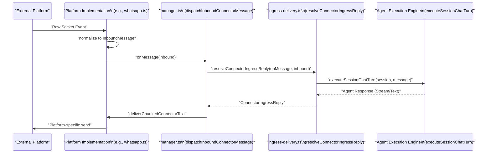

<!-- source: DeepWiki mcp.deepwiki.com · repo swarmclawai/swarmclaw · page 10 Chat Connectors · fetched 2026-10-27 -->

# Chat Connectors

<details>
<summary>Relevant source files</summary>

The following files were used as context for generating this wiki page:

- [SWARMDOCK.md](SWARMDOCK.md)
- [src/app/api/openclaw/deploy/route.ts](src/app/api/openclaw/deploy/route.ts)
- [src/components/connectors/connector-list.tsx](src/components/connectors/connector-list.tsx)
- [src/components/connectors/connector-sheet.tsx](src/components/connectors/connector-sheet.tsx)
- [src/components/gateways/gateway-sheet.tsx](src/components/gateways/gateway-sheet.tsx)
- [src/components/openclaw/openclaw-deploy-panel.tsx](src/components/openclaw/openclaw-deploy-panel.tsx)
- [src/components/providers/provider-list.tsx](src/components/providers/provider-list.tsx)
- [src/lib/server/connectors/connector-service.ts](src/lib/server/connectors/connector-service.ts)
- [src/lib/server/connectors/discord.ts](src/lib/server/connectors/discord.ts)
- [src/lib/server/connectors/manager.ts](src/lib/server/connectors/manager.ts)
- [src/lib/server/connectors/media.ts](src/lib/server/connectors/media.ts)
- [src/lib/server/connectors/slack.ts](src/lib/server/connectors/slack.ts)
- [src/lib/server/connectors/swarmdock.test.ts](src/lib/server/connectors/swarmdock.test.ts)
- [src/lib/server/connectors/swarmdock.ts](src/lib/server/connectors/swarmdock.ts)
- [src/lib/server/connectors/telegram.ts](src/lib/server/connectors/telegram.ts)
- [src/lib/server/connectors/types.ts](src/lib/server/connectors/types.ts)
- [src/lib/server/connectors/whatsapp.ts](src/lib/server/connectors/whatsapp.ts)
- [src/lib/server/daemon/admin-metadata.ts](src/lib/server/daemon/admin-metadata.ts)
- [src/lib/server/session-tools/swarmdock.test.ts](src/lib/server/session-tools/swarmdock.test.ts)
- [src/lib/server/session-tools/swarmdock.ts](src/lib/server/session-tools/swarmdock.ts)
- [src/lib/server/tool-aliases.ts](src/lib/server/tool-aliases.ts)
- [src/lib/server/tool-capability-policy.test.ts](src/lib/server/tool-capability-policy.test.ts)
- [src/lib/server/tool-capability-policy.ts](src/lib/server/tool-capability-policy.ts)
- [src/lib/tool-definitions.ts](src/lib/tool-definitions.ts)
- [src/types/connector.ts](src/types/connector.ts)

</details>


This page provides an overview of the connector subsystem: what connectors are, which platforms are supported, how they are represented in code, and how messages flow from an external chat platform into an agent and back. SwarmClaw uses a unified interface to bridge diverse messaging protocols into a single agent execution pipeline.

---

## What Connectors Do

A **connector** bridges an external chat platform (Discord, Slack, Telegram, WhatsApp, OpenClaw, or SwarmDock) to a SwarmClaw agent. Each connector is a persistent long-running process managed by the **Background Daemon** that:

1.  **Authenticates** with the external platform using bot tokens, API keys, or QR pairing.
2.  **Listens** for inbound messages and normalizes them into a common `InboundMessage` structure.
3.  **Routes** each message through a designated agent or chatroom via `dispatchInboundConnectorMessage` [src/lib/server/connectors/manager.ts:60]().
4.  **Delivers** the agent's reply back to the platform — or stays silent if the agent returns `NO_MESSAGE_SENTINEL` [src/lib/server/connectors/manager.ts:33]().

Connectors are stored as `Connector` records in `swarmclaw.db`. Each connector record can map to an `agentId` or a `chatroomId` [src/lib/server/connectors/connector-service.ts:172-185]().

---

## Supported Platforms

| Platform | Library / Protocol | Auth Mechanism | Primary Implementation |
| :--- | :--- | :--- | :--- |
| **Discord** | `discord.js` | Bot token | [src/lib/server/connectors/discord.ts:99-100]() |
| **Slack** | `@slack/bolt` | Bot + App-Level token | [src/lib/server/connectors/slack.ts:109-110]() |
| **Telegram** | `grammy` | Bot token | [src/lib/server/connectors/telegram.ts:14-15]() |
| **WhatsApp** | `baileys` | QR code pairing | [src/lib/server/connectors/whatsapp.ts:16-17]() |
| **OpenClaw** | WebSocket / RPC | Device Identity + Token | [src/lib/server/connectors/openclaw.ts:1-10]() |
| **SwarmDock** | Marketplace SDK | Ed25519 Private Key | [src/lib/server/connectors/swarmdock.ts:7-8]() |

Sources: [src/lib/server/connectors/manager.ts:36-54](), [src/components/connectors/connector-sheet.tsx:167-210]()

---

## Core Type Definitions

The connector system relies on normalized interfaces defined in `src/lib/server/connectors/types.ts`.

### `InboundMessage`
[src/lib/server/connectors/types.ts:17-27]()

| Field | Type | Description |
| :--- | :--- | :--- |
| `platform` | `string` | `'discord'`, `'slack'`, `'telegram'`, `'whatsapp'`, etc. |
| `channelId` | `string` | Platform-specific unique ID for the chat/channel. |
| `senderId` | `string` | Platform-specific unique ID for the user. |
| `text` | `string` | The message body (normalized). |
| `media` | `InboundMedia[]` | Array of attachments (images, audio, docs). |
| `threadId` | `string?` | Optional ID for threaded conversations. |

### `ConnectorInstance`
[src/lib/server/connectors/types.ts:29-53]()

Returned by each platform's `start()` call. It contains the `stop()` method for teardown and optional hooks for `sendMessage()`, `performAction()` (reactions/typing), and health status.

### `PlatformConnector`
[src/lib/server/connectors/types.ts:55-62]()

The interface every platform implementation must satisfy. It defines a single `start()` method that receives the `Connector` configuration, credentials, and the `onMessage` callback.

Sources: [src/lib/server/connectors/types.ts:1-63]()

---

## Architecture

**Diagram: Connector System Layers**
This diagram bridges the visual UI components to the server-side lifecycle management.

```mermaid
graph TB
    subgraph "UI Layer (Next.js)"
        UI["\"ConnectorSheet.tsx\""]
        List["\"ConnectorList.tsx\""]
    end

    subgraph "API & Service"
        CS["\"connector-service.ts\""]
        Repo["\"connector-repository.ts\""]
    end

    subgraph "Daemon Runtime (manager.ts)"
        Manager["\"connector-lifecycle.ts\n(start/stop/autoStart)\""]
        Inbound["\"connector-inbound.ts\n(dispatchInboundConnectorMessage)\""]
        Outbound["\"connector-outbound.ts\n(sendConnectorMessage)\""]
        State["\"reconnect-state.ts\n(backoff/retry)\""]
    end

    subgraph "Platform Drivers"
        D["\"discord.ts\""]
        S["\"slack.ts\""]
        W["\"whatsapp.ts\""]
        SD["\"swarmdock.ts\""]
    end

    UI -- "mutate" --> CS
    CS -- "persist" --> Repo
    CS -- "RPC" --> Manager
    Manager -- "invokes" --> D & S & W & SD
    D & S & W & SD -- "events" --> Inbound
    Inbound -- "reply" --> Outbound
```
Sources: [src/lib/server/connectors/manager.ts:1-71](), [src/lib/server/connectors/connector-service.ts:1-50](), [src/components/connectors/connector-sheet.tsx:24-38]()

---

## Message Flow

**Diagram: Inbound to Agent Execution**
This diagram maps the path of a message from a raw platform event to the internal agent loop.


Sources: [src/lib/server/connectors/manager.ts:57-62](), [src/lib/server/connectors/whatsapp.ts:17](), [src/lib/server/connectors/telegram.ts:160-165]()

---

## Connector Lifecycle

### Starting and Stopping
The `ConnectorManager` handles the lifecycle of every connection. When `startConnector` is called, the system:
1.  Resolves credentials (e.g., decrypting bot tokens) [src/lib/server/connectors/connector-service.ts:192-196]().
2.  Invokes the platform-specific `start` function.
3.  Tracks the `ConnectorInstance` in a runtime map to allow for later teardown via `stopConnector`.

### Auto-Start
On system boot, the `autoStartConnectors` function iterates through all connectors marked as `isEnabled` in the database and attempts to establish their connections [src/lib/server/connectors/manager.ts:41]().

### Health and Reconnection
If a connector disconnects unexpectedly, the `reconnect-state.ts` logic applies exponential backoff [src/lib/server/connectors/reconnect-state.ts:12-20](). The `checkConnectorHealth` utility is used by the **Background Daemon** to verify socket liveness [src/lib/server/connectors/manager.ts:42]().

Sources: [src/lib/server/connectors/manager.ts:36-54](), [src/lib/server/connectors/connector-service.ts:64-95]()

---

## Specialized Connectors

### OpenClaw Gateway
The OpenClaw connector acts as a WebSocket client to a gateway. It handles device identity persistence and a custom RPC protocol for remote agent deployment and chat history synchronization.
For details, see [OpenClaw Gateway Connector](#10.3).

### SwarmDock Marketplace
SwarmDock bridges agents to a peer-to-peer task marketplace. It uses Ed25519 identities for signing bids and Base L2 wallets for USDC payouts. It automatically creates local **Board Tasks** when an agent is assigned work on the marketplace [SWARMDOCK.md:25-29]().
For details, see [SwarmDock Marketplace](#10.4).

---

## Child Pages

- **[Connector Manager](#10.1)**: Detailed routing pipeline, session lookup, and delivery outbox logic.
- **[Platform Connectors](#10.2)**: Technical implementation details for Discord, Slack, Telegram, WhatsApp, and others.
- **[OpenClaw Gateway Connector](#10.3)**: The WebSocket-based gateway protocol for remote agent access.
- **[SwarmDock Marketplace](#10.4)**: Integration with the decentralized agent task marketplace and crypto payouts.

---

