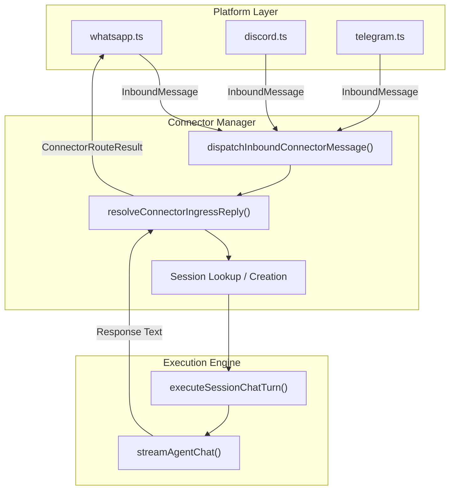
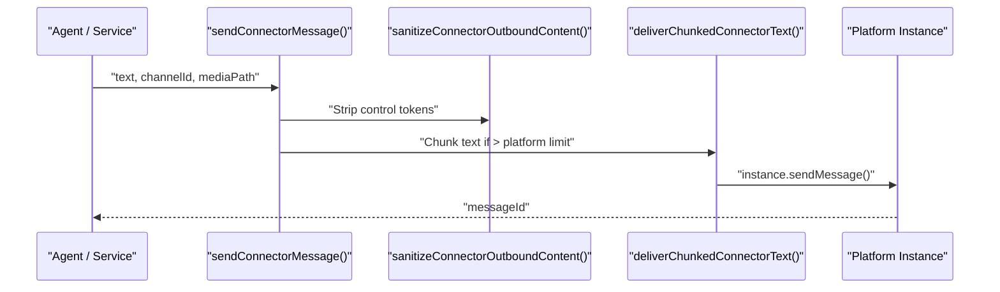

<!-- source: DeepWiki mcp.deepwiki.com · repo swarmclawai/swarmclaw · page 10.1 Connector Manager · fetched 2026-10-27 -->

# Connector Manager

Relevant source files

The following files were used as context for generating this wiki page:

- [scripts/benchmark-autonomy-harness.mjs](scripts/benchmark-autonomy-harness.mjs)
- [scripts/run-agent-regression-suite.ts](scripts/run-agent-regression-suite.ts)
- [src/app/api/openclaw/deploy/route.ts](src/app/api/openclaw/deploy/route.ts)
- [src/components/connectors/connector-list.tsx](src/components/connectors/connector-list.tsx)
- [src/components/connectors/connector-sheet.tsx](src/components/connectors/connector-sheet.tsx)
- [src/components/gateways/gateway-sheet.tsx](src/components/gateways/gateway-sheet.tsx)
- [src/components/openclaw/openclaw-deploy-panel.tsx](src/components/openclaw/openclaw-deploy-panel.tsx)
- [src/components/providers/provider-list.tsx](src/components/providers/provider-list.tsx)
- [src/lib/server/agents/subagent-runtime.test.ts](src/lib/server/agents/subagent-runtime.test.ts)
- [src/lib/server/connectors/connector-service.ts](src/lib/server/connectors/connector-service.ts)
- [src/lib/server/connectors/discord.ts](src/lib/server/connectors/discord.ts)
- [src/lib/server/connectors/manager.test.ts](src/lib/server/connectors/manager.test.ts)
- [src/lib/server/connectors/manager.ts](src/lib/server/connectors/manager.ts)
- [src/lib/server/connectors/media.ts](src/lib/server/connectors/media.ts)
- [src/lib/server/connectors/slack.ts](src/lib/server/connectors/slack.ts)
- [src/lib/server/connectors/telegram.ts](src/lib/server/connectors/telegram.ts)
- [src/lib/server/connectors/types.ts](src/lib/server/connectors/types.ts)
- [src/lib/server/connectors/whatsapp.ts](src/lib/server/connectors/whatsapp.ts)
- [src/lib/server/daemon/admin-metadata.ts](src/lib/server/daemon/admin-metadata.ts)
- [src/lib/server/eval/agent-regression.ts](src/lib/server/eval/agent-regression.ts)
- [src/lib/server/session-tools/delegate-fallback.test.ts](src/lib/server/session-tools/delegate-fallback.test.ts)
- [src/lib/server/skills/discovered-skill-prompt.test.ts](src/lib/server/skills/discovered-skill-prompt.test.ts)
- [src/lib/server/tool-planning.test.ts](src/lib/server/tool-planning.test.ts)
- [src/types/connector.ts](src/types/connector.ts)

The **Connector Manager** is the central coordination layer that manages the lifecycle and message routing for all external chat platforms (Discord, Slack, Telegram, WhatsApp, etc.). It acts as a bridge between platform-specific protocols and the SwarmClaw agent execution engine.

---

## Overview

The connector manager is implemented as a hub in [src/lib/server/connectors/manager.ts](). It re-exports logic from specialized modules to manage runtime state, lifecycle, and inbound/outbound message delivery.

Key responsibilities include:
- **Lifecycle Management**: Starting, stopping, and repairing connectors via `connector-lifecycle.ts`.
- **Inbound Routing**: Normalizing platform messages and dispatching them to the correct agent sessions via `connector-inbound.ts`.
- **Outbound Delivery**: Handling proactive messaging, media uploads, and chunking via `connector-outbound.ts` and `delivery.ts`.
- **State Persistence**: Maintaining a `running` map of active `ConnectorInstance` objects on `globalThis` to survive Hot Module Replacement (HMR).

Sources: [src/lib/server/connectors/manager.ts:1-9](), [src/lib/server/connectors/manager.ts:35-54]()

---

## Architecture & Data Flow

The Connector Manager bridges the gap between raw platform events and high-level agent logic.

### Message Ingress Pipeline
When a message arrives from a platform (e.g., a WhatsApp message), it follows a specific normalization and routing path.

**Inbound Routing Pipeline**

Sources: [src/lib/server/connectors/connector-inbound.ts:1-50](), [src/lib/server/connectors/manager.ts:57-62](), [src/lib/server/connectors/ingress-delivery.ts:1-20]()

---

## Connector Lifecycle

Connectors are managed through a serialized lifecycle to prevent race conditions during startup or reconfiguration.

### Start & Auto-Start
- **`startConnector(connectorId)`**: Loads the connector configuration, resolves credentials, and invokes the platform's `start()` method. [src/lib/server/connectors/connector-lifecycle.ts:110-150]()
- **`autoStartConnectors()`**: Invoked by the [Daemon Lifecycle](#11.1) on system boot to restore all connectors where `isEnabled` is true. [src/lib/server/connectors/connector-lifecycle.ts:250-270]()

### Health & Reconnection
The manager tracks the health of each instance using `checkConnectorHealth(connectorId)`. If a connector fails, the system uses `advanceConnectorReconnectState` to manage exponential backoff.

| Function | File | Purpose |
|---|---|---|
| `checkConnectorHealth` | `connector-lifecycle.ts` | Pings the instance's `isAlive()` method. |
| `repairConnector` | `connector-lifecycle.ts` | Force-stops and wipes auth state (useful for WhatsApp QR resets). |
| `advanceConnectorReconnectState` | `reconnect-state.ts` | Increments retry counters and calculates `nextRetryAt`. |

Sources: [src/lib/server/connectors/connector-lifecycle.ts:200-230](), [src/lib/server/connectors/reconnect-state.ts:1-40]()

---

## Inbound Routing & Session Management

### Inbound Normalization
All platform-specific messages are normalized into an `InboundMessage` interface. This includes text, media attachments, and thread context.

- **Session Lookup**: The manager looks for a session keyed by the connector ID and the platform's channel/chat ID. If no session exists, it creates one, effectively "pairing" the platform channel with a SwarmClaw session. [src/lib/server/connectors/connector-inbound.ts:120-150]()
- **Thread Context**: For platforms like Slack or Discord, the manager hydrates `threadHistory` to allow agents to maintain context within specific sub-threads. [src/lib/server/connectors/slack.ts:44-107](), [src/lib/server/connectors/discord.ts:35-97]()

### NO_MESSAGE Sentinel
The `NO_MESSAGE_SENTINEL` (the string `"NO_MESSAGE"`) is a core convention. If an agent determines no response is necessary (e.g., a simple "thanks" or a system notification), it returns this sentinel. The manager detects this via `isNoMessage()` and suppresses the outbound delivery.

Sources: [src/lib/server/connectors/message-sentinel.ts:1-10](), [src/lib/server/connectors/connector-inbound.ts:210-220]()

---

## Outbound Delivery & Outbox

The `sendConnectorMessage` function is the primary API for sending text and media to external platforms.

**Outbound Message Handling**

### Key Outbound Features:
1.  **Text Chunking**: Automatically splits long responses into multiple messages based on platform limits (e.g., 4096 characters for Telegram). [src/lib/server/connectors/delivery.ts:50-80]()
2.  **Media Transcoding**: Specifically for WhatsApp, the system can transcode audio to OGG/Opus for native "Voice Note" delivery. [src/lib/server/connectors/whatsapp.ts:183-210]()
3.  **Deduplication**: Inbound and outbound messages are recorded to prevent loops and duplicate processing. [src/lib/server/connectors/delivery.ts:10-30]()

Sources: [src/lib/server/connectors/connector-outbound.ts:40-100](), [src/lib/server/connectors/delivery.ts:1-100](), [src/lib/server/connectors/whatsapp.ts:63-68]()

---

## UI Integration

The **Connector Manager** is exposed to the user via the `ConnectorList` and `ConnectorSheet` components.

- **`ConnectorList`**: Displays all configured connectors, their current status (Healthy, Attention, Needs Setup), and allows toggling them on/off. [src/components/connectors/connector-list.tsx:46-163]()
- **`ConnectorSheet`**: Provides the configuration UI for each platform, including fields for Bot Tokens, Channel IDs, and advanced settings like `inboundDebounceMs`. [src/components/connectors/connector-sheet.tsx:1-185]()
- **Health Indicators**: The UI uses `ConnectorHealth` to show live status, reconnect attempts, and error messages from the runtime. [src/components/connectors/connector-health.tsx:1-50]()

Sources: [src/components/connectors/connector-list.tsx:104-127](), [src/components/connectors/connector-sheet.tsx:159-185]()

---

