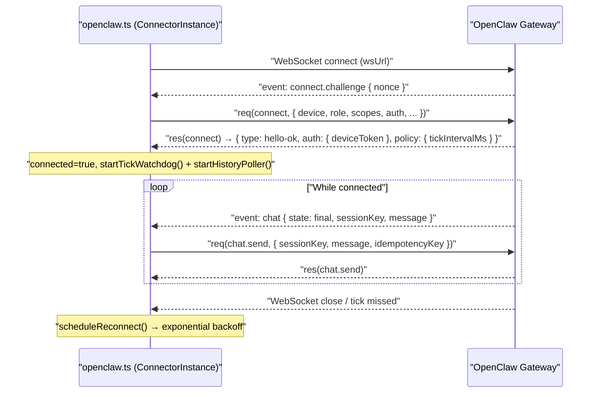
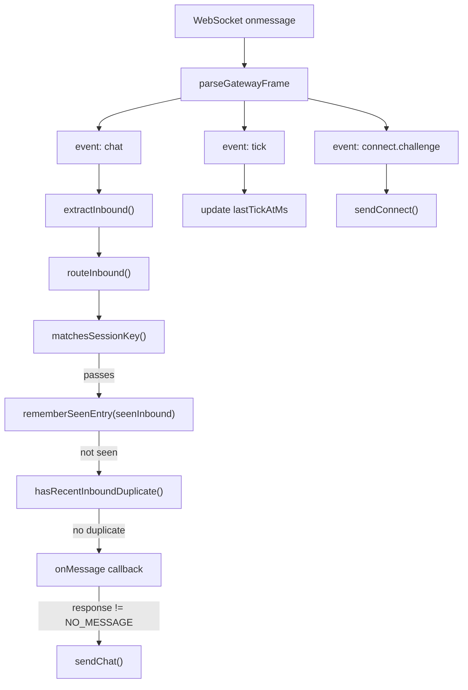

<!-- source: DeepWiki mcp.deepwiki.com · repo swarmclawai/swarmclaw · page 10.3 OpenClaw Gateway Connector · fetched 2026-10-27 -->

# OpenClaw Gateway Connector

<details>
<summary>Relevant source files</summary>

The following files were used as context for generating this wiki page:

- [src/app/api/memory/route.ts](src/app/api/memory/route.ts)
- [src/app/api/openclaw/deploy/route.ts](src/app/api/openclaw/deploy/route.ts)
- [src/app/api/openclaw/gateway/route.ts](src/app/api/openclaw/gateway/route.ts)
- [src/components/connectors/connector-list.tsx](src/components/connectors/connector-list.tsx)
- [src/components/connectors/connector-sheet.tsx](src/components/connectors/connector-sheet.tsx)
- [src/components/gateways/gateway-sheet.tsx](src/components/gateways/gateway-sheet.tsx)
- [src/components/openclaw/openclaw-deploy-panel.tsx](src/components/openclaw/openclaw-deploy-panel.tsx)
- [src/components/providers/provider-list.tsx](src/components/providers/provider-list.tsx)
- [src/lib/server/connectors/connector-service.ts](src/lib/server/connectors/connector-service.ts)
- [src/lib/server/connectors/openclaw.test.ts](src/lib/server/connectors/openclaw.test.ts)
- [src/lib/server/connectors/openclaw.ts](src/lib/server/connectors/openclaw.ts)
- [src/lib/server/daemon/admin-metadata.ts](src/lib/server/daemon/admin-metadata.ts)
- [src/lib/server/session-tools/openclaw-nodes.test.ts](src/lib/server/session-tools/openclaw-nodes.test.ts)
- [src/lib/server/session-tools/openclaw-nodes.ts](src/lib/server/session-tools/openclaw-nodes.ts)
- [src/types/connector.ts](src/types/connector.ts)

</details>


This page documents the OpenClaw WebSocket gateway connector: how it authenticates, maintains its connection, routes inbound messages, and sends outbound replies. It covers the implementation in [src/lib/server/connectors/openclaw.ts]() exclusively.

For the general connector manager that starts, stops, and routes messages through all connectors (including OpenClaw), see [Connector Manager](#10.1). For the other platform connectors (Discord, Slack, Telegram, WhatsApp), see [Platform Connectors](#10.2). For OpenClaw as an LLM inference gateway provider (distinct from the chat connector), see [Local & Gateway Providers](#5.3).

---

## Overview

The OpenClaw connector implements `PlatformConnector` by maintaining a persistent WebSocket connection to an OpenClaw gateway server. Unlike bot-token–based connectors, it identifies itself cryptographically using a persistent Ed25519 key pair. Inbound messages arrive via WebSocket events and can also be recovered via a history-poll RPC. Outbound replies are sent via the `chat.send` RPC.

---

## Key Constants

| Constant | Default | Purpose |
|---|---|---|
| `PROTOCOL_VERSION` | `3` | Minimum and maximum protocol version sent in `connect` handshake |
| `RECONNECT_BASE_MS` | `2,000` | Base delay for exponential reconnect backoff |
| `RECONNECT_MAX_MS` | `30,000` | Maximum reconnect delay cap |
| `RPC_TIMEOUT_MS` | `25,000` | Timeout for any pending RPC response |
| `CONNECT_HELLO_TIMEOUT_MS` | `20,000` | Timeout waiting for `hello-ok` after sending `connect` |
| `DEFAULT_WS_URL` | `ws://localhost:18789` | Fallback WebSocket URL if not configured |
| `DEFAULT_SESSION_KEY` | `main` | Fallback session key for messages without one |
| `DEFAULT_TICK_INTERVAL_MS` | `30,000` | Tick watchdog interval when not set by gateway policy |
| `TICK_MISS_TOLERANCE_MULTIPLIER` | `2` | Multiplier applied to tick interval before forcing reconnect |
| `DEFAULT_CHAT_HISTORY_POLL_MS` | `2,500` | History poll interval |
| `DEFAULT_CHAT_HISTORY_LIMIT` | `40` | Max messages fetched per history poll |
| `MAX_INLINE_ATTACHMENT_BYTES` | `5,000,000` | Size limit for inline base64 attachments |
| `MAX_SEEN_CHAT_EVENTS` | `2,048` | Capacity of the `seenInbound` deduplication set |
| `MAX_SEEN_HISTORY_MESSAGES` | `4,096` | Capacity of the `seenHistoryMessages` deduplication set |
| `RECENT_HISTORY_DUPLICATE_WINDOW_MS` | `20,000` | Window for suppressing history messages that were already delivered by a live event |

Sources: [src/lib/server/connectors/openclaw.ts:28-49]()

---

## Device Identity

Every connector instance has a persistent Ed25519 identity. The identity file is stored at:

```
data/openclaw/{connectorId}-device.json
```

The file has this shape (type `StoredIdentity`):

```typescript
type StoredIdentity = {
  version: 1
  deviceId: string
  publicKeyPem: string
  privateKeyPem: string
  createdAtMs: number
  deviceToken?: string
}
```

**`loadOrCreateIdentity`** [src/lib/server/connectors/openclaw.ts:206-255]() reads this file on startup. If the file is missing or malformed, it generates a new Ed25519 key pair via `crypto.generateKeyPairSync('ed25519')`, sets `deviceId` to the SHA-256 fingerprint of the public key, and writes the file with `chmod 0o600`. If the stored `deviceId` no longer matches the fingerprint of the stored public key, the file is silently rewritten with the correct fingerprint.

**`fingerprintPublicKey`** [src/lib/server/connectors/openclaw.ts:150-153]() derives the `deviceId` by exporting the key to SPKI DER form, stripping the 12-byte Ed25519 OID prefix (`302a300506032b6570032100`), and SHA-256 hashing the raw 32-byte key material.

**`persistIdentityToken`** [src/lib/server/connectors/openclaw.ts:825-830]() saves the `deviceToken` received from the gateway's `hello-ok` response back into the identity file so it is reused on subsequent connections.

Sources: [src/lib/server/connectors/openclaw.ts:54-68](), [src/lib/server/connectors/openclaw.ts:188-255]()

---

## Connection Lifecycle

**Connection lifecycle diagram:**



Sources: [src/lib/server/connectors/openclaw.ts:554-924]()

### `connect` (internal function)

The internal `connect()` function [src/lib/server/connectors/openclaw.ts:766-783]() creates a new `WebSocket` instance pointing at `wsUrl`. On `onopen`, it waits up to `CONNECT_DELAY_FALLBACK_MS` (750 ms) for the server to emit `connect.challenge`. If no challenge arrives within that window, `sendConnect()` is called immediately as a fallback. On `onclose` or `onerror`, `scheduleReconnect()` is called.

### `sendConnect` [src/lib/server/connectors/openclaw.ts:840-923]()

Builds the authentication parameters and calls `rpcRequest('connect', connectParams)`:

1. Reads the configured or stored `deviceToken` as `authToken`.
2. Calls `buildDeviceAuthPayload` [src/lib/server/connectors/openclaw.ts:155-180]() to produce a pipe-delimited string (`v2|deviceId|clientId|clientMode|role|scopes|signedAtMs|token|nonce`).
3. Calls `signDevicePayload` [src/lib/server/connectors/openclaw.ts:182-186]() to sign the payload with the Ed25519 private key and encode the signature as base64url.
4. Sends `connect` with fields: `minProtocol`, `maxProtocol`, `client`, `role`, `scopes`, `auth`, `device` (contains `id`, `publicKey`, `signature`, `signedAt`, `nonce`).
5. On success: sets `connected = true`, persists any `deviceToken` from `hello-ok`, reads `policy.tickIntervalMs` to update the tick interval, starts the tick watchdog, and starts the history poller.
6. On failure: closes the socket with code `1008`.

### `scheduleReconnect` [src/lib/server/connectors/openclaw.ts:720-747]()

Uses exponential backoff: `delay = min(RECONNECT_BASE_MS × 2^attempt, RECONNECT_MAX_MS)`. Each call increments `reconnectAttempt`. When `connect()` succeeds, `reconnectAttempt` resets to `0`.

### Security constraint

`isSecureWsUrl` [src/lib/server/connectors/openclaw.ts:119-132]() enforces that remote URLs use `wss://`. Plain `ws://` is only permitted for `localhost`, `127.x`, or `::1`. Attempting to start with a plain `ws://` remote URL throws immediately.

Sources: [src/lib/server/connectors/openclaw.ts:119-132](), [src/lib/server/connectors/openclaw.ts:766-923]()

---

## RPC System

All requests and responses use the frame types defined in `src/lib/server/gateway/protocol.ts` via `createGatewayRequestFrame`, `parseGatewayFrame`, and `serializeGatewayFrame`.

**`rpcRequest`** [src/lib/server/connectors/openclaw.ts:785-801]() sends a `req` frame with a UUID `id` and stores a `PendingRequest` entry (with a `RPC_TIMEOUT_MS` timer) in the `pending` map. When the matching `res` frame arrives with the same `id`, the pending promise is resolved or rejected. On socket close, `clearPending` rejects all outstanding requests.

```typescript
type PendingRequest = {
  method: string
  resolve: (value: unknown) => void
  reject: (reason?: unknown) => void
  timer: ReturnType<typeof setTimeout>
}
```

Sources: [src/lib/server/connectors/openclaw.ts:70-75](), [src/lib/server/connectors/openclaw.ts:785-801]()

---

## Tick Watchdog

The gateway periodically sends a `tick` event at an interval negotiated in `hello-ok` (`policy.tickIntervalMs`). The tick watchdog detects when ticks stop arriving and forces a reconnect.

**`startTickWatchdog`** [src/lib/server/connectors/openclaw.ts:692-718]():

1. Computes `toleranceMs = max(3000, tickIntervalMs × TICK_MISS_TOLERANCE_MULTIPLIER)`.
2. Sets a poll interval of `clamp(toleranceMs / 3, MIN_TICK_WATCHDOG_POLL_MS, MAX_TICK_WATCHDOG_POLL_MS)`.
3. Every poll tick: if `Date.now() - lastTickAtMs > toleranceMs`, closes the socket with code `4000` and reason `"tick missed"`.
4. The timer is `unref()`'d so it does not prevent Node.js from exiting.

When the gateway sends a `tick` event, `lastTickAtMs` is updated to `Date.now()`.

The watchdog can be disabled per-connector by setting `tickWatchdog: false` in the connector config.

Sources: [src/lib/server/connectors/openclaw.ts:692-718]()

---

## Inbound Message Routing

**Code entity map for inbound routing:**



Sources: [src/lib/server/connectors/openclaw.ts:925-945](), [src/lib/server/connectors/openclaw.ts:457-500]()

### `extractInbound` [src/lib/server/connectors/openclaw.ts:457-500]()

Converts a raw `ChatEventPayload` to `InboundMessage`. Rules:

- Returns `null` if `payload.state` is set but not `"final"` (ignores streaming intermediate states).
- Returns `null` if `message.role` is set but not `"user"`.
- Returns `null` if the extracted text is empty.
- Uses `payload.sessionKey` as `channelId`/`channelName`; falls back to `DEFAULT_SESSION_KEY`.
- Sender fields are read from `message.senderId`, `message.sender`, `payload.senderId`, or `payload.sender`.

### `routeInbound` [src/lib/server/connectors/openclaw.ts:925-945]()

1. Calls `matchesSessionKey(configuredSessionFilter, inbound.channelId)` — skips the message if the session key does not match the connector's configured filter.
2. Calls `rememberSeenEntry(seenInbound, dedupeKey, MAX_SEEN_CHAT_EVENTS)` — skips if already seen.
3. For history-sourced messages, additionally checks `hasRecentInboundDuplicate` to suppress messages that were already delivered by a live event within `RECENT_HISTORY_DUPLICATE_WINDOW_MS`.
4. Calls the `onMessage` callback (which invokes `routeMessage` in the connector manager).
5. If the response is not `NO_MESSAGE`, calls `sendChat`.

### Session Key Matching

`matchesSessionKey` [src/lib/server/connectors/openclaw.ts:281-292]() supports short aliases. If the configured filter has no colon (e.g., `"main"`) and the incoming key ends with `":main"` (e.g., `"agent:main:main"`), the match succeeds. This allows users to configure `sessionKey: main` in the connector and receive messages from full agent session keys like `agent:main:main`.

Sources: [src/lib/server/connectors/openclaw.ts:281-292](), [src/lib/server/connectors/openclaw.ts:457-500](), [src/lib/server/connectors/openclaw.ts:925-945]()

---

## Chat History Polling

The gateway supports a `chat.history` RPC that returns recent messages for a session. The connector polls this endpoint periodically as a fallback for missed live events.

**`startHistoryPoller`** [src/lib/server/connectors/openclaw.ts:1010-1033]() starts an interval timer at `historyPollMs`. Each tick calls `pollChatHistory()`.

**`pollChatHistory`** [src/lib/server/connectors/openclaw.ts:983-1008]():

1. Iterates over `historySessionCandidates` (resolved from `historySessionKey`, `sessionKey`, and `defaultSessionKey` in priority order).
2. Calls `pollHistorySession(sessionKey)` for each candidate until one succeeds.
3. Sets `historyPollingUnsupported = true` if the gateway returns an error indicating history is not supported.

**`pollHistorySession`** [src/lib/server/connectors/openclaw.ts:947-981]():

1. Sends `rpcRequest('chat.history', { sessionKey, limit: historyLimit })`.
2. On first response for a given session key (not yet in `historyWarmSessions`): marks all returned messages as seen without routing them ("warming" the dedupe set). This prevents replaying old history on startup.
3. On subsequent polls: routes any new messages (not in `seenHistoryMessages`) through `routeInbound`.

Each history message dedupe key is: `{sessionKey}:{timestamp}:{sha1(text).slice(0,16)}`.

History polling can be disabled by setting `historyPoll: false` in the connector config. Errors per session are rate-limited to one log per `HISTORY_ERROR_LOG_INTERVAL_MS` (30 seconds).

Sources: [src/lib/server/connectors/openclaw.ts:947-981]()

---

## Outbound Messages

### `sendChat` [src/lib/server/connectors/openclaw.ts:803-823]()

Sends a `chat.send` RPC with:

- `sessionKey`: the target session key.
- `message`: the reply text (or `"See attached."` if text is empty but attachments exist).
- `idempotencyKey`: a UUID generated per call.
- `attachments` (optional): array of `OutboundAttachment` objects.

### Attachment Resolution

`buildOutboundAttachments` [src/lib/server/connectors/openclaw.ts:406-455]() converts the `sendMessage` options into `OutboundAttachment[]`:

| Priority | Source | Handling |
|---|---|---|
| 1 | `options.mediaPath` | Read file from disk; encode as base64 |
| 2 | Data URL (`imageUrl` or `fileUrl`) | Decode base64 directly |
| 3 | HTTP/HTTPS URL | Attempt inline `fetch`; if size ≤ 5 MB, encode as base64; otherwise fall back to appending URL as text |

Each `OutboundAttachment` has:
```typescript
type OutboundAttachment = {
  type: 'image' | 'file'
  mimeType: string
  fileName?: string
  content: string // base64
}
```

MIME type is inferred from the explicit `mimeType` option, then from the file extension via `inferMimeFromFileName`, then defaults to `application/octet-stream`. If `mimeType` starts with `image/`, `type` is `"image"`, otherwise `"file"`.

The `NO_MESSAGE` sentinel is checked in `routeInbound` before calling `sendChat` — if the agent returns `"NO_MESSAGE"`, no outbound RPC is sent.

Sources: [src/lib/server/connectors/openclaw.ts:381-455](), [src/lib/server/connectors/openclaw.ts:803-823]()

---

## State Variables and Cleanup

The `start()` function manages the following mutable state internally:

| Variable | Type | Purpose |
|---|---|---|
| `ws` | `WebSocket \| null` | Active WebSocket instance |
| `stopped` | `boolean` | Set to `true` by `stop()` to suppress reconnects |
| `reconnectAttempt` | `number` | Counter for backoff calculation; resets on successful connect |
| `connected` | `boolean` | `true` after `hello-ok` is received |
| `connectSent` | `boolean` | Guards against double-sending `connect` |
| `connectNonce` | `string \| null` | Nonce from `connect.challenge` |
| `lastTickAtMs` | `number` | Timestamp of last tick event; used by watchdog |
| `tickIntervalMs` | `number` | Active tick interval (may be overridden by gateway policy) |
| `pending` | `Map<string, PendingRequest>` | In-flight RPC requests |
| `seenInbound` | `Set<string>` | Dedupe set for live chat events |
| `seenHistoryMessages` | `Set<string>` | Dedupe set for history-polled messages |
| `historyWarmSessions` | `Set<string>` | Sessions whose initial history has been consumed without routing |
| `recentInboundByText` | `Map<string, number>` | Timestamp map for cross-source duplicate suppression |

**`cleanupSocket`** [src/lib/server/connectors/openclaw.ts:749-764]() is called on socket close. It clears all timers, rejects all pending RPCs, closes the socket, and resets `connected`, `connectSent`, `connectNonce`, and `lastTickAtMs`.

The `ConnectorInstance.stop()` method sets `stopped = true` and calls `cleanupSocket()` with no reconnect scheduled.

Sources: [src/lib/server/connectors/openclaw.ts:625-647](), [src/lib/server/connectors/openclaw.ts:749-764]()

---

## Gateway Deployment and Profile Service

SwarmClaw includes a dedicated UI and API for deploying and managing OpenClaw gateways.

### Deployment Panel
The `OpenClawDeployPanel` [src/components/openclaw/openclaw-deploy-panel.tsx:136-145]() provides a multi-stage UI for:
1. **Local Deployment**: Running a gateway instance as a child process via `npx openclaw gateway run` [src/components/openclaw/openclaw-deploy-panel.tsx:214-218]().
2. **Bundle Generation**: Creating deployment bundles for Docker, Fly.io, Render, or Railway [src/components/openclaw/openclaw-deploy-panel.tsx:147-172]().
3. **SSH Deployment**: Automated deployment to VPS hosts (Hetzner, DigitalOcean, etc.) via SSH [src/components/openclaw/openclaw-deploy-panel.tsx:174-189]().

### Gateway Profiles
Gateway profiles are managed via the `GatewaySheet` [src/components/gateways/gateway-sheet.tsx:39-44]() and stored as `GatewayProfile` objects. These profiles include:
- `endpoint`: The HTTP/WS URL of the gateway [src/components/gateways/gateway-sheet.tsx:62]().
- `credentialId`: Reference to an `openclaw` provider credential [src/components/gateways/gateway-sheet.tsx:63]().
- `deployment`: Metadata about how the gateway was deployed (method, provider, last verified status) [src/components/gateways/gateway-sheet.tsx:114-133]().

### Node & Device Management
Agents can interact with "Nodes" (connected mobile apps or IoT devices) through the gateway using the `openclaw_nodes` tool [src/lib/server/session-tools/openclaw-nodes.ts:114-142]().
- **`node.list`**: Fetches all connected nodes [src/lib/server/session-tools/openclaw-nodes.ts:47]().
- **`node.invoke`**: Sends a command to a specific node [src/lib/server/session-tools/openclaw-nodes.ts:95-101]().
- **`device.pair.approve`**: Approves a new device pairing request [src/lib/server/session-tools/openclaw-nodes.ts:71]().

Sources: [src/app/api/openclaw/deploy/route.ts:1-210](), [src/lib/server/session-tools/openclaw-nodes.ts:19-109](), [src/components/gateways/gateway-sheet.tsx:39-186]()

---

## Integration with Connector Manager

The OpenClaw platform is registered in `listConnectorsWithRuntime` [src/lib/server/connectors/connector-service.ts:131-148](). The manager's `autoStartConnectorIfNeeded` [src/lib/server/connectors/connector-service.ts:191-205]() includes a special case for `openclaw` where it considers the connector to have credentials even without an explicit `credentialId` (since it can use its self-generated Ed25519 identity).

When `openclaw.start()` returns a `ConnectorInstance`, the instance exposes `sendMessage`, which calls `sendChat` via the active `ws`.

Sources: [src/lib/server/connectors/connector-service.ts:191-205](), [src/lib/server/connectors/connector-list.tsx:30-36]()

---

## Test Coverage

The test file [src/lib/server/connectors/openclaw.test.ts]() uses a `MockWebSocket` class that auto-opens after one tick and provides `emit()` for server-push simulation. Tests cover:

| Test | What it verifies |
|---|---|
| Connect handshake + inbound routing | Full flow: challenge → connect req → hello-ok → chat event → `chat.send` RPC |
| `NO_MESSAGE` suppression | Agent returning `"NO_MESSAGE"` produces no `chat.send` frame |
| Session key alias matching | Short `"main"` filter matches `"agent:main:main"` session key |
| Local media attachment | `sendMessage` with `mediaPath` sends base64-encoded `attachments` field |
| History polling | First poll warms the set; second poll delivers only new messages |
| Tick watchdog reconnect | Watchdog fires when `tickIntervalMs` elapses without a tick, creating a new WebSocket |

Sources: [src/lib/server/connectors/openclaw.test.ts:1-376]()

---

