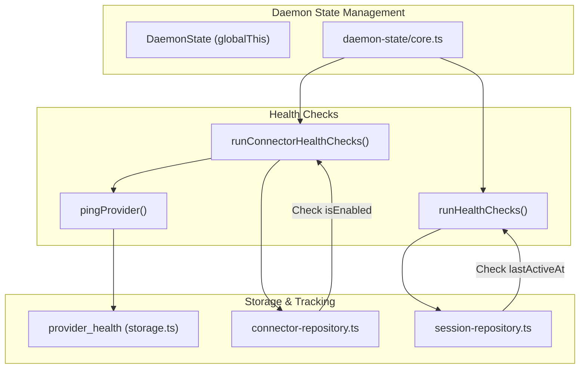
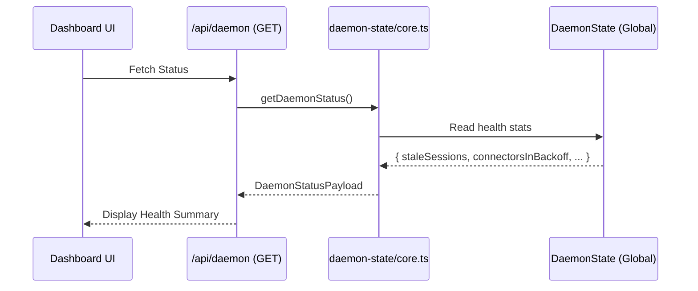

<!-- source: DeepWiki mcp.deepwiki.com · repo swarmclawai/swarmclaw · page 11.3 Health Monitoring · fetched 2026-10-27 -->

# Health Monitoring

Relevant source files

The following files were used as context for generating this wiki page:

- [CONTRIBUTING.md](CONTRIBUTING.md)
- [bin/update-cmd.test.js](bin/update-cmd.test.js)
- [src/app/api/gateways/[id]/health/route.ts](src/app/api/gateways/[id]/health/route.ts)
- [src/app/api/gateways/health-route.test.ts](src/app/api/gateways/health-route.test.ts)
- [src/app/api/setup/check-provider/helpers.ts](src/app/api/setup/check-provider/helpers.ts)
- [src/app/api/setup/check-provider/route.test.ts](src/app/api/setup/check-provider/route.test.ts)
- [src/app/api/version/route.ts](src/app/api/version/route.ts)
- [src/app/api/version/update/route.ts](src/app/api/version/update/route.ts)
- [src/lib/providers/cli-utils.ts](src/lib/providers/cli-utils.ts)
- [src/lib/server/daemon/controller.ts](src/lib/server/daemon/controller.ts)
- [src/lib/server/daemon/lease-owner.test.ts](src/lib/server/daemon/lease-owner.test.ts)
- [src/lib/server/daemon/lease-owner.ts](src/lib/server/daemon/lease-owner.ts)
- [src/lib/server/git-metadata.test.ts](src/lib/server/git-metadata.test.ts)
- [src/lib/server/git-metadata.ts](src/lib/server/git-metadata.ts)
- [src/lib/server/openclaw/health.ts](src/lib/server/openclaw/health.ts)
- [src/lib/server/provider-health.ts](src/lib/server/provider-health.ts)
- [src/lib/server/runtime/daemon-state/core.ts](src/lib/server/runtime/daemon-state/core.ts)
- [src/lib/server/runtime/heartbeat-service.test.ts](src/lib/server/runtime/heartbeat-service.test.ts)
- [src/lib/server/runtime/heartbeat-service.ts](src/lib/server/runtime/heartbeat-service.ts)
- [src/lib/server/runtime/process-manager.ts](src/lib/server/runtime/process-manager.ts)
- [src/lib/server/session-tools/context.ts](src/lib/server/session-tools/context.ts)

This page documents the SwarmClaw health monitoring subsystem, which ensures the operational integrity of the background daemon, LLM providers, chat connectors, and autonomous agent sessions. The health monitor provides automated recovery mechanisms, circuit breaking for failing providers, and proactive alerting.

---

## Overview

The health monitoring system consists of several interlocking services managed by the background daemon. Its primary responsibilities include:

1.  **Stale Session Detection**: Monitoring heartbeat-enabled sessions and auto-disabling those that have stopped progressing.
2.  **Provider Health Tracking**: Implementing circuit breakers and jittered backoff for failing LLM APIs.
3.  **Connector Liveness**: Monitoring chat platform connectors (Discord, Slack, etc.) and performing exponential backoff restarts on failure.
4.  **Integrity Monitoring**: Periodically checking for database drift and task stall recovery.
5.  **Proactive Alerting**: Delivering critical health notifications via WhatsApp.

Sources: [src/lib/server/daemon-state/core.ts:71-102](), [src/lib/server/provider-health.ts:6-20]()

---

## Provider Health & Circuit Breaking

The system tracks the success and failure rates of every LLM provider and credential pair. This prevents "hot-looping" against a failing API (e.g., during a rate limit or outage).

### Implementation Logic
When a provider request fails, `markProviderFailure` is called. This increments a failure counter and calculates a `cooldownUntil` timestamp using a jittered exponential backoff.

**Key Functions:**
- `markProviderFailure(providerId, error, credentialId)`: Records a failure and trips the cooldown. [src/lib/server/provider-health.ts:64-84]()
- `markProviderSuccess(providerId, credentialId)`: Resets failure counters on a successful turn. [src/lib/server/provider-health.ts:86-105]()
- `isProviderCoolingDown(providerId, credentialId)`: Checks if a provider is currently blocked by a circuit breaker. [src/lib/server/provider-health.ts:107-116]()

### Cooldown Calculation
The cooldown duration is determined by `cooldownMsForFailures`, which uses `jitteredBackoff`.
- **Base**: 10 seconds.
- **Maximum**: 5 minutes.
- **Scaling**: Clamped between 1 and 8 failures.

Sources: [src/lib/server/provider-health.ts:55-58](), [src/lib/shared-utils:29-29]()

---

## Daemon Health Monitor

The daemon runs a primary health loop every **2 minutes** (`HEALTH_CHECK_INTERVAL = 120_000ms`).

### Stale Session Detection & Auto-Disable
The monitor iterates through all sessions. If a session has `heartbeatEnabled` but has not been active within the allowed window, it is marked as stale.

| Threshold | Logic | Minimum |
| :--- | :--- | :--- |
| **Stale Alert** | `heartbeatIntervalSec * 4` | 4 minutes |
| **Auto-Disable** | `heartbeatIntervalSec * 16` | 45 minutes |

If a session remains stale beyond the auto-disable threshold, the daemon sets `heartbeatEnabled = false` and sends a notification. This prevents a "zombie" session from consuming resources or tokens if the agent is stuck in an unrecoverable loop.

Sources: [src/lib/server/daemon-state/core.ts:76-83](), [src/lib/server/daemon-state/core.ts:244-302]()

### Connector Health Checks
Connectors are checked every **15 seconds** (`CONNECTOR_HEALTH_CHECK_INTERVAL`). If a connector is enabled but its status is not `running`, the daemon attempts a restart.

**Exponential Backoff for Connectors:**
- **Base**: 30 seconds (`CONNECTOR_RESTART_BASE_MS`).
- **Max**: 15 minutes (`CONNECTOR_RESTART_MAX_MS`).
- **Logic**: `backoff = min(MAX, BASE * 2^failCount)`.

Sources: [src/lib/server/daemon-state/core.ts:77-77](), [src/lib/server/daemon-state/core.ts:84-85](), [src/lib/server/daemon-state/core.ts:208-242]()

---

## Entity Relationship Diagram

This diagram maps the health monitoring logic to the core code entities and repositories.

Sources: [src/lib/server/daemon-state/core.ts:105-130](), [src/lib/server/provider-health.ts:3-4](), [src/lib/server/connectors/connector-repository.ts:3-3]()

---

## Proactive Alerting (WhatsApp)

Critical failures (like auto-disabling a session or connector restart loops) trigger proactive alerts. The system attempts to find an active WhatsApp connector to deliver these messages.

**Alert Delivery Flow:**
1.  **Detection**: A health event occurs (e.g., `Auto-disabling stale session`).
2.  **Target Selection**: The system looks for a running WhatsApp connector. It prioritizes the `recentChannelId` (the last person who spoke to the agent) or the `configuredTargets` from the connector settings. [src/lib/server/daemon-state/core.ts:189-206]()
3.  **Normalization**: Phone numbers are normalized via `normalizeWhatsappTarget` to ensure correct international formatting (e.g., prefixing `44` for UK numbers). [src/lib/server/daemon-state/core.ts:50-61]()
4.  **Dispatch**: The alert is sent via `sendConnectorMessage`.

Sources: [src/lib/server/daemon-state/core.ts:189-206](), [src/lib/server/daemon-state/core.ts:50-61]()

---

## Health Status API

The health state is exposed via the `getDaemonStatus` function, which returns a `DaemonStatusPayload`.

**Health Payload Structure:**
- `monitorActive`: Boolean indicating if the interval is running.
- `staleSessions`: Count of sessions currently flagged as stale.
- `connectorsInBackoff`: Number of connectors currently waiting for a retry.
- `integrity`: Results of the last database drift check.

Sources: [src/lib/server/daemon/types.ts:24-24](), [src/lib/server/daemon/controller.ts:58-96](), [src/lib/server/daemon-state/core.ts:324-354]()

---

## System Integrity & Recovery

Beyond liveness, the health monitor performs routine maintenance:
- **Task Stall Recovery**: `recoverStalledRunningTasks()` identifies tasks marked as "running" that have no active process or session associated with them and returns them to the queue. [src/lib/server/runtime/queue.ts:14-14]()
- **Integrity Monitor**: `runIntegrityMonitor()` checks for logical inconsistencies between the SQLite database and the filesystem (e.g., missing workspace directories). [src/lib/server/integrity-monitor.ts:46-46]()
- **Browser Sweep**: `sweepOrphanedBrowsers()` closes Playwright/Puppeteer instances that are no longer attached to an active session. [src/lib/server/session-tools/index.ts:16-16]()

Sources: [src/lib/server/daemon-state/core.ts:14-16](), [src/lib/server/daemon-state/core.ts:46-46](), [src/lib/server/daemon-state/core.ts:74-75]()

---

