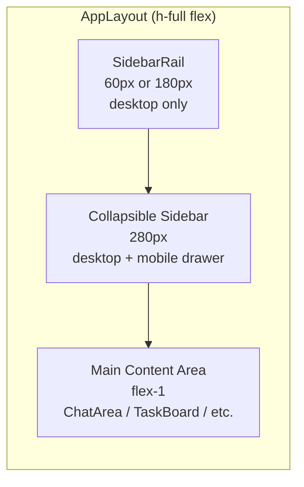
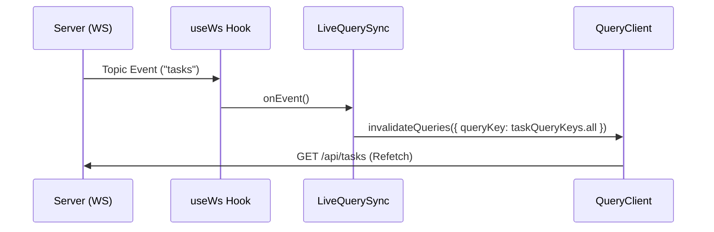

<!-- source: DeepWiki mcp.deepwiki.com · repo swarmclawai/swarmclaw · page 12.1 App Layout & Navigation · fetched 2026-10-27 -->

# App Layout & Navigation

Relevant source files

The following files were used as context for generating this wiki page:

- [next.config.ts](next.config.ts)
- [src/app/api/credentials/route.ts](src/app/api/credentials/route.ts)
- [src/app/api/documents/route.ts](src/app/api/documents/route.ts)
- [src/app/api/external-agents/route.ts](src/app/api/external-agents/route.ts)
- [src/app/api/mcp-servers/[id]/tools/route.ts](src/app/api/mcp-servers/[id]/tools/route.ts)
- [src/app/api/providers/ollama/route.ts](src/app/api/providers/ollama/route.ts)
- [src/app/api/setup/openclaw-device/route.ts](src/app/api/setup/openclaw-device/route.ts)
- [src/app/api/webhooks/[id]/history/route.ts](src/app/api/webhooks/[id]/history/route.ts)
- [src/components/auth/access-key-gate.tsx](src/components/auth/access-key-gate.tsx)
- [src/components/layout/live-query-sync.tsx](src/components/layout/live-query-sync.tsx)
- [src/components/layout/sidebar-rail.tsx](src/components/layout/sidebar-rail.tsx)
- [src/components/org-chart/mini-chat-bubble.tsx](src/components/org-chart/mini-chat-bubble.tsx)
- [src/hooks/use-ws.ts](src/hooks/use-ws.ts)
- [src/lib/app/navigation.ts](src/lib/app/navigation.ts)
- [src/lib/app/view-constants.ts](src/lib/app/view-constants.ts)
- [src/lib/ws-client.ts](src/lib/ws-client.ts)

This page documents the `AppLayout` component — the top-level shell that renders the SwarmClaw dashboard — including the navigation rail, side panel, mobile drawer, view switching logic, global sheet management, and Zustand state integration.

---

## Component Overview

`AppLayout` is the root React component of the dashboard. It manages the layout zones, navigation state, and global overlays. The layout adapts to screen size, providing a desktop rail and sidebar or a mobile drawer.

**Source:** [src/components/layout/sidebar-rail.tsx:21-29]()

The layout consists of three primary zones:

1.  **Sidebar Rail:** The leftmost fixed-width navigation bar.
2.  **Side Panel:** A collapsible list view for entities (agents, tasks, etc.).
3.  **Main Content Area:** The primary workspace (Chat, Task Board, etc.).

*Sources: [src/components/layout/sidebar-rail.tsx:95-98]()*

---

## AppView & Navigation Model

Navigation is driven by the `AppView` type. The mapping between view names and URL paths is handled by `VIEW_TO_PATH` [src/lib/app/navigation.ts:7-37]().

### View Constants
Metadata for each view is stored in `src/lib/app/view-constants.ts`:
*   **VIEW_LABELS:** Display names for navigation items [src/lib/app/view-constants.ts:3-33]().
*   **VIEW_DESCRIPTIONS:** Tooltip and header descriptions [src/lib/app/view-constants.ts:51-81]().
*   **VIEW_EMPTY_STATES:** Configuration for informational placeholders [src/lib/app/view-constants.ts:83-148]().

### Navigation Logic
The `useNavigate` hook provides a type-safe `navigateTo` function [src/lib/app/navigation.ts:59-67](). It uses `getViewPath` to construct URLs, supporting entity-specific paths for `agents` and `chatrooms` [src/lib/app/navigation.ts:40-46]().

| View Category | Example Views |
| :--- | :--- |
| **Communication** | `agents`, `chatrooms`, `inbox`, `swarmfeed` |
| **Orchestration** | `protocols`, `tasks`, `missions`, `schedules` |
| **Resources** | `memory`, `knowledge`, `mcp_servers`, `skills` |
| **Infrastructure** | `providers`, `connectors`, `webhooks`, `wallets` |

*Sources: [src/lib/app/navigation.ts:7-56](), [src/lib/app/view-constants.ts:3-81]()*

---

## Desktop Navigation Rail

The `SidebarRail` component [src/components/layout/sidebar-rail.tsx:21]() manages the primary navigation.

### Expansion States
*   **Expanded (180px):** Shows icons and text labels.
*   **Collapsed (60px):** Shows icons only with `RailTooltip` [src/components/layout/sidebar-rail.tsx:162-165]().
*   **Persistence:** The state is saved in `localStorage` via `sc_rail_expanded` [src/components/layout/sidebar-rail.tsx:17-52]().

### Default Agent Shortcut
The rail features a prominent shortcut to the "Default Agent" [src/components/layout/sidebar-rail.tsx:134-160](). Clicking this calls `goToDefaultChat`, which navigates to the agent thread and triggers a `swarmclaw:scroll-bottom` event [src/components/layout/sidebar-rail.tsx:68-74]().

### Navigation Behavior
When a user clicks a navigation item:
1.  If the view is a `FULL_WIDTH_VIEW` (e.g., `marketplace`), the sidebar is closed [src/components/layout/sidebar-rail.tsx:83-84]().
2.  If the view is already active, the sidebar toggles [src/components/layout/sidebar-rail.tsx:85-86]().
3.  Otherwise, the sidebar opens to show the list for that view [src/components/layout/sidebar-rail.tsx:88]().

*Sources: [src/components/layout/sidebar-rail.tsx:51-92](), [src/lib/app/view-constants.ts:151-155]()*

---

## Live Query Sync

The `LiveQuerySync` component [src/components/layout/live-query-sync.tsx:28]() maintains UI freshness by bridging WebSocket events to TanStack Query invalidations.

### Topic Subscriptions
`LiveQuerySync` subscribes to various topics with specific fallback polling intervals:
*   **`agents`**: 60s fallback [src/components/layout/live-query-sync.tsx:34]().
*   **`tasks`**: 5s fallback [src/components/layout/live-query-sync.tsx:41]().
*   **`messages`**: 5s fallback [src/components/layout/live-query-sync.tsx:97]().
*   **`protocol_runs`**: 2s fallback [src/components/layout/live-query-sync.tsx:48]().

*Sources: [src/components/layout/live-query-sync.tsx:31-121](), [src/hooks/use-ws.ts:61-137]()*

---

## Global State & Sheet Management

The `useAppStore` (Zustand) acts as the central coordinator for layout state.

### Sheet Pattern
SwarmClaw uses a global sheet/dialog pattern where components like `AgentSheet`, `TaskSheet`, and `ProviderSheet` are controlled via the store.
*   **Visibility:** `setSidebarOpen(boolean)` [src/components/layout/sidebar-rail.tsx:42]().
*   **Context:** `currentAgentId` [src/components/layout/sidebar-rail.tsx:40]() and `currentUser` [src/components/layout/sidebar-rail.tsx:32]() drive content rendering.

### Authentication Gate
Before the layout renders, the `AccessKeyGate` [src/components/auth/access-key-gate.tsx:17]() ensures the user is authenticated.
1.  Checks `/api/auth` for existing session or first-time setup [src/components/auth/access-key-gate.tsx:34-40]().
2.  If first-time, displays the generated key and requires confirmation [src/components/auth/access-key-gate.tsx:132-170]().
3.  Stores the key in `localStorage` via `setStoredAccessKey` upon success [src/components/auth/access-key-gate.tsx:68]().

*Sources: [src/components/auth/access-key-gate.tsx:30-81](), [src/components/layout/sidebar-rail.tsx:32-44]()*

---

## Mobile Navigation

On mobile devices, the layout shifts to a drawer-based system.
*   **Drawer:** The `SidebarRail` is rendered with the `mobile` prop, forcing it to full width [src/components/layout/sidebar-rail.tsx:96]().
*   **Auto-close:** Navigation actions automatically call `setSidebarOpen(false)` to close the mobile drawer [src/components/layout/sidebar-rail.tsx:79-81]().
*   **Rail:** Expansion is forced to `true` on mobile [src/components/layout/sidebar-rail.tsx:56]().

*Sources: [src/components/layout/sidebar-rail.tsx:55-82]()*

---

## Mini Chat Bubbles

A unique navigation feature is the `MiniChatBubble` [src/components/org-chart/mini-chat-bubble.tsx:39](), used in the Org Chart to allow quick interaction without switching the primary view.

### Implementation Details
*   **Session Caching:** Uses an `hmrSingleton` cache to map `agentId` to `sessionId`, avoiding redundant session creation [src/components/org-chart/mini-chat-bubble.tsx:24-56]().
*   **Streaming:** Implements `streamChat` with SSE event handling for `d` (data), `tool_call`, and `status` events [src/components/org-chart/mini-chat-bubble.tsx:143-174]().
*   **Real-time Sync:** Uses `useWs` on the specific `messages:sessionId` topic to keep the bubble updated [src/components/org-chart/mini-chat-bubble.tsx:106-110]().

*Sources: [src/components/org-chart/mini-chat-bubble.tsx:52-110]()*

---

