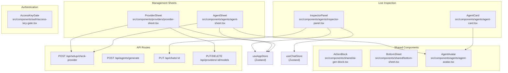
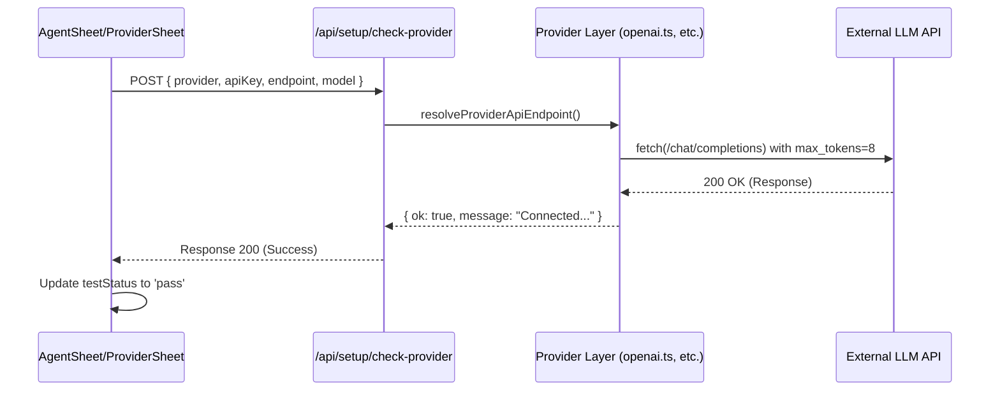

<!-- source: DeepWiki mcp.deepwiki.com · repo swarmclawai/swarmclaw · page 12.3 Agent & Provider Management UI · fetched 2026-10-27 -->

# Agent & Provider Management UI

Relevant source files

The following files were used as context for generating this wiki page:

- [src/app/api/setup/check-provider/route.ts](src/app/api/setup/check-provider/route.ts)
- [src/components/agents/agent-avatar.tsx](src/components/agents/agent-avatar.tsx)
- [src/components/agents/agent-sheet.tsx](src/components/agents/agent-sheet.tsx)
- [src/components/agents/inspector-panel.tsx](src/components/agents/inspector-panel.tsx)
- [src/components/chat/chat-list.tsx](src/components/chat/chat-list.tsx)
- [src/components/chatrooms/chatroom-input.tsx](src/components/chatrooms/chatroom-input.tsx)
- [src/components/chatrooms/chatroom-view.tsx](src/components/chatrooms/chatroom-view.tsx)
- [src/components/providers/provider-sheet.tsx](src/components/providers/provider-sheet.tsx)
- [src/features/providers/queries.ts](src/features/providers/queries.ts)
- [src/lib/chatroom-sessions.ts](src/lib/chatroom-sessions.ts)
- [src/lib/provider-sets.ts](src/lib/provider-sets.ts)
- [src/lib/providers/anthropic.ts](src/lib/providers/anthropic.ts)
- [src/lib/providers/index.ts](src/lib/providers/index.ts)
- [src/lib/providers/openai.ts](src/lib/providers/openai.ts)
- [src/lib/server/chatrooms/chatroom-helpers.test.ts](src/lib/server/chatrooms/chatroom-helpers.test.ts)
- [src/lib/server/chatrooms/chatroom-helpers.ts](src/lib/server/chatrooms/chatroom-helpers.ts)
- [src/lib/server/context-manager.ts](src/lib/server/context-manager.ts)
- [src/lib/server/provider-endpoint.ts](src/lib/server/provider-endpoint.ts)
- [src/stores/slices/agent-slice.ts](src/stores/slices/agent-slice.ts)
- [src/stores/slices/session-slice.test.ts](src/stores/slices/session-slice.test.ts)
- [src/stores/slices/session-slice.ts](src/stores/slices/session-slice.ts)
- [src/types/provider.ts](src/types/provider.ts)
- [src/types/session.ts](src/types/session.ts)

This page documents the UI components responsible for creating and configuring agents (`AgentSheet`), managing LLM providers (`ProviderSheet`), and gating access to the dashboard (`AccessKeyGate`). It also covers the `InspectorPanel` used for real-time session monitoring and the `AgentCard` / `AgentList` components for roster management.

For background on the underlying agent data model, see [4.1 Agent Configuration](). For provider internals and failover logic, see [5 LLM Providers](). For the API client utility that these components use to communicate with the server, see [12.5 API Client]().

---

## Component Map

**Component to code entity mapping:**

Sources: [src/components/agents/agent-sheet.tsx:1-50](), [src/components/agents/inspector-panel.tsx:1-30](), [src/components/providers/provider-sheet.tsx:1-30](), [src/components/agents/agent-avatar.tsx:1-10]()

---

## AgentSheet

`AgentSheet` (`src/components/agents/agent-sheet.tsx`) is the primary create/edit form for `Agent` records. It handles complex configurations including provider selection, tool enablement, and agent pack import/export.

### State Initialization & Provider Logic
The sheet uses `buildAgentSelectableProviders` to filter available backends based on the system's current `providers` and `providerConfigs`. It categorizes providers into sets like `NON_LANGGRAPH_PROVIDER_IDS` (CLI tools) and `WORKER_ONLY_PROVIDER_IDS` to adjust UI visibility.

[src/components/agents/agent-sheet.tsx:12-32](), [src/components/agents/agent-sheet.tsx:300-310]()

### Key Features
- **Provider Connection Testing**: Calls `POST /api/setup/check-provider` to verify API keys and endpoints before saving. It supports a `CONNECTION_TEST_TIMEOUT_MS` of 40 seconds. [src/components/agents/agent-sheet.tsx:52-52](), [src/app/api/setup/check-provider/route.ts:56-62]()
- **Heartbeat Configuration**: Allows setting autonomous "pulse" intervals using presets like 30m, 1h, 2h, 6h, or 12h. [src/components/agents/agent-sheet.tsx:34-34]()
- **Agent Pack Import/Export**: Facilitates portability of agent definitions (prompts, tools, and identity) via JSON manifests. [src/components/agents/agent-sheet.tsx:13-13]()
- **Identity Lists**: Supports multi-line input for agent identities and gateway tags, parsed into arrays for the backend. [src/components/agents/agent-sheet.tsx:117-151]()

Sources: [src/components/agents/agent-sheet.tsx:1-100](), [src/app/api/setup/check-provider/route.ts:1-50]()

---

## ProviderSheet

`ProviderSheet` manages both built-in (e.g., Anthropic, OpenAI) and custom OpenAI-compatible providers.

### API Connection Verification
The `check-provider` API route acts as the backend for the "Test Connection" button. It performs provider-specific health checks:
- **OpenAI-Compatible**: Attempts a minimal chat completion with `max_completion_tokens: 8`. [src/app/api/setup/check-provider/route.ts:105-115]()
- **Anthropic**: Verifies the key using a specific `anthropic-version` header. [src/app/api/setup/check-provider/route.ts:133-140]()
- **Ollama**: Probes `/api/tags` or `/v1/models` to discover available local or cloud models. [src/app/api/setup/check-provider/route.ts:189-195]()

### AI-Assisted Generation
Users can provide a natural language description of a provider (e.g., "Connect to my local vLLM instance"), and the sheet uses AI-assisted generation to populate `baseUrl`, `models`, and required security settings.

Sources: [src/app/api/setup/check-provider/route.ts:56-200](), [src/components/providers/provider-sheet.tsx:1-50]()

---

## InspectorPanel

`InspectorPanel` (`src/components/agents/inspector-panel.tsx`) is a side-panel component providing a "live view" of a specific agent's state within a session.

### Tabs and Capabilities
1. **Dashboard**: Displays real-time metrics, heartbeat status, and session-specific tool configurations.
2. **Config**: Allows hot-swapping the `model` or `provider` for an active session via the `ModelSwitcherInline` component. [src/components/agents/inspector-panel.tsx:68-108]()
3. **Files**: (OpenClaw only) Provides a file explorer and editor for the agent's workspace. [src/components/agents/inspector-panel.tsx:44-48]()

### Model Hot-Swapping
The `ModelSwitcherInline` component allows users to change the LLM powering a chat without leaving the view. It calls `PUT /api/chats/${session.id}` and refreshes the session state in the store. [src/components/agents/inspector-panel.tsx:95-108]()

Sources: [src/components/agents/inspector-panel.tsx:1-120]()

---

## AgentCard & AgentList

These components form the roster view for managing multiple agents.

- **AgentCard**: Displays the agent's avatar, name, and current provider. It features a "heartbeat pulse" animation when the agent is active and shows the remaining daily budget.
- **AgentAvatar**: A shared component that renders the agent's image or a generated placeholder based on the `agent.avatar` property. [src/components/agents/agent-avatar.tsx:1-20]()
- **Heartbeat Visualization**: The UI listens for `heartbeat:agent:${agentId}` events via WebSockets to trigger visual pulses in the roster. [src/components/chatrooms/chatroom-view.tsx:57-64]()

Sources: [src/components/agents/agent-avatar.tsx:1-30](), [src/components/chatrooms/chatroom-view.tsx:139-142]()

---

## AccessKeyGate

`AccessKeyGate` serves as the primary authentication wall. It intercepts application mounting until a valid `X-Access-Key` is provided.

### Authentication Flow
1. **Initial Check**: On mount, the component checks `localStorage` for an existing key.
2. **Challenge**: If no key exists or the server returns `401`, the gate displays a login overlay.
3. **API Integration**: All requests made via the `api()` utility automatically include the key in the headers. If the server rejects the key, the `sc_auth_required` event is dispatched to trigger the gate.

Sources: [src/lib/app/api-client.ts:1-50]() (referenced), [src/components/auth/access-key-gate.tsx:1-50]() (referenced)

---

## Technical Data Flow: Provider Validation

The following diagram illustrates how the UI interacts with the backend to validate a new LLM provider during setup.

Sources: [src/app/api/setup/check-provider/route.ts:56-128](), [src/lib/providers/openai.ts:91-118](), [src/components/agents/agent-sheet.tsx:356-383]()

---

