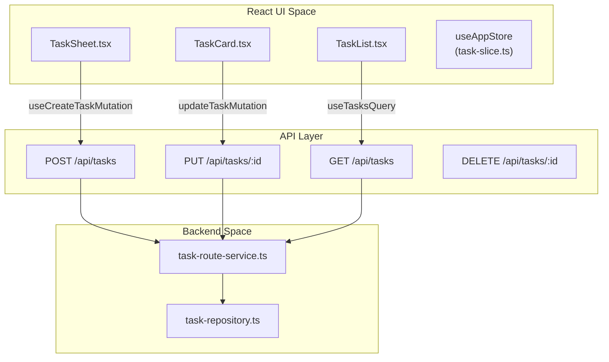
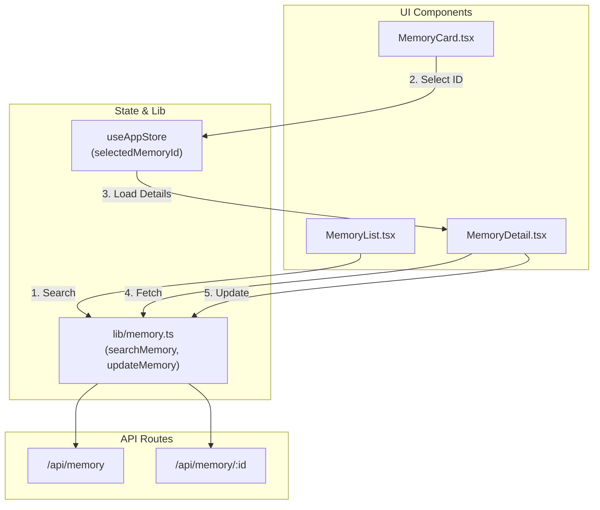

<!-- source: DeepWiki mcp.deepwiki.com · repo swarmclawai/swarmclaw · page 12.4 Task & Memory UI · fetched 2026-10-27 -->

# Task & Memory UI

Relevant source files

The following files were used as context for generating this wiki page:

- [src/app/api/tasks/[id]/route.ts](src/app/api/tasks/[id]/route.ts)
- [src/app/api/tasks/route.ts](src/app/api/tasks/route.ts)
- [src/components/memory/memory-detail.tsx](src/components/memory/memory-detail.tsx)
- [src/components/memory/memory-list.tsx](src/components/memory/memory-list.tsx)
- [src/components/shared/settings-sheet.tsx](src/components/shared/settings-sheet.tsx)
- [src/components/tasks/task-card.tsx](src/components/tasks/task-card.tsx)
- [src/components/tasks/task-column.tsx](src/components/tasks/task-column.tsx)
- [src/components/tasks/task-list.tsx](src/components/tasks/task-list.tsx)
- [src/components/tasks/task-sheet.tsx](src/components/tasks/task-sheet.tsx)
- [src/lib/server/session-tools.ts](src/lib/server/session-tools.ts)
- [src/stores/use-app-store.ts](src/stores/use-app-store.ts)

This page documents the frontend components responsible for task management (`TaskSheet`, `TaskCard`, `TaskList`, `TaskColumn`) and the agent memory browsing interface (`MemoryList`, `MemoryCard`, `MemoryDetail`). It explains how these components interact with the `useAppStore`, React Query hooks, and the backend REST API.

---

## Task UI

The Task UI is built around a Kanban-style board and a detailed creation/editing sheet. It leverages `useTasksQuery` and associated mutations for data synchronization.

### TaskSheet

`TaskSheet` ([src/components/tasks/task-sheet.tsx:47]()) is a complex entry form rendered within a `BottomSheet`. It handles task creation, editing, and execution configuration.

**Key Features & Implementation:**

*   **State Management**: Uses `useAppStore` to track `taskSheetOpen` ([src/components/tasks/task-sheet.tsx:49]()) and `editingTaskId` ([src/components/tasks/task-sheet.tsx:51]()).
*   **Quality Gate Configuration**: Allows setting validation criteria for task completion, including minimum result characters, evidence items, and requirements for artifacts or reports ([src/components/tasks/task-sheet.tsx:82-87]()).
*   **DAG Dependencies**: Users can manage `blockedBy` relationships ([src/components/tasks/task-sheet.tsx:76]()) to create task dependencies.
*   **Image Upload**: `handleImageUpload` [src/components/tasks/task-sheet.tsx:120-135] (not shown in snippet but implied by state) manages uploading assets to the backend.
*   **Comment Management**: Supports appending comments to tasks via `useAppendTaskCommentMutation` ([src/components/tasks/task-sheet.tsx:63]()).

### TaskCard & TaskColumn

The Kanban board consists of `TaskColumn` ([src/components/tasks/task-column.tsx:32]()) components representing different `BoardTaskStatus` values (backlog, queued, running, completed, failed, etc.).

*   **Drag and Drop**: `TaskCard` implements native HTML5 drag-and-drop ([src/components/tasks/task-card.tsx:104-112]()). `TaskColumn` handles the `onDrop` event to trigger status transitions via `updateTaskMutation` ([src/components/tasks/task-column.tsx:60-67]()).
*   **Visual Indicators**: Cards display priority badges ([src/components/tasks/task-card.tsx:65-71]()), blocked status icons ([src/components/tasks/task-card.tsx:153-158]()), and agent avatars for the assigned agent ([src/components/tasks/task-card.tsx:8]()).
*   **Quick Add**: `TaskColumn` includes a "Quick Add" input for rapidly creating tasks directly into a specific status ([src/components/tasks/task-column.tsx:111-124]()).

### TaskList

`TaskList` ([src/components/tasks/task-list.tsx:22]()) provides a simplified, searchable list view of tasks, typically used in the sidebar or mobile views. It includes a "Clear finished" utility ([src/components/tasks/task-list.tsx:76-85]()) that invokes `useClearDoneTasksMutation` to archive completed/failed tasks.

---

**Diagram: Task Data Flow (UI to API)**

Sources: [src/components/tasks/task-sheet.tsx](), [src/components/tasks/task-card.tsx](), [src/app/api/tasks/route.ts](), [src/app/api/tasks/[id]/route.ts]()

---

## Memory UI

The Memory UI provides a master-detail interface for browsing agent "memories" (durable facts, preferences, and findings).

### MemoryList & MemoryCard

`MemoryList` ([src/components/memory/memory-list.tsx:14]()) manages the search and filtering of memory entries.

*   **Search**: Performs debounced calls to `searchMemory` ([src/components/memory/memory-list.tsx:29-38]()) which hits `GET /api/memory`.
*   **Filtering**: Provides client-side filtering by Agent ([src/components/memory/memory-list.tsx:96-124]()) and Category ([src/components/memory/memory-list.tsx:127-151]()).
*   **Refresh Logic**: Uses a `memoryRefreshKey` from the store to force re-fetches after edits ([src/components/memory/memory-list.tsx:44-47]()).

### MemoryDetail

`MemoryDetail` ([src/components/memory/memory-detail.tsx:14]()) is the primary viewing and editing component.

*   **CRUD Operations**: Uses `getMemory`, `updateMemory`, and `deleteMemory` utilities from `@/lib/memory` ([src/components/memory/memory-detail.tsx:6]()).
*   **Tiers & Scope**: Displays and allows editing of memory tiers (working, durable, archive) and scope (agent-specific vs. global) ([src/components/memory/memory-detail.tsx:105-110]()).
*   **Graph Links**: Resolves and displays titles for `linkedMemoryIds` ([src/components/memory/memory-detail.tsx:75-93]()), allowing users to traverse the memory graph.
*   **Context Links**: Provides navigation back to the specific session where the memory was formed ([src/components/memory/memory-detail.tsx:138-144]()).

---

**Diagram: Memory UI Interaction Model**

Sources: [src/components/memory/memory-list.tsx](), [src/components/memory/memory-detail.tsx](), [src/stores/use-app-store.ts]()

---

## Global State Integration

Both subsystems rely on `useAppStore` ([src/stores/use-app-store.ts:14]()) which aggregates slices for different domains.

### Task Slice
Tracks UI state for the task sheet and active project filters.
*   `taskSheetOpen`: Boolean toggle for the sheet.
*   `editingTaskId`: The ID of the task currently being modified.
*   `activeProjectFilter`: Used by `TaskList` ([src/components/tasks/task-list.tsx:35]()) and Kanban board to filter items by project.

### Memory Slice
Tracks selection and refresh signals.
*   `selectedMemoryId`: The UUID of the memory entry displayed in `MemoryDetail`.
*   `memoryRefreshKey`: A counter incremented to trigger `useEffect` hooks in `MemoryList`.
*   `memoryAgentFilter`: Stores the currently selected agent filter for the memory list.

Sources: [src/stores/use-app-store.ts](), [src/components/tasks/task-list.tsx:23-25](), [src/components/memory/memory-list.tsx:16-21]()

---

