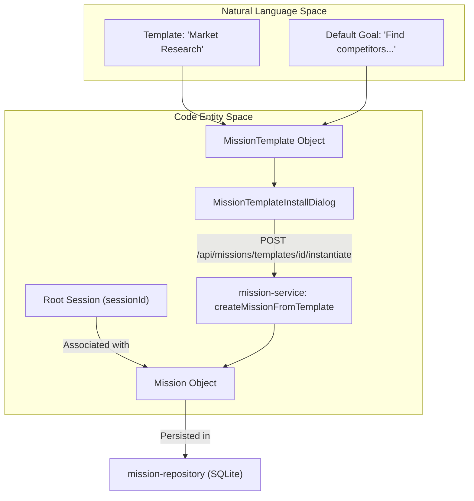
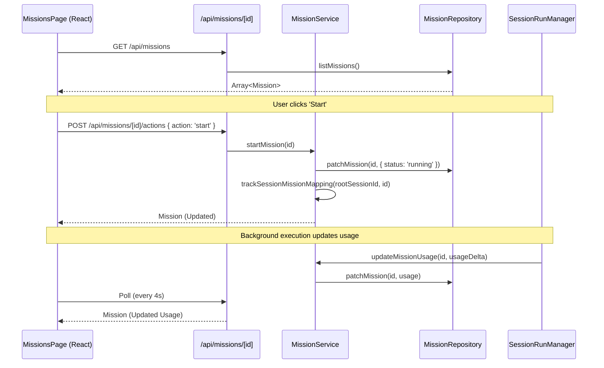

<!-- source: DeepWiki mcp.deepwiki.com · repo swarmclawai/swarmclaw · page 14.2 Mission UI · fetched 2026-10-27 -->

# Mission UI

Relevant source files

The following files were used as context for generating this wiki page:

- [src/app/api/missions/[id]/route.ts](src/app/api/missions/[id]/route.ts)
- [src/app/api/missions/route.ts](src/app/api/missions/route.ts)
- [src/app/api/missions/templates/[id]/instantiate/route.ts](src/app/api/missions/templates/[id]/instantiate/route.ts)
- [src/app/api/missions/templates/route.ts](src/app/api/missions/templates/route.ts)
- [src/app/api/s/[token]/raw/route.ts](src/app/api/s/[token]/raw/route.ts)
- [src/app/api/s/[token]/route.ts](src/app/api/s/[token]/route.ts)
- [src/app/api/share/[id]/route.ts](src/app/api/share/[id]/route.ts)
- [src/app/api/share/route.ts](src/app/api/share/route.ts)
- [src/app/missions/page.tsx](src/app/missions/page.tsx)
- [src/app/s/[token]/page.tsx](src/app/s/[token]/page.tsx)
- [src/components/missions/mission-template-gallery.tsx](src/components/missions/mission-template-gallery.tsx)
- [src/components/missions/mission-template-install-dialog.tsx](src/components/missions/mission-template-install-dialog.tsx)
- [src/lib/server/agents/subagent-runtime.ts](src/lib/server/agents/subagent-runtime.ts)
- [src/lib/server/agents/subagent-swarm.test.ts](src/lib/server/agents/subagent-swarm.test.ts)
- [src/lib/server/agents/subagent-swarm.ts](src/lib/server/agents/subagent-swarm.ts)
- [src/lib/server/missions/mission-service.ts](src/lib/server/missions/mission-service.ts)
- [src/lib/server/missions/mission-templates.test.ts](src/lib/server/missions/mission-templates.test.ts)
- [src/lib/server/session-tools/subagent.ts](src/lib/server/session-tools/subagent.ts)
- [src/lib/server/sharing/share-link-repository.test.ts](src/lib/server/sharing/share-link-repository.test.ts)
- [src/lib/server/sharing/share-link-repository.ts](src/lib/server/sharing/share-link-repository.ts)
- [src/lib/server/sharing/share-resolver.ts](src/lib/server/sharing/share-resolver.ts)
- [src/lib/server/storage-normalization.ts](src/lib/server/storage-normalization.ts)
- [src/types/mission.ts](src/types/mission.ts)

The Mission UI provides a high-level command center for managing long-running, goal-oriented agent activities. Unlike standard chat sessions, the Mission UI focuses on budget tracking, milestone visualization, and automated progress reporting. It bridges the gap between the **Mission Service** and the user-facing dashboard.

## Overview

The Missions page [src/app/missions/page.tsx:1-117]() serves as the primary interface for creating, monitoring, and controlling missions. It utilizes a master-detail layout where users can browse active missions, view their real-time resource consumption, and drill down into specific milestones or reports.

### Key UI Components

| Component | Purpose |
| :--- | :--- |
| `MissionsPage` | Main view controller; handles polling [src/app/missions/page.tsx:17-17]() and state management. |
| `MissionCard` | Displays mission summary, current status badge, and high-level usage [src/app/missions/page.tsx:88-117](). |
| `MissionControls` | Provides action buttons for state transitions (Start, Pause, Resume, Cancel) [src/app/missions/page.tsx:127-189](). |
| `BudgetBar` | Visual progress indicator for USD, Token, and Turn consumption against caps [src/app/missions/page.tsx:60-80](). |
| `MissionTemplateGallery` | Browser for pre-defined mission archetypes [src/components/missions/mission-template-gallery.tsx](). |
| `MissionTemplateInstallDialog` | Configuration wizard for instantiating a mission from a template [src/components/missions/mission-template-install-dialog.tsx:51-135](). |

**Sources:** [src/app/missions/page.tsx:1-189](), [src/components/missions/mission-template-install-dialog.tsx:1-135]()

## Mission Template System

Missions are rarely created from scratch. Instead, they are typically instantiated from a `MissionTemplate` [src/types/mission.ts:143-152]().

### Template Instantiation Flow
1.  **Gallery Selection**: The user selects a template (e.g., "Research", "Monitoring") from the `MissionTemplateGallery`.
2.  **Configuration**: The `MissionTemplateInstallDialog` opens, pre-filling defaults for `goal`, `successCriteria`, and `budget` [src/components/missions/mission-template-install-dialog.tsx:65-81]().
3.  **Session Linking**: The user must select a `rootSessionId` [src/components/missions/mission-template-install-dialog.tsx:100-103](). This session serves as the entry point for the mission's execution.
4.  **API Call**: The UI calls the instantiation endpoint `/api/missions/templates/[id]/instantiate` [src/lib/server/missions/mission-service.ts:140-159]().

### Implementation Diagram: Template to Mission
This diagram shows how a template in the "Natural Language Space" (Description/Icon) is converted into a functional "Code Entity" (Mission).

**Sources:** [src/types/mission.ts:143-152](), [src/components/missions/mission-template-install-dialog.tsx:51-135](), [src/lib/server/missions/mission-service.ts:140-159]()

## Data Flow & Linking

Missions act as an umbrella over several other system entities.

### Root Sessions and Tasks
A Mission is always anchored by a `rootSessionId` [src/types/mission.ts:105-105](). 
- When a mission starts, it maps the `rootSessionId` to the `missionId` in the runtime cache [src/lib/server/missions/mission-service.ts:18-26]().
- Any execution (turn) occurring within that session or its descendants (sub-agents spawned via `spawnSubagent`) is attributed to the mission's budget [src/lib/server/missions/mission-service.ts:42-52]().

### Sub-agent Swarms
Missions often utilize the `subagent-swarm` system to parallelize work. The `MissionBudget` can define a `maxParallelBranches` [src/types/mission.ts:36-36]() cap, which overrides system defaults during `spawnSwarm` calls [src/lib/server/agents/subagent-swarm.ts:134-140]().

### State Management Diagram
The following diagram illustrates how the UI interacts with the backend services to manage mission lifecycles.

**Sources:** [src/app/missions/page.tsx:17-17](), [src/lib/server/missions/mission-service.ts:42-52](), [src/lib/server/missions/mission-service.ts:161-191](), [src/lib/server/agents/subagent-swarm.ts:134-140]()

## Mission API Reference

The UI interacts with missions primarily through two route files:

### `GET /api/missions`
Lists all missions stored in the system [src/app/api/missions/route.ts:39-41]().

### `POST /api/missions`
Creates a new mission. Requires `title`, `goal`, and `rootSessionId` [src/app/api/missions/route.ts:28-37](). It also wires the session back-reference immediately so the budget hook can monitor the session [src/app/api/missions/route.ts:50-57]().

### `PUT /api/missions/[id]`
Updates mission metadata, success criteria, or budget caps [src/app/api/missions/[id]/route.ts:45-66]().

### `DELETE /api/missions/[id]`
Removes the mission and clears the `missionId` reference from the associated `rootSession` [src/app/api/missions/[id]/route.ts:68-83]().

**Sources:** [src/app/api/missions/route.ts:1-60](), [src/app/api/missions/[id]/route.ts:1-84]()

---

