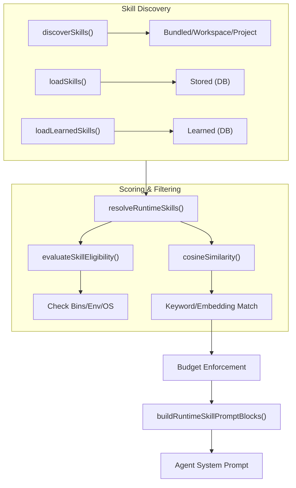
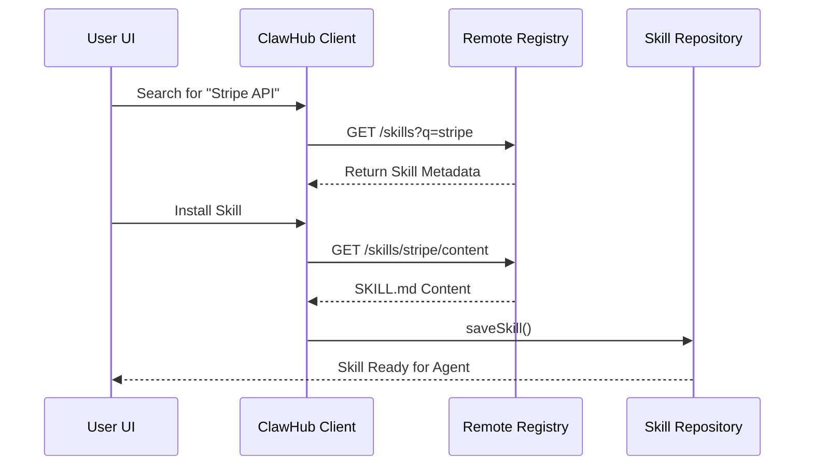

<!-- source: DeepWiki mcp.deepwiki.com · repo swarmclawai/swarmclaw · page 15.1 Skills System · fetched 2026-10-27 -->

# Skills System

Relevant source files

The following files were used as context for generating this wiki page:

- [skills/swarmclaw/SKILL.md](skills/swarmclaw/SKILL.md)
- [skills/swarmvault/SKILL.md](skills/swarmvault/SKILL.md)
- [src/app/api/mcp-servers/route.ts](src/app/api/mcp-servers/route.ts)
- [src/components/mcp-servers/mcp-server-sheet.tsx](src/components/mcp-servers/mcp-server-sheet.tsx)
- [src/lib/providers/openclaw.ts](src/lib/providers/openclaw.ts)
- [src/lib/server/__fixtures__/fake-mcp-stdio-server.mjs](src/lib/server/__fixtures__/fake-mcp-stdio-server.mjs)
- [src/lib/server/chat-execution/chat-turn-preparation.ts](src/lib/server/chat-execution/chat-turn-preparation.ts)
- [src/lib/server/chats/chat-session-service.ts](src/lib/server/chats/chat-session-service.ts)
- [src/lib/server/connectors/swarmdock-bidding.ts](src/lib/server/connectors/swarmdock-bidding.ts)
- [src/lib/server/connectors/swarmdock-payloads.test.ts](src/lib/server/connectors/swarmdock-payloads.test.ts)
- [src/lib/server/connectors/swarmdock-tasks.ts](src/lib/server/connectors/swarmdock-tasks.ts)
- [src/lib/server/mcp-client.ts](src/lib/server/mcp-client.ts)
- [src/lib/server/runtime/perf.ts](src/lib/server/runtime/perf.ts)
- [src/lib/server/runtime/queue-recovery.test.ts](src/lib/server/runtime/queue-recovery.test.ts)
- [src/lib/server/runtime/queue/core.ts](src/lib/server/runtime/queue/core.ts)
- [src/lib/server/skills/runtime-skill-resolver.ts](src/lib/server/skills/runtime-skill-resolver.ts)
- [src/lib/server/universal-tool-access.test.ts](src/lib/server/universal-tool-access.test.ts)
- [src/lib/server/universal-tool-access.ts](src/lib/server/universal-tool-access.ts)
- [src/types/misc.ts](src/types/misc.ts)
- [swarmclaw-skill.md](swarmclaw-skill.md)
- [swarmclaw/SKILL.md](swarmclaw/SKILL.md)

The **Skills System** is a documentation-driven orchestration layer that teaches agents how to use tools, APIs, and complex workflows. Unlike executable tools, skills are primarily structured Markdown files (`SKILL.md`) that provide the semantic "how-to" context required for an LLM to effectively utilize its available capabilities.

## Skill Format and Frontmatter

Skills are defined using a standardized `SKILL.md` format. This format combines YAML frontmatter for system-level discovery and eligibility with Markdown content for the agent's consumption.

### SKILL.md Structure
- **Frontmatter**: Defines the skill's identity, versioning, and requirements (e.g., environment variables, binary dependencies). [skills/swarmclaw/SKILL.md:1-13]()
- **Content**: Detailed documentation, tool selection guides, and JSON call examples that are injected into the agent's prompt. [skills/swarmclaw/SKILL.md:15-50]()

### Metadata Schema
The `metadata.openclaw` block provides specific instructions for the runtime:
- `emoji`: Visual representation in the UI. [swarmclaw/SKILL.md:13-13]()
- `requires`: Defines `env` (environment variables) and `bins` (required CLI binaries) needed for the skill to be considered "eligible". [swarmclaw/SKILL.md:5-11]()
- `primaryEnv`: The main credential key associated with the skill. [swarmclaw/SKILL.md:12-12]()

## Skill Discovery and Layers

SwarmClaw discovers skills across multiple filesystem layers, allowing for built-in, workspace-specific, and project-specific documentation.

| Layer | Location / Source | Purpose |
|-------|-------------------|---------|
| **Bundled** | `skills/` | Built-in platform skills (e.g., `swarmclaw`, `swarmvault`). [skills/swarmclaw/SKILL.md:75-75]() |
| **Stored** | `data/skills/` | User-created or imported skills via the UI/API. [skills/swarmclaw/SKILL.md:76-76]() |
| **Workspace** | Agent's CWD | Skills found within the current agent's working directory. [src/lib/server/skills/runtime-skill-resolver.ts:159-159]() |
| **Project** | Project Root | Skills shared across all agents in a specific project. [src/lib/server/skills/runtime-skill-resolver.ts:160-160]() |
| **Learned** | `learned_skills` table | Dynamic insights extracted by agents during execution. [src/lib/server/skills/runtime-skill-resolver.ts:158-158]() |

**Sources:** [src/lib/server/skills/runtime-skill-resolver.ts:24-24](), [src/lib/server/skills/runtime-skill-resolver.ts:155-161]()

## Runtime Skill Resolver

The `runtime-skill-resolver.ts` is responsible for aggregating, scoring, and filtering skills for a specific chat turn.

### Data Flow: From Discovery to Prompt

Title: Skill Resolution and Injection Pipeline

**Sources:** [src/lib/server/skills/runtime-skill-resolver.ts:129-139](), [src/lib/server/skills/runtime-skill-resolver.ts:17-18](), [src/lib/server/skills/runtime-skill-resolver.ts:26-28]()

### Skill Eligibility and Budget
To prevent context window overflow, the system enforces strict budgets:
- **MAX_SKILLS_IN_PROMPT**: Limits the number of skills injected. [src/lib/server/skills/runtime-skill-resolver.ts:20-20]()
- **MAX_SKILLS_PROMPT_CHARS**: Limits the total character count of injected documentation. [src/lib/server/skills/runtime-skill-resolver.ts:21-21]()
- **Eligibility**: Skills are only injected if the host environment satisfies the `requires` block (e.g., the `swarmclaw` binary is present). [src/lib/server/skills/skill-eligibility.ts:1-20]()

## Learned Skills and Suggestions

Agents can dynamically improve their own documentation through two mechanisms:
1. **Learned Skills**: During "Dream Cycles" or post-task reflection, agents can store new procedural knowledge in the `learned_skills` table. [src/lib/server/skills/runtime-skill-resolver.ts:16-16]()
2. **Skill Suggestions**: The system uses embeddings to suggest relevant skills based on the user's intent or current task description. [src/lib/server/skills/runtime-skill-resolver.ts:141-153]()

## Tool Integration: manage_skills

The `manage_skills` tool (part of the Universal Tool Access set) allows agents to interact with the skill system programmatically. [src/lib/server/universal-tool-access.ts:17-17]()

### Tool Actions
- **list**: Discover available skills. [skills/swarmclaw/SKILL.md:68-68]()
- **read**: Load the full content of a specific skill (e.g., `tools/files`). [skills/swarmclaw/SKILL.md:69-69]()
- **search**: Find skills using keyword queries (e.g., "github pr"). [skills/swarmclaw/SKILL.md:70-70]()

## Remote Skill Registry: ClawHub

SwarmClaw includes a client for **ClawHub**, a remote registry for sharing and discovering skills. This allows users to import high-quality documentation for third-party APIs and tools directly into their local instance.

Title: Remote Skill Import Flow

**Sources:** [src/lib/server/skills/skill-repository.ts:1-20](), [src/types/misc.ts:4-4]()

## Skill Audit and Maintenance

The system provides auditing tools to ensure skills remain valid:
- **Skill Audit**: Checks if required binaries have been uninstalled or if environment variables are missing. [src/lib/server/skills/runtime-skill-resolver.ts:63-73]()
- **Security Summary**: Evaluates the risk level of a skill based on the tools it requires (e.g., a skill requiring `execute` is higher risk than one requiring only `memory`). [src/lib/server/skills/runtime-skill-resolver.ts:10-10]()

**Sources:** [src/lib/server/skills/runtime-skill-resolver.ts:58-118](), [src/lib/server/skills/skill-prompt-budget.ts:1-10]()

---

