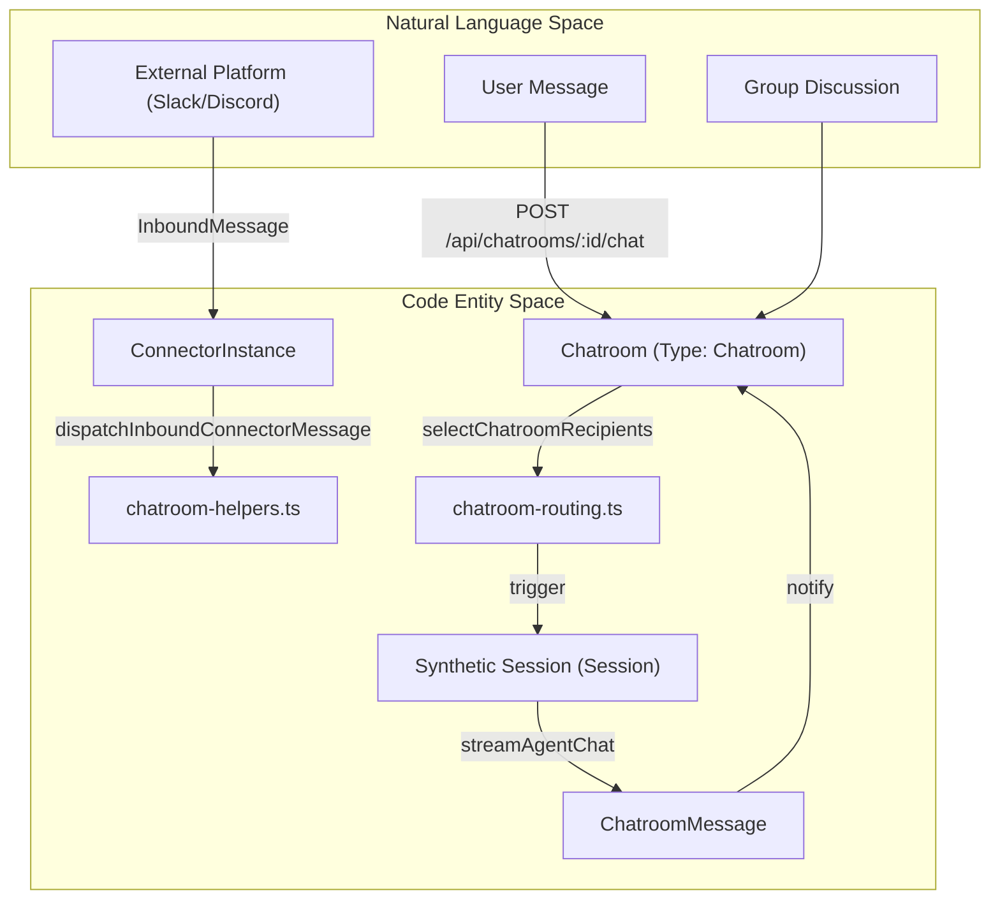
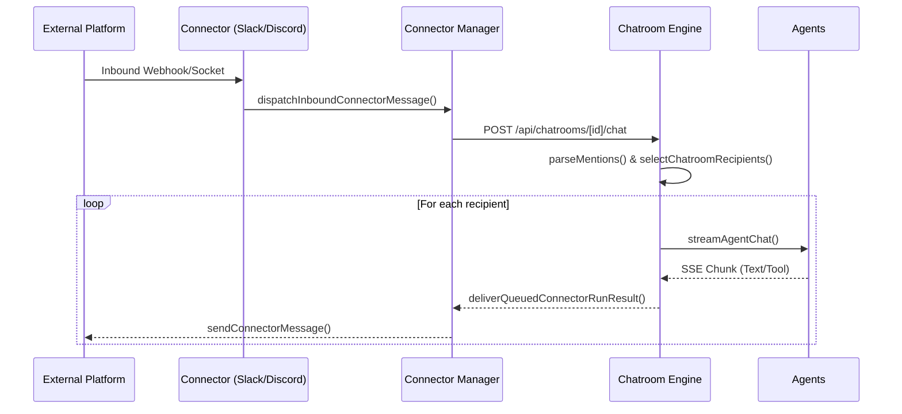

<!-- source: DeepWiki mcp.deepwiki.com · repo swarmclawai/swarmclaw · page 16 Chatrooms · fetched 2026-10-27 -->

# Chatrooms

Relevant source files

The following files were used as context for generating this wiki page:

- [src/app/api/chatrooms/[id]/chat/route.test.ts](src/app/api/chatrooms/[id]/chat/route.test.ts)
- [src/app/api/chatrooms/[id]/chat/route.ts](src/app/api/chatrooms/[id]/chat/route.ts)
- [src/app/api/chatrooms/[id]/members/route.ts](src/app/api/chatrooms/[id]/members/route.ts)
- [src/app/api/chatrooms/[id]/route.ts](src/app/api/chatrooms/[id]/route.ts)
- [src/app/api/chatrooms/route.ts](src/app/api/chatrooms/route.ts)
- [src/components/agents/inspector-panel.tsx](src/components/agents/inspector-panel.tsx)
- [src/components/chat/chat-list.tsx](src/components/chat/chat-list.tsx)
- [src/components/chatrooms/chatroom-input.tsx](src/components/chatrooms/chatroom-input.tsx)
- [src/components/chatrooms/chatroom-sheet.tsx](src/components/chatrooms/chatroom-sheet.tsx)
- [src/components/chatrooms/chatroom-view.tsx](src/components/chatrooms/chatroom-view.tsx)
- [src/lib/chatroom-sessions.ts](src/lib/chatroom-sessions.ts)
- [src/lib/server/chatrooms/chatroom-helpers.test.ts](src/lib/server/chatrooms/chatroom-helpers.test.ts)
- [src/lib/server/chatrooms/chatroom-helpers.ts](src/lib/server/chatrooms/chatroom-helpers.ts)
- [src/lib/server/connectors/discord.ts](src/lib/server/connectors/discord.ts)
- [src/lib/server/connectors/manager.ts](src/lib/server/connectors/manager.ts)
- [src/lib/server/connectors/media.ts](src/lib/server/connectors/media.ts)
- [src/lib/server/connectors/slack.ts](src/lib/server/connectors/slack.ts)
- [src/lib/server/connectors/telegram.ts](src/lib/server/connectors/telegram.ts)
- [src/lib/server/connectors/types.ts](src/lib/server/connectors/types.ts)
- [src/lib/server/connectors/whatsapp.ts](src/lib/server/connectors/whatsapp.ts)
- [src/lib/server/session-tools/chatroom.ts](src/lib/server/session-tools/chatroom.ts)
- [src/stores/slices/agent-slice.ts](src/stores/slices/agent-slice.ts)
- [src/stores/slices/session-slice.test.ts](src/stores/slices/session-slice.test.ts)
- [src/stores/slices/session-slice.ts](src/stores/slices/session-slice.ts)

The Chatrooms system provides a multi-agent collaborative environment where multiple agents and human users can interact within a single persistent context. Unlike standard sessions, which are typically 1:1 interactions between a user and a single agent, Chatrooms support complex routing rules, multi-agent chains, and integration with external platforms via [Chat Connectors](#10).

## System Overview

Chatrooms act as a synchronization layer for agents, managing message persistence, member presence, and the logic for determining which agents should respond to a given input.

### Key Capabilities
- **Multi-Agent Orchestration**: Support for `parallel` (simultaneous) or `sequential` (chained) response modes [src/app/api/chatrooms/[id]/route.ts:45-47]().
- **Dynamic Routing**: Rules-based engine that determines agent involvement based on message content, mentions, or specific routing guidance [src/lib/server/chatrooms/chatroom-routing.ts:8-12]().
- **External Bridging**: Chatrooms can be linked to [Chat Connectors](#10) (Discord, Slack, WhatsApp, etc.), allowing agents to participate in external group chats [src/app/api/chatrooms/[id]/route.ts:136-146]().
- **Synthetic Sessions**: Each agent in a chatroom operates within a "synthetic session" that bridges the chatroom's shared history into the agent's individual memory and tool execution context [src/lib/server/chatrooms/chatroom-helpers.ts:16-17]().

### Entity Relationships

The following diagram illustrates how Chatrooms bridge users, agents, and external platforms.

**Chatroom Entity Mapping**

**Sources**: [src/lib/server/chatrooms/chatroom-helpers.ts:1-22](), [src/lib/server/connectors/manager.ts:56-62](), [src/app/api/chatrooms/[id]/chat/route.ts:41-109]().

---

## Chatroom Engine

The backend engine handles the lifecycle of messages and the logic for agent activation. When a message arrives, the engine performs the following steps:
1. **Mention Parsing**: Identifies explicit `@mentions` and implicit "room reading" signals [src/lib/server/chatrooms/chatroom-helpers.ts:79-156]().
2. **Routing Selection**: Uses `selectChatroomRecipients` to determine which agents should join the conversation based on `routingRules` or `routingGuidance` [src/lib/server/chatrooms/chatroom-routing.ts:25-27]().
3. **Execution Queue**: Managed in `POST /api/chatrooms/[id]/chat`, agents are queued and executed. If an agent's response triggers another agent (chaining), the depth is tracked up to `MAX_CHAIN_DEPTH` [src/app/api/chatrooms/[id]/chat/route.ts:39-167]().
4. **Memory Bridge**: Interactions are persisted to the memory system via `persistChatroomInteractionMemory`, ensuring agents learn from group discussions [src/lib/server/chatrooms/chatroom-memory-bridge.ts:34]().

For technical details on the routing logic and refusal policies, see [Chatroom Engine](#16.1).

**Sources**: [src/app/api/chatrooms/[id]/chat/route.ts:1-167](), [src/lib/server/chatrooms/chatroom-helpers.ts:1-100]().

---

## Chatroom UI

The user interface allows users to manage rooms and participate in multi-agent discussions.

- **ChatroomView**: The primary container for the room, handling message grouping, day labels, and real-time updates via WebSockets (`useWs`) [src/components/chatrooms/chatroom-view.tsx:95-152]().
- **ChatroomInput**: A specialized composer that supports agent mentions (`@`), file uploads, and "Breakout" commands to move a discussion into a dedicated [Protocols](#13) [src/components/chatrooms/chatroom-input.tsx:26-165]().
- **ChatroomSheet**: The configuration interface for editing room metadata, managing members, and defining `routingRules` [src/components/chatrooms/chatroom-sheet.tsx:1-100]().

For details on the UI components and user interactions, see [Chatroom UI](#16.2).

**Sources**: [src/components/chatrooms/chatroom-view.tsx:1-152](), [src/components/chatrooms/chatroom-input.tsx:1-165]().

---

## Connectors & Persistence

Chatrooms serve as the target for many [Chat Connectors](#10). When a connector like **WhatsApp** or **Slack** receives a message in a group, it maps the external `channelId` to a SwarmClaw `chatroomId` [src/lib/server/connectors/whatsapp.ts:17-18]().

| Feature | Description | Code Pointer |
| :--- | :--- | :--- |
| **Cascade Deletion** | Deleting a chatroom nulls out references in all linked connectors. | [src/app/api/chatrooms/[id]/route.ts:131-156]() |
| **System Messages** | Join/Leave events are automatically injected into the chat history. | [src/app/api/chatrooms/[id]/route.ts:85-113]() |
| **History Compaction** | Long chatroom histories are periodically compacted to maintain context window efficiency. | [src/lib/server/chatrooms/chatroom-helpers.ts:60-74]() |

**Message Flow Architecture**

**Sources**: [src/lib/server/connectors/manager.ts:56-71](), [src/app/api/chatrooms/[id]/chat/route.ts:135-171](), [src/lib/server/connectors/slack.ts:109-175]().

---

## Child Pages
- [Chatroom Engine](#16.1) — Backend routing, health checks, and memory bridging.
- [Chatroom UI](#16.2) — Frontend views, input handling, and room management.

---

