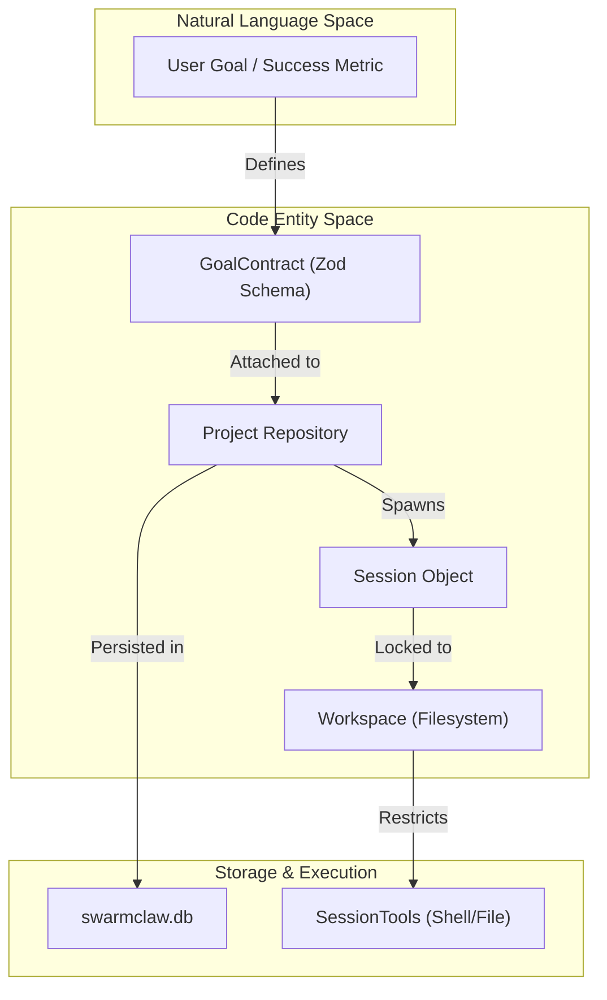
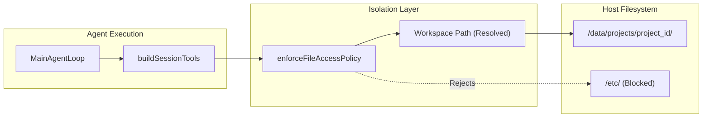

<!-- source: DeepWiki mcp.deepwiki.com · repo swarmclawai/swarmclaw · page 17 Projects & Workspaces · fetched 2026-10-27 -->

# Projects & Workspaces

Relevant source files

The following files were used as context for generating this wiki page:

- [src/app/api/mcp-servers/[id]/test/route.ts](src/app/api/mcp-servers/[id]/test/route.ts)
- [src/app/api/mcp-servers/route.test.ts](src/app/api/mcp-servers/route.test.ts)
- [src/app/api/settings/route.ts](src/app/api/settings/route.ts)
- [src/app/settings/page.tsx](src/app/settings/page.tsx)
- [src/components/mcp-servers/mcp-server-list.tsx](src/components/mcp-servers/mcp-server-list.tsx)
- [src/components/projects/project-detail.tsx](src/components/projects/project-detail.tsx)
- [src/components/projects/project-list.tsx](src/components/projects/project-list.tsx)
- [src/components/projects/tabs/activity-tab.tsx](src/components/projects/tabs/activity-tab.tsx)
- [src/components/projects/tabs/operations-tab.tsx](src/components/projects/tabs/operations-tab.tsx)
- [src/components/projects/tabs/overview-tab.tsx](src/components/projects/tabs/overview-tab.tsx)
- [src/components/projects/tabs/work-tab.tsx](src/components/projects/tabs/work-tab.tsx)
- [src/lib/server/agents/main-agent-loop-advanced.test.ts](src/lib/server/agents/main-agent-loop-advanced.test.ts)
- [src/lib/server/agents/main-agent-loop.ts](src/lib/server/agents/main-agent-loop.ts)
- [src/lib/server/chat-execution/post-stream-finalization.ts](src/lib/server/chat-execution/post-stream-finalization.ts)
- [src/lib/server/mcp-connection-pool.test.ts](src/lib/server/mcp-connection-pool.test.ts)
- [src/lib/server/mcp-connection-pool.ts](src/lib/server/mcp-connection-pool.ts)
- [src/lib/server/session-tools/index.ts](src/lib/server/session-tools/index.ts)
- [src/lib/server/session-tools/search-providers.test.ts](src/lib/server/session-tools/search-providers.test.ts)
- [src/lib/server/session-tools/search-providers.ts](src/lib/server/session-tools/search-providers.ts)
- [src/proxy.ts](src/proxy.ts)
- [src/types/app-settings.ts](src/types/app-settings.ts)
- [src/types/approval.ts](src/types/approval.ts)
- [src/views/settings/section-web-search.tsx](src/views/settings/section-web-search.tsx)

The Projects and Workspaces systems provide the organizational and isolation boundaries for autonomous operations within SwarmClaw. While **Projects** serve as logical containers for grouping related agents, tasks, and goals, **Workspaces** provide physical filesystem isolation to ensure that agent activities (like code execution or file manipulation) are confined to specific directories.

## Overview

SwarmClaw uses a hierarchical structure to manage complex AI workflows. Projects act as the top-level entity that binds together various system components to achieve specific objectives.

*   **Projects**: Group `Agents`, `Tasks`, `Schedules`, and `Skills`. They define the "Mission" and track budgets and success metrics across multiple sessions [src/lib/server/agents/main-agent-loop.ts:19-20]().
*   **Workspaces**: Provide the `cwd` (Current Working Directory) for sessions. They ensure that file-based tools (e.g., shell, edit_file) operate within a controlled path [src/lib/server/session-tools/index.ts:128]().
*   **Goals**: Projects are driven by a `GoalContract`, which defines the success criteria, budget in USD, and the level of autonomy granted to the agents [src/lib/server/agents/main-agent-loop.ts:34-48]().

### System Relationship

The following diagram illustrates how natural language goals are translated into code entities and isolated execution environments.

**Diagram: Goal to Workspace Mapping**

Sources: [src/lib/server/agents/main-agent-loop.ts:34-82](), [src/lib/server/session-tools/index.ts:128-150](), [src/app/api/settings/route.ts:143-144]()

## Project Management

The Project Management system is responsible for the lifecycle of projects and the enforcement of the **Goal System**. Projects can be configured to have specific "Quality Gates" that must be met before a task is considered complete [src/app/api/settings/route.ts:137-142]().

Key components include:
*   **Project Service**: Handles creation, updates, and the cascading deletion of references when a project is removed.
*   **Goal Hierarchy**: Supports `GoalLevel` (Strategic, Tactical, Operational) to organize complex objectives.
*   **Budgeting**: Enforces `budgetUsd` at the project level to prevent runaway autonomous costs [src/lib/server/agents/main-agent-loop.ts:79-81]().

For details, see [Project Management](#17.1).

## Workspaces & Filesystem Isolation

Workspaces are the physical manifestation of a project's scope on the server's disk. When an agent executes a tool via `buildSessionTools`, the `cwd` passed to the toolset is typically resolved to the project's workspace [src/lib/server/session-tools/index.ts:128-133]().

### Execution Context
The system uses `enforceFileAccessPolicy` to ensure that even if an agent attempts to use relative paths, it cannot escape the designated workspace directory [src/lib/server/session-tools/index.ts:53]().

**Diagram: Workspace Isolation Flow**

Sources: [src/lib/server/session-tools/index.ts:128-153](), [src/lib/server/agents/main-agent-loop.ts:15-17]()

## Project UI

The Project UI provides a centralized dashboard for monitoring and controlling autonomous projects. It is primarily centered around the `ProjectDetail` component [src/components/projects/project-detail.tsx:13]().

The interface is divided into several functional tabs:
*   **Overview**: Summarizes the `GoalContract` and project-wide progress [src/components/projects/project-detail.tsx:7-9]().
*   **Work**: A Kanban-style task board for managing `BoardTask` entities [src/components/projects/tabs/work-tab.tsx:16-17]().
*   **Operations**: Displays active schedules, runs, and the status of the background daemon [src/components/projects/project-detail.tsx:9]().
*   **Activity**: A unified log of agent thoughts, tool calls, and system events [src/components/projects/project-detail.tsx:10]().

For details, see [Project UI](#17.2).

## Settings & Global Configuration

Project and Task management can be toggled globally via the system settings. These settings control whether the UI elements and backend services for projects are active [src/app/api/settings/route.ts:143-144]().

| Setting Key | Default | Description |
| :--- | :--- | :--- |
| `projectManagementEnabled` | `true` | Enables the Project repository and UI [src/app/api/settings/route.ts:144]() |
| `taskManagementEnabled` | `true` | Enables the Task queue and Kanban board [src/app/api/settings/route.ts:143]() |
| `taskQualityGateEnabled` | `true` | Requires agents to meet criteria before finishing tasks [src/app/api/settings/route.ts:137]() |

Sources: [src/app/api/settings/route.ts:135-145]()

---

