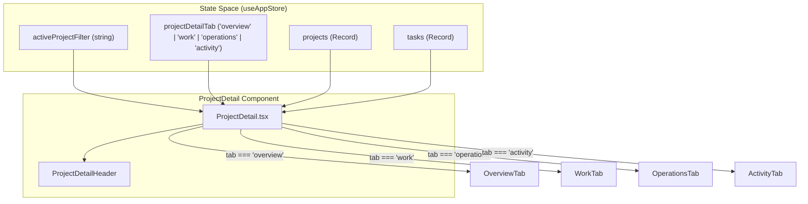
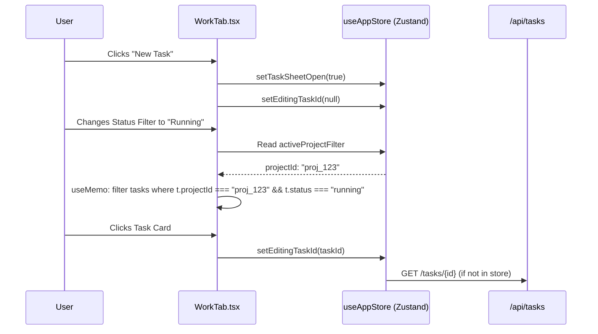

<!-- source: DeepWiki mcp.deepwiki.com · repo swarmclawai/swarmclaw · page 17.2 Project UI · fetched 2026-10-27 -->

# Project UI

Relevant source files

The following files were used as context for generating this wiki page:

- [next.config.ts](next.config.ts)
- [src/components/agents/inspector-panel.tsx](src/components/agents/inspector-panel.tsx)
- [src/components/chat/chat-list.tsx](src/components/chat/chat-list.tsx)
- [src/components/chatrooms/chatroom-input.tsx](src/components/chatrooms/chatroom-input.tsx)
- [src/components/chatrooms/chatroom-view.tsx](src/components/chatrooms/chatroom-view.tsx)
- [src/components/org-chart/mini-chat-bubble.tsx](src/components/org-chart/mini-chat-bubble.tsx)
- [src/components/projects/project-detail.tsx](src/components/projects/project-detail.tsx)
- [src/components/projects/project-list.tsx](src/components/projects/project-list.tsx)
- [src/components/projects/tabs/activity-tab.tsx](src/components/projects/tabs/activity-tab.tsx)
- [src/components/projects/tabs/operations-tab.tsx](src/components/projects/tabs/operations-tab.tsx)
- [src/components/projects/tabs/overview-tab.tsx](src/components/projects/tabs/overview-tab.tsx)
- [src/components/projects/tabs/work-tab.tsx](src/components/projects/tabs/work-tab.tsx)
- [src/lib/chatroom-sessions.ts](src/lib/chatroom-sessions.ts)
- [src/lib/server/chatrooms/chatroom-helpers.test.ts](src/lib/server/chatrooms/chatroom-helpers.test.ts)
- [src/lib/server/chatrooms/chatroom-helpers.ts](src/lib/server/chatrooms/chatroom-helpers.ts)
- [src/stores/slices/agent-slice.ts](src/stores/slices/agent-slice.ts)
- [src/stores/slices/session-slice.test.ts](src/stores/slices/session-slice.test.ts)
- [src/stores/slices/session-slice.ts](src/stores/slices/session-slice.ts)

The Project UI provides a high-level organizational layer for managing complex workflows, grouping multiple agents, tasks, schedules, and goals into cohesive units. It facilitates multi-agent coordination through shared project contexts and visualizes organizational relationships through the project-aware Org Chart.

## ProjectDetail Component

The `ProjectDetail` component is the primary view for interacting with a specific project. It manages the display of project-specific data by filtering global state (tasks, agents, projects) based on the `activeProjectFilter` stored in the application state.

### Implementation and Data Flow

`ProjectDetail` utilizes several hooks from the `useAppStore` to synchronize with the backend and local state:
- **Project Selection**: It retrieves the active project object from the `projects` record using `activeProjectFilter` [src/components/projects/project-detail.tsx:25-25]().
- **Dependency Loading**: On mount or project change, it triggers `loadSecrets()` to ensure any project-specific credentials or environment variables are available [src/components/projects/project-detail.tsx:20-23]().
- **Computed Metrics**: It calculates summary statistics (failed tasks, blocked tasks, and credential requirements) to pass to the `ProjectDetailHeader` [src/components/projects/project-detail.tsx:32-45]().

### Project Navigation Diagram

This diagram illustrates how the `ProjectDetail` component routes data to its specialized tabs.

**Sources**: [src/components/projects/project-detail.tsx:13-92]()

---

## Tabbed Views

### WorkTab (Task Board)
The `WorkTab` serves as the project's Kanban or list-based task manager. It filters the global `tasks` store to only show those belonging to the current `projectId` [src/components/projects/tabs/work-tab.tsx:27-30]().

- **Filtering**: Supports filtering by status (`backlog`, `queued`, `running`, `completed`, `failed`) and by specific `agentId` assigned to the task [src/components/projects/tabs/work-tab.tsx:33-39]().
- **Sorting**: Tasks can be sorted by status priority (defined in `STATUS_PRIORITY`), update timestamp, or agent name [src/components/projects/tabs/work-tab.tsx:42-49]().
- **Task Interaction**: Clicking a task sets the `editingTaskId` and opens the `TaskSheet` via the app store [src/components/projects/tabs/work-tab.tsx:149-149]().

### ActivityTab (Activity Log)
Displays a chronological stream of events related to the project. This includes task completions, agent status changes, and message logs specific to the project's scope.

### OperationsTab (Schedules and Runs)
Manages the automation aspect of the project.
- **Schedules**: Lists cron-based or interval-based schedules associated with project tasks.
- **Runs**: Displays historical execution data for protocol runs and task batches initiated within the project.

### OverviewTab (Summary and Goals)
The landing page for a project, providing:
- **Project Summary**: Basic metadata and description.
- **Goals System**: Visualizes the `GoalLevel` hierarchy, tracking `GoalContract` progress, `successMetric` attainment, and `budgetUsd` consumption [src/lib/server/projects/project-repository.ts]().

**Sources**: [src/components/projects/tabs/work-tab.tsx:1-131](), [src/components/projects/project-detail.tsx:77-88]()

---

## ProjectList and Navigation

The `ProjectList` component (typically located in the sidebar) allows users to switch between projects.

- **Selection Logic**: When a project is selected, the `activeProjectFilter` is updated in `useAppStore`.
- **Global Context**: Changing the project filter affects visibility across the entire UI, including which tasks appear in the global task board and which agents are highlighted in the Org Chart.

---

## Project-to-Agent Relationships

Projects group agents through a many-to-many relationship, often visualized in the **Org Chart**.

### Org Chart and Projects
The Org Chart view relates to projects by:
1.  **Filtering**: Highlighting agents that are active within the selected project.
2.  **Visualizing Hierarchy**: Displaying the reporting structure of agents (Orchestrator vs. Sub-agents) within the context of project goals.
3.  **Status Sync**: Using `StatusDot` and heartbeat listeners to show real-time agent activity on project-related tasks [src/components/agents/inspector-panel.tsx:17-17]().

### Technical Entity Mapping

| UI Concept | Code Entity / Store | File Reference |
| :--- | :--- | :--- |
| **Active Project** | `activeProjectFilter` | [src/stores/use-app-store.ts]() |
| **Project Tasks** | `BoardTask` (with `projectId`) | [src/types/index.ts]() |
| **Project Data** | `Project` interface | [src/types/index.ts]() |
| **Tab State** | `projectDetailTab` | [src/stores/use-app-store.ts]() |

### Data Interaction Diagram

This diagram maps UI actions to the underlying API and Store logic.

**Sources**: [src/components/projects/tabs/work-tab.tsx:17-30](), [src/components/projects/tabs/work-tab.tsx:119-129](), [src/stores/slices/agent-slice.ts:1-24]()

---

