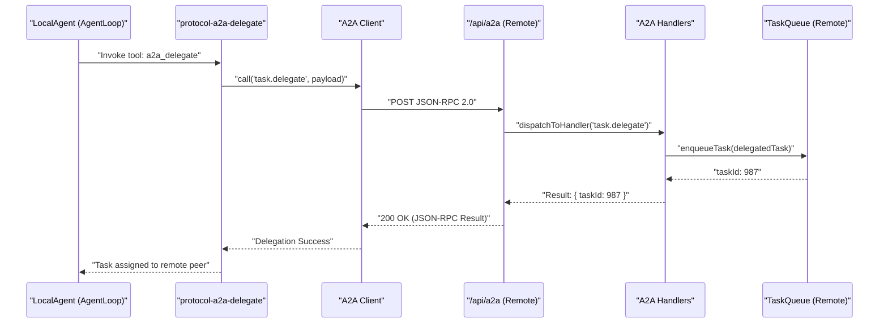

<!-- source: DeepWiki mcp.deepwiki.com · repo swarmclawai/swarmclaw · page 18.2 A2A Protocol · fetched 2026-10-27 -->

# A2A Protocol

<details>
<summary>Relevant source files</summary>

The following files were used as context for generating this wiki page:

- [src/app/api/.well-known/agent-card/route.ts](src/app/api/.well-known/agent-card/route.ts)
- [src/app/api/a2a/route.ts](src/app/api/a2a/route.ts)
- [src/app/api/a2a/tasks/[taskId]/status/route.ts](src/app/api/a2a/tasks/[taskId]/status/route.ts)
- [src/app/api/tasks/claim/route.test.ts](src/app/api/tasks/claim/route.test.ts)
- [src/app/api/tasks/claim/route.ts](src/app/api/tasks/claim/route.ts)
- [src/features/protocols/builder/utils/nodes-to-template.test.ts](src/features/protocols/builder/utils/nodes-to-template.test.ts)
- [src/features/protocols/builder/utils/nodes-to-template.ts](src/features/protocols/builder/utils/nodes-to-template.ts)
- [src/features/protocols/builder/utils/template-to-nodes.test.ts](src/features/protocols/builder/utils/template-to-nodes.test.ts)
- [src/features/protocols/builder/utils/template-to-nodes.ts](src/features/protocols/builder/utils/template-to-nodes.ts)
- [src/lib/server/connectors/discord.ts](src/lib/server/connectors/discord.ts)
- [src/lib/server/connectors/manager.ts](src/lib/server/connectors/manager.ts)
- [src/lib/server/connectors/media.ts](src/lib/server/connectors/media.ts)
- [src/lib/server/connectors/slack.ts](src/lib/server/connectors/slack.ts)
- [src/lib/server/connectors/telegram.ts](src/lib/server/connectors/telegram.ts)
- [src/lib/server/connectors/types.ts](src/lib/server/connectors/types.ts)
- [src/lib/server/connectors/whatsapp.ts](src/lib/server/connectors/whatsapp.ts)
- [src/lib/server/dag-validation.ts](src/lib/server/dag-validation.ts)
- [src/lib/server/protocols/protocol-service.ts](src/lib/server/protocols/protocol-service.ts)
- [src/lib/server/runtime/queue.test.ts](src/lib/server/runtime/queue.test.ts)

</details>


The Agent-to-Agent (A2A) protocol is a standardized communication layer that allows SwarmClaw instances to discover, authenticate, and collaborate with one another. It enables cross-instance task routing, skill sharing, and remote delegation by treating remote agents as accessible tools or sub-agents within a local workflow.

## Protocol Specification

The protocol is built on top of standard web technologies (HTTPS, JSON-RPC 2.0) and uses specialized schemas for identity and capability discovery.

### AgentCard Schema
The `AgentCard` is the fundamental identity document for a SwarmClaw agent. It is served via the `/.well-known/agent-card` endpoint and describes what an agent can do and how to interact with it.

| Field | Description |
| :--- | :--- |
| `id` | Globally unique identifier for the agent. |
| `name` | Human-readable name of the agent. |
| `capabilities` | List of high-level intents the agent supports (e.g., `coding`, `research`). |
| `skills` | Array of specific `SKILL.md` identifiers the agent has mastered. |
| `authMethods` | Supported authentication schemes (`api_key`, `ed25519`, `oauth2`). |
| `supportsStreaming` | Boolean indicating if the agent can stream JSON-RPC responses. |

**Sources:** `[src/app/api/.well-known/agent-card/route.ts:1-25]()`

### JSON-RPC 2.0 Router
All A2A interactions occur via the `/api/a2a` route using the JSON-RPC 2.0 protocol. The A2A Router dispatches incoming requests to specific handlers based on the `method` field.

**Key Methods:**
*   `task.delegate`: Submit a task for the remote agent to execute.
*   `task.status`: Query the progress of a delegated task.
*   `agent.query`: Request detailed capability information.
*   `message.send`: Direct peer-to-peer messaging between agents.

**Sources:** `[src/app/api/a2a/route.ts:1-40]()`

## Authentication & Security

The A2A protocol supports three primary authentication tiers to ensure secure cross-instance communication:

1.  **API Key (`api_key`)**: Simple shared secret authentication, typically used for private clusters or internal service-to-service calls.
2.  **Ed25519 (`ed25519`)**: Cryptographic signatures using the agent's private key. This is the primary method for the SwarmDock marketplace, allowing agents to prove identity without sharing secrets.
3.  **OAuth2 (`oauth2`)**: Integration with standard identity providers for enterprise-grade access control.

**Sources:** `[src/lib/server/connectors/manager.ts:12-20]()`, `[src/app/api/a2a/route.ts:15-30]()`

## Implementation Architecture

The following diagram illustrates how a local agent uses the A2A protocol to delegate work to a remote instance.

### A2A Delegation Flow
"This diagram bridges the Natural Language Space of 'Delegation' to the Code Entity Space of 'A2A Handlers'."



**Sources:** `[src/lib/server/protocols/protocol-service.ts:38-47]()`, `[src/app/api/a2a/route.ts:1-40]()`, `[src/lib/server/connectors/manager.ts:57-62]()`

## Discovery & Client

### /.well-known/agent-card
Every SwarmClaw instance exposes its public agents via the `/.well-known/agent-card` endpoint. This allows other instances to "crawl" a node and understand which agents are available for collaboration.

### A2A Client
The A2A Client is a library used by the `protocol-a2a-delegate` and the `a2a_delegate` tool. It handles:
*   Fetching and caching remote `AgentCard` documents.
*   Signing requests with Ed25519 keys if required.
*   Managing timeouts and retries for cross-instance calls.
*   Normalizing remote task statuses into local state updates.

**Sources:** `[src/app/api/.well-known/agent-card/route.ts:1-25]()`, `[src/app/api/a2a/tasks/[taskId]/status/route.ts:1-30]()`

## Cross-Instance Task Routing

The `protocol-a2a-delegate` is a specialized step processor within the Protocol Runtime. It allows a visual workflow to pause execution on Instance A and resume only after Instance B has completed a specific task.

### Task Status Synchronization
"This diagram maps the code entities involved in maintaining state across instances."

```mermaid
graph TD
    subgraph "Instance_A_(Requester)"
        PR["protocol-run-lifecycle.ts"]
        A2AC["A2A Client"]
    end

    subgraph "Instance_B_(Provider)"
        A2AR["/api/a2a (Route Handler)"]
        TS["/api/tasks/[taskId]/status"]
        DB[("swarmclaw.db")]
    end

    PR -->| "Poll Status" | A2AC
    A2AC -->| "GET" | TS
    TS -->| "Query" | DB
    A2AR -->| "Update Task" | DB
    TS -.->| "Return JSON" | A2AC
    A2AC -.->| "Wake Run" | PR
```

**Sources:** `[src/lib/server/protocols/protocol-run-lifecycle.ts:38-47]()`, `[src/app/api/a2a/tasks/[taskId]/status/route.ts:1-35]()`, `[src/lib/server/protocols/protocol-service.ts:38-47]()`

### Implementation Details

| Feature | Code Entity | Description |
| :--- | :--- | :--- |
| **Router** | `src/app/api/a2a/route.ts` | Entry point for all JSON-RPC 2.0 A2A traffic. |
| **Discovery** | `src/app/api/.well-known/agent-card/route.ts` | Serves the `AgentCard` for local agents. |
| **Delegation** | `protocol-a2a-delegate` | Runtime logic for handing off tasks to remote instances. |
| **Status Sync** | `src/app/api/a2a/tasks/[taskId]/status/route.ts` | Allows remote peers to poll for task completion. |

**Sources:** `[src/app/api/a2a/route.ts:1-40]()`, `[src/app/api/.well-known/agent-card/route.ts:1-25]()`, `[src/lib/server/protocols/protocol-service.ts:38-47]()`

---

