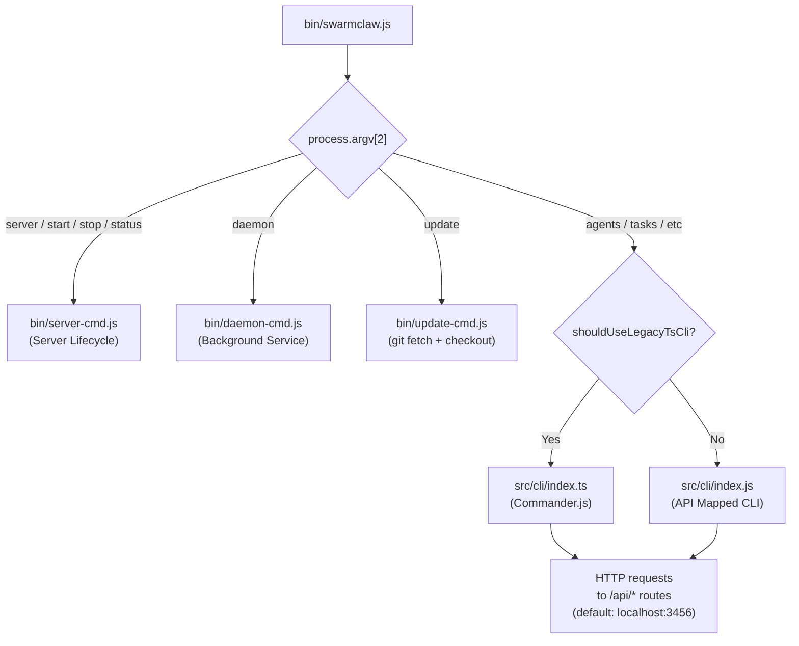
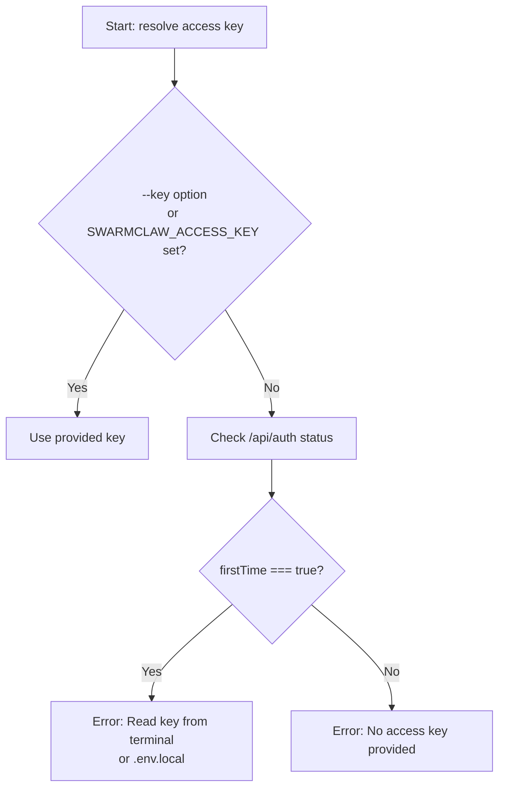
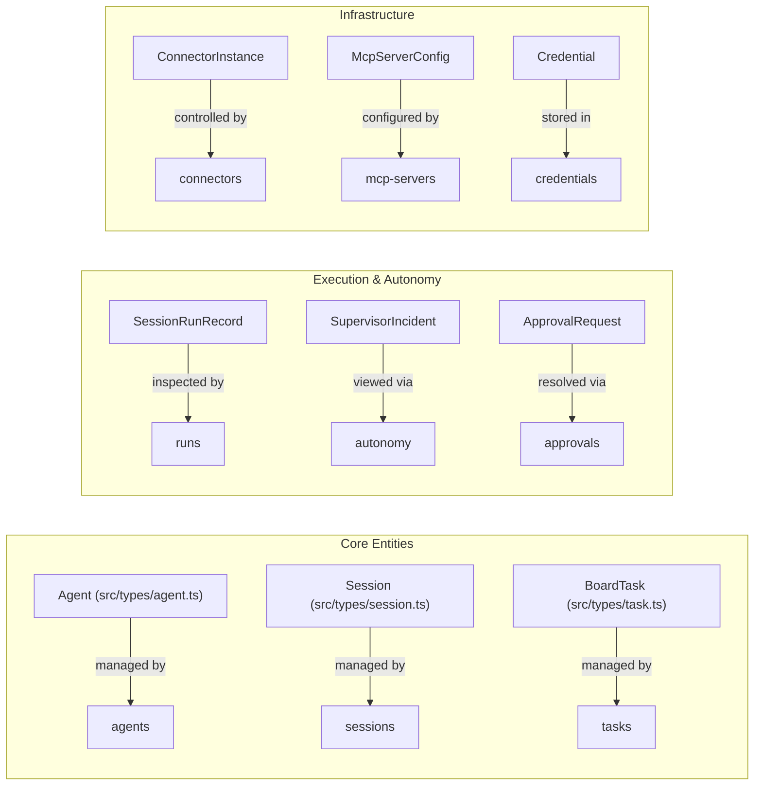

<!-- source: DeepWiki mcp.deepwiki.com · repo swarmclawai/swarmclaw · page 19 CLI Reference · fetched 2026-10-27 -->

# CLI Reference

Relevant source files

The following files were used as context for generating this wiki page:

- [.eslint-baseline.json](.eslint-baseline.json)
- [README.md](README.md)
- [bin/doctor-cmd.js](bin/doctor-cmd.js)
- [bin/doctor-cmd.test.js](bin/doctor-cmd.test.js)
- [bin/install-root.js](bin/install-root.js)
- [bin/install-root.test.js](bin/install-root.test.js)
- [bin/server-cmd.js](bin/server-cmd.js)
- [bin/swarmclaw.js](bin/swarmclaw.js)
- [bin/worker-cmd.js](bin/worker-cmd.js)
- [package-lock.json](package-lock.json)
- [package.json](package.json)
- [src/app/usage/page.tsx](src/app/usage/page.tsx)
- [src/cli/binary.test.js](src/cli/binary.test.js)
- [src/cli/index.js](src/cli/index.js)
- [src/cli/index.test.js](src/cli/index.test.js)
- [src/cli/index.ts](src/cli/index.ts)
- [src/cli/server-cmd.test.js](src/cli/server-cmd.test.js)
- [src/cli/spec.js](src/cli/spec.js)
- [src/lib/server/gateways/gateway-profile-service.ts](src/lib/server/gateways/gateway-profile-service.ts)
- [src/lib/server/missions/mission-templates.ts](src/lib/server/missions/mission-templates.ts)
- [src/lib/server/openclaw/deploy.test.ts](src/lib/server/openclaw/deploy.test.ts)
- [src/lib/server/openclaw/deploy.ts](src/lib/server/openclaw/deploy.ts)
- [src/lib/server/storage.ts](src/lib/server/storage.ts)
- [src/types/index.ts](src/types/index.ts)

This page covers the `swarmclaw` command-line interface: how the binary is structured, how subcommands are dispatched, global options, access key resolution, the full list of command groups, and output behavior. For the complete per-command argument and option reference, see [CLI Commands](#19.1). For the `server` and `update` subcommands, see [Server Management](#19.2).

---

## Binary Entry Point & Dispatch

The `swarmclaw` executable is defined in `package.json` and points to `bin/swarmclaw.js`. It is a dispatcher that routes subcommands to specialized handlers.

**Dispatch logic:** [bin/swarmclaw.js:198-258]()

| First argument | Handler | Description |
|---|---|---|
| `server` / `run` / `start` | `bin/server-cmd.js` | Manages the Next.js server lifecycle and PID files. |
| `stop` / `status` | `bin/server-cmd.js` | Lifecycle management for detached server processes. |
| `daemon` | `bin/daemon-cmd.js` | Controls the background autonomous loop service. |
| `update` | `bin/update-cmd.js` | Handles `git`-based updates and `easy-update.mjs`. |
| `help` | `runHelp()` | Context-aware help for all groups and binaries. |
| _(anything else)_ | `src/cli/index.js` or `src/cli/index.ts` | Dispatches to the API-mapped CLI or legacy TS CLI. |

The `server`, `daemon`, and `update` subcommands are isolated into plain CommonJS (CJS) scripts to ensure they can run without a TypeScript-capable runtime or experimental flags. All other commands are handled by the API-mapped CLI in `src/cli/index.js` or the TypeScript Commander.js implementation in `src/cli/index.ts`.

**Dispatch model:**

Title: CLI Command Dispatch Flow

Sources: [bin/swarmclaw.js:1-41](), [bin/swarmclaw.js:198-258](), [package.json:34-36]()

---

## Global Options

Global options apply to all API-interacting subcommands. In the TypeScript CLI, these are defined on the root `Command` object.

[src/cli/index.ts:117-129]()

| Option | Short | Environment variable | Default | Description |
|---|---|---|---|---|
| `--url <url>` | `-u` | `SWARMCLAW_URL` | `http://localhost:3456` | Base URL of the SwarmClaw server |
| `--key <key>` | `-k` | `SWARMCLAW_ACCESS_KEY` | _(empty)_ | Access key for `X-Access-Key` header |
| `--raw` | | | `false` | Print compact JSON instead of pretty-printed |

Sources: [src/cli/index.ts:34-53](), [src/cli/index.ts:117-129]()

---

## Access Key Resolution

The CLI resolves the access key required for authentication via `apiRequestWithAccessKey`.

[src/cli/index.ts:212-246]()

The CLI also checks `SWARMCLAW_API_KEY`, `SC_ACCESS_KEY`, and a local `platform-api-key.txt` file as fallback sources.

Sources: [src/cli/index.ts:39-53](), [src/cli/index.ts:212-246]()

---

## Command Groups

Commands are organized into logical groups mapping to system features. Use `swarmclaw <group> --help` to list subcommands.

**System Architecture to CLI Group Mapping:**

Title: System Entity to CLI Group Mapping

Sources: [src/cli/index.js:12-140](), [src/cli/spec.js:1-126](), [src/types/index.ts:1-20]()

**Primary Command Groups:**

| Group | Description | API Route Prefix |
|---|---|---|
| `agents` | Manage agent definitions, threads, and dreams | `/api/agents` |
| `tasks` | Manage task queue, status, and archiving | `/api/tasks` |
| `sessions` | Interaction with chat sessions and heartbeats | `/api/sessions` |
| `connectors` | Lifecycle and health of chat platform bridges | `/api/connectors` |
| `memory` | Search and maintenance of agent memory | `/api/memory` |
| `autonomy` | Inspect supervisor incidents and emergency stop | `/api/autonomy` |
| `approvals` | Resolve human-in-the-loop approval requests | `/api/approvals` |
| `mcp-servers` | Configure and test Model Context Protocol servers | `/api/mcp-servers` |
| `missions` | Create and monitor long-running agent missions | `/api/missions` |
| `setup` | Provider initialization and system diagnostics | `/api/setup` |

Sources: [src/cli/index.js:12-140](), [src/cli/spec.js:1-126]()

---

## Output and Streaming

### JSON Output
By default, the CLI pretty-prints JSON responses. The `rawOutput` flag (via `--raw`) toggles compact output for pipeability.
[src/cli/index.ts:15-19]()

### SSE Streaming
For chat-related commands (e.g., `sessions chat`), the CLI handles `text/event-stream` responses, parsing individual events for live feedback.
[src/cli/index.js:95-98]()

Sources: [src/cli/index.ts:15-19](), [src/cli/index.js:95-98]()

---

For details on specific command usage, see [CLI Commands](#19.1).
For details on server lifecycle and background processes, see [Server Management](#19.2).

---

