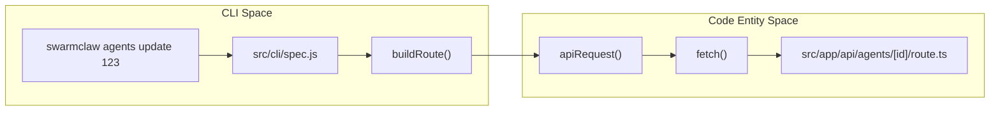

<!-- source: DeepWiki mcp.deepwiki.com · repo swarmclawai/swarmclaw · page 19.1 CLI Commands · fetched 2026-10-27 -->

# CLI Commands

<details>
<summary>Relevant source files</summary>

The following files were used as context for generating this wiki page:

- [.eslint-baseline.json](.eslint-baseline.json)
- [CONTRIBUTING.md](CONTRIBUTING.md)
- [README.md](README.md)
- [bin/swarmclaw.js](bin/swarmclaw.js)
- [package-lock.json](package-lock.json)
- [package.json](package.json)
- [src/app/api/version/route.ts](src/app/api/version/route.ts)
- [src/app/api/version/update/route.ts](src/app/api/version/update/route.ts)
- [src/cli/binary.test.js](src/cli/binary.test.js)
- [src/cli/index.js](src/cli/index.js)
- [src/cli/index.test.js](src/cli/index.test.js)
- [src/cli/index.ts](src/cli/index.ts)
- [src/cli/spec.js](src/cli/spec.js)
- [src/lib/server/daemon/controller.ts](src/lib/server/daemon/controller.ts)
- [src/lib/server/daemon/lease-owner.test.ts](src/lib/server/daemon/lease-owner.test.ts)
- [src/lib/server/daemon/lease-owner.ts](src/lib/server/daemon/lease-owner.ts)
- [src/lib/server/git-metadata.test.ts](src/lib/server/git-metadata.test.ts)
- [src/lib/server/git-metadata.ts](src/lib/server/git-metadata.ts)
- [src/lib/server/missions/mission-templates.ts](src/lib/server/missions/mission-templates.ts)
- [src/lib/server/runtime/daemon-state/core.ts](src/lib/server/runtime/daemon-state/core.ts)
- [src/lib/server/storage.ts](src/lib/server/storage.ts)
- [src/types/index.ts](src/types/index.ts)

</details>


This page is a complete reference for all `swarmclaw` CLI command groups and their subcommands. It covers argument formats, global options, how commands map to API routes, and special behaviors such as SSE streaming and polling. For information on the `server` subcommand (start/stop/status) and the `update` subcommand, see [Server Management]().

---

## Binary Dispatch

The `swarmclaw` binary is defined at [bin/swarmclaw.js:1-5]() and acts as a router. It dispatches to three distinct execution paths based on the first argument: local server lifecycle management, repository updates, or the full API-mapped CLI.

**Binary Dispatch Diagram**

```mermaid
flowchart TD
    BIN["bin/swarmclaw.js"]
    ARG{{"process.argv[2]"}}
    SERVER["server-cmd.js\n(Lifecycle/Daemon)"]
    UPDATE["update-cmd.js\n(Git/NPM Updates)"]
    LEGACY["src/cli/index.ts\n(TS Runtime)"]
    MAPPED["src/cli/index.js\n(API Mapping)"]

    BIN --> ARG
    ARG -->|"\"server\" | \"run\" | \"start\""| SERVER
    ARG -->|"\"update\""| UPDATE
    ARG -->|"\"agents list\" (Legacy Match)"| LEGACY
    ARG -->|"\"chatrooms list\" (New Group)"| MAPPED
```

Sources: [bin/swarmclaw.js:8-41](), [bin/swarmclaw.js:198-245]()

The binary uses a dual-CLI approach:
1. **Legacy TS CLI**: Invoked for core groups like `agents`, `tasks`, `sessions`, and `memory` using `node --experimental-strip-types` [bin/swarmclaw.js:56-68]().
2. **Mapped JS CLI**: Invoked for newer features like `chatrooms`, `connectors`, and `missions` by importing a command specification [src/cli/index.js:12-110]().

---

## Global Options

These options are available on every command and can be set via flags or environment variables.

| Option | Env variable(s) | Default | Description |
|--------|----------------|---------|-------------|
| `-u, --url <url>` | `SWARMCLAW_URL` | `http://localhost:3456` | API base URL |
| `-k, --key <key>` | `SWARMCLAW_ACCESS_KEY` | _(empty)_ | Access key for `X-Access-Key` header |
| `--raw` | — | `false` | Print compact JSON output |
| `--data <json>` | — | — | JSON body for POST/PUT requests |
| `--query <k=v>` | — | — | Append URL query parameters |

**Access Key Resolution Order**
The CLI resolves the authentication key in the following priority:
1. `--key` or `-k` command line flag [src/cli/index.ts:117-129]().
2. `SWARMCLAW_ACCESS_KEY`, `SWARMCLAW_API_KEY`, or `SC_ACCESS_KEY` environment variables [src/cli/index.ts:40-46]().
3. Local `platform-api-key.txt` file in the current working directory [src/cli/index.ts:48-51]().

Sources: [src/cli/index.ts:34-53](), [src/cli/index.js:121-131]()

---

## Command Groups

All groups follow the pattern: `swarmclaw <group> <command> [args] [options]`.

### Agents
Manages the agent registry and autonomous "dream" configurations.
- `list`: `GET /agents`
- `get <id>`: `GET /agents/:id`
- `create`: `POST /agents` (expects JSON body)
- `dream <id>`: `GET /agents/:id/dream` (inspects idle reflection state)
- `status <id>`: `GET /agents/:id/status` (live activity monitoring)

Sources: [src/cli/index.js:14-31](), [src/cli/spec.js:2-17]()

### Tasks & Schedules
Controls the asynchronous task queue and cron-based automation.
- `tasks list`: `GET /tasks`
- `tasks create`: `POST /tasks` (options: `--title`, `--agent-id`, `--status`)
- `schedules list`: `GET /schedules`
- `schedules run <id>`: `POST /schedules/:id/run` (immediate trigger)

Sources: [src/cli/index.ts:319-455](), [src/cli/spec.js:131-150]()

### Autonomy & Safety
Inspects the supervisor reflection system and manages the Emergency Stop (E-Stop).
- `autonomy incidents`: `GET /autonomy/incidents` (list policy violations)
- `autonomy estop`: `GET /autonomy/estop` (check global halt state)
- `autonomy estop-set`: `POST /autonomy/estop` (engage/disengage E-Stop)
- `autonomy guardian-restore`: `POST /autonomy/guardian/restore` (rollback to checkpoint)

Sources: [src/cli/index.js:52-60](), [src/cli/spec.js:32-40]()

### Connectors & Webhooks
Manages external platform integrations (Discord, Slack, etc.) and inbound triggers.
- `connectors start <id>`: `PUT /connectors/:id` with `action: 'start'`
- `connectors health <id>`: `GET /connectors/:id/health`
- `webhooks trigger <id>`: `POST /webhooks/:id` (manually fire a webhook)

Sources: [src/cli/index.js:111-138](), [src/cli/spec.js:64-95]()

### Missions
Goal-driven long-running activities with budget tracking.
- `missions list`: `GET /missions`
- `missions create`: `POST /missions` (uses `BUILT_IN_MISSION_TEMPLATES` as defaults)
- `missions report <id>`: `GET /missions/:id/reports`

Sources: [src/cli/index.js:215-227](), [src/lib/server/missions/mission-templates.ts:28-172]()

---

## Implementation Details

### API Route Mapping
The CLI uses a template-based routing system. Path parameters prefixed with `:` are substituted with positional arguments from the command line.

**Data Flow: CLI to API**



Sources: [src/cli/index.js:669-682](), [src/cli/index.ts:143-160]()

### SSE Streaming
Commands like `sessions chat` or `chatrooms chat` use `responseType: 'sse'` [src/cli/index.js:95-98](). The CLI implements a `consumeSse` generator that parses `data:` chunks and streams them to the terminal.

- **Markdown chunks**: Printed as raw text to `stdout`.
- **Tool calls**: Formatted as JSON blocks.
- **Errors**: Routed to `stderr`.

Sources: [src/cli/index.js:744-809]()

### The Setup Wizard (`setup init`)
The `setup init` command [src/cli/index.ts:741-847]() is a composite workflow that:
1. Validates the provider (OpenAI, Anthropic, Ollama, etc.) via `POST /setup/check-provider` [src/cli/index.ts:778-788]().
2. Stores encrypted credentials in the database via `POST /credentials` [src/cli/index.ts:804-811]().
3. Creates a default agent using templates from `DEFAULT_AGENTS` [src/cli/index.ts:816-834]().
4. Marks the system as initialized via `PUT /settings`.

Sources: [src/cli/index.ts:741-847](), [src/lib/setup-defaults.ts:9-30]()

---

## Database Collections
The CLI interacts with the `swarmclaw.db` SQLite instance through the API. The following collections are exposed via CLI command groups:

| Command Group | Storage Table | Interface |
|---------------|---------------|-----------|
| `agents` | `agents` | `Agent` |
| `sessions` | `sessions` | `Session` |
| `tasks` | `tasks` | `BoardTask` |
| `memory` | `memory.db` | `MemoryEntry` |
| `connectors` | `connectors` | `ConnectorInstance` |
| `missions` | `agent_missions` | `Mission` |

Sources: [src/lib/server/storage.ts:129-186](), [src/types/index.ts:1-20]()

---

