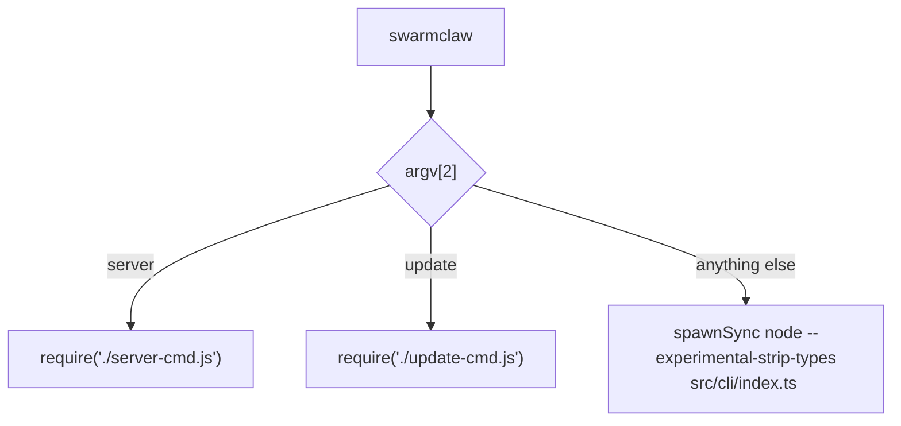
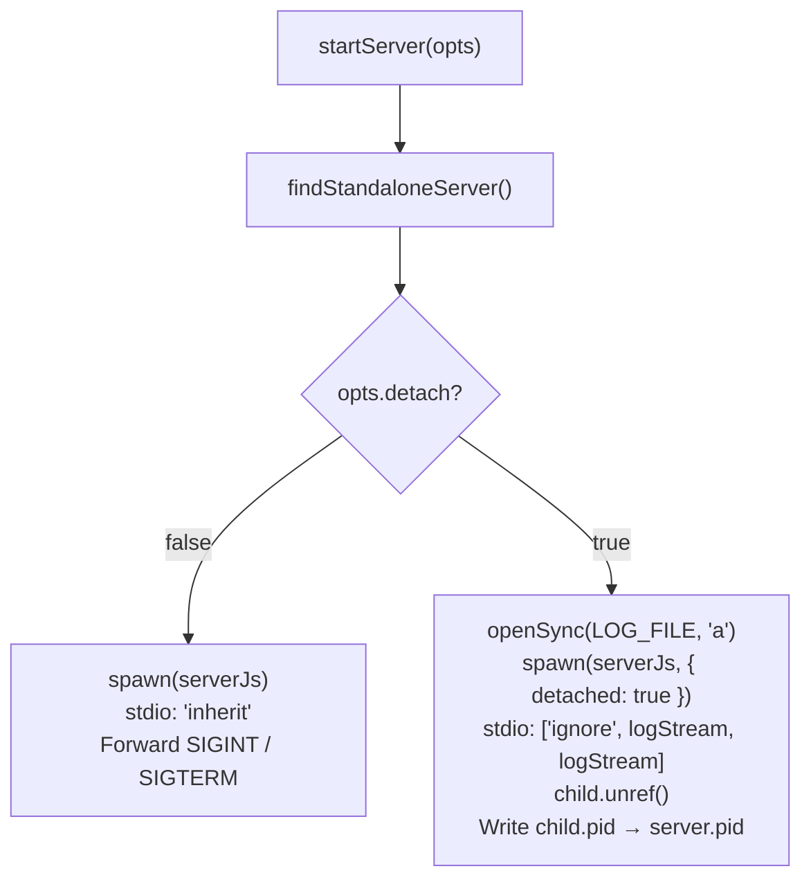
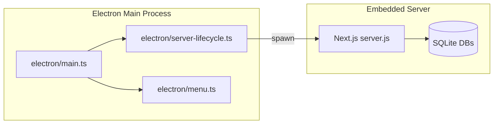

<!-- source: DeepWiki mcp.deepwiki.com · repo swarmclawai/swarmclaw · page 19.2 Server Management · fetched 2026-10-27 -->

# Server Management

Relevant source files

The following files were used as context for generating this wiki page:

- [.dockerignore](.dockerignore)
- [.github/workflows/desktop-release.yml](.github/workflows/desktop-release.yml)
- [.gitignore](.gitignore)
- [CLAUDE.md](CLAUDE.md)
- [Dockerfile](Dockerfile)
- [bin/doctor-cmd.js](bin/doctor-cmd.js)
- [bin/doctor-cmd.test.js](bin/doctor-cmd.test.js)
- [bin/install-root.js](bin/install-root.js)
- [bin/install-root.test.js](bin/install-root.test.js)
- [bin/server-cmd.js](bin/server-cmd.js)
- [bin/update-cmd.js](bin/update-cmd.js)
- [bin/worker-cmd.js](bin/worker-cmd.js)
- [docker-compose.yml](docker-compose.yml)
- [electron-builder.yml](electron-builder.yml)
- [electron/free-port.ts](electron/free-port.ts)
- [electron/main.ts](electron/main.ts)
- [electron/menu.ts](electron/menu.ts)
- [electron/paths.ts](electron/paths.ts)
- [electron/server-lifecycle.ts](electron/server-lifecycle.ts)
- [electron/tsconfig.json](electron/tsconfig.json)
- [install.sh](install.sh)
- [resources/README.md](resources/README.md)
- [resources/icon.icns](resources/icon.icns)
- [resources/icon.ico](resources/icon.ico)
- [resources/icon.png](resources/icon.png)
- [scripts/build-electron.mjs](scripts/build-electron.mjs)
- [scripts/easy-setup.mjs](scripts/easy-setup.mjs)
- [scripts/easy-update.mjs](scripts/easy-update.mjs)
- [src/app/api/setup/doctor/route.ts](src/app/api/setup/doctor/route.ts)
- [src/app/usage/page.tsx](src/app/usage/page.tsx)
- [src/cli/server-cmd.test.js](src/cli/server-cmd.test.js)
- [src/lib/server/credentials/credential-service.ts](src/lib/server/credentials/credential-service.ts)
- [src/lib/server/gateways/gateway-profile-service.ts](src/lib/server/gateways/gateway-profile-service.ts)
- [src/lib/server/openclaw/deploy.test.ts](src/lib/server/openclaw/deploy.test.ts)
- [src/lib/server/openclaw/deploy.ts](src/lib/server/openclaw/deploy.ts)
- [src/lib/server/openclaw/gateway.ts](src/lib/server/openclaw/gateway.ts)

This page documents the `swarmclaw server` and `swarmclaw update` subcommands: how the Next.js application is built, how the `SWARMCLAW_HOME` directory is prepared, how the server process is started in foreground and detached modes, and how PID/log files are managed. It also covers the Electron desktop application lifecycle and the `doctor` diagnostic system.

---

## Command Dispatch

The binary entry point at `bin/swarmclaw.js` decides which subsystem handles a given invocation:

**Command dispatch in `bin/swarmclaw.js`**

Sources: [bin/swarmclaw.js:1-31]()

The `server` and `update` subcommands are handled by plain CommonJS scripts with no TypeScript dependency. All other subcommands are delegated to `src/cli/index.ts` via Node.js's `--experimental-strip-types` flag.

---

## SWARMCLAW_HOME Layout

The `server-cmd.js` script operates inside a home directory called `SWARMCLAW_HOME`. Its location defaults to `~/.swarmclaw` but can be overridden with the `SWARMCLAW_HOME` environment variable.

| Path | Purpose |
|---|---|
| `$SWARMCLAW_HOME/` | Root of the server working directory |
| `$SWARMCLAW_HOME/server.pid` | PID of the currently running detached server |
| `$SWARMCLAW_HOME/server.log` | stdout/stderr log for detached mode |
| `$SWARMCLAW_HOME/data/` | SQLite database files (`swarmclaw.db`, `memory.db`, `logs.db`) |
| `$SWARMCLAW_HOME/workspace/` | Default sandbox/filesystem workspace for agents |
| `$SWARMCLAW_HOME/builds/` | Versioned build workspaces for registry installs |

Sources: [bin/server-cmd.js:28-40]()

---

## The `server` Command

### Build and Asset Management

SwarmClaw supports both git checkouts and global registry (npm) installs. The server command handles symlink setup and asset synchronization to ensure the Next.js standalone server has access to `public` and `.next/static` files.

**Asset Sync Logic**
- `syncStandaloneRuntimeAssets`: Copies `.next/static` and `public` folders into the standalone runtime directory [bin/server-cmd.js:213-252]().
- `ensurePackageDependencies`: Detects the package manager and runs install if `next` is missing [bin/server-cmd.js:163-176]().
- `symlinkDir`: Creates directory junctions (Windows) or symlinks (Unix) for workspace consistency [bin/server-cmd.js:208-211]().

### Starting the Server (`startServer`)

`startServer` launches the standalone `server.js` via `process.execPath`. It configures the environment for production execution.

| Variable | Value |
|---|---|
| `PORT` | `--port` option, default `3456` |
| `HOSTNAME` | `--host` option, default `0.0.0.0` |
| `SWARMCLAW_HOME` | Resolved state directory |
| `DATA_DIR` | `$SWARMCLAW_HOME/data` |

**Foreground vs. Detached Mode**

Sources: [bin/server-cmd.js:710-820](), [bin/server-cmd.js:35-36]()

### Ready Checks
The server uses `probeHttpReady` to perform a `GET /api/auth` check to verify the server is responding before returning control to the CLI [bin/server-cmd.js:86-109](). `waitForPortReady` polls this endpoint with a 30-second timeout [bin/server-cmd.js:111-134]().

---

## The `update` Command

`swarmclaw update` (`bin/update-cmd.js`) handles self-updates for both git checkouts and registry-based global installs.

**Update Strategies**
1. **Registry Update**: If no `.git` is detected, it uses `getGlobalUpdateSpec` to run `npm install -g @swarmclawai/swarmclaw` (or equivalent for yarn/pnpm) [bin/update-cmd.js:76-99]().
2. **Git Update**:
    - Fetches tags and identifies the latest stable release [bin/update-cmd.js:147-156]().
    - Checks out the latest tag or pulls `origin/main` [bin/update-cmd.js:159-191]().
    - Triggers `rebuildStandaloneServer` to refresh the production bundle [bin/update-cmd.js:208-212]().

Before updating, the command calls `stopRunningServer` to gracefully shut down the daemon and prevent SQLite WAL corruption [bin/update-cmd.js:101-122]().

Sources: [bin/update-cmd.js:1-227]()

---

## Doctor Diagnostics

The `doctor` system provides a diagnostic suite to verify environment readiness. It is accessible via the CLI (`swarmclaw doctor`) and a REST API endpoint.

**Key Checks in `src/app/api/setup/doctor/route.ts`**
- **Node.js Version**: Verifies Node 22.6+ requirement [src/app/api/setup/doctor/route.ts:95-104]().
- **Write Access**: Tests filesystem permissions by writing a probe file to `DATA_DIR` [src/app/api/setup/doctor/route.ts:75-86]().
- **Credentials**: Checks for undecryptable credentials that might indicate a missing or changed `CREDENTIAL_SECRET` [src/app/api/setup/doctor/route.ts:171-180]().
- **Docker**: Detects Docker availability for agent sandboxing [src/app/api/setup/doctor/route.ts:8-8]().

Sources: [src/app/api/setup/doctor/route.ts:1-200]()

---

## Electron Desktop App

The Electron app wraps the Next.js standalone server into a cross-platform desktop experience.

### Server Lifecycle Management
The `startEmbeddedServer` function in `electron/server-lifecycle.ts` manages the internal server:
1. Finds free ports for HTTP and WebSockets using `findFreePort` [electron/server-lifecycle.ts:32-33]().
2. Spawns the standalone entry point with `ELECTRON_RUN_AS_NODE: '1'` [electron/server-lifecycle.ts:45-55]().
3. Redirects logs to a file with a 1MB rotation limit (`LOG_MAX_BYTES`) [electron/server-lifecycle.ts:13-13](), [electron/server-lifecycle.ts:84-95]().
4. Implements a 5-second `SHUTDOWN_GRACE_MS` before sending `SIGKILL` [electron/server-lifecycle.ts:12-12](), [electron/server-lifecycle.ts:147-173]().

### Configuration and Build
- **Paths**: `electron/paths.ts` defines standard locations for `SWARMCLAW_HOME` across OSs [electron/paths.ts:1-20]().
- **Menu**: `electron/menu.ts` defines the native application menu [electron/menu.ts:1-30]().
- **Builder**: `electron-builder.yml` configures packaging for macOS (DMG/Zip), Windows (NSIS), and Linux (AppImage/Deb) [electron-builder.yml:38-88](). It includes the `.next/standalone` directory as an `extraResource` [electron-builder.yml:23-28]().

**Desktop Architecture**

Sources: [electron/main.ts:1-50](), [electron/server-lifecycle.ts:1-174](), [electron-builder.yml:1-88]()

---

## Deployment Options

Beyond local execution, SwarmClaw provides several containerized deployment paths:

- **Docker**: A `Dockerfile` based on `node:22-slim` builds the standalone app and exposes ports 3456 (HTTP) and 3457 (WS) [Dockerfile:1-55]().
- **Docker Compose**: Defines a service with volume persistence for `/app/data` and a healthcheck against `/api/healthz` [docker-compose.yml:1-20]().

Sources: [Dockerfile:1-55](), [docker-compose.yml:1-20]()

---

