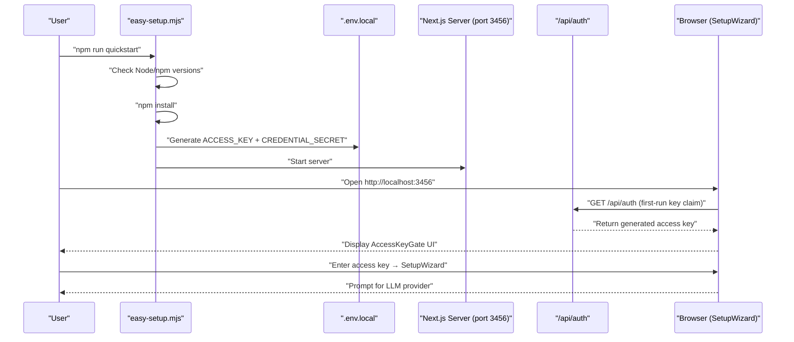
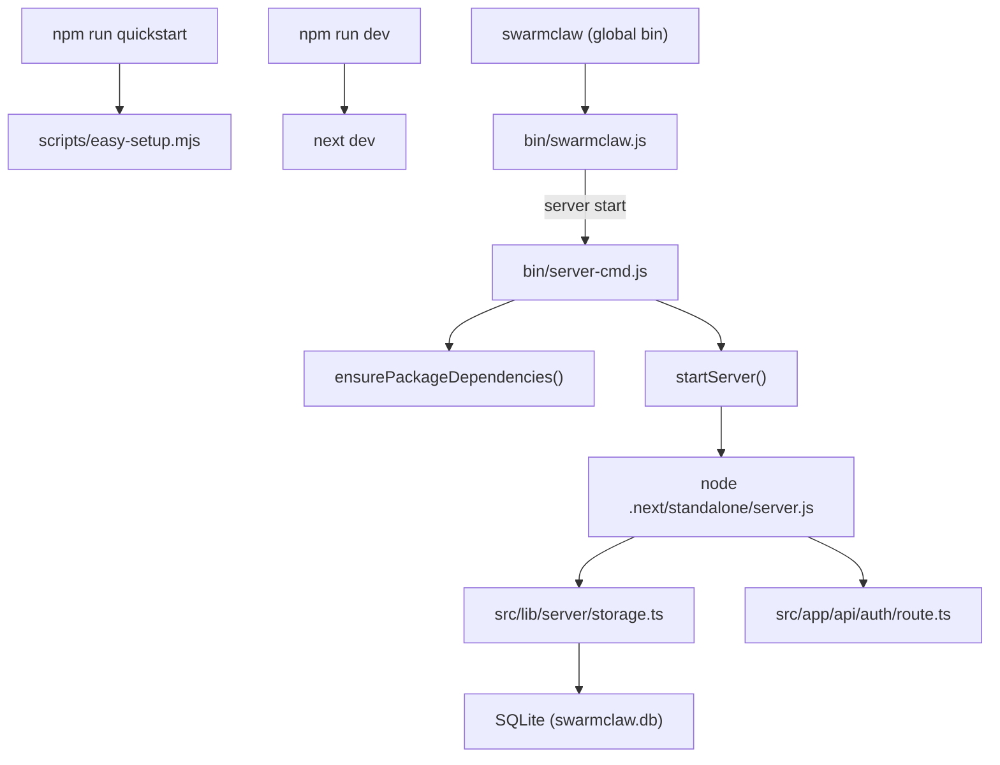
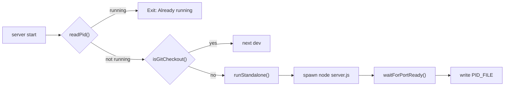

<!-- source: DeepWiki mcp.deepwiki.com · repo swarmclawai/swarmclaw · page 2 Getting Started · fetched 2026-10-27 -->

# Getting Started

<details>
<summary>Relevant source files</summary>

The following files were used as context for generating this wiki page:

- [.dockerignore](.dockerignore)
- [.eslint-baseline.json](.eslint-baseline.json)
- [Dockerfile](Dockerfile)
- [README.md](README.md)
- [bin/doctor-cmd.js](bin/doctor-cmd.js)
- [bin/doctor-cmd.test.js](bin/doctor-cmd.test.js)
- [bin/install-root.js](bin/install-root.js)
- [bin/install-root.test.js](bin/install-root.test.js)
- [bin/server-cmd.js](bin/server-cmd.js)
- [bin/update-cmd.js](bin/update-cmd.js)
- [bin/worker-cmd.js](bin/worker-cmd.js)
- [docker-compose.yml](docker-compose.yml)
- [install.sh](install.sh)
- [package-lock.json](package-lock.json)
- [package.json](package.json)
- [scripts/easy-setup.mjs](scripts/easy-setup.mjs)
- [scripts/easy-update.mjs](scripts/easy-update.mjs)
- [src/app/api/setup/doctor/route.ts](src/app/api/setup/doctor/route.ts)
- [src/app/usage/page.tsx](src/app/usage/page.tsx)
- [src/cli/index.js](src/cli/index.js)
- [src/cli/server-cmd.test.js](src/cli/server-cmd.test.js)
- [src/cli/spec.js](src/cli/spec.js)
- [src/lib/server/credentials/credential-service.ts](src/lib/server/credentials/credential-service.ts)
- [src/lib/server/gateways/gateway-profile-service.ts](src/lib/server/gateways/gateway-profile-service.ts)
- [src/lib/server/missions/mission-templates.ts](src/lib/server/missions/mission-templates.ts)
- [src/lib/server/openclaw/deploy.test.ts](src/lib/server/openclaw/deploy.test.ts)
- [src/lib/server/openclaw/deploy.ts](src/lib/server/openclaw/deploy.ts)
- [src/lib/server/openclaw/gateway.ts](src/lib/server/openclaw/gateway.ts)
- [src/lib/server/storage.ts](src/lib/server/storage.ts)
- [src/types/index.ts](src/types/index.ts)

</details>


This page covers installing SwarmClaw, running it for the first time, and the initial setup flow—from environment preparation through to configuring an LLM provider. SwarmClaw is a self-hosted AI runtime designed for autonomous agents with heartbeats, schedules, and memory.

For step-by-step installation details and npm script internals, see [Installation](#2.1). For provider-specific configuration during setup, see [Initial Provider Setup](#2.2). For architectural context, see [Architecture](#3).

---

## Requirements

| Requirement | Version |
|---|---|
| Node.js | `>=22.6.0` (authoritative per [package.json:32]()) |
| npm | `10+` |
| Docker Desktop | Recommended for sandbox browser execution [README.md:74]() |
| Provider CLIs | Optional (Claude Code, Codex, OpenCode, Gemini, etc.) [README.md:75]() |

> **Note:** The `engines` field in [package.json:31-33]() specifies Node `>=22.6.0`. Using `nvm use` in the repository will pick up the `.nvmrc` which matches this requirement [README.md:72]().

Sources: [package.json:31-33](), [README.md:70-76]()

---

## Installation Options

There are four primary installation paths:

**Option A — Desktop App (Recommended for non-technical users)**
One-click installers for macOS, Windows, and Linux are available at [swarmclaw.ai/downloads](https://swarmclaw.ai/downloads). Data is stored in standard OS app-data directories [README.md:79-93]().

**Option B — Global npm install**
```bash
npm i -g @swarmclawai/swarmclaw
swarmclaw
```
Running `swarmclaw` starts the server on `http://localhost:3456` [README.md:97-117]().

**Option C — From the Repository**
```bash
git clone https://github.com/swarmclawai/swarmclaw.git
cd swarmclaw
npm run quickstart
```
The `quickstart` script ([package.json:58]()) runs `scripts/easy-setup.mjs --start`, which installs dependencies, prepares local config, and starts the server [README.md:121-129]().

**Option D — Docker**
```bash
docker compose up -d --build
```
Uses the provided `Dockerfile` which builds the Next.js standalone server [Dockerfile:1-55]().

Sources: [README.md:77-140](), [package.json:57-59](), [Dockerfile:1-55]()

---

## npm Scripts Reference

| Script | Description |
|---|---|
| `npm run setup:easy` | Runs `scripts/easy-setup.mjs` to prepare the environment [package.json:57]() |
| `npm run quickstart` | Setup + start server in dev mode [package.json:58]() |
| `npm run quickstart:prod` | Setup + build + start production server [package.json:59]() |
| `npm run dev` | Starts Next.js dev server with Turbopack on port 3456 [package.json:61]() |
| `npm run build` | Runs `scripts/run-next-build.mjs` for production [package.json:65]() |
| `npm run start` | Starts the built standalone server [package.json:67]() |
| `npm run cli` | Direct entry to the SwarmClaw CLI [package.json:79]() |

Sources: [package.json:56-80]()

---

## First Launch Flow

The following diagram maps the first-launch sequence from script execution through to the ready state in the browser.

**Diagram: First-Launch Sequence**



Sources: [README.md:125-129](), [src/lib/server/storage.ts:69-79](), [src/app/api/setup/doctor/route.ts:122-145]()

---

## What Happens on First Run

When SwarmClaw starts for the first time:

1. **Environment Generation**: The system generates an `ACCESS_KEY` for UI authentication and a `CREDENTIAL_SECRET` for AES-256 encryption of provider keys [src/app/api/setup/doctor/route.ts:130-145]().
2. **Database Initialization**: Three SQLite databases (`swarmclaw.db`, `memory.db`, `logs.db`) are created in the `data/` directory [src/lib/server/storage.ts:81-99]().
3. **Setup Wizard**: The browser redirects to a guided setup. The `SetupWizard` component handles provider selection and starter agent creation.

The `/api/auth` route facilitates this by checking if it is a "first-time setup" to allow the initial key claim [src/lib/server/storage.ts:70-76]().

Sources: [src/lib/server/storage.ts:69-113](), [src/app/api/setup/doctor/route.ts:122-160]()

---

## Configuration Files and Data Directories

| Path | Purpose |
|---|---|
| `.env.local` | Stores `ACCESS_KEY` and `CREDENTIAL_SECRET` [src/app/api/setup/doctor/route.ts:122]() |
| `data/swarmclaw.db` | Primary relational store (agents, sessions, tasks) [src/lib/server/storage.ts:89]() |
| `data/uploads/` | Storage for files uploaded via chat or tasks [src/lib/server/storage.ts:81]() |
| `workspace/` | Filesystem area for agent sandbox execution [src/lib/server/storage.ts:9]() |

SwarmClaw uses `better-sqlite3` with WAL mode enabled for high-concurrency performance [src/lib/server/storage.ts:90-97]().

Sources: [src/lib/server/storage.ts:1-113](), [src/app/api/setup/doctor/route.ts:114-145]()

---

## Entry Points and Startup Architecture

The diagram below links startup commands to the code entities they invoke.

**Diagram: Entry Points to Server Components**



Sources: [package.json:56-80](), [bin/server-cmd.js:1-176](), [src/lib/server/storage.ts:88-113]()

---

## CLI-Based Setup (No UI Required)

For headless environments, the CLI provides a `setup init` command to configure the system without the browser:

```bash
# Example CLI initialization
swarmclaw setup init --provider anthropic --api-key "sk-ant-..."
```

This command interacts with the `setup` API group to store credentials and mark the initial wizard as complete [src/cli/index.js:141-155]().

Sources: [src/cli/index.js:141-160](), [src/cli/spec.js:105-113]()

---

## Server Management

The `bin/server-cmd.js` script manages the lifecycle of the background server, especially for global installations.

**Diagram: server-cmd.js Lifecycle**



Key files managed by the server command:
- `server.pid`: Stores the process ID of the running instance [bin/server-cmd.js:35]().
- `server.log`: Captures stdout/stderr for the background process [bin/server-cmd.js:36]().

Sources: [bin/server-cmd.js:1-134]()

---

## Security and Diagnostics

SwarmClaw includes a "Doctor" utility to verify the health of the installation. It checks Node.js versions, filesystem permissions, and database integrity [src/app/api/setup/doctor/route.ts:88-120]().

- **Access Key**: Protects the web UI. It is required for all API calls via the `X-Access-Key` header.
- **Credential Encryption**: API keys for Anthropic, OpenAI, etc., are encrypted at rest using the `CREDENTIAL_SECRET` [src/app/api/setup/doctor/route.ts:138-145]().

For full details on provider setup and connection testing, see [Initial Provider Setup](#2.2).

Sources: [src/app/api/setup/doctor/route.ts:1-180](), [src/lib/server/storage.ts:69-79]()

---

