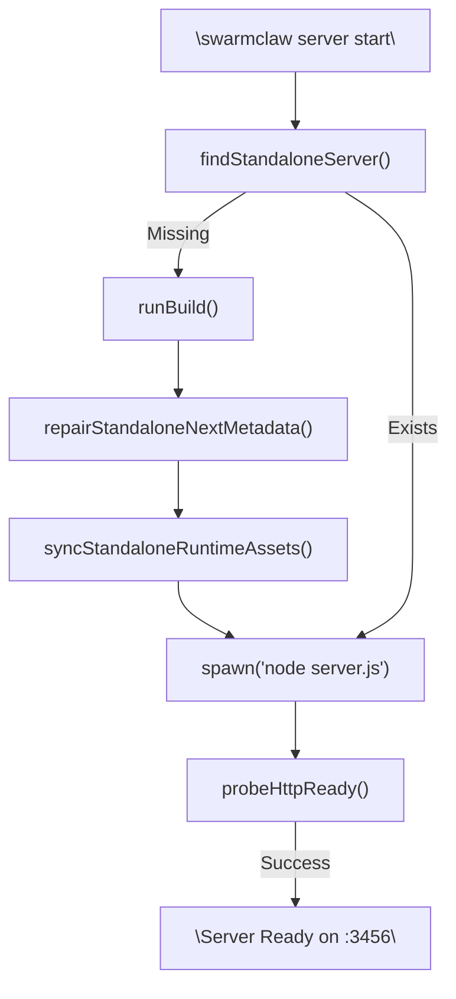

<!-- source: DeepWiki mcp.deepwiki.com · repo swarmclawai/swarmclaw · page 2.1 Installation · fetched 2026-10-27 -->

# Installation

<details>
<summary>Relevant source files</summary>

The following files were used as context for generating this wiki page:

- [.dockerignore](.dockerignore)
- [Dockerfile](Dockerfile)
- [bin/doctor-cmd.js](bin/doctor-cmd.js)
- [bin/doctor-cmd.test.js](bin/doctor-cmd.test.js)
- [bin/install-root.js](bin/install-root.js)
- [bin/install-root.test.js](bin/install-root.test.js)
- [bin/server-cmd.js](bin/server-cmd.js)
- [bin/update-cmd.js](bin/update-cmd.js)
- [bin/worker-cmd.js](bin/worker-cmd.js)
- [docker-compose.yml](docker-compose.yml)
- [install.sh](install.sh)
- [scripts/easy-setup.mjs](scripts/easy-setup.mjs)
- [scripts/easy-update.mjs](scripts/easy-update.mjs)
- [scripts/postinstall.mjs](scripts/postinstall.mjs)
- [scripts/postinstall.test.mjs](scripts/postinstall.test.mjs)
- [scripts/run-next-build.mjs](scripts/run-next-build.mjs)
- [scripts/run-next-build.test.mjs](scripts/run-next-build.test.mjs)
- [src/app/api/setup/doctor/route.ts](src/app/api/setup/doctor/route.ts)
- [src/app/usage/page.tsx](src/app/usage/page.tsx)
- [src/cli/server-cmd.test.js](src/cli/server-cmd.test.js)
- [src/lib/server/connectors/whatsapp.test.ts](src/lib/server/connectors/whatsapp.test.ts)
- [src/lib/server/credentials/credential-service.ts](src/lib/server/credentials/credential-service.ts)
- [src/lib/server/gateways/gateway-profile-service.ts](src/lib/server/gateways/gateway-profile-service.ts)
- [src/lib/server/openclaw/deploy.test.ts](src/lib/server/openclaw/deploy.test.ts)
- [src/lib/server/openclaw/deploy.ts](src/lib/server/openclaw/deploy.ts)
- [src/lib/server/openclaw/gateway.ts](src/lib/server/openclaw/gateway.ts)
- [src/lib/server/sandbox/session-runtime.test.ts](src/lib/server/sandbox/session-runtime.test.ts)

</details>


This page covers the step-by-step process for installing SwarmClaw, the available npm scripts for different run modes, how `server-cmd.js` manages the server lifecycle, the `SWARMCLAW_HOME` directory layout, Docker deployment, and Node.js version requirements.

---

## Prerequisites

| Requirement | Minimum version |
|---|---|
| Node.js | `>=22.6.0` |
| npm | bundled with Node.js |

The version constraint is verified by the setup doctor and required for features like `node:sqlite` and specific ESM behaviors [src/app/api/setup/doctor/route.ts:95-104]().

---

## Installation Methods

### Global Install from npm

```sh
npm install -g @swarmclawai/swarmclaw
```

This makes the `swarmclaw` binary available system-wide. The binary entry point is declared at [bin/server-cmd.js:1]().

### From Source (Git Checkout)

```sh
git clone https://github.com/swarmclawai/swarmclaw.git
cd swarmclaw
npm install
```

After cloning, all npm scripts are available. The `postinstall.mjs` script automatically rebuilds `better-sqlite3` and attempts to pull the sandbox browser image if Docker is available [scripts/postinstall.mjs:63-91]().

---

## npm Scripts Reference

The following scripts are defined in the package root.

| Script | Command | Purpose |
|---|---|---|
| `setup:easy` | `node ./scripts/easy-setup.mjs` | Interactive guided setup including dependency check [scripts/easy-setup.mjs:118-146]() |
| `quickstart` | `node ./scripts/easy-setup.mjs --start` | Setup and immediately start in dev mode |
| `quickstart:prod` | `node ./scripts/easy-setup.mjs --prod` | Setup and immediately start in production mode |
| `update:easy` | `node ./scripts/easy-update.mjs` | Pull updates, run migrations, and rebuild [scripts/easy-update.mjs:92-172]() |
| `dev` | `next dev -p 3456` | Development server with hot reload |
| `build` | `next build` | Standard production build |
| `build:ci` | `npm run build` | CI build with specific environment overrides [Dockerfile:29]() |
| `start` | `next start` | Start a pre-built production server |

Sources: [scripts/easy-setup.mjs:1-149](), [scripts/easy-update.mjs:1-175]()

---

## Production Mode via `server-cmd.js`

When running `swarmclaw server` commands, the lifecycle is managed by [bin/server-cmd.js](). This script handles building, asset syncing, and process management.

### `server-cmd.js` Lifecycle

The script determines if a build is necessary by checking for the existence of the standalone server [bin/server-cmd.js:148-159]().

**`runBuild` Logic:**
1. **Dependency Check**: Ensures `next` is installed; if not, triggers `npm install` [bin/server-cmd.js:163-176]().
2. **Memory Management**: The build process uses `scripts/run-next-build.mjs` to derive optimal `max-old-space-size` based on system or cgroup limits to prevent OOM during heavy Next.js compilation [scripts/run-next-build.mjs:73-91]().
3. **Standalone Repair**: Next.js standalone mode often misses `public` and `static` assets. `server-cmd.js` calls `syncStandaloneRuntimeAssets` to copy these into the standalone directory [bin/server-cmd.js:213-252]().

**`startServer` Logic:**
1. **PID Management**: Writes the process ID to `server.pid` in `SWARMCLAW_HOME` [bin/server-cmd.js:35]().
2. **Liveness Probe**: Uses `probeHttpReady` to poll `/api/auth` until the server is responsive [bin/server-cmd.js:86-109]().
3. **Log Redirection**: In detached mode, `stdout` and `stderr` are piped to `server.log` [bin/server-cmd.js:36]().

**Diagram: `swarmclaw server` Lifecycle & Asset Flow**



Sources: [bin/server-cmd.js:86-109](), [bin/server-cmd.js:213-252](), [scripts/run-next-build.mjs:139-161]()

---

## `SWARMCLAW_HOME` Directory Layout

`SWARMCLAW_HOME` (defaulting to `~/.swarmclaw`) is the central state directory.

**Diagram: Filesystem Entity Mapping**

```mermaid
graph TD
  subgraph "SWARMCLAW_HOME"
    DATA["\"data/ (DATA_DIR)\""]
    WORKSPACE["\"workspace/ (WORKSPACE_DIR)\""]
    BUILDS["\"builds/\""]
    LOGS["\"server.log\""]
    PID["\"server.pid\""]
  end

  DATA --> DB1["\"swarmclaw.db\""]
  DATA --> DB2["\"memory.db\""]
  WORKSPACE --> AGENT_FS["\"Agent Local Files\""]
  BUILDS --> STANDALONE["\".next/standalone/\""]

  style DATA stroke-dasharray: 5 5
  style WORKSPACE stroke-dasharray: 5 5
```

| Path | Code Reference | Purpose |
|---|---|---|
| `data/` | `DATA_DIR` [bin/server-cmd.js:37]() | SQLite databases and persistent JSON storage. |
| `workspace/` | `WORKSPACE_DIR` [bin/server-cmd.js:38]() | Default root for agent file operations and sandboxes. |
| `builds/` | `BUILD_WORKSPACES_DIR` [bin/server-cmd.js:40]() | Isolated build environments for different versions. |
| `server.log` | `LOG_FILE` [bin/server-cmd.js:36]() | Background process output. |

Sources: [bin/server-cmd.js:35-41](), [src/app/api/setup/doctor/route.ts:114-120]()

---

## Docker & Cloud Deployment

### Docker
The `Dockerfile` uses a multi-stage build. It utilizes `node:22-slim` as the base [Dockerfile:1]().
- **Stage 1 (base)**: Installs `git`, `python3`, `make`, and `g++` to compile `better-sqlite3` [Dockerfile:3-4]().
- **Stage 2 (runner)**: Copies only the `.next/standalone` output and necessary `node_modules` [Dockerfile:38-42]().
- **Persistence**: The `/app/data` directory must be mounted as a volume [Dockerfile:44-45]().

### Docker Compose
The provided `docker-compose.yml` maps ports `3456` (Web UI) and `3457` (internal/gateway) and mounts the `./data` volume [docker-compose.yml:5-9](). It includes a health check targeting `/api/healthz` [docker-compose.yml:13-18]().

### Cloud (Fly.io / Railway)
SwarmClaw is compatible with container-based PaaS.
- **Port**: Set `PORT=3456`.
- **Volumes**: Ensure a persistent volume is mounted at `/app/data`.
- **Environment**: Set `NODE_ENV=production`.

Sources: [Dockerfile:1-54](), [docker-compose.yml:1-20]()

---

## Update Lifecycle

The `swarmclaw update` command (driven by `bin/update-cmd.js`) handles the transition between versions.

1. **Stop Server**: Gracefully shuts down the running server to prevent SQLite WAL corruption [bin/update-cmd.js:101-122]().
2. **Git Pull / Registry Update**: Fetches the latest stable tag [bin/update-cmd.js:147-175]().
3. **Dependency Diff**: Detects if `package.json` changed and triggers `npm install` only if necessary [bin/update-cmd.js:196-206]().
4. **Rebuild**: Triggers `rebuildStandaloneServer()` to ensure the standalone bundle matches the new source [bin/update-cmd.js:55-74]().

Sources: [bin/update-cmd.js:55-215](), [scripts/easy-update.mjs:118-172]()

---

