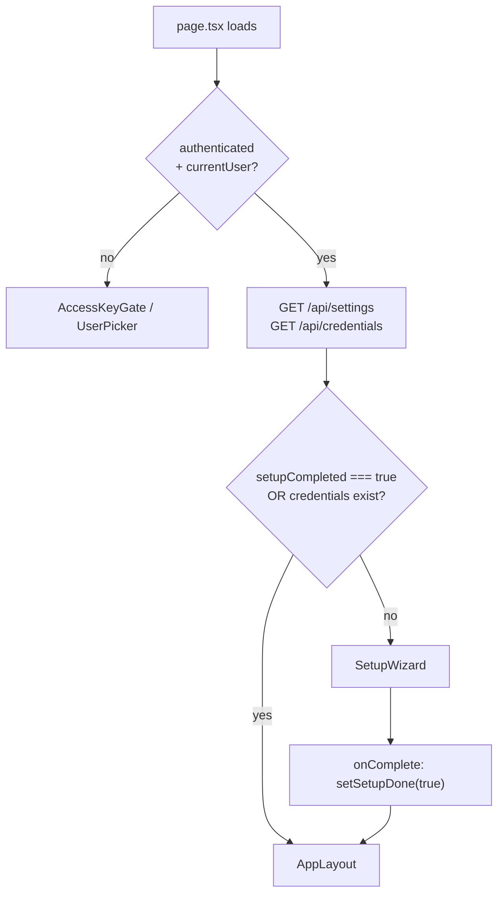
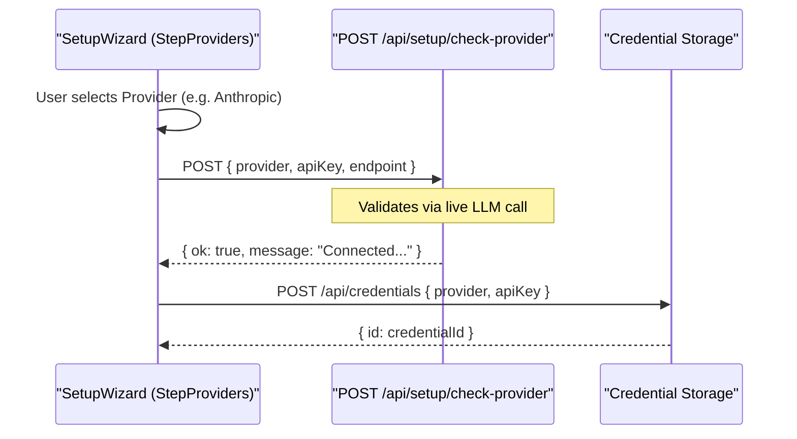
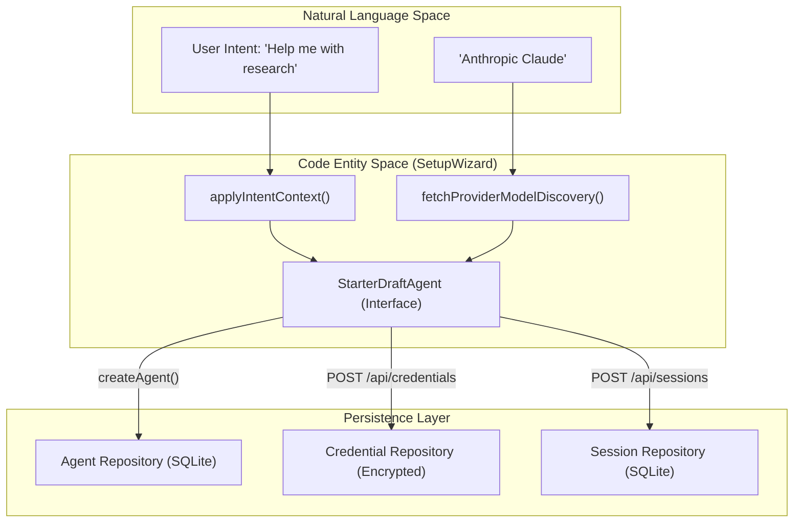

<!-- source: DeepWiki mcp.deepwiki.com · repo swarmclawai/swarmclaw · page 2.2 Initial Provider Setup · fetched 2026-10-27 -->

# Initial Provider Setup

Relevant source files

The following files were used as context for generating this wiki page:

- [src/app/api/eval/scenarios/route.ts](src/app/api/eval/scenarios/route.ts)
- [src/app/api/eval/suite/route.ts](src/app/api/eval/suite/route.ts)
- [src/app/api/eval/suites/route.ts](src/app/api/eval/suites/route.ts)
- [src/app/api/setup/check-provider/route.ts](src/app/api/setup/check-provider/route.ts)
- [src/app/api/usage/live/route.ts](src/app/api/usage/live/route.ts)
- [src/app/setup/page.tsx](src/app/setup/page.tsx)
- [src/components/agents/agent-sheet.tsx](src/components/agents/agent-sheet.tsx)
- [src/components/auth/setup-wizard/index.tsx](src/components/auth/setup-wizard/index.tsx)
- [src/components/auth/setup-wizard/step-agents.tsx](src/components/auth/setup-wizard/step-agents.tsx)
- [src/components/auth/setup-wizard/step-connect.tsx](src/components/auth/setup-wizard/step-connect.tsx)
- [src/components/auth/setup-wizard/step-next.tsx](src/components/auth/setup-wizard/step-next.tsx)
- [src/components/auth/setup-wizard/step-progress.tsx](src/components/auth/setup-wizard/step-progress.tsx)
- [src/components/auth/setup-wizard/step-providers.tsx](src/components/auth/setup-wizard/step-providers.tsx)
- [src/components/auth/setup-wizard/types.test.ts](src/components/auth/setup-wizard/types.test.ts)
- [src/components/auth/setup-wizard/types.ts](src/components/auth/setup-wizard/types.ts)
- [src/components/auth/setup-wizard/utils.test.ts](src/components/auth/setup-wizard/utils.test.ts)
- [src/components/auth/setup-wizard/utils.ts](src/components/auth/setup-wizard/utils.ts)
- [src/lib/provider-sets.ts](src/lib/provider-sets.ts)
- [src/lib/providers/index.ts](src/lib/providers/index.ts)
- [src/lib/server/chat-execution/chat-turn-finalization.ts](src/lib/server/chat-execution/chat-turn-finalization.ts)
- [src/lib/server/context-manager.ts](src/lib/server/context-manager.ts)
- [src/lib/server/eval/runner.ts](src/lib/server/eval/runner.ts)
- [src/lib/server/eval/scenarios.ts](src/lib/server/eval/scenarios.ts)
- [src/lib/server/eval/types.ts](src/lib/server/eval/types.ts)
- [src/lib/setup-defaults.ts](src/lib/setup-defaults.ts)
- [src/types/provider.ts](src/types/provider.ts)
- [src/types/session.ts](src/types/session.ts)

This page covers the first-time provider configuration flow in SwarmClaw: the browser-based `SetupWizard` component, the `check-provider` API endpoint that validates credentials, and the CLI-based initialization path.

For general installation and how to start the server, see [Installation](#2.1). For managing providers after initial setup (adding custom providers, editing API keys, model overrides), see [Agent & Provider Management UI](#12.3) and [API Providers](#5.1).

---

## When Setup is Triggered

On first run, the root page (`src/app/page.tsx`) determines whether the setup wizard should be shown before rendering the main dashboard. It checks the `setupCompleted` flag in settings and whether any credentials exist.

If setup is not completed and no credentials exist, the page renders the `<SetupWizard />` component. Completing the wizard sets `setupCompleted: true` in settings.

**First-run trigger flow:**

Sources: [src/app/page.tsx:129-171]()

---

## The SetupWizard Component

The `SetupWizard` (found in `src/components/auth/setup-wizard/index.tsx`) is a multi-step onboarding flow designed to bridge the user from installation to a working agent swarm.

### Onboarding Paths
The wizard supports three primary paths defined in `OnboardingPath`:
- **Quick Start (`quick`)**: Focused on a minimal set of high-performance starter kits.
- **Intent-Based (`intent`)**: Asks the user "What are you building?" and applies this context to the system prompts of all starter agents.
- **Manual (`manual`)**: Provides the full catalog of starter kits and advanced configuration options.

Sources: [src/components/auth/setup-wizard/utils.ts:17-39](), [src/components/auth/setup-wizard/types.ts:10-15]()

### Step 1: Provider Configuration
The user selects an LLM provider from `SETUP_PROVIDERS`. This list includes API providers (OpenAI, Anthropic), Local providers (Ollama), and Gateway providers (OpenClaw).

| Feature | Code Entity |
|---|---|
| Provider List | `SETUP_PROVIDERS` in `src/lib/setup-defaults.ts` |
| Connection Check | `checkOpenAiCompatible`, `checkAnthropic`, `checkOllama` in `check-provider/route.ts` |
| Verification Logic | `requiresSetupProviderVerification` in `src/components/auth/setup-wizard/utils.ts` |

**Provider selection and validation flow:**

Sources: [src/lib/setup-defaults.ts:53-236](), [src/app/api/setup/check-provider/route.ts:56-160](), [src/components/auth/setup-wizard/utils.ts:114-116]()

### Step 2: Agent Swarm Creation
Based on the selected `StarterKit`, the wizard generates a set of `StarterDraftAgent` objects.
- **Intent Context**: If the user provided an intent (e.g., "Build a React app"), the `applyIntentContext` function appends this to the base system prompts.
- **Model Discovery**: For providers like Ollama or OpenRouter, the wizard calls the `/discover-models` endpoint to fetch available models for the user to pick from.

Sources: [src/components/auth/setup-wizard/utils.ts:41-50](), [src/components/auth/setup-wizard/step-agents.tsx:59-85](), [src/components/auth/setup-wizard/utils.ts:142-200]()

---

## The `check-provider` API Endpoint

**Route:** `POST /api/setup/check-provider`
**File:** `src/app/api/setup/check-provider/route.ts`

This endpoint performs live validation of provider credentials before they are saved to the database. It prevents "broken" agents by ensuring the API key and endpoint are functional.

### Per-Provider Validation Logic

| Provider Type | Logic | Implementation |
|---|---|---|
| **OpenAI Compatible** | Calls `/chat/completions` with a minimal "Reply OK" prompt. | `checkOpenAiCompatible` [line 56]() |
| **Anthropic** | Calls `/v1/messages` with `max_tokens: 12`. | `checkAnthropic` [line 130]() |
| **Ollama** | Probes `/api/tags` (local) or `/v1/models` (cloud) and suggests the first available model. | `checkOllama` [line 161]() |
| **CLI Providers** | Probes for binary existence and auth status via `probeCliAuth`. | `probeCliAuth` [line 5]() |

Sources: [src/app/api/setup/check-provider/route.ts:56-160](), [src/lib/providers/cli-utils.ts:1-20]()

---

## CLI-Based Provider Initialization

Headless setup is supported via the `swarmclaw setup init` command. This is used for Docker deployments or automated environments where the UI wizard is not accessible.

### Execution Flow
1. **Discovery**: The CLI checks for existing credentials in `swarmclaw.db`.
2. **Validation**: It invokes the same logic as the `check-provider` API to verify the provided `--api-key`.
3. **Persistence**: It writes the credential and creates the default "Assistant" agent using `createAgent`.

Sources: [src/lib/agents/index.ts:6-10](), [src/lib/server/storage.ts:19-25]()

---

## Technical Data Flow: Natural Language to Code Entities

The following diagram illustrates how a user's intent and provider choice are transformed into persistent system entities during setup.

Sources: [src/components/auth/setup-wizard/utils.ts:41-50](), [src/components/agents/agent-sheet.tsx:8-10](), [src/lib/agents/index.ts:6-10]()

---

## OpenClaw Gateway Setup

Special handling is provided for **OpenClaw** gateways. Unlike standard API providers, OpenClaw setup involves:
1. **URL Normalization**: `normalizeOpenClawUrl` ensures the endpoint is correctly formatted for WebSocket or HTTP usage.
2. **Dashboard Resolution**: `resolveOpenClawDashboardUrl` converts gateway endpoints back to the human-readable dashboard URL for user reference.
3. **Local Detection**: `isLocalOpenClawEndpoint` checks if the gateway is running on `localhost`, which triggers specific UI hints for port forwarding.

Sources: [src/components/auth/setup-wizard/utils.ts:85-95](), [src/components/auth/setup-wizard/utils.ts:78-83](), [src/app/api/setup/check-provider/route.ts:8-10]()

---

