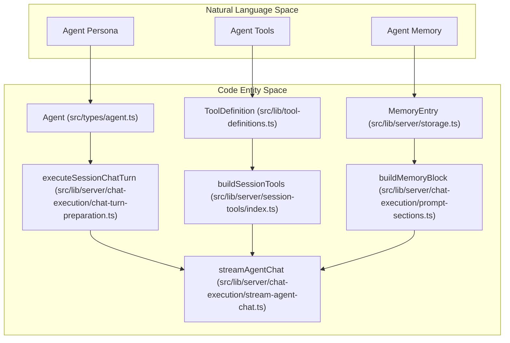
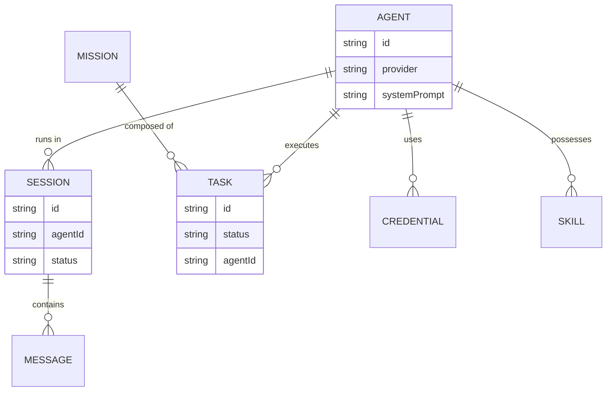

<!-- source: DeepWiki mcp.deepwiki.com · repo swarmclawai/swarmclaw · page 21 Glossary · fetched 2026-10-27 -->

# Glossary

Relevant source files

The following files were used as context for generating this wiki page:

- [.eslint-baseline.json](.eslint-baseline.json)
- [.github/workflows/desktop-release.yml](.github/workflows/desktop-release.yml)
- [.gitignore](.gitignore)
- [CLAUDE.md](CLAUDE.md)
- [README.md](README.md)
- [SWARMDOCK.md](SWARMDOCK.md)
- [electron/free-port.ts](electron/free-port.ts)
- [electron/menu.ts](electron/menu.ts)
- [electron/paths.ts](electron/paths.ts)
- [electron/tsconfig.json](electron/tsconfig.json)
- [package-lock.json](package-lock.json)
- [package.json](package.json)
- [skills/swarmclaw/SKILL.md](skills/swarmclaw/SKILL.md)
- [skills/swarmvault/SKILL.md](skills/swarmvault/SKILL.md)
- [src/app/api/mcp-servers/route.ts](src/app/api/mcp-servers/route.ts)
- [src/app/api/missions/[id]/route.ts](src/app/api/missions/[id]/route.ts)
- [src/app/api/missions/route.ts](src/app/api/missions/route.ts)
- [src/cli/index.js](src/cli/index.js)
- [src/cli/spec.js](src/cli/spec.js)
- [src/components/mcp-servers/mcp-server-sheet.tsx](src/components/mcp-servers/mcp-server-sheet.tsx)
- [src/lib/server/__fixtures__/fake-mcp-stdio-server.mjs](src/lib/server/__fixtures__/fake-mcp-stdio-server.mjs)
- [src/lib/server/agents/agent-service.ts](src/lib/server/agents/agent-service.ts)
- [src/lib/server/agents/subagent-runtime.ts](src/lib/server/agents/subagent-runtime.ts)
- [src/lib/server/agents/subagent-swarm.test.ts](src/lib/server/agents/subagent-swarm.test.ts)
- [src/lib/server/agents/subagent-swarm.ts](src/lib/server/agents/subagent-swarm.ts)
- [src/lib/server/chat-execution/prompt-sections.planning-mode.test.ts](src/lib/server/chat-execution/prompt-sections.planning-mode.test.ts)
- [src/lib/server/chat-execution/prompt-sections.ts](src/lib/server/chat-execution/prompt-sections.ts)
- [src/lib/server/chat-execution/stream-agent-chat.ts](src/lib/server/chat-execution/stream-agent-chat.ts)
- [src/lib/server/connectors/swarmdock.test.ts](src/lib/server/connectors/swarmdock.test.ts)
- [src/lib/server/connectors/swarmdock.ts](src/lib/server/connectors/swarmdock.ts)
- [src/lib/server/mcp-client.ts](src/lib/server/mcp-client.ts)
- [src/lib/server/missions/mission-templates.ts](src/lib/server/missions/mission-templates.ts)
- [src/lib/server/session-tools/subagent.ts](src/lib/server/session-tools/subagent.ts)
- [src/lib/server/session-tools/swarmdock.test.ts](src/lib/server/session-tools/swarmdock.test.ts)
- [src/lib/server/session-tools/swarmdock.ts](src/lib/server/session-tools/swarmdock.ts)
- [src/lib/server/storage-normalization.ts](src/lib/server/storage-normalization.ts)
- [src/lib/server/storage.ts](src/lib/server/storage.ts)
- [src/lib/server/tool-aliases.ts](src/lib/server/tool-aliases.ts)
- [src/lib/server/tool-capability-policy.test.ts](src/lib/server/tool-capability-policy.test.ts)
- [src/lib/server/tool-capability-policy.ts](src/lib/server/tool-capability-policy.ts)
- [src/lib/tool-definitions.ts](src/lib/tool-definitions.ts)
- [src/lib/validation/schemas.test.ts](src/lib/validation/schemas.test.ts)
- [src/lib/validation/schemas.ts](src/lib/validation/schemas.ts)
- [src/types/agent.ts](src/types/agent.ts)
- [src/types/index.ts](src/types/index.ts)
- [src/types/misc.ts](src/types/misc.ts)
- [src/types/mission.ts](src/types/mission.ts)

This page defines codebase-specific terms, jargon, and domain concepts used throughout SwarmClaw. It serves as a technical reference for onboarding engineers to bridge the gap between natural language concepts and their implementation in the code.

## Core Agent Primitives

The fundamental building blocks of the SwarmClaw autonomous system.

| Term | Definition | Code Pointer |
|:---|:---|:---|
| **Agent** | A persistent configuration defining an AI's persona, provider settings, and capabilities. | [src/types/agent.ts:1-150]() |
| **Session** | A specific conversation thread or execution context. Agents run inside sessions. | [src/types/session.ts:1-80]() |
| **Mission** | A long-running, goal-oriented objective that may span multiple sessions and agents. | [src/types/mission.ts:1-100]() |
| **Skill** | Markdown-based documentation (`SKILL.md`) that teaches agents how to use specific tools or APIs. | [src/lib/server/storage.ts:138-140]() |
| **Tool** | An executable function (JSON-RPC) that an agent can call to interact with the world. | [src/lib/tool-definitions.ts:1-50]() |
| **Capability** | A high-level permission gate (e.g., `files`, `shell`) that controls access to groups of tools. | [src/lib/server/tool-capability-policy.ts:1-100]() |

### Data Flow: Agent to Execution
The following diagram illustrates how an abstract "Agent" concept is realized through specific code entities during a chat turn.

**Natural Language to Code Entity Space**

**Sources:** [src/types/agent.ts:1-150](), [src/lib/server/chat-execution/stream-agent-chat.ts:1-200](), [src/lib/server/storage.ts:128-186]()

---

## Architectural Terms

### Daemon
The background process responsible for autonomous activities like heartbeats, scheduled tasks, and connector maintenance.
*   **Implementation:** Managed via `ensureDaemonStarted` and tracked in the `daemon_status` collection.
*   **Source:** [src/lib/server/storage.ts:178-178]()

### Heartbeat
A recurring "tick" that wakes an agent to check for pending tasks, reflect on its goals, or continue a long-running process.
*   **Implementation:** Configured via `heartbeatIntervalSec` in the agent schema.
*   **Source:** [src/lib/validation/schemas.ts:103-110]()

### Dream Cycle
An idle-time background process where agents reflect on past memories to produce `dream_reflection` and `consolidated_insight` entries.
*   **Implementation:** Handled by the dream service and stored in `agents/:id/dream`.
*   **Source:** [src/lib/server/storage.ts:29-30](), [src/cli/index.js:29-31]()

### MCP (Model Context Protocol)
An open standard for connecting AI agents to external data sources and tools.
*   **Implementation:** Managed via `McpServerConfig` and the `mcp_servers` storage collection.
*   **Source:** [src/lib/server/storage.ts:152-152](), [src/lib/server/mcp-client.ts:1-50]()

---

## Platform & Integration Concepts

### OpenClaw
The gateway protocol and ecosystem SwarmClaw is built to support. It includes agent identity and cross-instance communication.
*   **Source:** [README.md:17-23](), [src/lib/server/storage.ts:137-137]()

### SwarmDock
A marketplace for agents to discover tasks, bid on work, and receive USDC payments.
*   **Implementation:** Integrated via the `swarmdock` connector and session tools.
*   **Source:** [src/lib/server/connectors/swarmdock.ts:1-100](), [src/lib/server/session-tools/swarmdock.ts:1-50]()

### Sandbox
A Docker-based isolated environment for executing untrusted code or running a browser.
*   **Implementation:** Defined by `AgentSandboxConfigSchema`.
*   **Source:** [src/lib/validation/schemas.ts:24-40]()

---

## System State & Storage

### Storage Collections
SwarmClaw uses a single SQLite database (`swarmclaw.db`) with a "Collection" pattern where each table stores JSON blobs indexed by ID.

| Collection | Description |
|:---|:---|
| `agents` | Core agent definitions. |
| `sessions` | Chat and execution history. |
| `tasks` | Units of work with status tracking. |
| `credentials` | Encrypted API keys and auth tokens. |
| `memories` | Persistent knowledge entries. |

**System Entity Relationship Diagram**

**Sources:** [src/lib/server/storage.ts:128-186](), [src/types/index.ts:1-20]()

---

## Technical Jargon & Abbreviations

*   **A2A:** Agent-to-Agent protocol for cross-instance communication.
*   **CDP:** Chrome DevTools Protocol, used for the `browser` tool in the sandbox.
*   **FTS5:** SQLite Full-Text Search version 5, used for memory retrieval.
*   **SSE:** Server-Sent Events, the primary transport for streaming agent responses.
*   **WAL:** Write-Ahead Logging, the SQLite journal mode used for high concurrency. [src/lib/server/storage.ts:92-92]()
*   **E-Stop:** Emergency Stop, a global state that halts all autonomous agent activity. [src/cli/index.js:57-58]()
*   **DAG:** Directed Acyclic Graph, used for task dependencies and protocol workflows. [src/lib/server/storage.ts:194-195]()

**Sources:** [src/lib/server/storage.ts:89-114](), [src/cli/index.js:52-61](), [src/lib/validation/schemas.ts:10-15]()