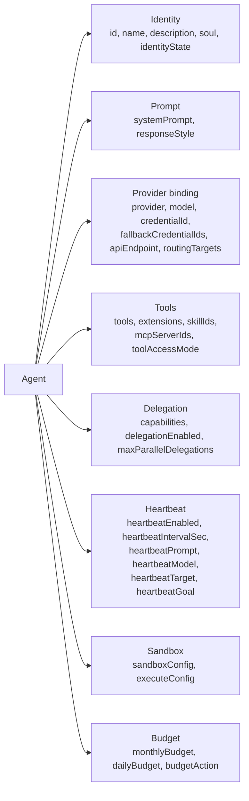
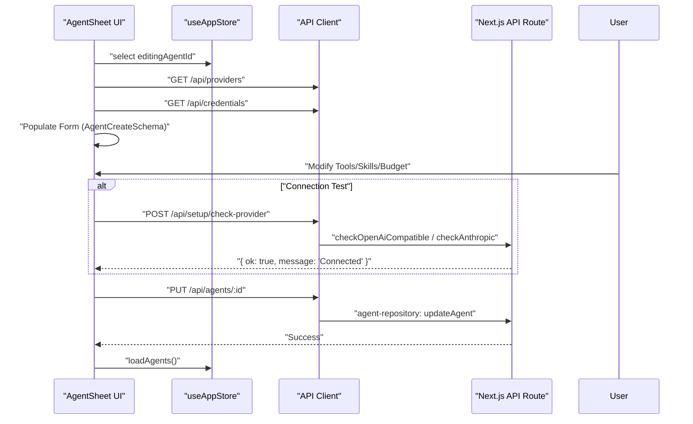

<!-- source: DeepWiki mcp.deepwiki.com · repo swarmclawai/swarmclaw · page 4.1 Agent Configuration · fetched 2026-10-27 -->

# Agent Configuration

Relevant source files

The following files were used as context for generating this wiki page:

- [src/app/api/setup/check-provider/route.ts](src/app/api/setup/check-provider/route.ts)
- [src/components/agents/agent-sheet.tsx](src/components/agents/agent-sheet.tsx)
- [src/lib/provider-sets.ts](src/lib/provider-sets.ts)
- [src/lib/providers/index.ts](src/lib/providers/index.ts)
- [src/lib/providers/ollama.ts](src/lib/providers/ollama.ts)
- [src/lib/providers/provider-defaults.ts](src/lib/providers/provider-defaults.ts)
- [src/lib/server/agents/agent-runtime-config.test.ts](src/lib/server/agents/agent-runtime-config.test.ts)
- [src/lib/server/agents/agent-service.ts](src/lib/server/agents/agent-service.ts)
- [src/lib/server/build-llm.test.ts](src/lib/server/build-llm.test.ts)
- [src/lib/server/build-llm.ts](src/lib/server/build-llm.ts)
- [src/lib/server/chat-execution/chat-turn-state.test.ts](src/lib/server/chat-execution/chat-turn-state.test.ts)
- [src/lib/server/chat-execution/chat-turn-state.ts](src/lib/server/chat-execution/chat-turn-state.ts)
- [src/lib/server/chat-execution/prompt-sections.planning-mode.test.ts](src/lib/server/chat-execution/prompt-sections.planning-mode.test.ts)
- [src/lib/server/chat-execution/prompt-sections.ts](src/lib/server/chat-execution/prompt-sections.ts)
- [src/lib/server/chat-execution/stream-agent-chat.ts](src/lib/server/chat-execution/stream-agent-chat.ts)
- [src/lib/server/context-manager.ts](src/lib/server/context-manager.ts)
- [src/lib/server/messages/message-repository.ts](src/lib/server/messages/message-repository.ts)
- [src/lib/validation/schemas.test.ts](src/lib/validation/schemas.test.ts)
- [src/lib/validation/schemas.ts](src/lib/validation/schemas.ts)
- [src/types/agent.ts](src/types/agent.ts)
- [src/types/provider.ts](src/types/provider.ts)
- [src/types/session.ts](src/types/session.ts)

This page is a reference for all properties of the `Agent` data type, the workflow for creating and editing agents through the `AgentSheet` UI component, how providers and credentials are assigned, and how tools, skills, MCP servers, and capabilities are attached to an agent.

For how agents are discovered by peers and orchestrators at runtime, see [Agent Registry](#4.2). For the autonomous main loop that runs inside a live agent session, see [Main Agent Loop](#4.3). For provider setup and model lists, see [LLM Providers](#5). For how the tool list is assembled and gated at execution time, see [Session Tools](#7.1).

---

## The `Agent` Interface

All agent configuration is expressed as the `Agent` interface in [src/types/agent.ts:42-200](). Each record is persisted in the `swarmclaw.db` SQLite database. Validation is enforced using Zod via `AgentCreateSchema` [src/lib/validation/schemas.ts:73-137]().

*`Agent` interface fields grouped by functional role — field names map directly to `src/types/agent.ts:42-200`*

Sources: [src/types/agent.ts:42-200](), [src/lib/validation/schemas.ts:73-137]()

### Identity and Continuity Fields

| Field | Type | Description |
|---|---|---|
| `id` | `string` | Unique identifier (UUID) |
| `name` | `string` | Display name [src/types/agent.ts:44]() |
| `description` | `string` | Short description of the agent's purpose [src/types/agent.ts:46]() |
| `soul` | `string?` | Optional personality/voice text injected before `systemPrompt` [src/types/agent.ts:47]() |
| `identityState` | `IdentityContinuityState?` | Persistent state including self-summary and tone style [src/types/agent.ts:48]() |
| `systemPrompt` | `string` | Primary instruction prompt [src/types/agent.ts:54]() |

The `soul` and `identityState` are injected during prompt assembly in `buildIdentitySection` [src/lib/server/chat-execution/prompt-sections.ts:32-82]().

### Provider and Routing Configuration

Agents can use a single provider or a set of `routingTargets` for failover or specialized roles.

| Field | Type | Description |
|---|---|---|
| `provider` | `ProviderId` | Primary LLM provider [src/types/agent.ts:55]() |
| `model` | `string` | Primary model name [src/types/agent.ts:56]() |
| `routingStrategy` | `AgentRoutingStrategy?` | Strategy like `single`, `balanced`, or `economy` [src/types/agent.ts:64]() |
| `routingTargets` | `AgentRoutingTarget[]?` | List of fallback or specialized provider/model pairs [src/types/agent.ts:65]() |
| `credentialId` | `string?` | ID of the primary `Credential` record [src/types/agent.ts:58]() |
| `apiEndpoint` | `string?` | Override URL for the provider API [src/types/agent.ts:60]() |

The `buildChatModel` function [src/lib/server/build-llm.ts:59-140]() resolves these fields into a LangChain-compatible chat model.

---

## Tool and Skill Configuration

Agents support a layered capability model including native tools, MCP servers, and instructional skills.

### Tool Access Modes
The `toolAccessMode` [src/types/agent.ts:83]() determines how tools are exposed to the LLM:
- `universal`: The agent has access to the full system toolset.
- `scoped`: Restricts enabled tools to the intersection of the system core and the agent's `tools` list.

### Skills and Knowledge
- `skillIds`: References to managed skills stored in the database [src/types/agent.ts:86]().
- `skills`: Pinned Claude Code skills to mention explicitly [src/types/agent.ts:85]().
- `mcpServerIds`: Activates Model Context Protocol servers for the agent [src/types/agent.ts:87]().

Sources: [src/types/agent.ts:76-92](), [src/lib/server/chat-execution/prompt-sections.ts:64-79]()

---

## Budget and Sandbox Settings

### Budget Configuration
Agents can be configured with strict spending limits to prevent runaway autonomous costs.
- `monthlyBudget`, `dailyBudget`, `hourlyBudget`: USD limits [src/types/agent.ts:126-128]().
- `budgetAction`: Either `warn` (log error) or `block` (prevent chat execution) [src/lib/validation/schemas.ts:136]().

### Sandbox Settings
The `sandboxConfig` [src/types/agent.ts:154-184]() defines the Docker-based isolation environment:
- `mode`: `'off'`, `'non-main'`, or `'all'` [src/lib/validation/schemas.ts:26]().
- `scope`: `'session'` (fresh container per session) or `'agent'` (shared across agent sessions) [src/lib/validation/schemas.ts:27]().
- `browser`: Configuration for a Playwright/noVNC browser container [src/lib/validation/schemas.ts:5-17]().

---

## The `AgentSheet` Component

`AgentSheet` in [src/components/agents/agent-sheet.tsx:153-]() is the primary UI for managing agent configuration. It utilizes `useAppStore` for state management and `api()` for backend communication.

*Data Flow in AgentSheet*

Sources: [src/components/agents/agent-sheet.tsx:153-271](), [src/app/api/setup/check-provider/route.ts:56-128]()

### Key UI Sections
- **Provider Settings**: Handles model discovery via `fetchProviderModelDiscovery` [src/components/agents/agent-sheet.tsx:8]().
- **Advanced Settings**: Toggles for `heartbeatEnabled`, `orchestratorEnabled`, and `planningMode` [src/components/agents/agent-sheet.tsx:22]().
- **Tool Selection**: Uses `getEnabledToolIds` to map selection UI to the agent record [src/lib/capability-selection.ts:29]().

---

## Heartbeat and Autonomous Settings

The Heartbeat service uses agent-specific intervals to drive autonomous activity.

| Field | Description |
|---|---|
| `heartbeatIntervalSec` | Frequency of autonomous ticks [src/types/agent.ts:94](). |
| `heartbeatGoal` | High-level objective for the agent during heartbeats [src/types/agent.ts:102](). |
| `heartbeatTarget` | Specific session ID or `'last'` where heartbeats are delivered [src/types/agent.ts:101](). |
| `planningMode` | If `'strict'`, requires the agent to emit a `[MAIN_LOOP_PLAN]` block before tools [src/types/agent.ts:142](). |

Sources: [src/types/agent.ts:93-104](), [src/lib/server/chat-execution/prompt-sections.ts:97-118]()

---

