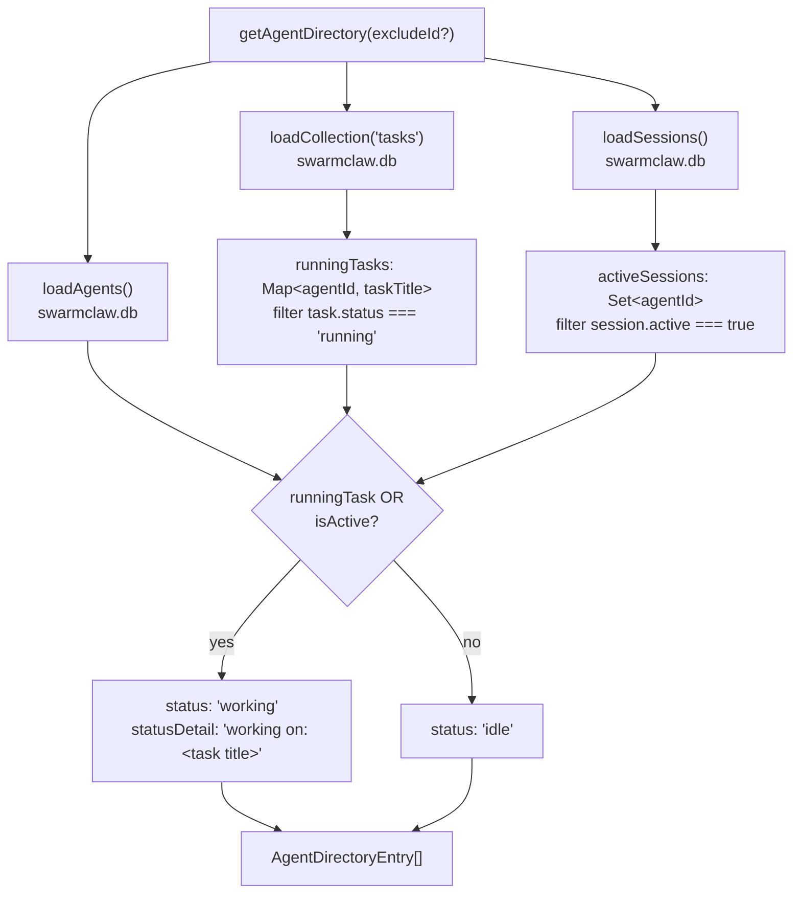
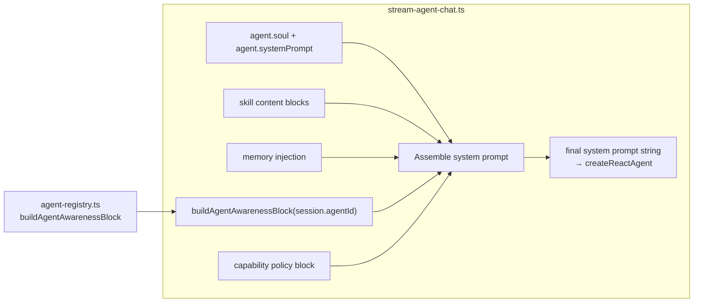
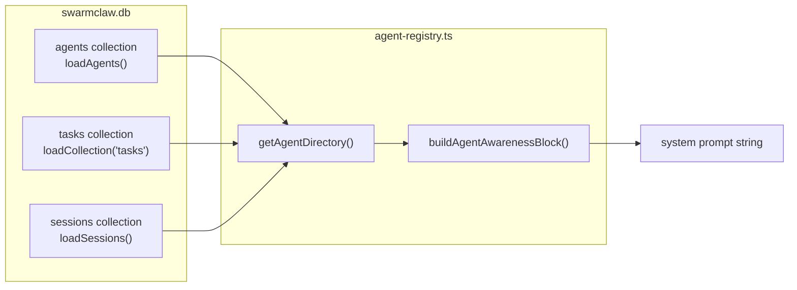

<!-- source: DeepWiki mcp.deepwiki.com · repo swarmclawai/swarmclaw · page 4.2 Agent Registry · fetched 2026-10-27 -->

# Agent Registry

<details>
<summary>Relevant source files</summary>

The following files were used as context for generating this wiki page:

- [src/app/api/missions/[id]/route.ts](src/app/api/missions/[id]/route.ts)
- [src/app/api/missions/route.ts](src/app/api/missions/route.ts)
- [src/app/api/settings/route.ts](src/app/api/settings/route.ts)
- [src/app/settings/page.tsx](src/app/settings/page.tsx)
- [src/components/agents/inspector-panel.tsx](src/components/agents/inspector-panel.tsx)
- [src/components/chat/chat-list.tsx](src/components/chat/chat-list.tsx)
- [src/components/chatrooms/chatroom-input.tsx](src/components/chatrooms/chatroom-input.tsx)
- [src/components/chatrooms/chatroom-view.tsx](src/components/chatrooms/chatroom-view.tsx)
- [src/lib/chatroom-sessions.ts](src/lib/chatroom-sessions.ts)
- [src/lib/server/agents/main-agent-loop-advanced.test.ts](src/lib/server/agents/main-agent-loop-advanced.test.ts)
- [src/lib/server/agents/main-agent-loop.ts](src/lib/server/agents/main-agent-loop.ts)
- [src/lib/server/agents/subagent-runtime.ts](src/lib/server/agents/subagent-runtime.ts)
- [src/lib/server/agents/subagent-swarm.test.ts](src/lib/server/agents/subagent-swarm.test.ts)
- [src/lib/server/agents/subagent-swarm.ts](src/lib/server/agents/subagent-swarm.ts)
- [src/lib/server/chat-execution/post-stream-finalization.ts](src/lib/server/chat-execution/post-stream-finalization.ts)
- [src/lib/server/chatrooms/chatroom-helpers.test.ts](src/lib/server/chatrooms/chatroom-helpers.test.ts)
- [src/lib/server/chatrooms/chatroom-helpers.ts](src/lib/server/chatrooms/chatroom-helpers.ts)
- [src/lib/server/session-tools/search-providers.test.ts](src/lib/server/session-tools/search-providers.test.ts)
- [src/lib/server/session-tools/search-providers.ts](src/lib/server/session-tools/search-providers.ts)
- [src/lib/server/session-tools/subagent.ts](src/lib/server/session-tools/subagent.ts)
- [src/lib/server/storage-normalization.ts](src/lib/server/storage-normalization.ts)
- [src/stores/slices/agent-slice.ts](src/stores/slices/agent-slice.ts)
- [src/stores/slices/session-slice.test.ts](src/stores/slices/session-slice.test.ts)
- [src/stores/slices/session-slice.ts](src/stores/slices/session-slice.ts)
- [src/types/app-settings.ts](src/types/app-settings.ts)
- [src/types/approval.ts](src/types/approval.ts)
- [src/types/mission.ts](src/types/mission.ts)
- [src/views/settings/section-web-search.tsx](src/views/settings/section-web-search.tsx)

</details>


This page documents the server-side agent registry: how the system enumerates agents, computes their live status from active tasks and sessions, and injects a peer-awareness block into agent prompts. It primarily covers the implementation in `src/lib/server/agent-registry.ts`.

For how agent properties (name, description, capabilities, tools, etc.) are *configured*, see [Agent Configuration](#4.1). For how the awareness block is consumed during prompt assembly inside `streamAgentChat`, see [Stream Agent Chat](#6.2). For how orchestrators and subagents use peer agents via delegation, see [Orchestration & Subagents](#4.4).

---

## Purpose

When an agent is active, it needs to know what other agents exist in the swarm, what they are capable of, and whether they are currently busy. The agent registry provides this information at runtime by querying live task and session state, then formatting the result into a Markdown block that is appended to the agent's system prompt. This allows the LLM to make informed decisions about using the `spawn_subagent` or `delegate_to_agent` tools.

---

## Data Type: `AgentDirectoryEntry`

[src/lib/server/agent-registry.ts:4-11]()

Each entry in the registry describes one agent's public-facing identity and current status. It is derived at query time—there is no separate table or cache.

| Field | Type | Description |
|---|---|---|
| `id` | `string` | Agent UUID |
| `name` | `string` | Display name |
| `description` | `string` | Human-readable description |
| `capabilities` | `string[]` | Tags declared by the agent (e.g. `["coding", "research"]`) |
| `status` | `'idle' \| 'working'` | Computed from live task and session state |
| `statusDetail` | `string \| undefined` | If working, contains the title of the active task |

The `capabilities` field is populated from `Agent.capabilities` as stored in `swarmclaw.db`.

Sources: [src/lib/server/agent-registry.ts:4-11](), [src/types/agent.ts:1-20]()

---

## `getAgentDirectory` Implementation

[src/lib/server/agent-registry.ts:13-53]()

**Signature:** `getAgentDirectory(excludeId?: string): AgentDirectoryEntry[]`

Builds the full agent directory from a point-in-time snapshot of agents, tasks, and sessions. An optional `excludeId` omits one agent from the result—typically used to prevent an agent from seeing itself in the peer list.

### Status Computation Logic

The system determines if an agent is "working" by checking both the Task Queue and active Chat Sessions.

**Diagram: Status Derivation Flow**



Sources: [src/lib/server/agent-registry.ts:13-53](), [src/lib/server/storage.ts:10-50]()

### Status Rules (in priority order)

1. **Task-based status**: If a `BoardTask` with `status === 'running'` has an `agentId` matching the agent, the agent is **working** and `statusDetail` is set to `"working on: <task.title>"`. [src/lib/server/agent-registry.ts:31-36]()
2. **Session-based status**: Else, if any `Session` with `active === true` has an `agentId` matching the agent, the agent is **working** (no `statusDetail`). [src/lib/server/agent-registry.ts:38-41]()
3. **Default**: Otherwise, the agent is **idle**. [src/lib/server/agent-registry.ts:43-50]()

Note that a task with `status === 'queued'` does **not** count as working—only `'running'`.

---

## `buildAgentAwarenessBlock`

[src/lib/server/agent-registry.ts:55-70]()

**Signature:** `buildAgentAwarenessBlock(excludeId: string): string`

Calls `getAgentDirectory(excludeId)` and formats the result into a Markdown string. If no peer agents exist, returns an empty string (the block is omitted from the prompt entirely).

### Output Format

Each agent entry renders to one line. The `statusDetail` is preferred over the bare `status` string when present.

```markdown
## Available Agents
- **Alpha** [id: abc123](research, coding) — idle
- **Beta** [id: def456](frontend) — working on: Build landing page
You can delegate tasks to any agent using the delegate_to_agent tool.
```

- Capabilities are omitted from the line if the agent has none.
- The trailing line always reminds the LLM of the availability of delegation tools.

Sources: [src/lib/server/agent-registry.ts:55-70]()

---

## Integration with Prompt Assembly

The awareness block is injected during the system prompt assembly phase. It provides context for the `spawn_subagent` action, which is part of the `subagent` tool.

**Diagram: Awareness Block Injection Site**



Sources: [src/lib/server/agent-registry.ts:55-70](), [src/lib/server/session-tools/subagent.ts:1-39]()

---

## Agent Assignment & Availability Checks

When an agent is selected for a task or subagent spawn, the system performs several checks to ensure valid assignment:

1. **Cycle Detection**: The `spawnSubagent` runtime collects ancestor agent IDs to prevent recursive loops (e.g., Agent A spawning Agent B, which then tries to spawn Agent A). [src/lib/server/agents/subagent-runtime.ts:192-205]()
2. **Capability Matching**: When using `selectionMode: 'best_fit'`, the `resolveBestDelegateTarget` function (invoked by the subagent tool) filters the registry for agents possessing the `requiredCapabilities`. [src/lib/server/session-tools/subagent.ts:245-260]()
3. **Depth Limits**: Assignments are gated by `DEFAULT_DELEGATION_MAX_DEPTH` to prevent runaway fanning out of the swarm. [src/lib/server/agents/subagent-runtime.ts:10-15]()

### Swarm Concurrency
For parallel execution (swarms), the `subagent-swarm` module manages a concurrency cap, defaulting to 4 and hard-capped at 16. [src/lib/server/agents/subagent-swarm.ts:130-132]()

Sources: [src/lib/server/agents/subagent-runtime.ts:192-205](), [src/lib/server/session-tools/subagent.ts:245-260](), [src/lib/server/agents/subagent-swarm.ts:130-143]()

---

## Data Dependencies

**Diagram: Registry Runtime Data Sources**



All data loads are synchronous SQLite reads via the `storage.ts` singleton. This ensures the registry reflects the exact state of the database at the moment the prompt is generated.

Sources: [src/lib/server/agent-registry.ts:13-53](), [src/lib/server/storage.ts:1-10]()

---

