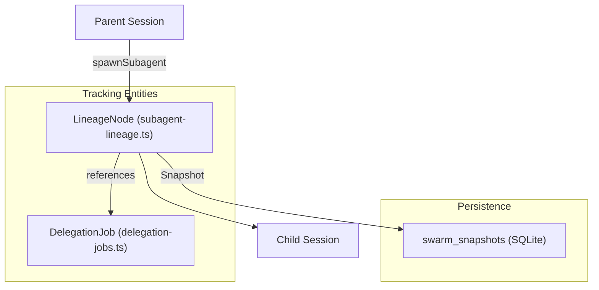
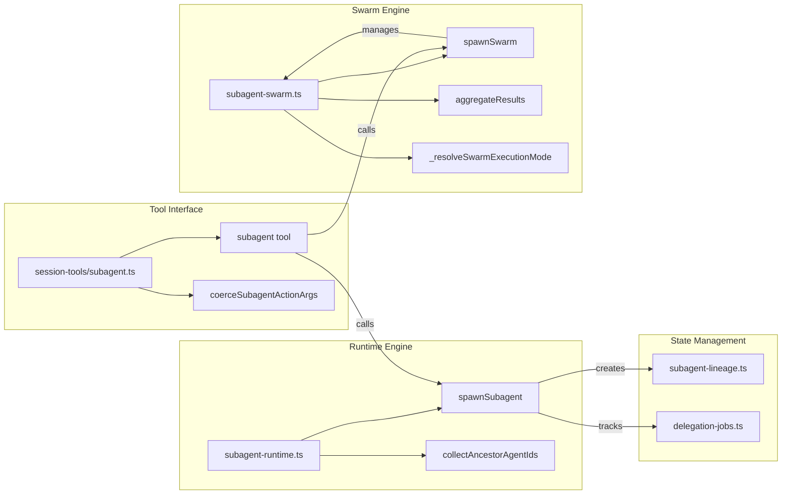

<!-- source: DeepWiki mcp.deepwiki.com · repo swarmclawai/swarmclaw · page 4.4 Orchestration & Subagents · fetched 2026-10-27 -->

# Orchestration & Subagents

Relevant source files

The following files were used as context for generating this wiki page:

- [src/app/api/missions/[id]/route.ts](src/app/api/missions/[id]/route.ts)
- [src/app/api/missions/route.ts](src/app/api/missions/route.ts)
- [src/lib/server/agents/subagent-runtime.ts](src/lib/server/agents/subagent-runtime.ts)
- [src/lib/server/agents/subagent-swarm.test.ts](src/lib/server/agents/subagent-swarm.test.ts)
- [src/lib/server/agents/subagent-swarm.ts](src/lib/server/agents/subagent-swarm.ts)
- [src/lib/server/runtime/heartbeat-wake.ts](src/lib/server/runtime/heartbeat-wake.ts)
- [src/lib/server/runtime/session-run-manager.test.ts](src/lib/server/runtime/session-run-manager.test.ts)
- [src/lib/server/runtime/session-run-manager.ts](src/lib/server/runtime/session-run-manager.ts)
- [src/lib/server/session-tools/delegate.ts](src/lib/server/session-tools/delegate.ts)
- [src/lib/server/session-tools/subagent.ts](src/lib/server/session-tools/subagent.ts)
- [src/lib/server/storage-normalization.ts](src/lib/server/storage-normalization.ts)
- [src/stores/use-chat-store.test.ts](src/stores/use-chat-store.test.ts)
- [src/types/mission.ts](src/types/mission.ts)

This page documents the SwarmClaw orchestration system: the mechanics of sub-agent delegation, parallel swarm execution, result aggregation, and the lineage tracking system that prevents infinite delegation cycles.

---

## Overview

SwarmClaw utilizes a multi-layered orchestration model. At the base is the **Subagent Runtime**, which handles direct in-process execution of child agents. Built on top of this is the **Subagent Swarm** module, which manages parallel execution, concurrency limits, and join policies (e.g., waiting for a quorum). The system maintains a **Lineage Tree** for every session, allowing the UI and the runtime to track the provenance of tasks and enforce depth limits.

---

## Subagent Runtime

The native subagent runtime replaces legacy CLI-based delegation with direct execution within the server process. It uses `LineageNode` objects to track lifecycle state and a `handleRegistry` for promise-based waiting.

### Key Functions
- `spawnSubagent`: The primary entry point for creating a child agent session. It handles depth checks, cycle detection, and capability inheritance [src/lib/server/agents/subagent-runtime.ts:59-117]().
- `mergeCapabilities`: Combines the parent session's enabled tools/extensions with the sub-agent's configuration, ensuring child agents have the necessary tools to perform delegated tasks [src/lib/server/agents/subagent-runtime.ts:138-158]().
- `getSessionDepth`: Calculates the current delegation depth by walking the parent chain or reading the cached `delegationDepth` field in the session record [src/lib/server/agents/subagent-runtime.ts:164-186]().

### Cycle Detection & Depth Guards
To prevent infinite loops (e.g., Agent A → Agent B → Agent A), `spawnSubagent` performs a cycle check using `collectAncestorAgentIds` [src/lib/server/agents/subagent-runtime.ts:192-205](). It also enforces a `DEFAULT_DELEGATION_MAX_DEPTH` (typically 8) [src/lib/server/agents/subagent-runtime.ts:10-10]().

Sources: [src/lib/server/agents/subagent-runtime.ts:1-205]()

---

## Swarm Orchestration

The Swarm module allows an agent to fan out tasks to multiple sub-agents simultaneously. It supports serial execution (required for local providers like Ollama) and parallel execution with configurable concurrency.

### Swarm Execution Modes
The system automatically resolves the best execution mode via `_resolveSwarmExecutionMode`:
- **Serial**: Used if any target agent uses the `ollama` provider to prevent local resource exhaustion [src/lib/server/agents/subagent-swarm.ts:155-163]().
- **Parallel**: The default for API-based providers [src/lib/server/agents/subagent-swarm.ts:162-162]().

### Concurrency & Limits
- **Default Parallel Concurrency**: 4 [src/lib/server/agents/subagent-swarm.ts:132-132]().
- **Hard Limit**: 16 concurrent branches [src/lib/server/agents/subagent-swarm.ts:130-130]().
- **Clamping**: Concurrency is clamped based on the mission's `maxParallelBranches` or system defaults [src/lib/server/agents/subagent-swarm.ts:134-140]().

### Join Policies
When spawning a swarm, the caller can choose how to wait for results:
1. **All**: Resolves when every member completes (`allSettled`).
2. **First**: Resolves as soon as the first member returns a result (`firstSettled`).
3. **Quorum**: Resolves when a specific number of members succeed. If `cancelRemaining` is true, it aborts other in-flight members once the quorum is met [src/lib/server/agents/subagent-swarm.ts:72-78]().

Sources: [src/lib/server/agents/subagent-swarm.ts:1-180](), [src/lib/server/session-tools/subagent.ts:79-82]()

---

## Lineage & Tracking

Every sub-agent spawn creates a node in a lineage tree. This tree is persisted and used to track the relationship between sessions.

**Lineage Data Flow**

Sources: [src/lib/server/agents/subagent-lineage.ts:27-44](), [src/lib/server/agents/subagent-swarm.ts:191-203]()

---

## Subagent Tool (`subagent`)

The `subagent` tool is the primary interface for LLMs to interact with the orchestration system. It exposes a unified `action` parameter to perform various operations.

| Action | Description |
|---|---|
| `start` | Spawns a single sub-agent [src/lib/server/session-tools/subagent.ts:44-44](). |
| `swarm` | Spawns multiple agents in parallel [src/lib/server/session-tools/subagent.ts:53-53](). |
| `status` | Checks the status of a specific `jobId` [src/lib/server/session-tools/subagent.ts:45-45](). |
| `aggregate` | Collects results from a swarm or list of jobs [src/lib/server/session-tools/subagent.ts:52-52](). |
| `cancel` | Aborts a running sub-agent or swarm [src/lib/server/session-tools/subagent.ts:49-49](). |

### Input Normalization
The tool uses `coerceSubagentActionArgs` to handle varied LLM outputs, converting string-encoded booleans, numbers, and JSON arrays into typed data [src/lib/server/session-tools/subagent.ts:157-182]().

Sources: [src/lib/server/session-tools/subagent.ts:43-87](), [src/lib/server/session-tools/subagent.ts:157-182]()

---

## Memory & Context Management

Orchestrated sessions have specialized memory access. Sub-agents inherit context from their parents but maintain their own working memory.

- **Browser Profile Sharing**: If `shareBrowserProfile` is enabled, child agents use the parent's `browserProfileId` to maintain session state (e.g., logged-in websites) across the swarm [src/lib/server/session-tools/subagent.ts:89-101]().
- **Lineage Tracking**: The `lineage` action allows an agent to see the hierarchy of agents currently working on the task [src/lib/server/session-tools/subagent.ts:50-50]().

Sources: [src/lib/server/session-tools/subagent.ts:89-101](), [src/lib/server/agents/subagent-runtime.ts:138-158]()

---

## Orchestration Logic Map

This diagram associates system orchestration names with the code entities that implement them.

**Orchestration Code Entity Space**

Sources: [src/lib/server/agents/subagent-runtime.ts:1-117](), [src/lib/server/agents/subagent-swarm.ts:1-163](), [src/lib/server/session-tools/subagent.ts:1-182]()

---

