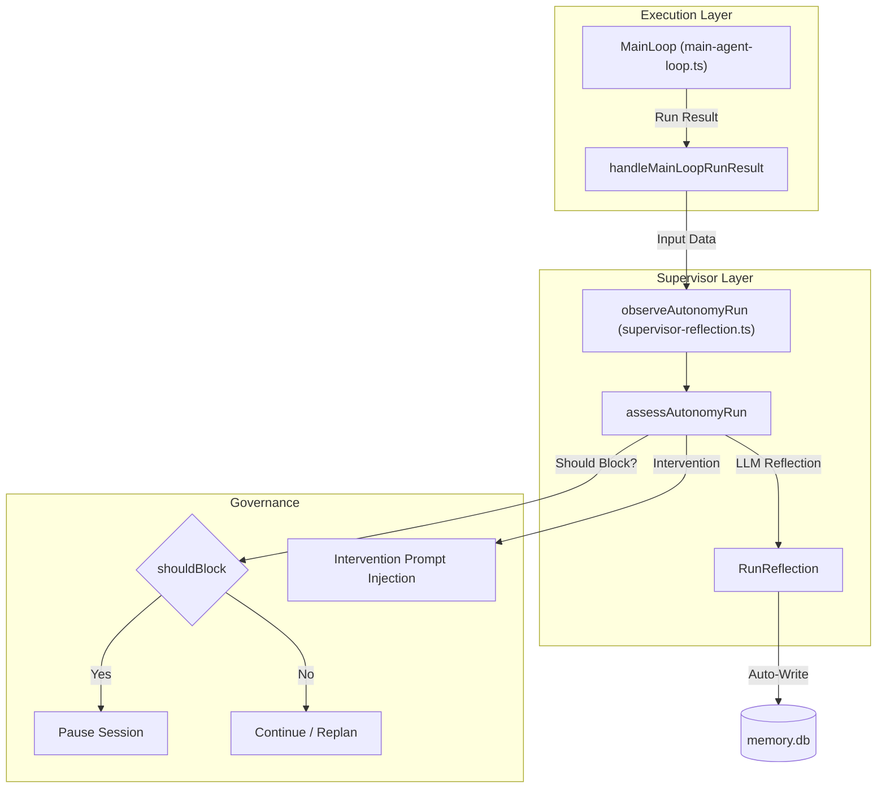
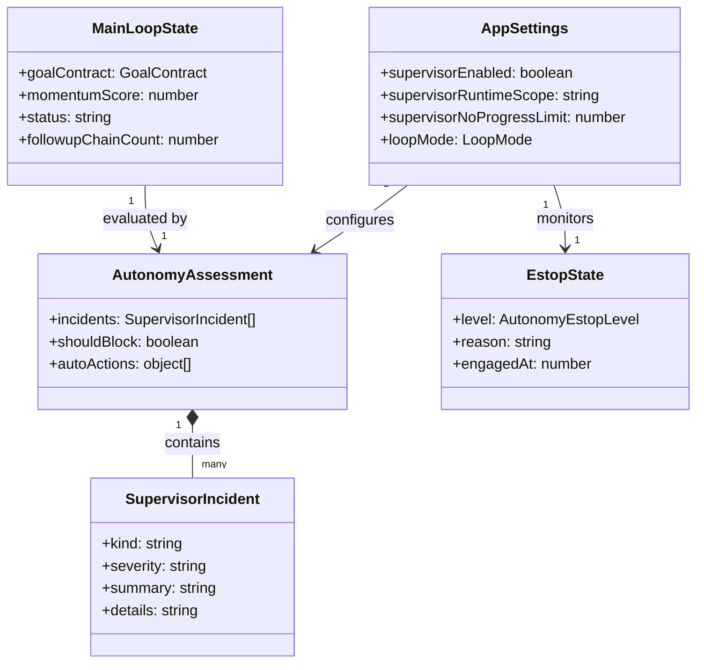

<!-- source: DeepWiki mcp.deepwiki.com · repo swarmclawai/swarmclaw · page 4.5 Autonomy & Safety · fetched 2026-10-27 -->

# Autonomy & Safety

Relevant source files

The following files were used as context for generating this wiki page:

- [src/app/api/settings/route.ts](src/app/api/settings/route.ts)
- [src/app/settings/page.tsx](src/app/settings/page.tsx)
- [src/lib/server/agents/guardian.ts](src/lib/server/agents/guardian.ts)
- [src/lib/server/agents/main-agent-loop-advanced.test.ts](src/lib/server/agents/main-agent-loop-advanced.test.ts)
- [src/lib/server/agents/main-agent-loop.ts](src/lib/server/agents/main-agent-loop.ts)
- [src/lib/server/autonomy/supervisor-reflection.test.ts](src/lib/server/autonomy/supervisor-reflection.test.ts)
- [src/lib/server/autonomy/supervisor-reflection.ts](src/lib/server/autonomy/supervisor-reflection.ts)
- [src/lib/server/chat-execution/continuation-evaluator.ts](src/lib/server/chat-execution/continuation-evaluator.ts)
- [src/lib/server/chat-execution/message-classifier.ts](src/lib/server/chat-execution/message-classifier.ts)
- [src/lib/server/chat-execution/post-stream-finalization.ts](src/lib/server/chat-execution/post-stream-finalization.ts)
- [src/lib/server/chat-execution/prompt-builder.ts](src/lib/server/chat-execution/prompt-builder.ts)
- [src/lib/server/chat-execution/situational-awareness.ts](src/lib/server/chat-execution/situational-awareness.ts)
- [src/lib/server/memory/memory-consolidation.ts](src/lib/server/memory/memory-consolidation.ts)
- [src/lib/server/memory/memory-db.ts](src/lib/server/memory/memory-db.ts)
- [src/lib/server/memory/memory-policy.ts](src/lib/server/memory/memory-policy.ts)
- [src/lib/server/memory/temporal-decay.ts](src/lib/server/memory/temporal-decay.ts)
- [src/lib/server/runtime/daemon-state.ts](src/lib/server/runtime/daemon-state.ts)
- [src/lib/server/runtime/idle-window.ts](src/lib/server/runtime/idle-window.ts)
- [src/lib/server/runtime/queue.ts](src/lib/server/runtime/queue.ts)
- [src/lib/server/session-tools/memory.ts](src/lib/server/session-tools/memory.ts)
- [src/lib/server/session-tools/search-providers.test.ts](src/lib/server/session-tools/search-providers.test.ts)
- [src/lib/server/session-tools/search-providers.ts](src/lib/server/session-tools/search-providers.ts)
- [src/lib/server/skills/learned-skills.ts](src/lib/server/skills/learned-skills.ts)
- [src/types/app-settings.ts](src/types/app-settings.ts)
- [src/types/approval.ts](src/types/approval.ts)
- [src/views/settings/section-web-search.tsx](src/views/settings/section-web-search.tsx)

The SwarmClaw supervisor and safety system provides a multi-layered governance framework for autonomous agents. It ensures that long-running agent loops remain aligned with user objectives, stay within budget constraints, and can be rolled back in the event of failure. The system combines real-time reflection, incident detection, and git-based state snapshots to manage the risks associated with high-autonomy operations.

## Supervisor Reflection System

The supervisor system acts as an "overseer" that evaluates agent performance at the end of every execution turn. It uses the `assessAutonomyRun` function to analyze the transcript, tool events, and loop state to detect anomalies or progress stalls.

### AutonomyAssessment & Incident Detection

An `AutonomyAssessment` is generated after each run, containing a list of `SupervisorIncident` objects. Incidents are classified by severity (low, medium, high) and kind.

| Incident Kind | Trigger Condition |
| :--- | :--- |
| `repeated_tool` | The same tool is called multiple times with identical arguments without progress. |
| `no_progress` | The agent's summary or next action hasn't changed across multiple iterations. |
| `budget_warning` | The session or mission cost is approaching the defined limit. |
| `error_thrash` | Repeated execution errors occurring in a tight loop. |
| `meta_miss` | The agent failed to output the required `[MAIN_LOOP_META]` or `[AGENT_HEARTBEAT_META]` blocks. |

Sources: `[src/lib/server/autonomy/supervisor-reflection.ts:57-66]()`, `[src/lib/server/autonomy/supervisor-reflection.ts:157-173]()`, `[src/lib/server/autonomy/supervisor-reflection.ts:208-250]()`.

### Implementation Data Flow

The supervisor operates within the `observeAutonomyRun` pipeline, which is triggered by the `MainLoop` after a provider response is processed.

Sources: `[src/lib/server/autonomy/supervisor-reflection.ts:68-80]()`, `[src/lib/server/agents/main-agent-loop.ts:96-108]()`, `[src/lib/server/autonomy/supervisor-reflection.ts:11-14]()`.

## GoalContract Enforcement

The `GoalContract` is the primary mechanism for defining the boundaries of an autonomous task. It is parsed from the agent's meta-output or explicitly assigned via the UI/API.

*   **Objective**: The high-level goal the agent is pursuing.
*   **Constraints**: A list of "don'ts" or "must-haves" for the execution.
*   **Budget**: Hard USD limits for the specific goal.
*   **Success Metric**: The criteria used by the supervisor to validate completion.

The `MainLoopState` tracks the `momentumScore`, which is adjusted based on how well the agent adheres to the contract. If the score drops too low, the supervisor triggers a `replan` action.

Sources: `[src/types/app-settings.ts:7-13]()`, `[src/lib/server/agents/main-agent-loop.ts:34-82]()`, `[src/lib/server/agents/autonomy-contract.ts:4-6]()`.

## Guardian Checkpoints

The Guardian system provides a "safety net" for filesystem-heavy operations. It utilizes git-based state snapshots to allow for manual or automatic rollbacks.

*   **Checkpoints**: Snapshots of the current `CWD` (Current Working Directory) created before sensitive operations.
*   **Rollback**: The `GuardianCheckpoint` stores the `head` commit hash and `branch` name, allowing the system to revert the workspace if the agent causes destructive changes.
*   **Governance**: Checkpoints can be associated with an `approvalId`, requiring a human to verify the state before the agent is allowed to proceed.

Sources: `[src/types/app-settings.ts:170-181]()`, `[src/lib/server/agents/guardian.ts:1-20]()`.

## Autonomy Runtime Scope

The supervisor's activity is governed by the `supervisorRuntimeScope` setting, which defines where the safety rails are active:

1.  **`chat`**: Only monitors standard user-assistant chat turns.
2.  **`task`**: Only monitors background tasks and scheduled runs.
3.  **`both`**: Universal monitoring across all execution surfaces.

If `autonomyResumeApprovalsEnabled` is set to `true`, any session blocked by the supervisor requires an explicit `ApprovalRequest` resolution before heartbeats or follow-ups can resume.

Sources: `[src/types/app-settings.ts:93-97]()`, `[src/lib/autonomy/supervisor-settings.ts:26-30]()`, `[src/app/api/settings/route.ts:145-148]()`.

## Emergency Stop (E-Stop)

SwarmClaw implements a global and per-session Emergency Stop mechanism via `AutonomyEstopLevel`.

| Level | Scope |
| :--- | :--- |
| `none` | No active emergency stop. |
| `autonomy` | Pauses all background heartbeats and autonomous loops, but allows direct user-initiated chat. |
| `all` | Immediately halts all provider calls and tool executions across the entire instance. |

The `EstopState` tracks who engaged the stop and the reason, preventing any further execution until the state is manually cleared or a `resumeApprovalId` is satisfied.

Sources: `[src/types/app-settings.ts:5]()`, `[src/types/app-settings.ts:161-168]()`.

## Code Entity Mapping

The following diagram maps the logical safety concepts to their specific implementation classes and data structures in the codebase.

Sources: `[src/types/app-settings.ts:21-159]()`, `[src/lib/server/agents/main-agent-loop.ts:34-82]()`, `[src/lib/server/autonomy/supervisor-reflection.ts:57-66]()`, `[src/types/app-settings.ts:161-168]()`.

---

