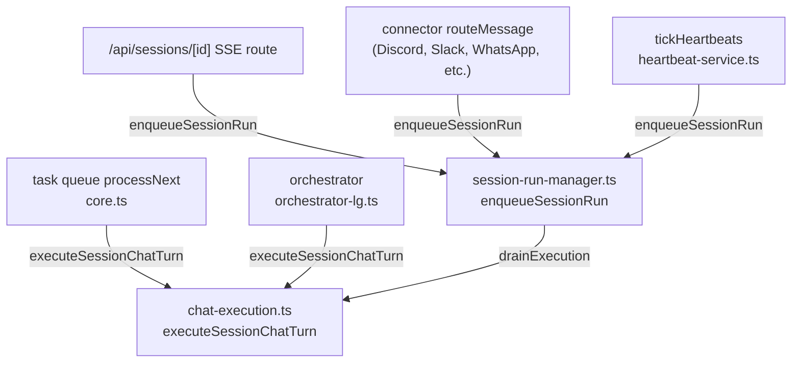
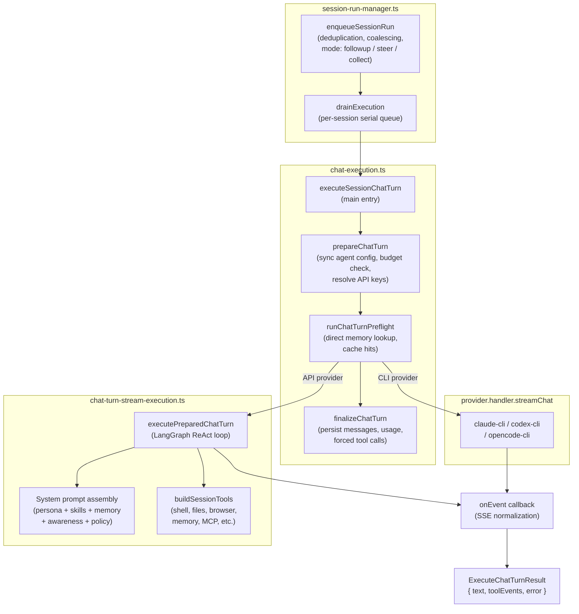

<!-- source: DeepWiki mcp.deepwiki.com · repo swarmclawai/swarmclaw · page 6 Chat Execution · fetched 2026-10-27 -->

# Chat Execution

<details>
<summary>Relevant source files</summary>

The following files were used as context for generating this wiki page:

- [src/lib/providers/openclaw.ts](src/lib/providers/openclaw.ts)
- [src/lib/server/chat-execution/chat-execution.ts](src/lib/server/chat-execution/chat-execution.ts)
- [src/lib/server/chat-execution/chat-streaming-utils.ts](src/lib/server/chat-execution/chat-streaming-utils.ts)
- [src/lib/server/chat-execution/chat-turn-preparation.ts](src/lib/server/chat-execution/chat-turn-preparation.ts)
- [src/lib/server/chat-execution/stream-agent-chat.test.ts](src/lib/server/chat-execution/stream-agent-chat.test.ts)
- [src/lib/server/chat-execution/stream-continuation.ts](src/lib/server/chat-execution/stream-continuation.ts)
- [src/lib/server/chats/chat-session-service.ts](src/lib/server/chats/chat-session-service.ts)
- [src/lib/server/runtime/heartbeat-wake.ts](src/lib/server/runtime/heartbeat-wake.ts)
- [src/lib/server/runtime/perf.ts](src/lib/server/runtime/perf.ts)
- [src/lib/server/runtime/queue-recovery.test.ts](src/lib/server/runtime/queue-recovery.test.ts)
- [src/lib/server/runtime/queue/core.ts](src/lib/server/runtime/queue/core.ts)
- [src/lib/server/runtime/session-run-manager.test.ts](src/lib/server/runtime/session-run-manager.test.ts)
- [src/lib/server/runtime/session-run-manager.ts](src/lib/server/runtime/session-run-manager.ts)
- [src/lib/server/skills/runtime-skill-resolver.ts](src/lib/server/skills/runtime-skill-resolver.ts)
- [src/lib/server/universal-tool-access.test.ts](src/lib/server/universal-tool-access.test.ts)
- [src/lib/server/universal-tool-access.ts](src/lib/server/universal-tool-access.ts)
- [src/stores/use-chat-store.test.ts](src/stores/use-chat-store.test.ts)

</details>


This page provides an overview of how a chat message is received, queued, dispatched to an LLM provider, and returned as an SSE stream. It covers the coordination layer connecting API routes, connector handlers, and background services to the core execution functions.

For per-function detail, see child pages:
- [Chat Turn Execution](#6.1) — `executeSessionChatTurn` internals: session sync, budget, and preflight.
- [Stream Agent Chat](#6.2) — `streamAgentChat` and the LangGraph agent loop.
- [Session Run Manager](#6.3) — `enqueueSessionRun`, run queuing, and deduplication logic.
- [Capability Routing](#6.4) — `routeTaskIntent` and universal tool access.

For tool construction, see [Agent Tools](#7). For the heartbeat service that drives autonomous runs, see [Heartbeat Service](#11.2).

---

## Overview

Chat execution is the pipeline that takes a text message (plus optional image) and produces a streaming LLM response. The same pipeline is used whether the trigger is a human typing in the web UI, an inbound message from a Slack connector, a scheduled heartbeat tick, or the task queue executing a work item.

The pipeline has three primary layers:

| Layer | Responsibility | Key File |
|---|---|---|
| **Run Manager** | Queuing, deduplication, and serialization per session | [src/lib/server/runtime/session-run-manager.ts:1-30]() |
| **Chat Turn** | Session sync, budget enforcement, API key resolution, and post-processing | [src/lib/server/chat-execution/chat-execution.ts:49-171]() |
| **LLM Stream** | Prompt assembly, tool list building, and the LangGraph agent loop | [src/lib/server/chat-execution/chat-turn-stream-execution.ts:1-50]() |

Sources: [src/lib/server/runtime/session-run-manager.ts:1-30](), [src/lib/server/chat-execution/chat-execution.ts:49-171](), [src/lib/server/chat-execution/chat-turn-stream-execution.ts:1-50]()

---

## Callers and Entry Points

Multiple independent subsystems converge on the same execution pipeline. Most external triggers go through the `session-run-manager` to ensure serial execution per session.

**Chat Execution Entry Points**



Sources: [src/lib/server/runtime/session-run-manager.ts:67-73](), [src/lib/server/runtime/queue/core.ts:21-24](), [src/lib/server/chats/chat-session-service.ts:13-19]()

---

## End-to-End Pipeline

The following diagram maps natural-language pipeline stages to concrete code entities.

**Full Chat Execution Pipeline**



Sources: [src/lib/server/chat-execution/chat-execution.ts:49-171](), [src/lib/server/chat-execution/chat-turn-preparation.ts:128-150](), [src/lib/server/chat-execution/chat-turn-stream-execution.ts:1-40]()

---

## Provider Path Selection

The choice between the LangGraph-based agent loop and direct CLI provider execution happens during the preparation phase.

| Condition | Path Used | Notes |
|---|---|---|
| API provider (`openai`, `anthropic`, `gemini`, etc.) | `executePreparedChatTurn` | Uses LangGraph ReAct agent loop with optional tools. |
| CLI provider (`claude-cli`, `codex-cli`, `opencode-cli`) | `provider.handler.streamChat` | Spawns a subprocess; the CLI tool manages its own tool loop. |
| Local / Gateway (`ollama`, `openclaw`) | `executePreparedChatTurn` | Treated as API providers via LangChain adapters. |

The classification of providers is defined by `NON_LANGGRAPH_PROVIDER_IDS` and `RUNTIME_MANAGED_PROVIDER_IDS`.

Sources: [src/lib/server/chat-execution/chat-turn-preparation.ts:48-51](), [src/lib/server/chat-execution/chat-execution.ts:81-86]()

---

## Key Interfaces

**`ExecuteChatTurnInput`** [src/lib/server/chat-execution/chat-execution-types.ts:1-20]()

```typescript
export interface ExecuteChatTurnInput {
  sessionId: string
  message: string
  imagePath?: string
  imageUrl?: string
  internal?: boolean        // True for heartbeats/tasks
  source?: string          // 'chat' | 'heartbeat' | 'connector' | 'task'
  runId?: string
  onEvent?: (event: SSEEvent) => void
  modelOverride?: string
}
```

**`ExecuteChatTurnResult`** [src/lib/server/chat-execution/chat-execution-types.ts:22-35]()

```typescript
export interface ExecuteChatTurnResult {
  runId?: string
  sessionId: string
  text: string             // Full accumulated response
  toolEvents: MessageToolEvent[]
  inputTokens?: number
  outputTokens?: number
  estimatedCost?: number
  error?: string
}
```

Sources: [src/lib/server/chat-execution/chat-execution.ts:49-59](), [src/lib/server/chat-execution/chat-execution-types.ts:1-47]()

---

## Run Modes and Coalescing

`enqueueSessionRun` accepts a `mode` that controls how the new run interacts with existing ones for the same session. This is critical for handling rapid user input and background heartbeats.

| Mode | Behavior |
|---|---|
| `followup` | Default. Appends to the session queue to be processed sequentially. |
| `steer` | Aborts any currently running execution for that session and clears the queue before starting. |
| `collect` | Used for background events. Adjacent `collect` runs within a 1500ms window are coalesced into a single message to reduce LLM overhead. |

Sources: [src/lib/server/runtime/session-run-manager.ts:15-31](), [src/lib/server/runtime/session-run-manager.ts:67-73]()

---

## Post-Processing and Finalization

After the LLM stream or CLI subprocess completes, `finalizeChatTurn` performs several critical steps:

1.  **Forced Tool Calls**: If the model failed to call a required tool (like `connector_message_tool` for a reply), the system can inject a forced call.
2.  **Message Persistence**: Saves the assistant response to the `messages` table in `swarmclaw.db`.
3.  **Budget Update**: Updates the session and agent's daily spend tracking.
4.  **Heartbeat Suppression**: For autonomous runs, it may strip "I am still working" noise before sending to external connectors.
5.  **Usage Logging**: Records token counts and duration to `logs.db`.

Sources: [src/lib/server/chat-execution/chat-turn-finalization.ts:1-50](), [src/lib/server/chat-execution/chat-execution.ts:138-150]()

---

