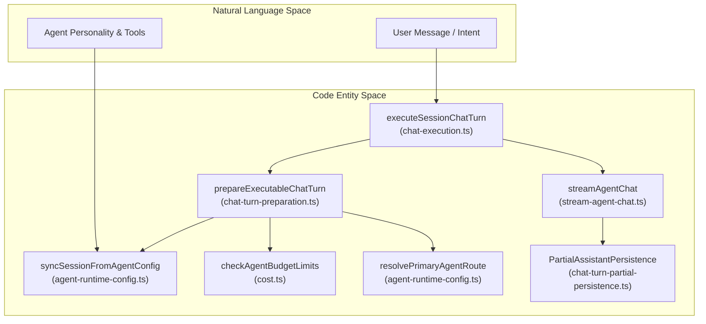
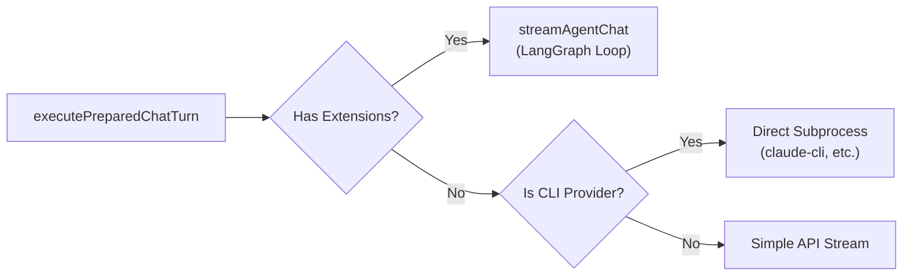

<!-- source: DeepWiki mcp.deepwiki.com · repo swarmclawai/swarmclaw · page 6.1 Chat Turn Execution · fetched 2026-10-27 -->

# Chat Turn Execution

Relevant source files

The following files were used as context for generating this wiki page:

- [fly.toml](fly.toml)
- [railway.json](railway.json)
- [render.yaml](render.yaml)
- [src/app/api/healthz/route.test.ts](src/app/api/healthz/route.test.ts)
- [src/app/api/healthz/route.ts](src/app/api/healthz/route.ts)
- [src/lib/providers/openclaw.ts](src/lib/providers/openclaw.ts)
- [src/lib/server/chat-execution/chat-execution-utils.test.ts](src/lib/server/chat-execution/chat-execution-utils.test.ts)
- [src/lib/server/chat-execution/chat-execution-utils.ts](src/lib/server/chat-execution/chat-execution-utils.ts)
- [src/lib/server/chat-execution/chat-turn-preparation.ts](src/lib/server/chat-execution/chat-turn-preparation.ts)
- [src/lib/server/chat-execution/chat-turn-stream-execution.ts](src/lib/server/chat-execution/chat-turn-stream-execution.ts)
- [src/lib/server/chats/chat-session-service.ts](src/lib/server/chats/chat-session-service.ts)
- [src/lib/server/protocols/protocol-run-lifecycle.ts](src/lib/server/protocols/protocol-run-lifecycle.ts)
- [src/lib/server/runtime/perf.ts](src/lib/server/runtime/perf.ts)
- [src/lib/server/runtime/queue-recovery.test.ts](src/lib/server/runtime/queue-recovery.test.ts)
- [src/lib/server/runtime/queue/core.ts](src/lib/server/runtime/queue/core.ts)
- [src/lib/server/skills/runtime-skill-resolver.ts](src/lib/server/skills/runtime-skill-resolver.ts)
- [src/lib/server/universal-tool-access.test.ts](src/lib/server/universal-tool-access.test.ts)
- [src/lib/server/universal-tool-access.ts](src/lib/server/universal-tool-access.ts)

This page documents the chat execution engine centered around `executeSessionChatTurn` in `src/lib/server/chat-execution/chat-execution.ts`. This function is the primary entry point for processing a single message exchange within a session, coordinating session synchronization, budget enforcement, API key resolution, and the transition into the LangGraph agent loop.

## Overview

`executeSessionChatTurn` processes inbound messages from multiple sources: human users in the UI, autonomous heartbeats, task queue workers, or external connectors. It manages the lifecycle of a single "turn," including preflight checks, streaming execution, and final persistence of the assistant's response.

**Function signature:**
`executeSessionChatTurn(input: ExecuteChatTurnInput): Promise<ExecuteChatTurnResult>`

| Input Field | Type | Description |
| :--- | :--- | :--- |
| `sessionId` | `string` | The target session ID. |
| `message` | `string` | The text content of the user or system message. |
| `internal` | `boolean` | Flag indicating if the message is system-generated (e.g., heartbeats). |
| `source` | `string` | Origin label: `'chat'`, `'heartbeat'`, `'task'`, `'subagent'`, etc. |
| `runId` | `string?` | Unique ID for this specific execution run. |
| `signal` | `AbortSignal?` | Used for preemptive cancellation. |

Sources: [src/lib/server/chat-execution/chat-execution.ts:143-162]()

---

## Execution Pipeline

The execution flow bridges high-level intent (Natural Language Space) to specific code entities (Code Entity Space).

**Chat Turn Execution — Entity Mapping**

Sources: [src/lib/server/chat-execution/chat-execution.ts:178-220](), [src/lib/server/chat-execution/chat-turn-preparation.ts:160-200](), [src/lib/server/agents/agent-runtime-config.ts:30-50]()

---

## Phase 1: Preparation & Preflight

Before the LLM is invoked, the system performs a series of preparation steps encapsulated in `prepareExecutableChatTurn`.

### Session Synchronization
The system ensures the `Session` object reflects the latest `Agent` configuration. `syncSessionFromAgentConfig` copies provider settings, model selection, and tool lists from the agent template to the active session.
Sources: [src/lib/server/agents/agent-runtime-config.ts:135-150]()

### Budget Enforcement
`checkAgentBudgetLimits` verifies if the agent or session has exceeded its configured USD or token limits. If the `safetyMaxDailySpendUsd` (from `AppSettings`) is met, the turn is aborted with a budget error.
Sources: [src/lib/server/cost.ts:45-60](), [src/lib/server/chat-execution/chat-turn-preparation.ts:250-265]()

### API Key Resolution
`loadCredentials` and `decryptKey` are used to resolve the `credentialId` stored in the session into a plaintext API key for the provider.
Sources: [src/lib/server/credentials/credential-repository.ts:50-70](), [src/lib/server/chat-execution/chat-turn-preparation.ts:280-295]()

---

## Phase 2: Execution Path Selection

The engine selects an execution path based on the provider type and the presence of tools.

| Path | Condition | Implementation |
| :--- | :--- | :--- |
| **Agentic Stream** | API Provider + Tools enabled | `streamAgentChat` (LangGraph ReAct loop) |
| **Direct Stream** | CLI Provider (e.g., `claude-cli`) | `provider.handler.streamChat` |
| **Simple Stream** | API Provider + No Tools | Direct provider completion via `streamChatWithFailover` |

**Path Selection Logic**

Sources: [src/lib/server/chat-execution/chat-turn-stream-execution.ts:145-177]()

---

## Phase 3: Partial Persistence & Streaming

During execution, chunks of text and tool events are handled by `PartialAssistantPersistence`. This class performs "opportunistic" saves to the database.

1.  **Buffer Management**: As chunks arrive, they are buffered in memory.
2.  **Periodic Flush**: Every 1500ms (or on tool completion), the current state is persisted to `session.messages` in the SQLite database.
3.  **UI Feedback**: Each chunk is emitted as an SSE event via `ws-hub` to update the user interface in real-time.

Sources: [src/lib/server/chat-execution/chat-turn-partial-persistence.ts:40-80]()

---

## Phase 4: Post-Processing & Forced Tool Calls

After the LLM completes its response, `executeSessionChatTurn` performs post-processing to ensure system integrity.

### Forced Tool Calls
If a user explicitly requests a tool (e.g., `delegate_to_claude_code`) but the LLM provides only text, the engine can force the tool execution if `preflightToolRoutingResult` identifies a high-confidence intent.
Sources: [src/lib/server/chat-execution/chat-execution.ts:240-260]()

### Session Freshness & Reset
The `evaluateSessionFreshness` check determines if a session has expired based on `sessionMaxAgeSec` or `sessionDailyResetAt`. If expired, `resetSessionRuntime` clears the message history (or archives it) before continuing.
Sources: [src/lib/server/session-reset-policy.ts:30-55]()

### Heartbeat Classification
For heartbeat runs, `classifyHeartbeatResponse` inspects the output. If the agent responds with a standard "No action needed" sentinel, the message may be suppressed from the permanent history to prevent "heartbeat bloat."
Sources: [src/lib/server/chat-execution/chat-execution-utils.ts:120-140]()

---

## Data Flow Summary

The following table summarizes the data transitions during a chat turn.

| Stage | Data Entity | Primary File |
| :--- | :--- | :--- |
| **Inbound** | `ExecuteChatTurnInput` | `chat-execution.ts` |
| **Preparation** | `PreparedExecutableChatTurn` | `chat-turn-preparation.ts` |
| **Execution** | `streamAgentChat` | `stream-agent-chat.ts` |
| **Persistence** | `Message` (SQLite) | `message-repository.ts` |
| **Outcome** | `ExecuteChatTurnResult` | `chat-execution-types.ts` |

Sources: [src/lib/server/chat-execution/chat-execution.ts:1-50](), [src/lib/server/chat-execution/chat-turn-stream-execution.ts:35-47]()

---

