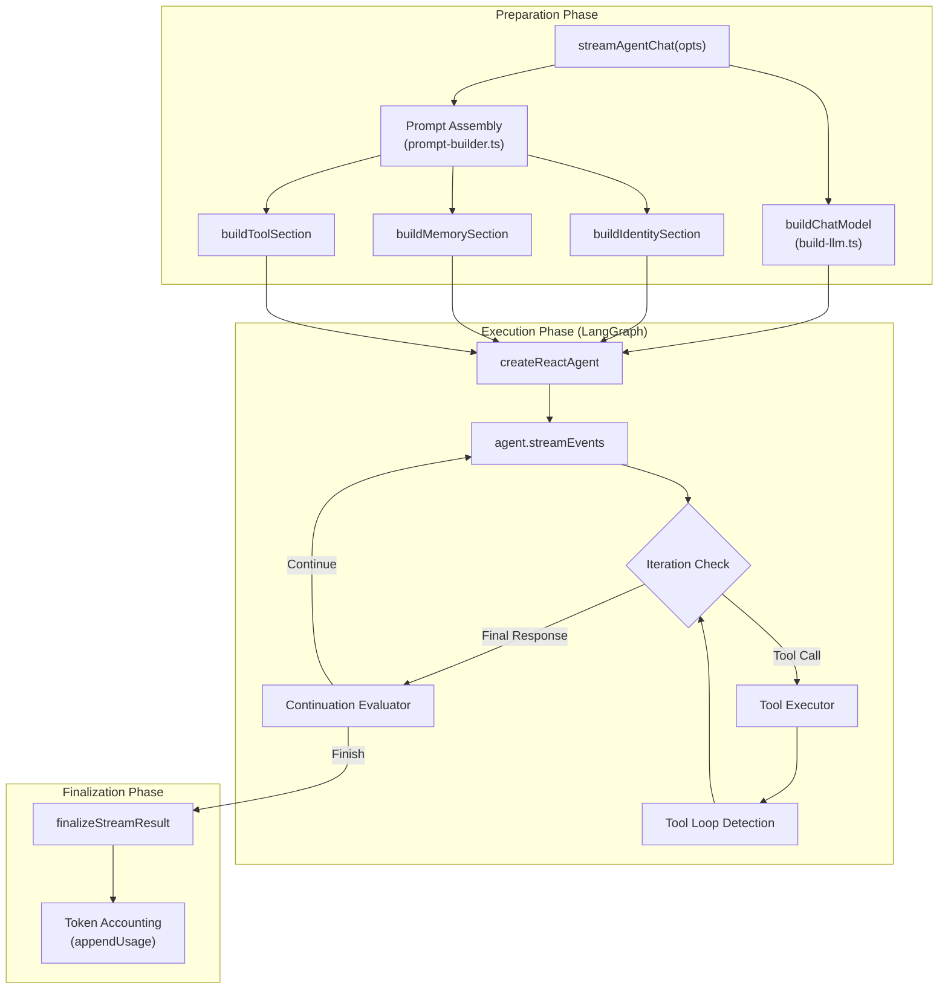
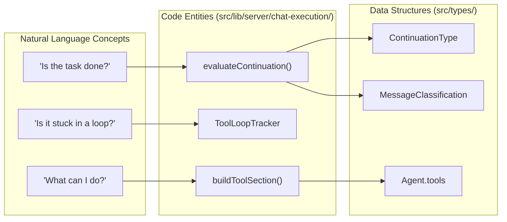

<!-- source: DeepWiki mcp.deepwiki.com · repo swarmclawai/swarmclaw · page 6.2 Stream Agent Chat · fetched 2026-10-27 -->

# Stream Agent Chat

Relevant source files

The following files were used as context for generating this wiki page:

- [src/lib/server/agents/agent-service.ts](src/lib/server/agents/agent-service.ts)
- [src/lib/server/autonomy/supervisor-reflection.test.ts](src/lib/server/autonomy/supervisor-reflection.test.ts)
- [src/lib/server/autonomy/supervisor-reflection.ts](src/lib/server/autonomy/supervisor-reflection.ts)
- [src/lib/server/chat-execution/chat-execution.ts](src/lib/server/chat-execution/chat-execution.ts)
- [src/lib/server/chat-execution/chat-streaming-utils.ts](src/lib/server/chat-execution/chat-streaming-utils.ts)
- [src/lib/server/chat-execution/continuation-evaluator.ts](src/lib/server/chat-execution/continuation-evaluator.ts)
- [src/lib/server/chat-execution/message-classifier.ts](src/lib/server/chat-execution/message-classifier.ts)
- [src/lib/server/chat-execution/prompt-builder.ts](src/lib/server/chat-execution/prompt-builder.ts)
- [src/lib/server/chat-execution/prompt-sections.planning-mode.test.ts](src/lib/server/chat-execution/prompt-sections.planning-mode.test.ts)
- [src/lib/server/chat-execution/prompt-sections.ts](src/lib/server/chat-execution/prompt-sections.ts)
- [src/lib/server/chat-execution/stream-agent-chat.test.ts](src/lib/server/chat-execution/stream-agent-chat.test.ts)
- [src/lib/server/chat-execution/stream-agent-chat.ts](src/lib/server/chat-execution/stream-agent-chat.ts)
- [src/lib/server/chat-execution/stream-continuation.ts](src/lib/server/chat-execution/stream-continuation.ts)
- [src/lib/server/memory/memory-policy.ts](src/lib/server/memory/memory-policy.ts)
- [src/lib/server/memory/temporal-decay.ts](src/lib/server/memory/temporal-decay.ts)
- [src/lib/server/session-tools/memory.ts](src/lib/server/session-tools/memory.ts)
- [src/lib/validation/schemas.test.ts](src/lib/validation/schemas.test.ts)
- [src/lib/validation/schemas.ts](src/lib/validation/schemas.ts)
- [src/types/agent.ts](src/types/agent.ts)

This page documents `streamAgentChat`, the function that executes a single agentic chat turn using the LangGraph ReAct loop. It covers LangChain model construction, system prompt assembly pipeline (persona, skills, memory injection, awareness block, capability policy), tool list building, event streaming, tool loop detection, and continuation evaluation.

For the caller that selects between `streamAgentChat` and direct CLI provider streaming, see [Chat Turn Execution](#6.1). For the tools that `streamAgentChat` hands to the agent, see [Session Tools](#7.1).

---

## Overview

`streamAgentChat` in [src/lib/server/chat-execution/stream-agent-chat.ts]() is the core execution engine for API-backed providers. It wires together a LangChain chat model, a session-specific system prompt, and a set of LangGraph-compatible tools into a `createReactAgent` loop. Unlike simple completion calls, `streamAgentChat` manages a multi-step ReAct (Reasoning + Acting) loop where the agent can call tools, observe results, and continue until the task is complete or limits are hit.

**Key Implementation Details:**
- **State Management**: Uses `ChatTurnState` to track streamed text, tool events, and loop detection triggers [src/lib/server/chat-execution/chat-turn-state.ts]().
- **Streaming**: Events are emitted as raw SSE strings via a `write` callback [src/lib/server/chat-execution/stream-agent-chat.ts:434-522]().
- **Persistence**: Leverages `createPartialAssistantPersistence` to save intermediate state during long-running tool loops [src/lib/server/chat-execution/chat-turn-partial-persistence.ts]().

---

## Execution Pipeline

The execution flow bridges the gap between high-level user intent and low-level code execution by assembling a specialized runtime environment for each turn.

**Diagram: Stream Agent Chat Execution Pipeline**

Sources: [src/lib/server/chat-execution/stream-agent-chat.ts:165-572](), [src/lib/server/chat-execution/prompt-builder.ts:1-20]()

---

## System Prompt Assembly

The system prompt is assembled declaratively by joining several composable sections. This pipeline ensures the agent has full situational awareness of its identity, capabilities, and the current project context.

### 1. Identity & Persona
- **`buildIdentitySection`**: Injects the agent's name, description, and "soul" (persona). It also handles identity continuity across sessions [src/lib/server/chat-execution/prompt-sections.ts:32-82]().
- **`buildThinkingSection`**: If `agent.thinkingLevel` is set (minimal to high), it injects reasoning depth guidance [src/lib/server/chat-execution/prompt-sections.ts:124-137]().

### 2. Capability & Tool Policy
- **`buildToolSection`**: Generates the `## Available Tools` block. It uses `buildToolAvailabilityLines` to list exact, case-sensitive tool names and `buildToolDisciplineLines` for efficiency guidance (e.g., "Prefer fewer, larger tool calls") [src/lib/server/chat-execution/prompt-builder.ts:97-136]().
- **Capability Policy**: Based on the `toolAccessMode` ('universal' vs 'scoped'), the prompt restricts tool descriptions to either the full universe or the agent's specific `tools` list [src/types/agent.ts:83-83]().

### 3. Memory & Context
- **`buildProactiveMemorySection`**: Injects relevant memories retrieved via vector/FTS5 search.
- **`buildAgentAwarenessSection`**: Adds a block describing peer agents' status (idle/working) to facilitate delegation [src/lib/server/chat-execution/prompt-sections.ts:298-306]().
- **`buildPlanningModeSection`**: When `agent.planningMode === 'strict'`, it instructs the model to emit a `[MAIN_LOOP_PLAN]` JSON block before any multi-step work [src/lib/server/chat-execution/prompt-sections.ts:97-118]().

Sources: [src/lib/server/chat-execution/prompt-sections.ts](), [src/lib/server/chat-execution/prompt-builder.ts]()

---

## Tool Loop & Continuation Evaluation

To prevent infinite loops and ensure task completion, the runtime employs a multi-layered evaluation strategy after each LLM iteration.

### Tool Loop Detection
The `ToolLoopTracker` monitors for repetitive patterns. If an agent calls the same tool with the same arguments multiple times, or enters a high-frequency tool-calling state, the tracker triggers a `loopDetectionTriggered` state [src/lib/server/tool-loop-detection.ts]().

### Continuation Evaluator
The `evaluateContinuation` function runs a series of checks in priority order to decide if the ReAct loop should continue [src/lib/server/chat-execution/continuation-evaluator.ts:38-63]():

| Check | Logic |
|---|---|
| **Unfinished Tool Calls** | Continues if there are tool calls in the message that haven't been executed [src/lib/server/chat-execution/continuation-evaluator.ts:91-104](). |
| **Loop Recovery** | If a tool frequency loop is detected but `loop_recovery` budget remains, it resets the trigger and continues with a warning [src/lib/server/chat-execution/continuation-evaluator.ts:113-134](). |
| **Deliverable Followthrough** | If the task is classified as a "deliverable" (e.g., writing a report) and the LLM stopped prematurely, it forces a continuation [src/lib/server/chat-execution/continuation-evaluator.ts:172-185](). |
| **Memory Mutation** | If the only tools called were memory writes, the loop may terminate early to save tokens [src/lib/server/chat-execution/continuation-evaluator.ts:27-28](). |

**Diagram: Code Entity Mapping (Natural Language to Code)**

Sources: [src/lib/server/chat-execution/continuation-evaluator.ts](), [src/lib/server/tool-loop-detection.ts](), [src/lib/server/chat-execution/prompt-builder.ts]()

---

## Event Streaming & Finalization

The streaming process uses LangChain's `streamEvents` (v2) to capture granular lifecycle events.

### Event Handling
- **`on_chat_model_stream`**: Emits `t: 'd'` (data) events containing text chunks [src/lib/server/chat-execution/stream-agent-chat.ts:440-445]().
- **`on_tool_start`**: Emits `t: 'tool_call'` with the tool name and arguments. This is also where `logExecution` records the start of an external action [src/lib/server/chat-execution/stream-agent-chat.ts:465-475]().
- **`on_tool_end`**: Emits `t: 'tool_result'`. If the tool modified the filesystem, a `file_op` event is also logged [src/lib/server/chat-execution/stream-agent-chat.ts:484-505]().

### Post-Stream Finalization
Once the loop terminates, `finalizeStreamResult` performs the following:
1. **Token Accounting**: Aggregates usage metadata from all LLM turns and calls `appendUsage` [src/lib/server/chat-execution/stream-agent-chat.ts:535-556]().
2. **Result Selection**: Returns `fullText` (the entire transcript) and `finalResponse` (the last assistant message, used for connector replies) [src/lib/server/chat-execution/stream-agent-chat.ts:564-571]().
3. **Cleanup**: Executes the cleanup callback returned by `buildSessionTools` (e.g., closing browser containers or MCP connections) [src/lib/server/chat-execution/stream-agent-chat.ts:560-562]().

Sources: [src/lib/server/chat-execution/stream-agent-chat.ts:434-572](), [src/lib/server/chat-execution/post-stream-finalization.ts]()

---

