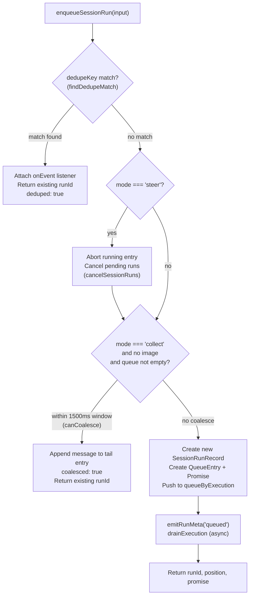
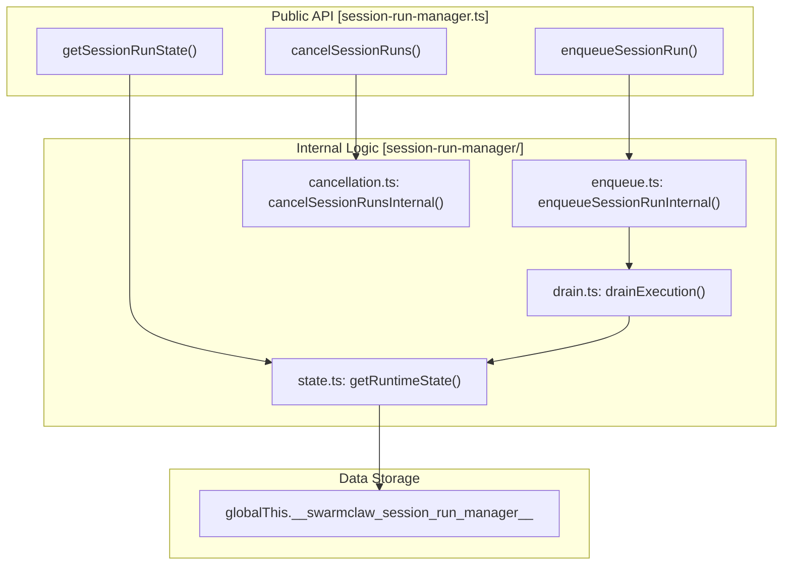
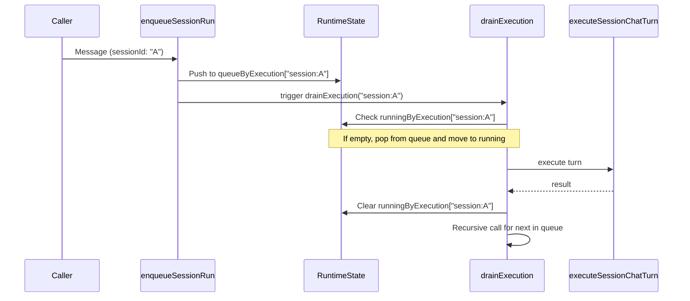

<!-- source: DeepWiki mcp.deepwiki.com · repo swarmclawai/swarmclaw · page 6.3 Session Run Manager · fetched 2026-10-27 -->

# Session Run Manager

Relevant source files

The following files were used as context for generating this wiki page:

- [src/lib/keyed-queue.test.ts](src/lib/keyed-queue.test.ts)
- [src/lib/keyed-queue.ts](src/lib/keyed-queue.ts)
- [src/lib/server/agents/guardian.ts](src/lib/server/agents/guardian.ts)
- [src/lib/server/chat-execution/situational-awareness.ts](src/lib/server/chat-execution/situational-awareness.ts)
- [src/lib/server/memory/memory-consolidation.ts](src/lib/server/memory/memory-consolidation.ts)
- [src/lib/server/memory/memory-db.ts](src/lib/server/memory/memory-db.ts)
- [src/lib/server/runtime/daemon-state.ts](src/lib/server/runtime/daemon-state.ts)
- [src/lib/server/runtime/heartbeat-wake.ts](src/lib/server/runtime/heartbeat-wake.ts)
- [src/lib/server/runtime/idle-window.ts](src/lib/server/runtime/idle-window.ts)
- [src/lib/server/runtime/queue.ts](src/lib/server/runtime/queue.ts)
- [src/lib/server/runtime/session-run-manager.test.ts](src/lib/server/runtime/session-run-manager.test.ts)
- [src/lib/server/runtime/session-run-manager.ts](src/lib/server/runtime/session-run-manager.ts)
- [src/lib/server/skills/learned-skills.ts](src/lib/server/skills/learned-skills.ts)
- [src/stores/use-chat-store.test.ts](src/stores/use-chat-store.test.ts)

The Session Run Manager is the concurrency layer between callers that want to trigger a chat turn and `executeSessionChatTurn`, which performs the actual LLM work. It enforces **one-at-a-time execution per session** by queuing incoming run requests and draining them sequentially. It also handles run deduplication, message coalescing, user preemption (steering), and post-run lifecycle recovery.

All public exports and the primary facade live in [src/lib/server/runtime/session-run-manager.ts](). The implementation is split across specialized modules in `src/lib/server/runtime/session-run-manager/`.

---

## Core Data Types

### Session Run Record
Every run request creates a `SessionRunRecord`, a lightweight descriptor stored in memory for the lifetime of the process (up to `MAX_RECENT_RUNS = 500` entries).

[src/lib/server/runtime/session-run-manager/types.ts:32-52]()

| Field | Type | Description |
|---|---|---|
| `id` | `string` | Random 8-byte hex run ID |
| `sessionId` | `string` | Target session |
| `source` | `string` | Origin: `'chat'`, `'heartbeat'`, `'connector'`, `'main-loop-followup'`, etc. |
| `internal` | `boolean` | Whether this is an autonomous (non-user) run |
| `mode` | `SessionQueueMode` | See queue mode table below |
| `status` | `SessionRunStatus` | Lifecycle state: `queued`, `running`, `completed`, `failed`, `cancelled` |
| `messagePreview` | `string` | First 140 chars of message, for display |
| `queuedAt` | `number` | Unix ms timestamp |
| `startedAt` / `endedAt` | `number?` | Set when run transitions |
| `error` | `string?` | Error message if failed |

### Queue Mode
`SessionQueueMode` controls how a new request interacts with the current queue.

[src/lib/server/runtime/session-run-manager/types.ts:13-18]()

| Mode | Behavior |
|---|---|
| `'followup'` | Default for user-initiated runs. Appends to queue after any running or pending runs. |
| `'collect'` | Internal/background runs. Can be coalesced into an adjacent pending `collect` run within a 1500ms window. |
| `'steer'` | User course-correction. Aborts the currently running task and cancels all pending runs for the session before enqueuing. |

---

## Runtime State Management

The module stores all mutable state in a `RuntimeState` object pinned to `globalThis` under the key `__swarmclaw_session_run_manager__` using the `hmrSingleton` pattern. This ensures state survives Next.js hot-module reloads during development.

[src/lib/server/runtime/session-run-manager/state.ts:17-32]()

| State field | Type | Description |
|---|---|---|
| `runningByExecution` | `Map<string, QueueEntry>` | At most one entry per execution key (session) |
| `queueByExecution` | `Map<string, QueueEntry[]>` | Pending entries per execution key |
| `runs` | `Map<string, SessionRunRecord>` | All recent run records, keyed by run ID |
| `recentRunIds` | `string[]` | Ordered list of run IDs for LRU eviction |
| `promises` | `Map<string, Promise<unknown>>` | Run promise lookup by run ID |

The execution key for a session is always `session:<sessionId>`, produced by `executionKeyForSession`.

[src/lib/server/runtime/session-run-manager/state.ts:61-63]()

---

## Enqueue and Deduplication Logic

### `enqueueSessionRun`
The primary public API. Callers include the SSE API route, the heartbeat service, the task queue, and the connector manager.

[src/lib/server/runtime/session-run-manager/enqueue.ts:37-147]()

**Enqueue Decision Flow:**

Sources: [src/lib/server/runtime/session-run-manager/enqueue.ts:37-147](), [src/lib/server/runtime/session-run-manager/state.ts:61-120]()

### Message Coalescing (1500ms Window)
When mode is `'collect'` (typical for heartbeats and internal background triggers), consecutive enqueue calls within `COLLECT_COALESCE_WINDOW_MS` (1500 ms) that share the same `source` and `internal` flag are merged into a single queue entry. The message text is appended with a `[Collected follow-up]` separator.

[src/lib/server/runtime/session-run-manager/enqueue.ts:70-101]()

---

## Sequential Execution (Drain Loop)

`drainExecution` is the internal scheduler. It ensures that only one LLM turn runs per session at a time by serializing the `queueByExecution` for each key.

[src/lib/server/runtime/session-run-manager/drain.ts:25-144]()

**Drain Lifecycle:**

1. **Check Occupancy:** If `runningByExecution` already has an entry for the session, the function exits.
2. **Shift Queue:** Takes the next `QueueEntry` from `queueByExecution`.
3. **Status Transition:** Updates status to `'running'` and sets `startedAt`.
4. **Execution:** Calls `executeSessionChatTurn` (imported dynamically to avoid circular dependencies).
5. **Post-Processing:** Calls `handleMainLoopRunResult` to update the main agent loop state and optionally schedule follow-up runs.
6. **Recursion:** Once finished (success or failure), it deletes itself from `runningByExecution` and calls `drainExecution` again to process the next item in the queue.

[src/lib/server/runtime/session-run-manager/drain.ts:114-142]()

---

## User Preemption and Cancellation

### Steering and Preemption
When a user sends a message while the agent is already "thinking" (running), the system uses the `'steer'` mode. This triggers `cancelSessionRuns`, which calls `abort()` on the `AbortController` of the running entry. This signal propagates into the LLM provider stream, stopping it immediately to allow the new user instruction to take priority.

[src/lib/runtime/session-run-manager/cancellation.ts:51-70]()

### `cancelSessionRuns`
Cancels all queued runs for a session and aborts any in-flight run.

[src/lib/server/runtime/session-run-manager/cancellation.ts:51-70]()

| Function | Scope |
|---|---|
| `cancelQueuedRunsForSession` | Only removes items from the pending queue. |
| `cancelSessionRuns` | Aborts the active run AND clears the queue. |
| `cancelAllHeartbeatRuns` | Targeted cancellation for internal heartbeat-sourced runs only. |

Sources: [src/lib/server/runtime/session-run-manager/cancellation.ts:14-110]()

---

## State Queries

| Function | Purpose |
|---|---|
| `getSessionRunState` | Returns `runningRunId` and `queueLength`. Used by `heartbeat-service` to skip busy sessions. |
| `getSessionExecutionState` | Returns detailed `running` and `queued` objects for UI display. |
| `hasActiveNonHeartbeatSessionLease` | Returns true if a user-initiated or non-background run is active. |

Sources: [src/lib/server/runtime/session-run-manager/queries.ts:15-110](), [src/lib/server/runtime/session-run-manager/state.ts:135-144]()

---

## Code Entity Mapping

The following diagram bridges the high-level manager concepts to the specific code entities and files that implement them.

Sources: [src/lib/server/runtime/session-run-manager.ts:1-140](), [src/lib/server/runtime/session-run-manager/state.ts:17-32]()

### Sequential Processing Architecture
The system uses a per-session lock (via `runningByExecution`) to ensure sequential processing.

Sources: [src/lib/server/runtime/session-run-manager/drain.ts:25-144](), [src/lib/server/runtime/session-run-manager/enqueue.ts:37-147]()

---

