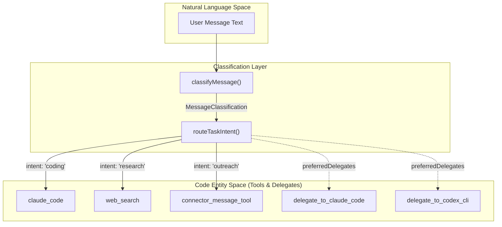
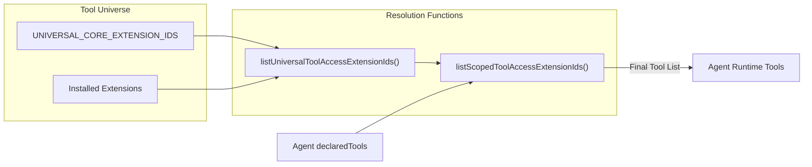

<!-- source: DeepWiki mcp.deepwiki.com · repo swarmclawai/swarmclaw · page 6.4 Capability Routing · fetched 2026-10-27 -->

# Capability Routing

Relevant source files

The following files were used as context for generating this wiki page:

- [src/lib/ollama-mode.test.ts](src/lib/ollama-mode.test.ts)
- [src/lib/ollama-mode.ts](src/lib/ollama-mode.ts)
- [src/lib/providers/openclaw.ts](src/lib/providers/openclaw.ts)
- [src/lib/server/capability-router.test.ts](src/lib/server/capability-router.test.ts)
- [src/lib/server/capability-router.ts](src/lib/server/capability-router.ts)
- [src/lib/server/chat-execution/chat-turn-preparation.ts](src/lib/server/chat-execution/chat-turn-preparation.ts)
- [src/lib/server/chat-execution/chat-turn-tool-routing.ts](src/lib/server/chat-execution/chat-turn-tool-routing.ts)
- [src/lib/server/chats/chat-session-service.ts](src/lib/server/chats/chat-session-service.ts)
- [src/lib/server/ollama-runtime.ts](src/lib/server/ollama-runtime.ts)
- [src/lib/server/runtime/perf.ts](src/lib/server/runtime/perf.ts)
- [src/lib/server/runtime/queue-recovery.test.ts](src/lib/server/runtime/queue-recovery.test.ts)
- [src/lib/server/runtime/queue/core.ts](src/lib/server/runtime/queue/core.ts)
- [src/lib/server/skills/runtime-skill-resolver.ts](src/lib/server/skills/runtime-skill-resolver.ts)
- [src/lib/server/universal-tool-access.test.ts](src/lib/server/universal-tool-access.test.ts)
- [src/lib/server/universal-tool-access.ts](src/lib/server/universal-tool-access.ts)

This page documents the capability routing subsystem: how incoming chat messages are classified into task intents and how those classifications drive preferred tool selection, delegate ordering, and automatic tool invocation. Capability routing serves as a bridge between Natural Language intent and concrete Code Entities (tools and delegates).

---

## Overview

Capability routing is a core logic layer that translates user intent into a structured `CapabilityRoutingDecision` [src/lib/server/capability-router.ts:14-20](). This decision informs the execution engine which tools to prioritize or automatically invoke if the LLM fails to select them.

The system relies on `routeTaskIntent` [src/lib/server/capability-router.ts:70-169](), which integrates with the `MessageClassification` produced by the `message-classifier` [src/lib/server/chat-execution/message-classifier.ts:1-10]().

### Key Components

| Code Entity | Role |
|:---|:---|
| `routeTaskIntent` | Primary entry point for classifying message intent and selecting tools. |
| `TaskIntent` | Union type defining supported categories: `coding`, `research`, `browsing`, `outreach`, `scheduling`, `general`. |
| `CapabilityRoutingDecision` | The result object containing intent, confidence, preferred tools, and delegates. |
| `normalizeDelegateOrder` | Resolves the preferred order of CLI delegates from `AppSettings`. |
| `preferredToolsForCapabilities` | Maps high-level capabilities to specific tool names. |

Sources: [src/lib/server/capability-router.ts:6-22](), [src/lib/server/capability-router.ts:70-75]()

---

## Intent Classification & Tool Selection

The routing logic maps a `MessageClassification` (or raw text keywords) to a specific `TaskIntent`. Each intent has a hardcoded list of `preferredTools` that are prioritized during session tool assembly.

### Intent Mapping Table

| Intent | Triggers / Logic | Preferred Tools (Code Entity Names) |
|:---|:---|:---|
| `coding` | `classification.taskIntent === 'coding'` | `claude_code`, `codex_cli`, `opencode_cli`, `gemini_cli`, `cursor_cli`, `qwen_code_cli`, `shell`, `files`, `edit_file` |
| `outreach` | `wantsVoiceDelivery`, `wantsOutboundDelivery` | `connector_message_tool`, `manage_connectors`, `manage_sessions` |
| `scheduling` | `classification.taskIntent === 'scheduling'` | `manage_schedules`, `manage_tasks` |
| `browsing` | `classification.taskIntent === 'browsing'` | `browser`, `web_fetch` |
| `research` | `isResearchSynthesis` or `research` keywords | `web_search`, `web_fetch`, `browser` |
| `general` | Fallback intent | *(Empty)* |

Sources: [src/lib/server/capability-router.ts:84-168](), [src/lib/server/capability-router.test.ts:78-103]()

---

## Delegate Ordering & AppSettings

The system supports "Universal Tool Access" through a delegation system. When a task is identified as `coding` or `general`, the router provides an ordered list of `preferredDelegates` [src/lib/server/capability-router.ts:18]().

The order is determined by `normalizeDelegateOrder`, which reads `autonomyPreferredDelegates` from the `AppSettings` [src/lib/server/capability-router.ts:38-68]().

**Default Fallback Order:**
1. `delegate_to_claude_code`
2. `delegate_to_codex_cli`
3. `delegate_to_opencode_cli`
4. `delegate_to_gemini_cli`
5. `delegate_to_copilot_cli`
6. `delegate_to_droid_cli`
7. `delegate_to_cursor_cli`
8. `delegate_to_qwen_code_cli`

Sources: [src/lib/server/capability-router.ts:38-48](), [src/lib/server/capability-router.ts:77-77]()

---

## Data Flow: From Intent to Tool

The following diagram bridges the **Natural Language Space** (User Message) to the **Code Entity Space** (Functions and Tool Names).

### Capability Routing Pipeline

Sources: [src/lib/server/capability-router.ts:70-169](), [src/lib/server/chat-execution/message-classifier.ts:1-10](), [src/lib/server/chat-execution/chat-turn-tool-routing.ts:23-23]()

---

## Universal Tool Access System

The `universal-tool-access.ts` module defines the "Universe" of tools available to agents. This is used by the capability router and session builder to ensure agents have a baseline of functional tools regardless of their specific configuration.

### Tool Scoping Logic

The system distinguishes between `Universal` access and `Scoped` access:
- **Universal:** Includes all `UNIVERSAL_CORE_EXTENSION_IDS` (e.g., `shell`, `files`, `web`, `memory`, `ask_human`) plus any installed extensions [src/lib/server/universal-tool-access.ts:4-39]().
- **Scoped:** Filters the universe against the agent's `declaredTools`, but always enforces a `SCOPED_TOOL_BASELINE`: `['memory', 'context_mgmt', 'ask_human']` [src/lib/server/universal-tool-access.ts:66-82]().

### Universal Tool Resolution

Sources: [src/lib/server/universal-tool-access.ts:48-59](), [src/lib/server/universal-tool-access.ts:74-82](), [src/lib/server/universal-tool-access.test.ts:22-25]()

---

## Integration in Chat Execution

Capability routing is integrated into the post-LLM response phase in `chat-turn-tool-routing.ts`. If the LLM produces a response but fails to call a tool that matches a high-confidence intent, the system can perform "Auto-Routing".

### Auto-Routing Scenarios

1.  **Direct Memory Intent:** If `classifyDirectMemoryIntent` identifies a storage or recall request, the system may bypass the standard loop to call `memory_store` or `memory_search` directly [src/lib/server/chat-execution/chat-turn-tool-routing.ts:140-181]().
2.  **Forced Delegation:** If the intent is `coding` and no code tools were called, the system invokes the first available delegate from `preferredDelegates` [src/lib/server/chat-execution/chat-turn-tool-routing.ts:33-43]().

Sources: [src/lib/server/chat-execution/chat-turn-tool-routing.ts:100-128](), [src/lib/server/chat-execution/chat-turn-tool-routing.ts:140-200]()

---

## Implementation Details

### Intent Priority
The `routeTaskIntent` function evaluates intents in a specific order. If multiple intents might match, the higher-priority one (e.g., `coding` over `research`) is selected. This is verified in regression tests where a prompt like "Build a calculator and remember it" correctly resolves to `coding` [src/lib/server/capability-router.test.ts:16-24]().

### Confidence Scoring
Confidence is inherited from the `MessageClassification` [src/lib/server/capability-router.ts:79-79](). High-confidence classifications (typically > 0.8) are required for destructive or high-cost auto-routing actions.

Sources: [src/lib/server/capability-router.ts:70-169](), [src/lib/server/capability-router.test.ts:1-122]()

---

