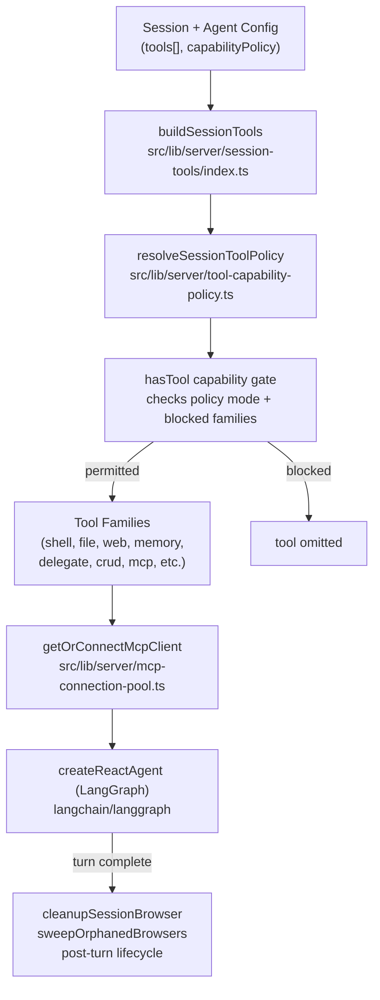
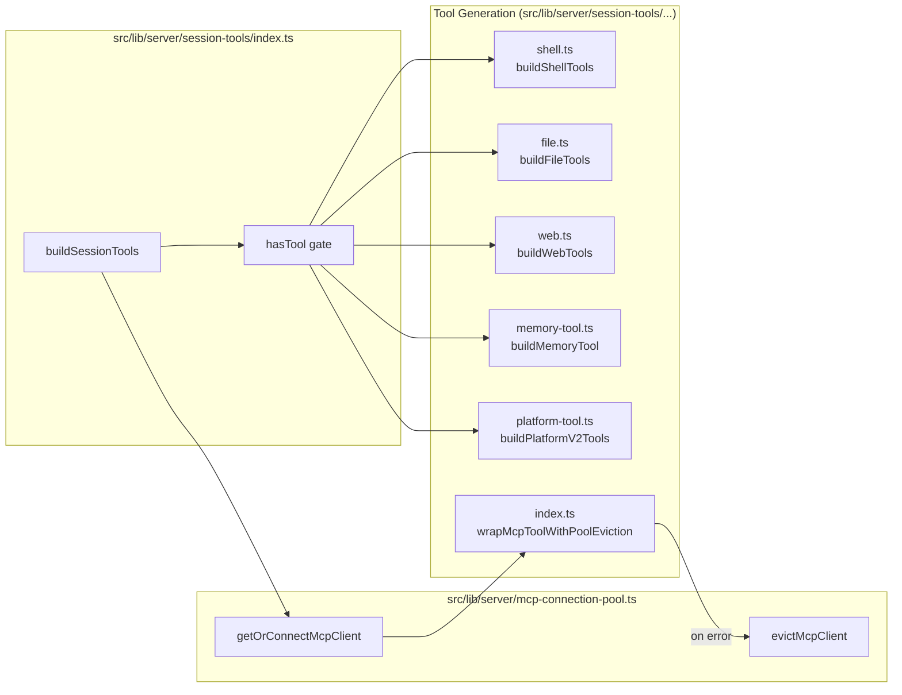

<!-- source: DeepWiki mcp.deepwiki.com · repo swarmclawai/swarmclaw · page 7 Agent Tools · fetched 2026-10-27 -->

# Agent Tools

Relevant source files

The following files were used as context for generating this wiki page:

- [SWARMDOCK.md](SWARMDOCK.md)
- [skills/swarmclaw/SKILL.md](skills/swarmclaw/SKILL.md)
- [skills/swarmvault/SKILL.md](skills/swarmvault/SKILL.md)
- [src/app/api/mcp-servers/[id]/test/route.ts](src/app/api/mcp-servers/[id]/test/route.ts)
- [src/app/api/mcp-servers/route.test.ts](src/app/api/mcp-servers/route.test.ts)
- [src/app/api/mcp-servers/route.ts](src/app/api/mcp-servers/route.ts)
- [src/components/mcp-servers/mcp-server-list.tsx](src/components/mcp-servers/mcp-server-list.tsx)
- [src/components/mcp-servers/mcp-server-sheet.tsx](src/components/mcp-servers/mcp-server-sheet.tsx)
- [src/lib/server/__fixtures__/fake-mcp-stdio-server.mjs](src/lib/server/__fixtures__/fake-mcp-stdio-server.mjs)
- [src/lib/server/connectors/swarmdock.test.ts](src/lib/server/connectors/swarmdock.test.ts)
- [src/lib/server/connectors/swarmdock.ts](src/lib/server/connectors/swarmdock.ts)
- [src/lib/server/mcp-client.ts](src/lib/server/mcp-client.ts)
- [src/lib/server/mcp-connection-pool.test.ts](src/lib/server/mcp-connection-pool.test.ts)
- [src/lib/server/mcp-connection-pool.ts](src/lib/server/mcp-connection-pool.ts)
- [src/lib/server/session-tools/index.ts](src/lib/server/session-tools/index.ts)
- [src/lib/server/session-tools/swarmdock.test.ts](src/lib/server/session-tools/swarmdock.test.ts)
- [src/lib/server/session-tools/swarmdock.ts](src/lib/server/session-tools/swarmdock.ts)
- [src/lib/server/tool-aliases.ts](src/lib/server/tool-aliases.ts)
- [src/lib/server/tool-capability-policy.test.ts](src/lib/server/tool-capability-policy.test.ts)
- [src/lib/server/tool-capability-policy.ts](src/lib/server/tool-capability-policy.ts)
- [src/lib/tool-definitions.ts](src/lib/tool-definitions.ts)
- [src/proxy.ts](src/proxy.ts)
- [src/types/misc.ts](src/types/misc.ts)

This page provides an overview of the tool system in SwarmClaw: how tools are assembled for each session, how the capability policy governs access, and what tool categories are available. For the detailed implementation of tool construction, see [Session Tools](#7.1). For sandboxed code execution specifically, see [Sandbox Execution](#7.2). For Model Context Protocol (MCP) integration, see [MCP Integration](#7.3).

---

## What Are Agent Tools?

Tools are discrete callable functions injected into an agent's LangGraph ReAct loop. When an agent receives a message, it may invoke zero or more tools before producing a final reply. The set of tools available depends on:

1. Which tools are enabled on the agent or session configuration [src/lib/server/session-tools/index.ts:138-140]()
2. Which tool families are permitted by the active **capability policy** [src/lib/server/session-tools/index.ts:140-144]()
3. Whether required runtime dependencies (e.g., Playwright, MCP servers, Docker) are available [src/lib/server/session-tools/index.ts:150-153]()

Tools are constructed fresh per session turn by `buildSessionTools` in [src/lib/server/session-tools/index.ts:128]() and passed directly into the LangGraph execution loop.

Sources: [src/lib/server/session-tools/index.ts:128-153](), [skills/swarmclaw/SKILL.md:24-36]()

---

## Tool Assembly Flow

The following diagram shows how tools flow from session configuration through the capability gate into the agent loop, associating system logic with code entities.

**Diagram: Tool Assembly Pipeline**

Sources: [src/lib/server/session-tools/index.ts:128-153](), [src/lib/server/mcp-connection-pool.ts:69-71](), [src/lib/server/tool-capability-policy.ts:8]()

---

## Capability Policy

The capability policy is a global gate applied during `buildSessionTools` before any tool is registered with the agent. It enforces control across several axes:

| Policy field | Effect |
|---|---|
| `mode` | `permissive`, `balanced`, or `strict` — sets the default stance |
| `blockedExtensions` | Blocks entire families (e.g., `shell`, `process`, `filesystem`) |
| `blockedTools` | Blocks specific named tools within any family |
| `enabledExtensions` | Explicitly allows tool families for a session |

Policy is configured in **Settings → Capability Policy** and is resolved via `resolveSessionToolPolicy` [src/lib/server/session-tools/index.ts:140](). The internal check is the `hasTool` function provided in the `ToolBuildContext`. Each tool family builder (e.g., `buildShellTools`, `buildFileTools`) respects these flags before registration.

Sources: [src/lib/server/session-tools/index.ts:128-153](), [src/lib/server/tool-capability-policy.ts:1-20]()

---

## Tool Categories

SwarmClaw unifies granular tools into several "Primitive Tools" and platform management tools.

### Primitive Tools

Every agent has access to these core capabilities, defined in [src/lib/tool-definitions.ts:17-34]().

| Tool | Purpose | Source Module |
|---|---|---|
| **files** | Read, write, edit, list, search files | `buildFilesTools` |
| **execute** | Run bash scripts (sandboxed or host) | `buildExecuteTools` |
| **memory** | Store and retrieve persistent knowledge | `buildMemoryTool` |
| **platform** | Tasks, communication, delegation, projects | `buildPlatformV2Tools` |
| **browser** | Control a headless Playwright browser | `buildWebTools` |
| **skills** | Discover and load skill documentation | `buildSkillsTools` |

### MCP Tools

Agents can use tools served by external **Model Context Protocol** servers. These are registered in the UI and dynamically discovered at runtime. SwarmClaw supports `stdio`, `sse`, and `streamable-http` transports [src/components/mcp-servers/mcp-server-sheet.tsx:11]().

- **SwarmVault**: Local-first knowledge vault.
- **SwarmDock**: Agent marketplace for bidding and tasks [SWARMDOCK.md:1-13]().
- **MCP Gateway**: Consolidates multiple MCP servers behind one entry [src/components/mcp-servers/mcp-server-sheet.tsx:47]().

Sources: [skills/swarmclaw/SKILL.md:24-36](), [src/lib/tool-definitions.ts:17-34](), [src/components/mcp-servers/mcp-server-sheet.tsx:31-68]()

---

## Tool Family to Code Entity Map

The following diagram bridges the functional tool names to the specific TypeScript modules and functions that generate them.

**Diagram: Tool Names and Their Source Modules**

Sources: [src/lib/server/session-tools/index.ts:15-53](), [src/lib/server/mcp-connection-pool.ts:69-106]()

---

## Integration Points

The tool system connects to several other subsystems:

| Subsystem | Interaction |
|---|---|
| **MCP Connection Pool** | Manages long-lived connections to tool servers to avoid 500ms startup latency [src/lib/server/mcp-connection-pool.ts:6-10](). |
| **File Access Policy** | Enforces directory-level restrictions via `enforceFileAccessPolicy` [src/lib/server/session-tools/index.ts:53](). |
| **SwarmDock** | Connects agents to a P2P marketplace for tasks and USDC payouts [SWARMDOCK.md:13-17](). |
| **Credential System** | Injects API keys as environment variables into the `execute` tool [skills/swarmclaw/SKILL.md:53-57](). |

Sources: [src/lib/server/mcp-connection-pool.ts:1-15](), [src/lib/server/session-tools/index.ts:53](), [SWARMDOCK.md:1-30]()

---

## Child Pages

| Page | Content |
|---|---|
| [Session Tools](#7.1) | Details on `buildSessionTools`, `ToolBuildContext`, tool result truncation, and the cleanup lifecycle. |
| [Sandbox Execution](#7.2) | Docker-based sandbox system, `SandboxMode`, `SandboxScope`, and container lifecycle. |
| [MCP Integration](#7.3) | `McpServerConfig`, transport types, connection pooling, and the MCP Inspector UI. |

---

