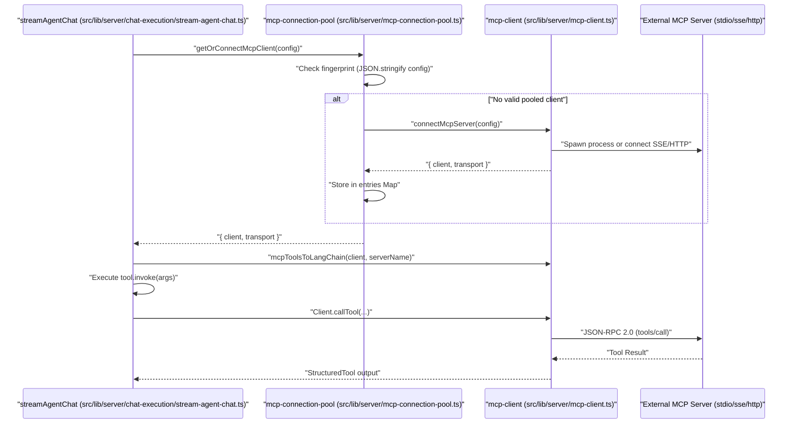
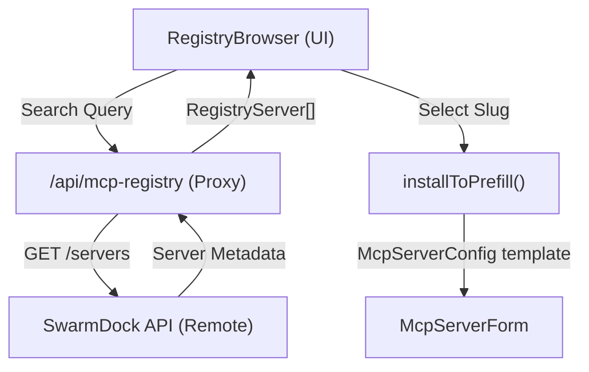

<!-- source: DeepWiki mcp.deepwiki.com · repo swarmclawai/swarmclaw · page 7.3 MCP Integration · fetched 2026-10-27 -->

# MCP Integration

Relevant source files

The following files were used as context for generating this wiki page:

- [skills/swarmclaw/SKILL.md](skills/swarmclaw/SKILL.md)
- [skills/swarmvault/SKILL.md](skills/swarmvault/SKILL.md)
- [src/app/api/mcp-registry/[slug]/route.ts](src/app/api/mcp-registry/[slug]/route.ts)
- [src/app/api/mcp-registry/route.ts](src/app/api/mcp-registry/route.ts)
- [src/app/api/mcp-servers/[id]/test/route.ts](src/app/api/mcp-servers/[id]/test/route.ts)
- [src/app/api/mcp-servers/route.test.ts](src/app/api/mcp-servers/route.test.ts)
- [src/app/api/mcp-servers/route.ts](src/app/api/mcp-servers/route.ts)
- [src/components/mcp-servers/mcp-server-list.tsx](src/components/mcp-servers/mcp-server-list.tsx)
- [src/components/mcp-servers/mcp-server-sheet.tsx](src/components/mcp-servers/mcp-server-sheet.tsx)
- [src/components/mcp-servers/registry-browser.tsx](src/components/mcp-servers/registry-browser.tsx)
- [src/lib/server/__fixtures__/fake-mcp-stdio-server.mjs](src/lib/server/__fixtures__/fake-mcp-stdio-server.mjs)
- [src/lib/server/mcp-client.ts](src/lib/server/mcp-client.ts)
- [src/lib/server/mcp-connection-pool.test.ts](src/lib/server/mcp-connection-pool.test.ts)
- [src/lib/server/mcp-connection-pool.ts](src/lib/server/mcp-connection-pool.ts)
- [src/lib/server/session-tools/index.ts](src/lib/server/session-tools/index.ts)
- [src/proxy.ts](src/proxy.ts)
- [src/types/misc.ts](src/types/misc.ts)

SwarmClaw integrates the **Model Context Protocol (MCP)** to allow agents to discover and execute tools served by external processes or remote services. This integration supports various transport layers, provides a high-performance connection pool with automatic error recovery, and exposes MCP tools to agents through the LangChain ecosystem.

---

## Architecture & Data Flow

The MCP subsystem bridges external tool providers with the SwarmClaw agent runtime. It uses a connection pool to minimize the overhead of spawning child processes or establishing network connections on every chat turn.

**Diagram: MCP Tool Execution Data Flow**

Sources: [src/lib/server/mcp-connection-pool.ts:69-106](), [src/lib/server/mcp-client.ts:4-35](), [src/lib/server/session-tools/index.ts:128-165]()

---

## Connection Management

### Configuration (McpServerConfig)
MCP servers are defined by the `McpServerConfig` interface. SwarmClaw supports three transport types:
- **stdio**: Spawns a local child process and communicates over standard input/output.
- **sse**: Connects to a remote server using Server-Sent Events.
- **streamable-http**: A high-performance HTTP-based transport used by SwarmDock.

Sources: [src/types/index.ts:11-30](), [src/components/mcp-servers/mcp-server-sheet.tsx:11-29]()

### Connection Pool (mcp-connection-pool)
To avoid the 100–500ms latency of re-connecting to MCP servers on every turn, SwarmClaw maintains a long-lived pool in `globalThis.mcpConnectionPool`.

- **Fingerprinting**: Connections are keyed by a hash of their configuration (command, args, env, etc.). If the config changes, the old connection is evicted and a new one is created [src/lib/server/mcp-connection-pool.ts:57-67]().
- **Coalescing**: Concurrent requests for the same server ID are coalesced into a single connection attempt [src/lib/server/mcp-connection-pool.ts:82-87]().
- **Pool Eviction**: Connections are automatically evicted on "hard" errors (e.g., `EPIPE`, `ECONNRESET`, or "process exited") via `isConnectionLikeError` [src/lib/server/mcp-connection-pool.ts:142-150]().

Sources: [src/lib/server/mcp-connection-pool.ts:1-42](), [src/lib/server/mcp-connection-pool.test.ts:53-98]()

---

## Tool Exposure

SwarmClaw transforms MCP tools into LangChain-compatible `StructuredToolInterface` objects using `mcpToolsToLangChain`.

### Exposure Modes
In the UI, users can configure how tools are exposed to the LLM:
1. **All**: Every tool the MCP server provides is injected into the prompt.
2. **Selected**: Only tools in an explicit allow-list are exposed.
3. **Lazy**: Tools are not shown initially; the agent must use a discovery tool to find and "load" them into the session context.

Sources: [src/components/mcp-servers/mcp-server-sheet.tsx:90-100](), [src/lib/server/session-tools/index.ts:57-64]()

### Tool Wrapping & Safety
MCP tools are wrapped by `wrapMcpToolWithPoolEviction` [src/lib/server/session-tools/index.ts:103-126](). If a tool call fails with a connection-level error, the wrapper catches it, evicts the dead client from the pool, and propagates the error so the next turn can attempt a fresh connection.

| Function | Role |
|---|---|
| `sanitizeName` | Normalizes MCP server/tool names for LLM compatibility [src/lib/server/mcp-client.ts:57-60](). |
| `jsonSchemaToZod` | Converts MCP tool input schemas into Zod for LangChain validation [src/lib/server/mcp-client.ts:57-60](). |
| `evictMcpClient` | Manually closes and removes a client from the pool [src/lib/server/mcp-connection-pool.ts:108-113](). |

Sources: [src/lib/server/session-tools/index.ts:92-126](), [src/lib/server/mcp-client.ts:57-60]()

---

## User Interface & Discovery

### MCP Inspector UI
The **Inspector UI** (`McpServerList`) allows developers to test MCP servers directly. It provides:
- **Status Probes**: Real-time health checks (StatusDot) [src/components/mcp-servers/mcp-server-list.tsx:9-15]().
- **Tool Browser**: View schemas and descriptions of all tools provided by a server [src/components/mcp-servers/mcp-server-list.tsx:91-93]().
- **Direct Invocation**: A form to manually trigger MCP tools with JSON arguments for debugging [src/components/mcp-servers/mcp-server-list.tsx:61-68]().

Sources: [src/components/mcp-servers/mcp-server-list.tsx:53-156]()

### Registry Browser
The `RegistryBrowser` component connects to the **SwarmDock MCP Registry** (`mcp.swarmdock.ai`). It allows users to search for public MCP servers and "one-click" install them by automatically pre-filling the `McpServerConfig` (command, args, transport) based on the registry's recommended installation method (e.g., `npx`, `uvx`, `docker`) [src/components/mcp-servers/registry-browser.tsx:48-77]().

**Diagram: Registry Discovery to Configuration**

Sources: [src/components/mcp-servers/registry-browser.tsx:13-40](), [src/app/api/mcp-registry/[slug]/route.ts:1-31]()

---

## Presets & Specialized Servers

SwarmClaw includes built-in presets for common MCP use cases:

- **SwarmVault**: Local-first knowledge management. Uses `npx @swarmvaultai/cli mcp` [src/components/mcp-servers/mcp-server-sheet.tsx:31-43]().
- **MCP Gateway**: A local proxy that consolidates multiple MCP servers behind a single entry point to save tokens [src/components/mcp-servers/mcp-server-sheet.tsx:44-55]().
- **SwarmDock**: An agent marketplace for browsing tasks and earning USDC. Uses `streamable-http` with Bearer token authentication [src/components/mcp-servers/mcp-server-sheet.tsx:56-68]().

Sources: [src/components/mcp-servers/mcp-server-sheet.tsx:31-68](), [skills/swarmclaw/SKILL.md:128-135]()

---

