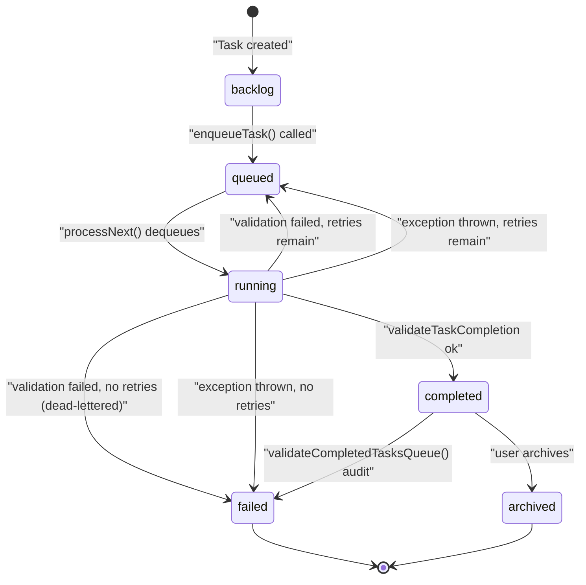
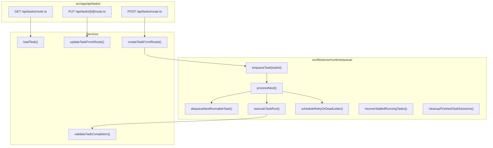
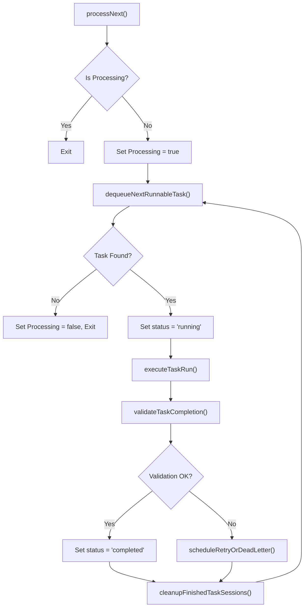

<!-- source: DeepWiki mcp.deepwiki.com · repo swarmclawai/swarmclaw · page 8.1 Task Queue · fetched 2026-10-27 -->

# Task Queue

Relevant source files

The following files were used as context for generating this wiki page:

- [src/app/api/tasks/[id]/route.ts](src/app/api/tasks/[id]/route.ts)
- [src/app/api/tasks/route.ts](src/app/api/tasks/route.ts)
- [src/components/shared/settings-sheet.tsx](src/components/shared/settings-sheet.tsx)
- [src/components/tasks/task-card.tsx](src/components/tasks/task-card.tsx)
- [src/components/tasks/task-column.tsx](src/components/tasks/task-column.tsx)
- [src/components/tasks/task-list.tsx](src/components/tasks/task-list.tsx)
- [src/components/tasks/task-sheet.tsx](src/components/tasks/task-sheet.tsx)
- [src/lib/server/agents/guardian.ts](src/lib/server/agents/guardian.ts)
- [src/lib/server/chat-execution/situational-awareness.ts](src/lib/server/chat-execution/situational-awareness.ts)
- [src/lib/server/memory/memory-consolidation.ts](src/lib/server/memory/memory-consolidation.ts)
- [src/lib/server/memory/memory-db.ts](src/lib/server/memory/memory-db.ts)
- [src/lib/server/runtime/daemon-state.ts](src/lib/server/runtime/daemon-state.ts)
- [src/lib/server/runtime/idle-window.ts](src/lib/server/runtime/idle-window.ts)
- [src/lib/server/runtime/queue.ts](src/lib/server/runtime/queue.ts)
- [src/lib/server/session-tools.ts](src/lib/server/session-tools.ts)
- [src/lib/server/skills/learned-skills.ts](src/lib/server/skills/learned-skills.ts)
- [src/stores/use-app-store.ts](src/stores/use-app-store.ts)

This page documents the task queue subsystem: how tasks are enqueued, executed by agents, retried on failure, and eventually completed or dead-lettered. It covers the worker loop, retry backoff policy, stall recovery, and the `/api/tasks` REST endpoint.

For the broader task lifecycle including validation criteria, see [Task Validation (8.3)](). For the scheduler that generates recurring tasks, see [Scheduler (8.2)](). For how `executeSessionChatTurn` works once a task session is created, see [Chat Turn Execution (6.1)]().

---

## Task Status Model

Every `BoardTask` carries a `status` field that progresses through a defined set of states. The queue persists as an ordered array of task IDs stored in the `queue` singleton table in `swarmclaw.db` (see [Data Storage (3.2)]()).

**Task status transitions:**

Sources: [src/lib/server/runtime/queue/execution.ts:10-50](), [src/lib/server/runtime/queue/recovery.ts:20-60]()

---

## Key Data Fields on `BoardTask`

The `BoardTask` interface defines the schema for task persistence and runtime management.

| Field | Type | Purpose |
|---|---|---|
| `status` | `BoardTaskStatus` | Current state: `backlog`, `queued`, `running`, `completed`, `failed`, `archived`, `deferred` |
| `attempts` | `number` | Number of execution attempts made so far |
| `maxAttempts` | `number` | Maximum attempts before dead-lettering |
| `retryBackoffSec` | `number` | Base backoff in seconds (exponentially scaled) |
| `retryScheduledAt` | `number \| null` | Unix ms timestamp when retry becomes eligible |
| `blockedBy` | `string[]` | Array of Task IDs that must complete before this task can run |
| `projectId` | `string \| null` | Project association for filtering and scoping |
| `customFields` | `Record<string, any>` | Extensible field system for platform-specific metadata |
| `qualityGate` | `TaskQualityGateConfig` | Configuration for automated completion validation |

Sources: [src/components/tasks/task-sheet.tsx:24-87](), [src/components/tasks/task-card.tsx:11-85]()

---

## Core Queue Functions

**Code entity map:**

Sources: [src/lib/server/runtime/queue.ts:1-5](), [src/app/api/tasks/route.ts:1-51](), [src/app/api/tasks/[id]/route.ts:1-45]()

---

## Task DAG Dependencies (`blockedBy`)

The system supports a Directed Acyclic Graph (DAG) of tasks using the `blockedBy` field. A task will not be dequeued for execution if any task ID in its `blockedBy` array has a status other than `completed`.

- **UI Implementation**: The `TaskSheet` allows users to search for and select dependency tasks [src/components/tasks/task-sheet.tsx:76-130]().
- **Visual Feedback**: The `TaskCard` displays a lock icon and rose-colored border for blocked tasks [src/components/tasks/task-card.tsx:73-85]().
- **Queue Logic**: `dequeueNextRunnableTask` filters out tasks whose dependencies are not yet met.

Sources: [src/components/tasks/task-sheet.tsx:129-131](), [src/components/tasks/task-card.tsx:153-169]()

---

## `processNext()` — The Worker Loop

`processNext()` is the primary execution engine for the task system. It operates as a singleton loop to ensure agents are not over-subscribed beyond their configured concurrency limits.

**Execution flow:**

Sources: [src/lib/server/runtime/queue/execution.ts:50-150](), [src/lib/server/runtime/queue/claims.ts:5-25]()

---

## Custom Field System

Tasks support a flexible `customFields` system, allowing integrations and users to attach arbitrary metadata without schema migrations.

- **Storage**: Stored as a JSON object within the task record [src/components/tasks/task-sheet.tsx:80-133]().
- **Editing**: The `TaskSheet` provides a reactive interface for managing these key-value pairs [src/components/tasks/task-sheet.tsx:133-141]().
- **Usage**: Used by platform connectors (e.g., GitHub issue numbers, Slack thread IDs) to maintain context between the task and the external platform.

Sources: [src/components/tasks/task-sheet.tsx:80-141](), [src/app/api/tasks/[id]/route.ts:26-31]()

---

## Stall Recovery & Cleanup

To maintain system health, the daemon periodically runs recovery routines to handle orphaned or hung tasks.

- **`recoverStalledRunningTasks()`**: Identifies tasks that have been in the `running` state for longer than the configured timeout without a heartbeat. These are transitioned back to `queued` (if retries remain) or `failed` [src/lib/server/runtime/queue/recovery.ts:10-40]().
- **`cleanupFinishedTaskSessions()`**: Closes active browser instances and sandboxes associated with tasks that have reached a terminal state (`completed`, `failed`, `archived`) [src/lib/server/runtime/queue/recovery.ts:45-70]().
- **`sweepOrphanedBrowsers()`**: A lower-level utility that ensures no Docker containers or Playwright instances remain active if their parent session is gone [src/lib/server/session-tools.ts:3-9]().

Sources: [src/lib/server/runtime/queue/recovery.ts:1-70](), [src/lib/server/session-tools.ts:1-9]()

---

## REST API Endpoints

### `GET /api/tasks`
Returns a list of tasks, optionally filtered by project or archival status.
- **Query Params**: `includeArchived=true` [src/app/api/tasks/route.ts:12-32]().

### `POST /api/tasks`
Creates a new task.
- **Validation**: Uses `TaskCreateSchema` to validate inputs before calling `createTaskFromRoute` [src/app/api/tasks/route.ts:40-51]().

### `PUT /api/tasks/[id]`
Updates an existing task (e.g., changing status to `queued` or updating description).
- **Service**: Calls `updateTaskFromRoute` which handles persistence and queue re-entry if the status changes to `queued` [src/app/api/tasks/[id]/route.ts:19-37]().

### `DELETE /api/tasks`
Bulk cleanup of tasks.
- **Filters**: Supports `all`, `schedule`, or `done` filters [src/app/api/tasks/route.ts:34-38]().

Sources: [src/app/api/tasks/route.ts:1-51](), [src/app/api/tasks/[id]/route.ts:1-45]()

---

