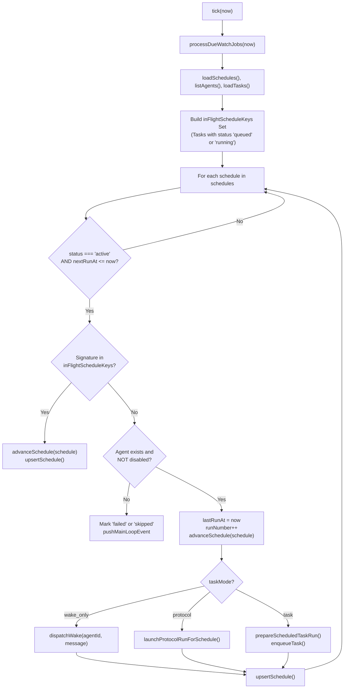

<!-- source: DeepWiki mcp.deepwiki.com · repo swarmclawai/swarmclaw · page 8.2 Scheduler · fetched 2026-10-27 -->

# Scheduler

Relevant source files

The following files were used as context for generating this wiki page:

- [src/app/api/agents/[id]/thread/route.ts](src/app/api/agents/[id]/thread/route.ts)
- [src/app/api/schedules/[id]/route.ts](src/app/api/schedules/[id]/route.ts)
- [src/app/api/schedules/[id]/run/route.ts](src/app/api/schedules/[id]/run/route.ts)
- [src/app/api/schedules/route.ts](src/app/api/schedules/route.ts)
- [src/app/api/webhooks/[id]/helpers.ts](src/app/api/webhooks/[id]/helpers.ts)
- [src/app/api/webhooks/[id]/route.ts](src/app/api/webhooks/[id]/route.ts)
- [src/app/api/webhooks/route.test.ts](src/app/api/webhooks/route.test.ts)
- [src/components/schedules/schedule-sheet.tsx](src/components/schedules/schedule-sheet.tsx)
- [src/lib/server/approvals.ts](src/lib/server/approvals.ts)
- [src/lib/server/runtime/scheduler.ts](src/lib/server/runtime/scheduler.ts)
- [src/lib/server/runtime/watch-jobs.ts](src/lib/server/runtime/watch-jobs.ts)
- [src/lib/server/schedules/schedule-normalization.ts](src/lib/server/schedules/schedule-normalization.ts)
- [src/lib/server/session-tools/schedule.ts](src/lib/server/session-tools/schedule.ts)
- [tests/memory.test.ts](tests/memory.test.ts)

This page covers the scheduler engine responsible for time-based task execution in SwarmClaw: its 60-second tick loop, schedule types (cron, interval, once), in-flight deduplication, watch jobs, webhooks, and the REST API.

---

## Overview

The scheduler polls stored schedules every 60 seconds. For any active schedule whose `nextRunAt` time has elapsed, the engine triggers an action based on the `taskMode`: it can create a board task, launch a protocol, or simply "wake" an agent session. 

The core logic resides in [src/lib/server/runtime/scheduler.ts](), utilizing repositories for persistence [src/lib/server/schedules/schedule-repository.ts]().

---

## Schedule Data Model

Schedules are defined by the `Schedule` interface. Key fields include:

| Field | Type | Description |
|---|---|---|
| `id` | `string` | Unique identifier. |
| `agentId` | `string` | The agent assigned to the schedule [src/lib/server/runtime/scheduler.ts:138](). |
| `scheduleType` | `'cron' \| 'interval' \| 'once'` | Timing strategy [src/lib/server/runtime/scheduler.ts:109-124](). |
| `taskMode` | `'task' \| 'protocol' \| 'wake_only'` | The execution payload type [src/lib/server/runtime/scheduler.ts:42-48](). |
| `nextRunAt` | `number` | Epoch ms of the next scheduled fire [src/lib/server/runtime/scheduler.ts:129](). |
| `staggerSec` | `number` | Optional random jitter added to `nextRunAt` [src/lib/server/runtime/scheduler.ts:103-106](). |
| `sourceScheduleKey`| `string` | Signature used for in-flight deduplication [src/lib/server/runtime/scheduler.ts:99](). |

Sources: [src/lib/server/runtime/scheduler.ts:16-32](), [src/lib/server/schedules/schedule-normalization.ts:25-35]()

---

## Scheduler Lifecycle & Tick Loop

The scheduler is managed as an `hmrSingleton` to persist state across hot reloads [src/lib/server/runtime/scheduler.ts:21-23]().

**Diagram: Scheduler Tick Logic**

Sources: [src/lib/server/runtime/scheduler.ts:91-180](), [src/lib/server/runtime/scheduler.ts:20-23]()

### In-Flight Deduplication
To prevent overlapping runs of the same schedule, the engine checks `inFlightScheduleKeys` [src/lib/server/runtime/scheduler.ts:96-101](). This set is populated by the `sourceScheduleKey` of any task currently in `queued` or `running` status. If a match is found, the schedule's `nextRunAt` is advanced, but no new execution is triggered [src/lib/server/runtime/scheduler.ts:132-136]().

### Schedule Advancement
The `advanceSchedule` function calculates the next execution time [src/lib/server/runtime/scheduler.ts:108-125]():
*   **Cron**: Parsed via `CronExpressionParser`. Supports timezones [src/lib/server/runtime/scheduler.ts:111-115]().
*   **Interval**: `now + intervalMs`.
*   **Once**: Status transitions to `completed`.
*   **Stagger**: If `staggerSec` is provided, a random offset is added to `nextRunAt` to prevent "thundering herd" issues [src/lib/server/runtime/scheduler.ts:103-106]().

---

## Webhooks

Webhooks allow external systems to trigger agent activity. They are managed via the `/api/webhooks` routes and handled by `handleWebhookPost`.

### Webhook Execution Flow
1.  **Validation**: Verifies the webhook exists, is enabled, and matches the `x-webhook-secret` [src/app/api/webhooks/[id]/helpers.ts:47-74]().
2.  **Event Filtering**: Checks if the incoming event (from payload or headers) matches the registered `events` list [src/app/api/webhooks/[id]/helpers.ts:104-112]().
3.  **Session Routing**: Finds or creates a session named `webhook:{id}` for the target agent [src/app/api/webhooks/[id]/helpers.ts:131-168]().
4.  **Content Guarding**: The payload is passed through `guardUntrustedText` to prevent prompt injection [src/app/api/webhooks/[id]/helpers.ts:171-176]().
5.  **Execution**: Enqueues a session run with `mode: 'followup'` and dispatches a wake signal [src/app/api/webhooks/[id]/helpers.ts:193-203]().

Sources: [src/app/api/webhooks/[id]/helpers.ts:41-210](), [src/app/api/webhooks/[id]/route.ts:51-54]()

---

## Watch Jobs

Watch jobs provide a "wait-until" mechanism for agents or schedules. They are processed at the start of every scheduler tick via `processDueWatchJobs(now)` [src/lib/server/runtime/scheduler.ts:92]().

Watch jobs can trigger on:
*   **Webhook Events**: Triggered when a specific webhook receives a matching event [src/app/api/webhooks/[id]/helpers.ts:114-118]().
*   **Approval Decisions**: Triggered when a human approves or rejects a request [src/lib/server/approvals.ts:113-121]().

Sources: [src/lib/server/runtime/watch-jobs.ts](), [src/lib/server/runtime/scheduler.ts:9-92]()

---

## API Endpoints

The system exposes a REST API for schedule management:

| Endpoint | Method | Description |
|---|---|---|
| `/api/schedules` | `GET` | List all schedules [src/app/api/schedules/route.ts:9-13](). |
| `/api/schedules` | `POST` | Create a new schedule. Performs normalization [src/app/api/schedules/route.ts:15-22](). |
| `/api/schedules/[id]` | `PUT` | Update an existing schedule [src/app/api/schedules/[id]/route.ts:17-26](). |
| `/api/schedules/[id]/run` | `POST` | Manually trigger a schedule execution immediately [src/app/api/schedules/[id]/run/route.ts:5-12](). |

### Schedule Normalization
Before creation, payloads pass through `normalizeScheduleResult`. This service:
*   Parses natural language "at 9am" into cron strings [src/lib/server/schedules/schedule-normalization.ts:58-78]().
*   Derives `taskPrompt` from `command` or `path` if not explicitly provided [src/lib/server/schedules/schedule-normalization.ts:156-174]().
*   Validates that file paths remain within the `WORKSPACE_DIR` [src/lib/server/schedules/schedule-normalization.ts:186-189]().

Sources: [src/lib/server/schedules/schedule-normalization.ts:13-174](), [src/lib/server/schedules/schedule-route-service.ts]()

---

## UI Components

The `ScheduleSheet` component provides the interface for creating and editing schedules [src/components/schedules/schedule-sheet.tsx:87]().

*   **Templates**: Users can select from `SCHEDULE_TEMPLATES` (e.g., "Daily Briefing", "System Health Check") which pre-fill prompts and cadences [src/components/schedules/schedule-sheet.tsx:14-26]().
*   **Cron Preview**: Uses `cronstrue` to provide a human-readable description of the cron expression and `getNextRunsAsync` to show upcoming execution times [src/components/schedules/schedule-sheet.tsx:35-55]().

Sources: [src/components/schedules/schedule-sheet.tsx:14-175]()

---

