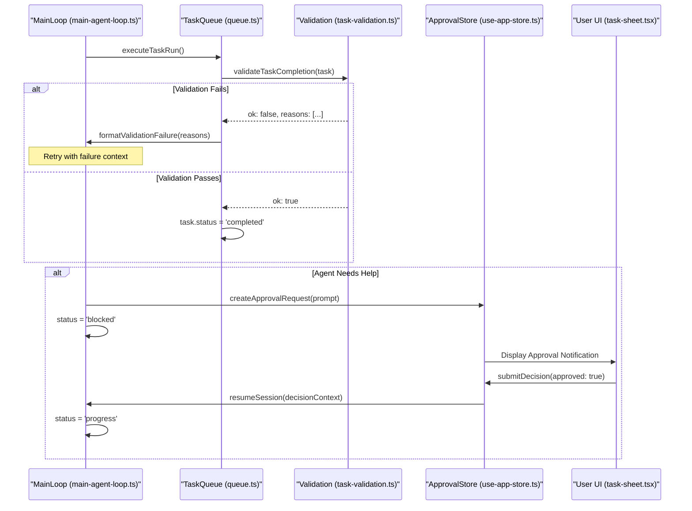
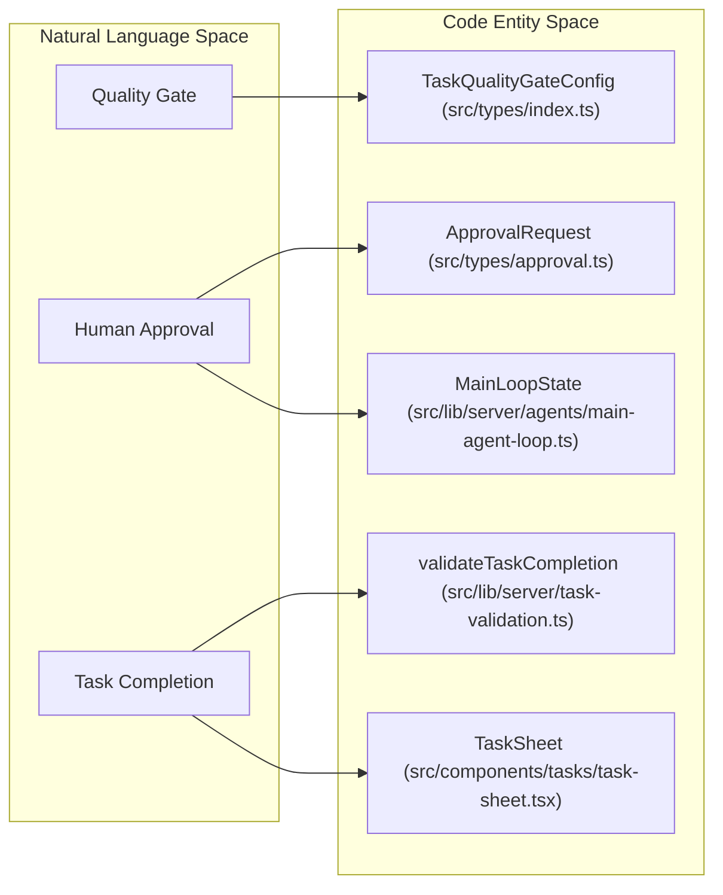

<!-- source: DeepWiki mcp.deepwiki.com · repo swarmclawai/swarmclaw · page 8.3 Task Validation & Approvals · fetched 2026-10-27 -->

# Task Validation & Approvals

<details>
<summary>Relevant source files</summary>

The following files were used as context for generating this wiki page:

- [src/app/api/settings/route.ts](src/app/api/settings/route.ts)
- [src/app/api/tasks/[id]/route.ts](src/app/api/tasks/[id]/route.ts)
- [src/app/api/tasks/route.ts](src/app/api/tasks/route.ts)
- [src/app/settings/page.tsx](src/app/settings/page.tsx)
- [src/components/shared/settings-sheet.tsx](src/components/shared/settings-sheet.tsx)
- [src/components/tasks/task-card.tsx](src/components/tasks/task-card.tsx)
- [src/components/tasks/task-sheet.tsx](src/components/tasks/task-sheet.tsx)
- [src/lib/server/agents/guardian.ts](src/lib/server/agents/guardian.ts)
- [src/lib/server/agents/main-agent-loop-advanced.test.ts](src/lib/server/agents/main-agent-loop-advanced.test.ts)
- [src/lib/server/agents/main-agent-loop.ts](src/lib/server/agents/main-agent-loop.ts)
- [src/lib/server/chat-execution/post-stream-finalization.ts](src/lib/server/chat-execution/post-stream-finalization.ts)
- [src/lib/server/chat-execution/situational-awareness.ts](src/lib/server/chat-execution/situational-awareness.ts)
- [src/lib/server/memory/memory-consolidation.ts](src/lib/server/memory/memory-consolidation.ts)
- [src/lib/server/memory/memory-db.ts](src/lib/server/memory/memory-db.ts)
- [src/lib/server/runtime/daemon-state.ts](src/lib/server/runtime/daemon-state.ts)
- [src/lib/server/runtime/idle-window.ts](src/lib/server/runtime/idle-window.ts)
- [src/lib/server/runtime/queue.ts](src/lib/server/runtime/queue.ts)
- [src/lib/server/session-tools.ts](src/lib/server/session-tools.ts)
- [src/lib/server/session-tools/search-providers.test.ts](src/lib/server/session-tools/search-providers.test.ts)
- [src/lib/server/session-tools/search-providers.ts](src/lib/server/session-tools/search-providers.ts)
- [src/lib/server/skills/learned-skills.ts](src/lib/server/skills/learned-skills.ts)
- [src/stores/use-app-store.ts](src/stores/use-app-store.ts)
- [src/types/app-settings.ts](src/types/app-settings.ts)
- [src/types/approval.ts](src/types/approval.ts)
- [src/views/settings/section-web-search.tsx](src/views/settings/section-web-search.tsx)

</details>


This page documents the SwarmClaw task validation system and the human-in-the-loop approval framework. It covers how completion criteria (Quality Gates) are enforced, how validation failures are handled, and the lifecycle of approval requests that block and resume agent sessions.

---

## Task Validation & Quality Gates

After an agent finishes executing a task, SwarmClaw runs a validation pass to ensure the output meets the configured **Quality Gate** criteria. Tasks that fail validation are either retried or moved to a failed state, depending on the session's retry policy.

### Validation Rules (validateTaskCompletion)

`validateTaskCompletion` applies checks against the task result and any generated artifacts. A task is only marked `completed` if all enabled checks pass.

**Sources:** [src/components/tasks/task-sheet.tsx:82-87](), [src/app/api/settings/route.ts:137-142]()

| Check | Description | Configurable Range |
|-------|-------------|--------------------|
| **Result Length** | Minimum character count for `task.result`. | 10 - 2000 chars (Default: 80) |
| **Evidence Items** | Minimum number of evidence entries (links, file paths, logs) required. | 0 - 8 items (Default: 2) |
| **Require Artifact** | Must produce a file artifact (e.g., screenshot, document). | Boolean |
| **Require Report** | Must include a structured completion report. | Boolean |
| **Verification** | Requires a secondary "verification" pass by a supervisor agent. | Boolean |

### Validation Failure Formatting

When a task fails these checks, `formatValidationFailure` generates a human-readable error message. This message is stored in `task.error` and appended as a system comment to the task, providing the agent with feedback for the next retry.

**Sources:** [src/app/api/settings/route.ts:112-123](), [src/components/tasks/task-sheet.tsx:135-141]()

---

## Human-in-the-Loop Approvals

The approval system allows agents to pause execution and request human intervention for sensitive actions, budget increases, or when they encounter ambiguity.

### ApprovalRequest Lifecycle

An `ApprovalRequest` transitions through several states: `pending`, `approved`, `rejected`, or `cancelled`.

**Sources:** [src/types/approval.ts:1-20]()

1.  **Creation**: Triggered via the `ask_human` tool or automatically by the `Supervisor` (e.g., budget exhaustion).
2.  **Blocking**: The `MainLoopState` for the session is set to `status: 'blocked'`, and the `heartbeat` service pauses execution.
3.  **Decision**: A user interacts with the UI (TaskSheet or ChatArea) to approve or reject.
4.  **Resumption**: Upon approval, the `approval-hook` triggers a session wake-up, injecting the user's decision back into the agent's context.

### The ask_human Tool

Agents use the `ask_human` tool to explicitly create an approval request. This tool is part of the standard session tools.

**Sources:** [src/lib/server/session-tools.ts:1-9](), [src/lib/server/agents/main-agent-loop.ts:66-74]()

---

## Technical Data Flow

The following diagram illustrates the relationship between the Task Queue, the Main Agent Loop, and the Approval system.

**Diagram: Task Validation and Approval Flow**



**Sources:** [src/lib/server/runtime/queue.ts:1-5](), [src/lib/server/agents/main-agent-loop.ts:34-82](), [src/components/tasks/task-sheet.tsx:47-88]()

---

## Implementation Details

### MainLoopState & Blocking

The `MainLoopState` interface tracks the operational status of an agent session. When an approval is requested, the `status` field is updated, and the `skillBlocker` or `pendingEvents` may be used to store the context of the block.

**Sources:** [src/lib/server/agents/main-agent-loop.ts:34-82]()

```typescript
export interface MainLoopState {
  status: 'idle' | 'progress' | 'blocked' | 'ok';
  skillBlocker: {
    summary: string;
    status: 'approval_requested' | 'installed';
    approvalId: string | null;
  } | null;
  // ...
}
```

### UI Integration

The `TaskSheet` component provides the interface for configuring Quality Gates and responding to task-related approvals. It uses `useUpdateTaskMutation` to persist gate settings and `useAppStore` to manage the visibility of the task editor.

**Sources:** [src/components/tasks/task-sheet.tsx:9-24](), [src/components/tasks/task-sheet.tsx:82-87]()

**Diagram: Code Entity Mapping**



**Sources:** [src/types/index.ts:24-24](), [src/lib/server/agents/main-agent-loop.ts:34-82](), [src/components/tasks/task-sheet.tsx:47-52]()

---

## Configuration Settings

Global defaults for task validation are managed in the system settings and can be overridden per task.

**Sources:** [src/app/api/settings/route.ts:112-142]()

*   `taskQualityGateEnabled`: Global toggle for validation.
*   `taskQualityGateMinResultChars`: Minimum length of the result summary.
*   `taskQualityGateMinEvidenceItems`: Minimum number of evidence links/files.
*   `taskQualityGateRequireVerification`: Whether to force a supervisor review.
*   `autonomyResumeApprovalsEnabled`: Whether the system should automatically resume sessions after approval.

**Sources:** [src/app/api/settings/route.ts:137-147]()

---

