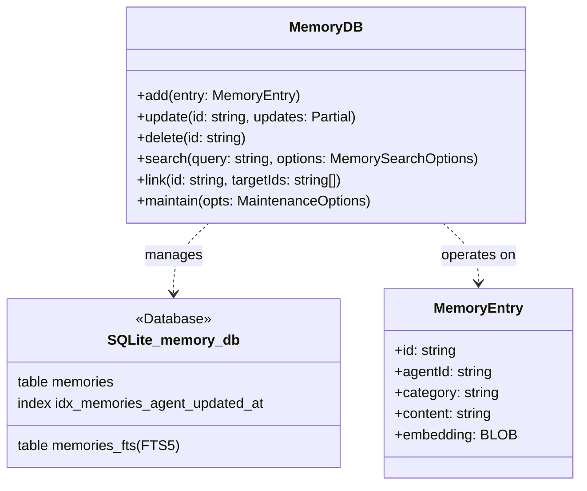
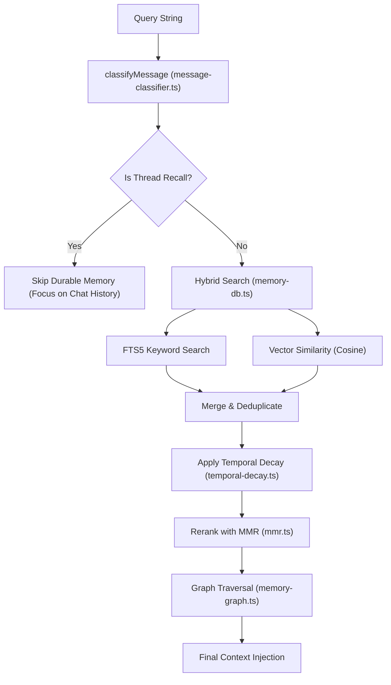

<!-- source: DeepWiki mcp.deepwiki.com · repo swarmclawai/swarmclaw · page 9 Memory System · fetched 2026-10-27 -->

# Memory System

Relevant source files

The following files were used as context for generating this wiki page:

- [skills/swarmclaw/SKILL.md](skills/swarmclaw/SKILL.md)
- [skills/swarmvault/SKILL.md](skills/swarmvault/SKILL.md)
- [src/app/api/mcp-servers/route.ts](src/app/api/mcp-servers/route.ts)
- [src/components/mcp-servers/mcp-server-sheet.tsx](src/components/mcp-servers/mcp-server-sheet.tsx)
- [src/lib/server/__fixtures__/fake-mcp-stdio-server.mjs](src/lib/server/__fixtures__/fake-mcp-stdio-server.mjs)
- [src/lib/server/agents/guardian.ts](src/lib/server/agents/guardian.ts)
- [src/lib/server/autonomy/supervisor-reflection.test.ts](src/lib/server/autonomy/supervisor-reflection.test.ts)
- [src/lib/server/autonomy/supervisor-reflection.ts](src/lib/server/autonomy/supervisor-reflection.ts)
- [src/lib/server/chat-execution/continuation-evaluator.ts](src/lib/server/chat-execution/continuation-evaluator.ts)
- [src/lib/server/chat-execution/message-classifier.ts](src/lib/server/chat-execution/message-classifier.ts)
- [src/lib/server/chat-execution/prompt-builder.ts](src/lib/server/chat-execution/prompt-builder.ts)
- [src/lib/server/chat-execution/situational-awareness.ts](src/lib/server/chat-execution/situational-awareness.ts)
- [src/lib/server/mcp-client.ts](src/lib/server/mcp-client.ts)
- [src/lib/server/memory/memory-consolidation.ts](src/lib/server/memory/memory-consolidation.ts)
- [src/lib/server/memory/memory-db.ts](src/lib/server/memory/memory-db.ts)
- [src/lib/server/memory/memory-policy.ts](src/lib/server/memory/memory-policy.ts)
- [src/lib/server/memory/temporal-decay.ts](src/lib/server/memory/temporal-decay.ts)
- [src/lib/server/runtime/daemon-state.ts](src/lib/server/runtime/daemon-state.ts)
- [src/lib/server/runtime/idle-window.ts](src/lib/server/runtime/idle-window.ts)
- [src/lib/server/runtime/queue.ts](src/lib/server/runtime/queue.ts)
- [src/lib/server/session-tools/memory.ts](src/lib/server/session-tools/memory.ts)
- [src/lib/server/skills/learned-skills.ts](src/lib/server/skills/learned-skills.ts)
- [src/types/misc.ts](src/types/misc.ts)

This page is a high-level overview of SwarmClaw's agent memory system: what is stored, how storage and search work, and how memories surface inside agent prompts. For the database schema and low-level CRUD operations, see [Memory Database](#9.1). For linked memory graph traversal and result assembly, see [Memory Graph & Retrieval](#9.2). For the `memory` tool that agents use at runtime, see [Session Tools](#7.1). For the background consolidation of memories, see [Dream Cycles](#9.3).

---

## Purpose

The memory system gives agents durable, queryable storage that persists across sessions and restarts. It is separate from the main operational database (`swarmclaw.db`) and lives in its own SQLite file (`data/memory.db`). Agents can store facts, execution notes, file references, and images, then retrieve relevant memories at the start of each chat turn.

---

## What Gets Stored

Each memory is a **`MemoryEntry`** record. The fields below cover the full shape as used throughout the codebase:

| Field | Type | Description |
|---|---|---|
| `id` | `string` | Hex random ID (12 chars) [src/lib/id.ts:1-10]() |
| `agentId` | `string \| null` | Owning agent; `null` for cross-agent knowledge |
| `sessionId` | `string \| null` | Session context when the memory was created |
| `category` | `string` | Logical bucket (e.g., `note`, `knowledge`, `dream_reflection`) |
| `title` | `string` | Short summary of the memory |
| `content` | `string` | Full text body |
| `metadata` | `object \| undefined` | Arbitrary key-value bag |
| `references` | `MemoryReference[]` | Typed references to files, folders, projects, tasks, sessions, URLs |
| `linkedMemoryIds` | `string[]` | IDs of related memories forming a graph |
| `embedding` | `BLOB` | Serialized float32 vector for vector search |
| `createdAt` / `updatedAt` | `number` | Unix timestamps in ms |

Sources: [src/lib/server/memory/memory-db.ts:6-18](), [src/types/index.ts:1-100]()

### Memory Tiers

The system classifies memories into tiers to manage recall priority and lifecycle:

| Tier | Categories | Behavior |
|---|---|---|
| **Working** | `working`, `scratch`, `execution`, `step` | Short-term context, pruned frequently. |
| **Durable** | `note`, `preference`, `fact`, `decision` | Long-term knowledge, preserved across sessions. |
| **Archive** | `session_archive`, `task_archive` | Compressed historical summaries. |

Sources: [src/lib/server/memory/memory-tiers.ts:1-30](), [src/lib/server/memory/memory-db.ts:851-996]()

---

## Storage Architecture

**Database file:** `data/memory.db`  
**Singleton accessor:** `getMemoryDb()` (lazy-initializes on first call).

**Code Entity Space Mapping:**

The FTS5 table `memories_fts` is kept in sync by SQLite triggers (`memories_ai`, `memories_au`, `memories_ad`). This ensures that full-text search is always consistent with the primary table without manual synchronization.

Sources: [src/lib/server/memory/memory-db.ts:1-40](), [src/lib/server/memory/memory-db.ts:329-403]()

---

## Search & Retrieval

Search is the primary way agents retrieve relevant memories. The `search()` method runs a **hybrid search**: FTS5 keyword matching and vector cosine similarity, then merges results using Temporal Decay and MMR (Maximal Marginal Relevance).

**Retrieval Logic Flow:**

### Retrieval Optimization
- **Temporal Decay:** Older memories receive lower scores unless they are explicitly marked as "decay exempt". [src/lib/server/memory/temporal-decay.ts:1-20]()
- **Thread Recall Detection:** The `message-classifier.ts` detects if a user is asking about the *current* conversation (e.g., "what did you just say?") to prevent irrelevant durable memory lookups. [src/lib/server/chat-execution/message-classifier.ts:114-120]()

Sources: [src/lib/server/memory/memory-db.ts:755-809](), [src/lib/server/chat-execution/message-classifier.ts:30-68]()

---

## Integration with Agent Prompts

Memories are injected into the agent's system prompt before each chat turn.

1. **Situational Awareness:** At the start of `streamAgentChat`, the system builds a "situational awareness" block including relevant memories. [src/lib/server/chat-execution/situational-awareness.ts:1-50]()
2. **Memory Tool:** Agents use the `memory` tool (implemented in `src/lib/server/session-tools/memory.ts`) to proactively store or search for information. [src/lib/server/session-tools/memory.ts:1-100]()
3. **Policy Control:** The `memory-policy.ts` determines which turns are significant enough to trigger an automatic memory capture. [src/lib/server/memory/memory-policy.ts:20-40]()

Sources: [skills/swarmclaw/SKILL.md:86-111](), [src/lib/server/session-tools/memory.ts:15-33]()

---

## Dream Cycles

Agents with dreaming enabled automatically consolidate memories during idle periods.

- **Reflection:** The `dream-service` reflects on past memories to produce `dream_reflection` and `consolidated_insight` entries.
- **Hygiene:** Maintenance tasks like deduplication and stale record detection are performed during the dream cycle.
- **Trigger:** Dreams occur automatically during `idle-window` periods or can be triggered manually via the API.

For details, see [Dream Cycles](#9.3).

Sources: [skills/swarmclaw/SKILL.md:95-110](), [src/lib/server/runtime/idle-window.ts:1-20]()

---

## Maintenance & Hygiene

The `maintain()` method on the database object cleans up stale and redundant memories.

- **Deduplication:** Identifies and removes entries with identical content.
- **Pruning:** Deletes `working` and `execution` tier memories older than a specified TTL (default 24-72 hours).
- **Consolidation:** Summarizes fragmented session notes into cohesive archive entries.

Sources: [src/lib/server/memory/memory-db.ts:851-996](), [src/lib/server/memory/memory-consolidation.ts:1-40]()

---

