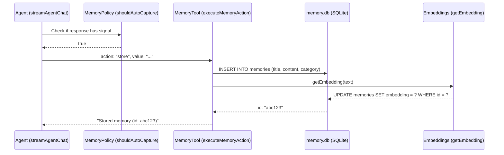
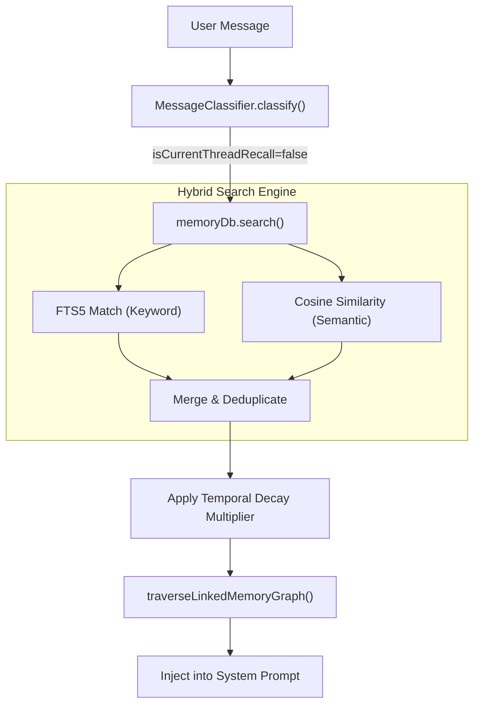

<!-- source: DeepWiki mcp.deepwiki.com · repo swarmclawai/swarmclaw · page 9.1 Memory Database · fetched 2026-10-27 -->

# Memory Database

<details>
<summary>Relevant source files</summary>

The following files were used as context for generating this wiki page:

- [src/lib/server/agents/guardian.ts](src/lib/server/agents/guardian.ts)
- [src/lib/server/autonomy/supervisor-reflection.test.ts](src/lib/server/autonomy/supervisor-reflection.test.ts)
- [src/lib/server/autonomy/supervisor-reflection.ts](src/lib/server/autonomy/supervisor-reflection.ts)
- [src/lib/server/chat-execution/continuation-evaluator.ts](src/lib/server/chat-execution/continuation-evaluator.ts)
- [src/lib/server/chat-execution/message-classifier.ts](src/lib/server/chat-execution/message-classifier.ts)
- [src/lib/server/chat-execution/prompt-builder.ts](src/lib/server/chat-execution/prompt-builder.ts)
- [src/lib/server/chat-execution/situational-awareness.ts](src/lib/server/chat-execution/situational-awareness.ts)
- [src/lib/server/memory/memory-consolidation.ts](src/lib/server/memory/memory-consolidation.ts)
- [src/lib/server/memory/memory-db.ts](src/lib/server/memory/memory-db.ts)
- [src/lib/server/memory/memory-integration.test.ts](src/lib/server/memory/memory-integration.test.ts)
- [src/lib/server/memory/memory-policy.ts](src/lib/server/memory/memory-policy.ts)
- [src/lib/server/memory/temporal-decay.ts](src/lib/server/memory/temporal-decay.ts)
- [src/lib/server/runtime/daemon-state.ts](src/lib/server/runtime/daemon-state.ts)
- [src/lib/server/runtime/heartbeat-service-timer.test.ts](src/lib/server/runtime/heartbeat-service-timer.test.ts)
- [src/lib/server/runtime/idle-window.ts](src/lib/server/runtime/idle-window.ts)
- [src/lib/server/runtime/queue.ts](src/lib/server/runtime/queue.ts)
- [src/lib/server/session-tools/memory.ts](src/lib/server/session-tools/memory.ts)
- [src/lib/server/skills/learned-skills.ts](src/lib/server/skills/learned-skills.ts)

</details>


This page documents the `memory.db` SQLite database: its schema, the `MemoryEntry` data type, memory tiers (working/durable/archive), CRUD operations, FTS5 full-text search, vector embedding generation, and hybrid search mechanics including temporal decay and session archiving.

---

## Overview

`memory.db` is a dedicated SQLite database, separate from the main `swarmclaw.db`, that stores all agent memories. It is initialized and accessed through the singleton returned by `getMemoryDb` in [src/lib/server/memory/memory-db.ts:7-12]().

The database file path is:
```
<SWARMCLAW_HOME>/data/memory.db
```

Images referenced by memories are stored at:
```
<SWARMCLAW_HOME>/data/memory-images/
```

Sources: [src/lib/server/memory/memory-db.ts:29-31](), [src/lib/server/data-dir.ts:1-25]()

---

## Schema & Initialization

The `memories` table and its FTS5 index are initialized via `initDb`. The schema supports structured metadata, vector embeddings, and a linked graph structure.

### `memories` Table
| Column | Type | Description |
|---|---|---|
| `id` | `TEXT PRIMARY KEY` | Random 6-byte hex string via `genId` [src/lib/id.ts:1-10]() |
| `agentId` | `TEXT` | Owning agent ID (nullable) |
| `sessionId` | `TEXT` | Source session ID (nullable) |
| `category` | `TEXT` | Semantic category (e.g., `identity/profile`, `knowledge/facts`) |
| `title` | `TEXT` | Short descriptor |
| `content` | `TEXT` | Full memory text |
| `metadata` | `TEXT` | JSON blob for arbitrary data (e.g., `projectRoot`, `sourceId`) |
| `embedding` | `BLOB` | Serialized float32 vector for semantic search |
| `references` | `TEXT` | JSON array of `MemoryReference` (file, URL, task) |
| `image` | `TEXT` | JSON `MemoryImage` object |
| `linkedMemoryIds` | `TEXT` | JSON array of IDs forming the memory graph |
| `createdAt` | `INTEGER` | Unix ms timestamp |
| `updatedAt` | `INTEGER` | Unix ms timestamp |

### `memories_fts` Virtual Table
A content-backed FTS5 table index over `title`, `content`, and `category` is synchronized via triggers (`memories_ai`, `memories_ad`, `memories_au`).

Sources: [src/lib/server/memory/memory-db.ts:329-402]()

---

## Memory Tiers & Policy

SwarmClaw categorizes memories into tiers to manage prompt context efficiency and long-term relevance.

### Tiers
- **Working Memory**: Transient, high-churn data (e.g., `working/scratch`). Filtered by `isWorkingMemoryCategory` [src/lib/server/memory/memory-tiers.ts:1-15]().
- **Durable Memory**: Long-term facts, preferences, and lessons.
- **Archive Memory**: Historical session logs stored in `memory.db` via `syncSessionArchiveMemory` [src/lib/server/memory/session-archive-memory.ts:1-50]().

### Memory Policy
The system uses an LLM-based `MessageClassification` to decide when to store or retrieve memories [src/lib/server/chat-execution/message-classifier.ts:30-48]().
- `shouldInjectMemoryContext`: Decides if the current turn requires a memory lookup [src/lib/server/memory/memory-policy.ts:33-51]().
- `shouldAutoCaptureMemory`: Determines if the assistant's response contains a fact worth saving [src/lib/server/memory/memory-policy.ts:82-90]().

Sources: [src/lib/server/memory/memory-tiers.ts:1-40](), [src/lib/server/memory/memory-policy.ts:1-120]()

---

## Hybrid Search & Temporal Decay

Search operations combine keyword (FTS5) and semantic (Vector) results, adjusted by temporal decay.

### Search Pipeline
1. **FTS5 Query**: Built via `buildFtsQuery` which tokenizes and filters stop words [src/lib/server/memory/memory-db.ts:187-211]().
2. **Vector Search**: Computes `cosineSimilarity` against the `embedding` column [src/lib/server/memory/memory-db.ts:7-12]().
3. **Reranking**: Merges results based on `MemoryRerankMode` (`balanced`, `semantic`, `lexical`) [src/lib/server/memory/memory-db.ts:49-50]().
4. **MMR**: Applies Maximal Marginal Relevance to ensure diversity [src/lib/server/mmr.ts:1-20]().

### Temporal Decay
The relevance of a memory decays over time unless it is "decay exempt" (e.g., identity or standing instructions).
- **Multiplier**: Calculated via `calculateTemporalDecayMultiplier(updatedAt)` [src/lib/server/memory/temporal-decay.ts:1-30]().
- **Exemptions**: Categories like `identity/*` and `knowledge/instructions` do not decay [src/lib/server/memory/temporal-decay.ts:32-50]().

Sources: [src/lib/server/memory/memory-db.ts:755-809](), [src/lib/server/memory/temporal-decay.ts:1-60]()

---

## Data Flow: Storage & Retrieval

The following diagram bridges the Natural Language space (user/agent interaction) to the Code Entity Space (database operations).

**Memory Persistence Flow:**


**Memory Retrieval Flow:**


Sources: [src/lib/server/session-tools/memory.ts:52-131](), [src/lib/server/memory/memory-db.ts:755-809](), [src/lib/server/memory/memory-graph.ts:1-50]()

---

## CRUD Implementation Details

Public operations are methods on the `MemoryDatabase` class instance.

### `add(entry)`
1. Generates `id` via `genId()`.
2. Normalizes category via `normalizeMemoryCategory()` [src/lib/server/memory/memory-policy.ts:93-115]().
3. Performs duplicate detection using `stmts.exactDuplicateBySessionCategory`.
4. Triggers async embedding generation.

### `update(id, updates)`
1. Merges JSON metadata.
2. Re-computes embedding if `title` or `content` changed.
3. Synchronizes bidirectional links via `this.link()` and `this.unlink()`.

### `delete(id)`
1. Removes image assets from `MEMORY_IMAGES_DIR`.
2. Deletes row (FTS triggers handle index cleanup).
3. Cleans up back-references in other memories' `linkedMemoryIds`.

Sources: [src/lib/server/memory/memory-db.ts:548-671](), [src/lib/server/session-tools/memory.ts:35-100]()

---

## Memory Session Archive

The `syncSessionArchiveMemory` function periodically captures the state of human-agent chat sessions into the `archive` tier of `memory.db`. This allows agents to recall the outcome of past conversations even after the original session has been compacted or deleted.

- **Trigger**: Called during session finalization or dream cycles.
- **Content**: Summarized transcript and key outcomes.
- **Search**: Archive memories are searchable via the `archive` source in `memory_search` [src/lib/server/session-tools/memory.ts:66-68]().

Sources: [src/lib/server/memory/session-archive-memory.ts:1-100](), [src/lib/server/session-tools/memory.ts:21-27]()

---

