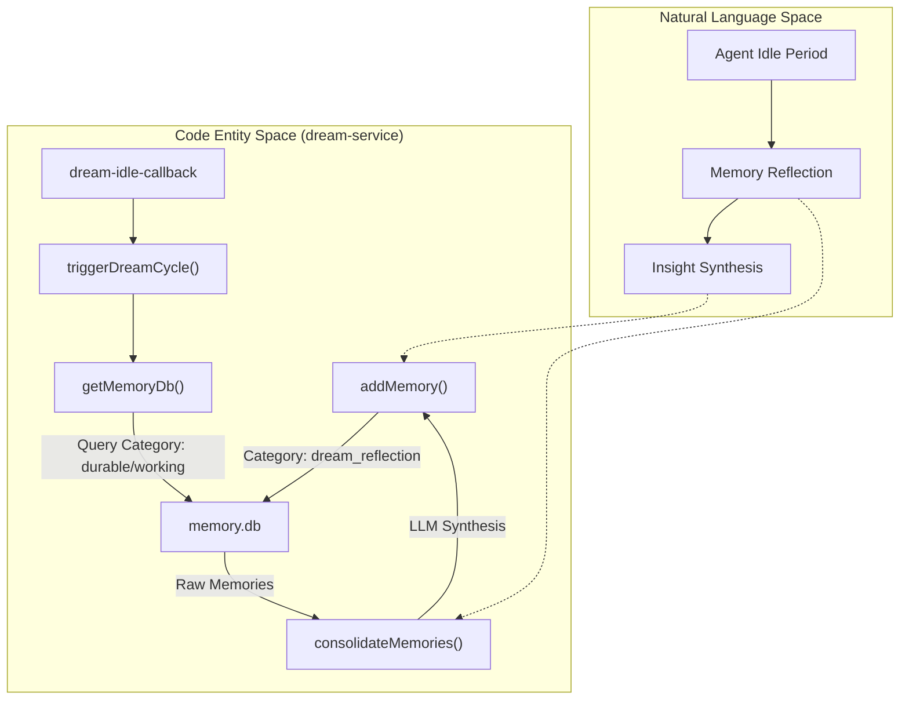
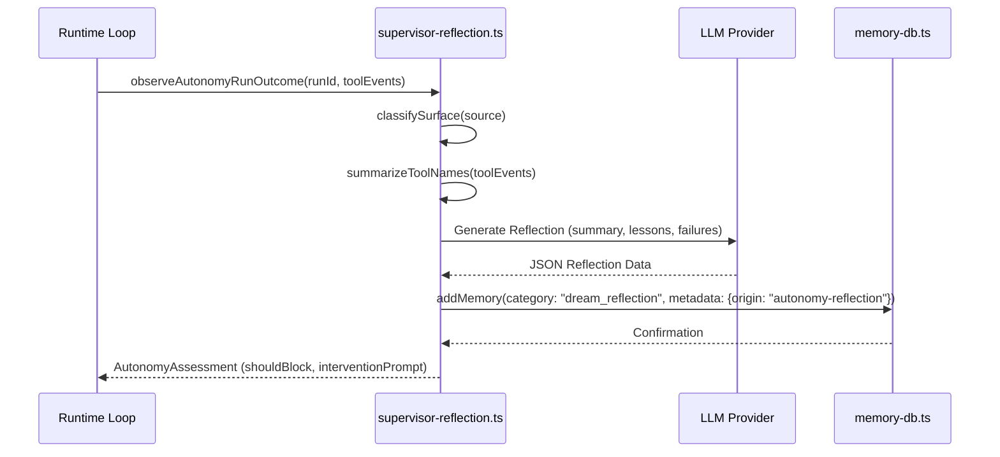

<!-- source: DeepWiki mcp.deepwiki.com · repo swarmclawai/swarmclaw · page 9.3 Dream Cycles · fetched 2026-10-27 -->

# Dream Cycles

<details>
<summary>Relevant source files</summary>

The following files were used as context for generating this wiki page:

- [skills/swarmclaw/SKILL.md](skills/swarmclaw/SKILL.md)
- [skills/swarmvault/SKILL.md](skills/swarmvault/SKILL.md)
- [src/app/api/mcp-servers/route.ts](src/app/api/mcp-servers/route.ts)
- [src/components/mcp-servers/mcp-server-sheet.tsx](src/components/mcp-servers/mcp-server-sheet.tsx)
- [src/lib/server/__fixtures__/fake-mcp-stdio-server.mjs](src/lib/server/__fixtures__/fake-mcp-stdio-server.mjs)
- [src/lib/server/agents/guardian.ts](src/lib/server/agents/guardian.ts)
- [src/lib/server/autonomy/supervisor-reflection.test.ts](src/lib/server/autonomy/supervisor-reflection.test.ts)
- [src/lib/server/autonomy/supervisor-reflection.ts](src/lib/server/autonomy/supervisor-reflection.ts)
- [src/lib/server/chat-execution/continuation-evaluator.ts](src/lib/server/chat-execution/continuation-evaluator.ts)
- [src/lib/server/chat-execution/message-classifier.ts](src/lib/server/chat-execution/message-classifier.ts)
- [src/lib/server/chat-execution/prompt-builder.ts](src/lib/server/chat-execution/prompt-builder.ts)
- [src/lib/server/chat-execution/situational-awareness.ts](src/lib/server/chat-execution/situational-awareness.ts)
- [src/lib/server/mcp-client.ts](src/lib/server/mcp-client.ts)
- [src/lib/server/memory/memory-consolidation.ts](src/lib/server/memory/memory-consolidation.ts)
- [src/lib/server/memory/memory-db.ts](src/lib/server/memory/memory-db.ts)
- [src/lib/server/memory/memory-policy.ts](src/lib/server/memory/memory-policy.ts)
- [src/lib/server/memory/temporal-decay.ts](src/lib/server/memory/temporal-decay.ts)
- [src/lib/server/runtime/daemon-state.ts](src/lib/server/runtime/daemon-state.ts)
- [src/lib/server/runtime/idle-window.ts](src/lib/server/runtime/idle-window.ts)
- [src/lib/server/runtime/queue.ts](src/lib/server/runtime/queue.ts)
- [src/lib/server/session-tools/memory.ts](src/lib/server/session-tools/memory.ts)
- [src/lib/server/skills/learned-skills.ts](src/lib/server/skills/learned-skills.ts)
- [src/types/misc.ts](src/types/misc.ts)

</details>


The **Dream Cycle** system is an autonomous background process where agents reflect on past interactions and memories during idle periods. This process facilitates "memory hygiene" by consolidating fragmented information into coherent insights, deduplicating stale data, and identifying long-term patterns that improve agent performance and situational awareness.

## Overview

Dream Cycles operate on the principle that continuous task execution often produces "noisy" or highly specific working memories. When the system detects an idle state via the `dream-idle-callback`, it triggers the `dream-service` to process an agent's memory store. This results in the creation of high-order memory categories: `dream_reflection` and `consolidated_insight` [skills/swarmclaw/SKILL.md:95-110]().

### Key Objectives
*   **Consolidation**: Merging multiple session-specific memories into single, durable facts.
*   **Reflection**: Evaluating agent performance and extracting lessons learned [src/lib/server/autonomy/supervisor-reflection.ts:155-165]().
*   **Hygiene**: Removing redundant entries and detecting stale information [src/lib/server/memory/memory-db.ts:149-161]().
*   **Pattern Recognition**: Identifying user preferences and project-specific invariants that were not explicitly stated.

---

## Data Flow & Architecture

The Dream Cycle is managed by the `dream-service` which coordinates between the agent's memory database (`memory.db`) and the LLM provider to generate reflections.

### Dream Cycle Implementation Diagram
This diagram illustrates the transition from the "Natural Language Space" of agent thoughts to the "Code Entity Space" of the `memory-db`.


**Sources:** [src/lib/server/memory/memory-db.ts:1-25](), [skills/swarmclaw/SKILL.md:95-110](), [src/lib/server/autonomy/supervisor-reflection.ts:47-66]()

---

## The DreamCycle Type

Dream Cycles are tracked and persisted as structured entities. While raw memories are stored in `MemoryEntry` format, the dream process itself produces specific metadata.

| Property | Type | Description |
| :--- | :--- | :--- |
| `agentId` | `string` | The unique identifier of the agent undergoing the dream cycle. |
| `category` | `string` | Usually `dream_reflection` or `consolidated_insight`. |
| `content` | `string` | The synthesized text generated by the LLM. |
| `metadata.origin` | `string` | Set to `autonomy-reflection` to distinguish from manual entries. |
| `metadata.failures` | `string[]` | Specific failures identified during the cycle. |
| `metadata.lessons` | `string[]` | Abstracted rules for future behavior. |

**Sources:** [src/lib/server/autonomy/supervisor-reflection.ts:47-66](), [src/lib/server/autonomy/supervisor-reflection.test.ts:154-166]()

---

## Memory Hygiene Process

The hygiene process ensures that the agent's context window is not cluttered with redundant or low-value information.

### 1. Deduplication
The system uses `knowledgeChunkHashScope` to identify overlapping content in the `knowledge` category [src/lib/server/memory/memory-db.ts:149-161](). During a dream cycle, the agent reviews these hashes to prune duplicates.

### 2. Stale Detection & Temporal Decay
Memories are subject to temporal decay. The `calculateTemporalDecayMultiplier` function reduces the "salience" of older memories unless they are marked as `decayExempt` [src/lib/server/memory/memory-db.ts:10-15](). The dream cycle identifies memories with low salience scores for archival.

### 3. Consolidation Logic
The `memory-consolidation.ts` utility (referenced via `dream-service`) groups memories by `projectRoot` and `agentId`. It then prompts the LLM to "rewrite" these into a single `consolidated_insight` entry [src/lib/server/memory/memory-db.ts:109-134]().

---

## Supervisor Reflection

A specialized form of dreaming occurs through `supervisor-reflection.ts`. This monitors `SessionRunStatus` and `toolEvents` to detect "incidents" such as repeated tool failures or budget thrashing [src/lib/server/autonomy/supervisor-reflection.ts:68-80]().

### Reflection Sequence Diagram
This diagram shows how `assessAutonomyRun` translates execution logs into `dream_reflection` memories.


**Sources:** [src/lib/server/autonomy/supervisor-reflection.ts:157-184](), [src/lib/server/autonomy/supervisor-reflection.ts:208-220](), [src/lib/server/autonomy/supervisor-reflection.test.ts:136-167]()

---

## Manual Triggering

While typically automated, dream cycles can be triggered manually via the Platform API or tool calls.

### API Endpoint
Agents can self-trigger a dream cycle using the `execute` tool with `curl`:
`POST /api/memory/dream` with payload `{"agentId": "..."}` [skills/swarmclaw/SKILL.md:104-110]().

### Tool-Based Retrieval
Agents retrieve their reflections using the `memory` tool:
```json
{
  "tool": "memory",
  "action": "list",
  "category": "dream_reflection"
}
```
**Sources:** [skills/swarmclaw/SKILL.md:100-102](), [src/lib/server/session-tools/memory.ts:60-68]()

## Summary of Memory Tiers during Dreams

| Tier | Dream Action |
| :--- | :--- |
| **Working** | Frequently converted into `dream_reflection` or deleted after session closure. |
| **Durable** | Consolidated into `consolidated_insight` to reduce token count. |
| **Archive** | Scanned for historical patterns but rarely modified. |

**Sources:** [src/lib/server/memory/memory-tiers.ts:19-21](), [src/lib/server/session-tools/memory.ts:66-68]()

---

