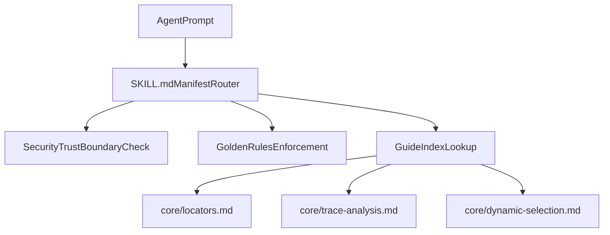
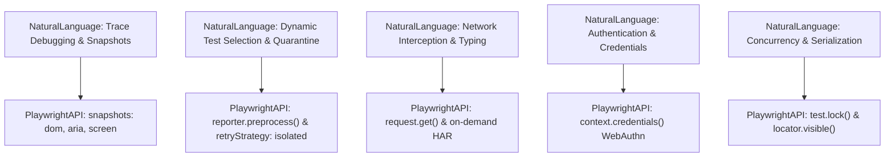

<!-- source: DeepWiki mcp.deepwiki.com · repo testdino-hq/playwright-skill · page 1.2 Skill Manifest Structure and Golden Rules · fetched 2026-10-27 -->

# Skill Manifest Structure and Golden Rules

Relevant source files

The following files were used as context for generating this wiki page:

- [SKILL.md](SKILL.md)
- [core/SKILL.md](core/SKILL.md)

## Purpose and Scope
This page defines the structural and architectural specifications for `SKILL.md` manifest files within the `playwright-skill` repository. It covers how manifests function as routing engines for AI coding agents, details the mandatory 10 Golden Rules for test authoring, catalogs the Playwright 1.59-1.63 feature surface supported by the repository, and outlines authoring conventions for creating new reference guides.

Sources: `[SKILL.md:1-106]()`, `[core/SKILL.md:1-101]()`

---

## Skill Manifests as Routers and Indexes

`SKILL.md` at the repository root and `core/SKILL.md` act as hierarchical routing indexes for AI coding agents [SKILL.md:41-106](). When an agent evaluates a testing task, it parses the YAML frontmatter name and description [SKILL.md:1-8](), evaluates the Security Trust Boundary [SKILL.md:20-27](), checks the Golden Rules [SKILL.md:28-40](), and consults the Markdown tables in the Guide Index [SKILL.md:41-106]() to locate the specific reference file (e.g., `core/locators.md` or `core/trace-analysis.md`).

*Figure 1: Natural Language Space to Code Entity Space for Manifest Routing*

Sources: `[SKILL.md:1-106](), [core/SKILL.md:1-101]()`

---

## The 10 Golden Rules

The repository enforces 10 core governance rules to guarantee test reliability, maintainability, and architectural integrity across all generated and human-authored tests [SKILL.md:28-40](), [core/SKILL.md:18-30]().

1. **`getByRole()` over CSS/XPath**: Resilient to markup changes and mirrors accessibility trees.
2. **Never `page.waitForTimeout()`**: Use deterministic assertions like `expect(locator).toBeVisible()` or `page.waitForURL()`.
3. **Web-first assertions**: `expect(locator)` auto-retries; `expect(await locator.textContent())` does not.
4. **Isolate every test**: Enforce zero shared state and zero execution-order dependencies.
5. **`baseURL` in config**: Prohibit hardcoded absolute URLs in tests.
6. **Retries**: Configured to `2` in CI environments and `0` locally to expose flakiness.
7. **Traces**: Set to `'on-first-retry'` to capture debugging data without bloating successful CI runs.
8. **Fixtures over globals**: Share state via `test.extend()`, avoiding module-level variables.
9. **One behavior per test**: Multiple related `expect()` checks validating a single behavior are permitted.
10. **Mock external services only**: Never mock your own application backend; restrict mocks to third-party APIs, payment gateways, and external email providers.

Sources: `[SKILL.md:28-40](), [core/SKILL.md:18-30]()`

---

## Playwright 1.59 - 1.63 Feature Surface

The instruction packs integrate specialized APIs and configuration patterns spanning Playwright releases 1.59 through 1.63 [SKILL.md:16-19](). These feature sets map directly to code execution primitives and classes.

*Figure 2: Natural Language Space to Code Entity Space for Playwright Feature Surface*

### Version Release Mapping

| Release | Key Features & APIs | Corresponding Guides |
|---|---|---|
| **1.63** | `test.lock()`, `locator.visible()`, `snapshots: { dom, aria, screen }`, `--add-reporter`, `perfetto`, typed `request.get<User>()`, `ariaSnapshotJSON()` | [SKILL.md:16](), [core/SKILL.md:1-101]() |
| **1.62** | `reporter.preprocess()`, `retryStrategy: 'isolated'`, WebP screenshots with `quality`, `AbortSignal`, `locator.waitForFunction()`, `apiResponse.timing()`, stories-and-galleries CT model | [SKILL.md:16](), [core/dynamic-test-selection.md]() |
| **1.61** | WebAuthn passkeys via `context.credentials()`, `page.localStorage` / `page.sessionStorage`, video retention modes, `expect.soft.poll()`, WebSockets in HAR/traces | [SKILL.md:18](), [core/SKILL.md:1-101]() |
| **1.60** | On-demand HAR in tracing, `locator.drop()`, page-level aria snapshots, `test.abort()` | [SKILL.md:18](), [core/SKILL.md:1-101]() |
| **1.59** | Screencast recording, CLI debugging, trace analysis via `npx playwright trace` | [SKILL.md:18](), [core/trace-analysis.md]() |

Sources: `[SKILL.md:16-19](), [core/SKILL.md:1-101]()`

---

## Authoring Conventions for New Guides

When contributing or authoring new reference guides within the repository structure, authors must adhere to strict formatting and structural standards:

1. **Frontmatter Definition**: Include YAML frontmatter specifying appropriate naming and descriptive contexts.
2. **Opinionated Guidance**: Structure guides to explicitly declare **when** and **when *not*** to use a specific pattern [SKILL.md:12]().
3. **Bilingual Examples**: Provide parallel code examples in both TypeScript and JavaScript.
4. **Index Integration**: Register newly created guide files in the parent `SKILL.md` or pack-specific manifest routing tables.

Sources: `[SKILL.md:1-106](), [core/SKILL.md:1-101]()`

---

